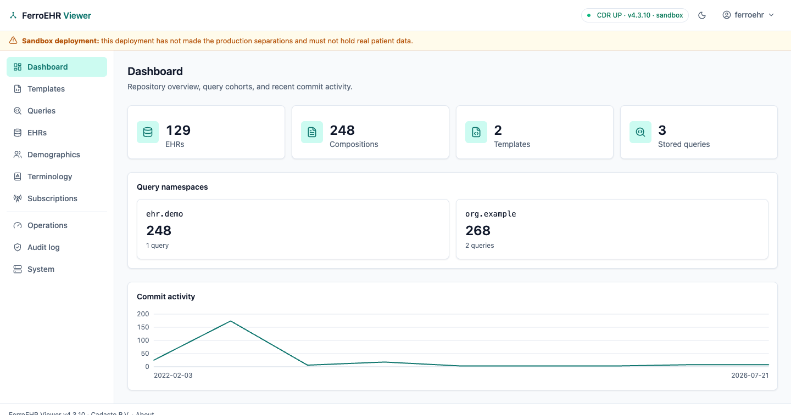

<div align="center">


**The openEHR health record server, written in Rust, with every conformance claim measured.**

**Project**<br>
[](https://github.com/FerroHEALTH/FerroEHR/releases/latest)
[](https://github.com/FerroHEALTH/FerroEHR/actions/workflows/ci.yml)
[](https://github.com/FerroHEALTH/FerroEHR/actions/workflows/containers.yml)
[](LICENSE)
[](https://ferroehr.eu/docs/latest/)
[](https://github.com/FerroHEALTH/FerroEHR/pkgs/container/ferroehr)
[](https://github.com/FerroHEALTH/FerroEHR/pkgs/container/ferroehr)
[](https://artifacthub.io/packages/search?repo=ferroehr)
[](https://crates.io/crates/openehr-rm)
[](https://docs.rs/openehr-rm)
[](https://doi.org/10.5281/zenodo.21940279)

**Quality and security**<br>
[](https://scorecard.dev/viewer/?uri=github.com/FerroHEALTH/FerroEHR)
[](https://www.bestpractices.dev/projects/13982)
[](https://sonarcloud.io/summary/new_code?id=FerroHEALTH_FerroEHR)
[](https://sonarcloud.io/component_measures?id=FerroHEALTH_FerroEHR&metric=coverage)
[](https://github.com/FerroHEALTH/FerroEHR/actions/workflows/codeql.yml)
[-success?style=flat-square)](https://ferroehr.eu/docs/latest/verifying-releases.html)
[](https://ferroehr.eu/docs/latest/verifying-releases.html#what-slsa-level-each-artifact-reaches)

**Conformance and compliance**<br>
[](docs/conformance/ferroehr/CONFORMANCE_REPORT.md)
[](docs/conformance/ferroehr/CONFORMANCE_CERTIFICATE.md)
[](docs/conformance/ferroehr/CONFORMANCE_CERTIFICATE.md)
[](docs/conformance/ferroehr/CONFORMANCE_CERTIFICATE.md)
[](docs/conformance/ferroehr/CONFORMANCE_CERTIFICATE.md)
[](docs/conformance/ferroehr/CONFORMANCE_CERTIFICATE.md)
[](https://ferroehr.eu/docs/latest/compliance/ehds-readiness.html)
[](https://ferroehr.eu/docs/latest/compliance/cra-risk-assessment.html)

[Documentation](https://ferroehr.eu/docs/latest/) ·
[Live sandbox](https://sandbox.ferroehr.eu) ·
[Quick start](#quick-start) ·
[Commercial licence](https://ferroehr.eu/docs/latest/licensing.html)

</div>

## What FerroEHR does

FerroEHR stores patient health records. It keeps them in openEHR, an open
standard that describes clinical information (a blood pressure, a diagnosis,
a discharge letter) independently of any one software product. Every change
is kept as a new version, so the full history of a record stays readable and
nothing is ever overwritten.

Applications such as an electronic patient record, a nursing app or a
research dashboard all read and write through one standard interface. The
data does not belong to the application that wrote it: you can replace an
application, or add a new one, and the records stay where they are. That
ends the usual lock-in, where moving to a new system means a migration
project and a loss of history.

### Who it is for

- **Hospitals and care providers** that want to own their clinical data and
  choose their applications freely.
- **Software vendors and integrators** that build clinical applications and
  need a standard back end to store and query records.
- **Research groups** that need structured, queryable clinical data.

### Why you can trust what it claims

Each conformance badge above is computed by a separate test instrument that
runs the full openEHR conformance catalogue against a live server; nobody
types the numbers. Releases are signed and come with a software bill of
materials, so you can check what you install. The source is public under the
Business Source License, and every feature is in this repository: there is
no paid edition with extra functions.

## Part of FerroHEALTH

FerroEHR is one of five [FerroHEALTH](https://ferrohealth.eu) servers. Each
does one job and reaches the others only over published standards:
FerroEHR stores the record, FerroBRIDGE translates it to FHIR and the OMOP
research model, FerroFED connects records across organisations and borders,
FerroPIX matches patient identities, and FerroTERM serves the code systems
(the shared lists of medical terms). You can run FerroEHR alone or beside
products from other vendors. Sign-in, the audit trail and the web consoles
come from three shared libraries: FerroAUTH, FerroAUDIT and FerroUI.

<picture>
  <source media="(prefers-color-scheme: dark)" srcset="website/book/src/viewer/img/dashboard/dashboard-dark.png">
  
</picture>

## Quick start

Try it without installing anything in the
[live sandbox](https://sandbox.ferroehr.eu) (`ferroehr` / `ferroehr`, demo
data, reset nightly). To run it yourself you need Docker Compose 2.23.1 or
newer:

```shell
curl -LO https://github.com/FerroHEALTH/FerroEHR/releases/latest/download/docker-compose.yml
docker compose up
```

Then create an EHR and query it with AQL (development credentials
`ferroehr` / `ferroehr`):

```shell
curl -u ferroehr:ferroehr -X POST -i http://localhost:8080/ferroehr/rest/openehr/v1/ehr

curl -u ferroehr:ferroehr -H 'Content-Type: application/json' \
  -d '{"q":"SELECT e/ehr_id/value FROM EHR e"}' \
  http://localhost:8080/ferroehr/rest/openehr/v1/query/aql
```

The API documentation is at `http://localhost:8080/ferroehr/rest/swagger-ui`
(same credentials), and `docker compose --profile viewer up` adds the viewer
on `http://localhost:3000`. These defaults are for evaluation only. The
[getting started guide](https://ferroehr.eu/docs/latest/getting-started.html)
continues from here, and [Kubernetes & Helm](https://ferroehr.eu/docs/latest/installation/kubernetes.html)
covers production.

## What ships today

### Clinical records

- [openEHR REST API](https://ferroehr.eu/docs/latest/using-the-api/index.html) (ITS-REST 1.1.0) for EHRs, compositions, folders and contributions, in JSON and XML
- [AQL queries](https://ferroehr.eu/docs/latest/querying-aql.html), the openEHR query language, with stored queries and cohort queries
- [Templates and validation](https://ferroehr.eu/docs/latest/templates-validation.html) for ADL 1.4 and ADL 2.4, checked on every write
- [Full version history](https://ferroehr.eu/docs/latest/using-the-api/resources.html): every commit kept, point-in-time reads, logical delete
- [Version signing](https://ferroehr.eu/docs/latest/signing/index.html) with digest or PGP signatures
- [Demographics](https://ferroehr.eu/docs/latest/beyond-core/demographics.html), a versioned store of persons, organisations and their relationships
- [EHR Extract](https://ferroehr.eu/docs/latest/beyond-core/messaging.html), export and import of whole records between systems
- [A choice of specification generation](https://ferroehr.eu/docs/latest/installation/configuration.html#spec_profile): the released openEHR versions or the development ones

### Integration

- [Terminology](https://ferroehr.eu/docs/latest/beyond-core/terminology.html) through any FHIR terminology server, such as FerroTERM
- [Change events](https://ferroehr.eu/docs/latest/beyond-core/amqp.html) over AMQP for every commit, without patient data by default
- [Multimedia storage](https://ferroehr.eu/docs/latest/beyond-core/s3-multimedia.html) in any S3-compatible store, with integrity checks
- [The FerroEHR Viewer](https://ferroehr.eu/docs/latest/viewer/index.html), a web interface over the same public API
- [The `openehr-*` Rust crates](https://ferroehr.eu/docs/latest/crates.html), the openEHR specifications as libraries

### Security and privacy

- [Sign-in](https://ferroehr.eu/docs/latest/identity-providers.html) with Basic or OpenID Connect (Keycloak, Active Directory), with [SMART scopes](https://ferroehr.eu/docs/latest/smart-app-launch.html)
- [Access control](https://ferroehr.eu/docs/latest/security.html#authorization) by role and by attribute-based policy
- [Pseudonymisation](https://ferroehr.eu/docs/latest/security.html#the-pseudonymisation-boundary): clinical data and identities kept apart in the database
- [Audit trail](https://ferroehr.eu/docs/latest/audit.html) of every access and refusal, in the IHE ATNA format
- [One instance per organisation](https://ferroehr.eu/docs/latest/security.html#one-instance-one-organisation), each with its own database

### Operations

- [Docker Compose](https://ferroehr.eu/docs/latest/installation/compose.html) and a [Helm chart](https://ferroehr.eu/docs/latest/installation/kubernetes.html), with multi-arch images (amd64, arm64)
- [Observability](https://ferroehr.eu/docs/latest/operations.html#observability): Prometheus metrics, OpenTelemetry traces, health probes
- [Backup and point-in-time recovery](https://ferroehr.eu/docs/latest/operations.html#backup-and-point-in-time-recovery) on PostgreSQL
- [Measured conformance](https://ferroehr.eu/docs/latest/conformance.html), [performance](https://ferroehr.eu/docs/latest/performance.html) and a [comparison with EHRbase](https://ferroehr.eu/docs/latest/comparison.html)
- [Verifiable releases](https://ferroehr.eu/docs/latest/verifying-releases.html): signed, with provenance and a software bill of materials

## Learn more

- [Documentation](https://ferroehr.eu/docs/latest/) and the [FerroHEALTH book](https://ferrohealth.eu/docs/)
- [Why FerroEHR exists](https://ferroehr.eu/docs/latest/why-ferroehr.html)
- [Compliance overview](https://ferroehr.eu/docs/latest/compliance/index.html): EHDS, CRA and data protection
- [Changelog](CHANGELOG.md) and [milestones](https://github.com/FerroHEALTH/FerroEHR/milestones)
- [Security policy](SECURITY.md) and [threat model](https://ferroehr.eu/docs/latest/threat-model.html)
- [Contributing](CONTRIBUTING.md), [code of conduct](CODE_OF_CONDUCT.md), [support](SUPPORT.md), [governance](GOVERNANCE.md), [maintainers](MAINTAINERS.md) and the [AI statement](AI_STATEMENT.md)

## Licence

Business Source License 1.1 ([LICENSE](LICENSE)), with Apache License 2.0 as
the Change License four years after each version; the
[licensing page](https://ferroehr.eu/docs/latest/licensing.html) says when you
need a commercial licence from Cadasto B.V.
