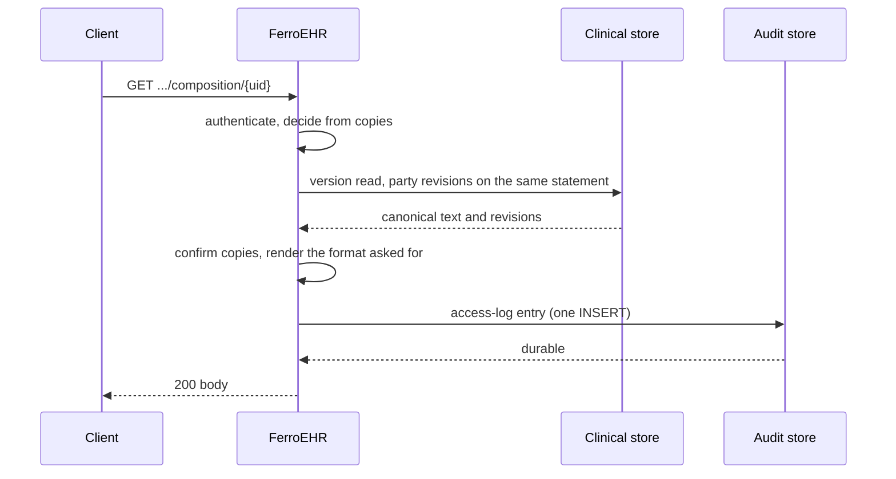
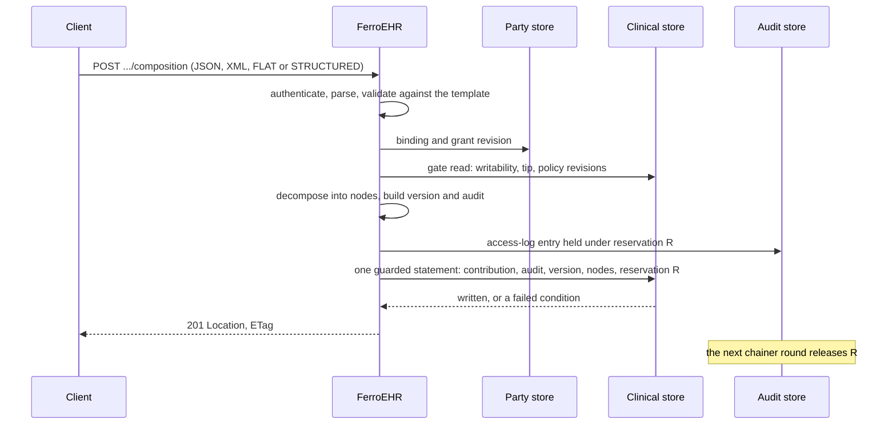
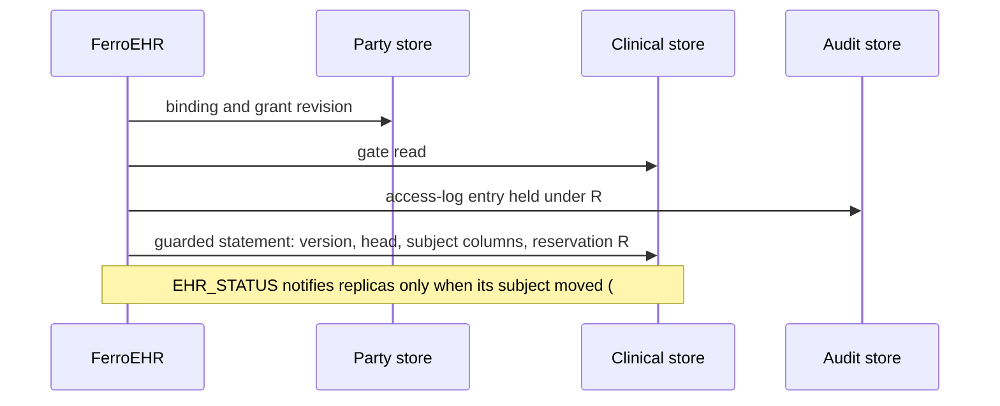
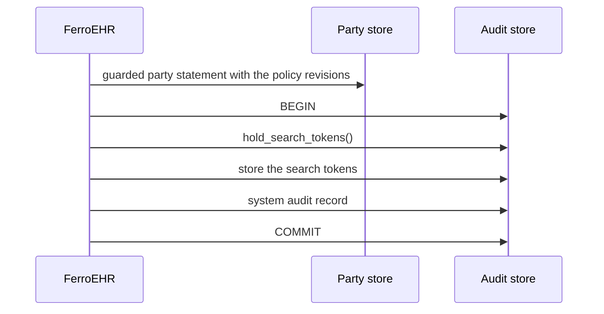
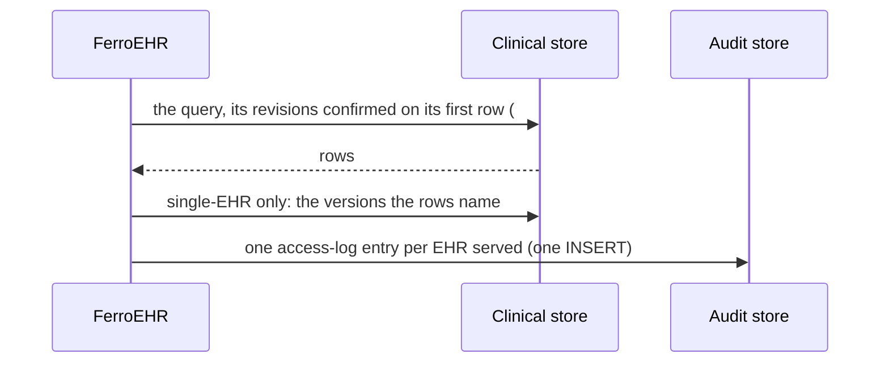

# Operation flow map (cdr-benchmark v0.19.0)

This record maps every operation the cdr-benchmark v0.19.0 mix sends through
FerroEHR, from the request's first byte to its last row and byte, with what
each step costs and whether a specification or a binding rule needs it
(#6239, under #6236). Each step is marked **required**, with its citation,
or **our own design**, with the decision taken on it: delete, merge or keep.

It was measured at main `ef9de89e6a` on PostgreSQL 19.0, after #6256 and
#6257 merged. The figures change with the code, so re-measure before relying
on one.

**A benchmark record, not a conformance record.** No openEHR specification
governs how a request is executed inside the CDR: the steps marked our own
design are ours to change, and the steps marked required name the text that
binds them.

## How it was measured

The budget harness (`app/ferroehr-rest/tests/it/statement_budget/`) drives
the assembled router with authentication, the access evaluator, the audit
drain and the local access log, over the IPS composition (128 KB, 402 node
rows), 10 measured requests a path after 3 warm ones. Per request it counts:

- **round trips:** the statements the request sends on the clinical and
  party pools inside the request (`paths.rs`);
- **nested:** the statements PostgreSQL runs inside them (functions,
  triggers);
- **WAL B:** the row records the request writes, as `pg_walinspect` reads
  them (`statement_budget::wal`), the background rounds left out;
- **wire B:** the bytes on the database wire in both directions, split by
  statement through a protocol relay (`statement_budget::wire`, #6286);
- **conversions:** the representation changes of the body
  (`openehr_its::conversion`).

The harness ran against a `postgres:19.0` container with the testkit's
settings. The counts do not depend on the host load.

## The mix

cdr-benchmark v0.19.0 (`docs/guides/architecture.md` at the tag) sends, per
job operation, 77% reads, 15% creates, 6% updates and 2% deletes; 90% of them
on compositions, 8% on directories and 2% on `EHR_STATUS`. A composition is
sent as canonical JSON 40%, FLAT 30%, canonical XML 20% and STRUCTURED 10%.
Beside the job operations run the query workload (template reads, stored
query `PUT`, `GET` and list, EHR-scoped and population AQL), one EHR create
and 45 template example reads per new-EHR job, and one administrative EHR
delete per 100 jobs.

| Operation | Share of job operations |
|---|---|
| composition read | 69.3% |
| composition create | 13.5% |
| directory read | 6.2% |
| composition update | 5.4% |
| composition delete | 1.8% |
| `EHR_STATUS` read | 1.5% |
| directory create, update, delete | 1.8% together |
| `EHR_STATUS` update | 0.5% |

## Per path

| Path | Conversions | Round trips | Nested | WAL B | Wire B (sent / received) |
|---|---:|---:|---:|---:|---|
| read JSON | 0 | 1 | 1 | 775 | 1,462 / 129,372 |
| read XML | 2 | 1 | 1 | 775 | 1,462 / 129,372 |
| read FLAT | 2 | 1 | 1 | 775 | 1,462 / 129,372 |
| read at time | 0 | 1 | 1 | 775 | 1,493 / 129,372 |
| read from the version copy | 0 | 1 | 1 | 775 | 1,470 / 214 |
| EHR read | 1 | 1 | 1 | 575 | 1,269 / 286 |
| `EHR_STATUS` read | 0 | 1 | 1 | 703 | 1,406 / 1,354 |
| commit JSON | 5 | 4 | 0 | 176,577 | 200,796 / 436 |
| commit XML | 5 | 4 | 0 | 176,605 | 200,789 / 399 |
| commit FLAT | 5 | 4 | 0 | 176,490 | 200,785 / 399 |
| update JSON | 5 | 4 | 0 | 176,404 | 200,859 / 679 |
| delete | 2 | 4 | 0 | 3,597 | 3,024 / 705 |
| `CONTRIBUTION` commit | 6 | 4 | 0 | 176,976 | 200,987 / 399 |
| `EHR_STATUS` commit | 4 | 4 | 0 | 4,163 | 3,556 / 600 |
| directory create | 5 | 4 | 1 | 5,197 | 3,918 / 521 |
| directory update | 4 | 4 | 1 | 4,138 | 3,617 / 636 |
| directory delete | 2 | 4 | 1 | 3,569 | 3,002 / 608 |
| party read | 0 | 6 | 1 | 1,035 | 2,805 / 2,396 |
| party commit | 8 | 9 | 5 | 5,971 | 6,155 / 1,286 |
| single-EHR AQL | 2 | 2 | 1 | 1,758 | 2,951 / 1,345 |
| population AQL | 2 | 1 | 1 | 4,762 | 5,491 / 543 |
| ITI-81 page | 0 | 1 | 1 | 567 | 1,496 / 25,132 |

The STRUCTURED format takes the FLAT path with its own serializer, so it costs
what FLAT costs. A composition commit's wire is the composition itself:
199,199 of its 200,796 sent bytes are the one guarded statement.

## The common spine

Every request passes these steps.

| # | Step | Cost | Verdict |
|---|---|---|---|
| 1 | Edge stack: request id, panic catch, timeout, body ceiling (`ferrohealth-server`) | CPU only | required: the family's server contract; a panic is a clean 500 (`reliability.md`) |
| 2 | Authentication: Basic against the credential cache, or a bearer JWT verified (`extensions/auth`) | CPU, no statement on a cache hit | required: ITS-REST `overview.md` §Security, SMART App Launch 2.x |
| 3 | One connection per pool per request, given back after the last statement (#5879, #5986, #6255) | one checkout per pool | required by the pool rules; keep |
| 4 | The access decision, from copies confirmed on the request's own first statement per store (#6251, #6320) | no round trip of its own; one nested `party_door.party_revisions` call | required: EHDS Art 9 and the exact-reads rule (#5891); keep |
| 5 | The operation's own statements | per group below | per group below |
| 6 | Render: canonical JSON served from the stored text; XML, FLAT and STRUCTURED parsed and rendered | the conversions column | required: ITS-REST `Resources.md` §Simplified Formats and the canonical XML schema |
| 7 | The access-log entry, one statement on the audit pool, durable before the response | one round trip; 431 to 639 B of WAL a read | required: EHDS Annex II 3.2 (every access) and the audit-completeness rule; how it is written is our own design (§The audit step) |

## Reads

| Step | Round trips | Rows | WAL B | Wire B | Verdict |
|---|---:|---:|---:|---|---|
| version read with the party revisions (`party_door.party_revisions`, one nested call) | 1 | 0 | 0 | 67 / 129,340 | required: ITS-REST `ehr.md` GET COMPOSITION; the revisions ride on it by the exact-reads rule (#6320); keep |
| render XML or FLAT: parse the stored text, render the format | 0 | 0 | 0 | 0 | required: ITS-REST §Simplified Formats; JSON is served verbatim with no conversion; keep |
| access-log entry | 1 (audit) | 1 | 775 | 1,395 / 32 | required: EHDS Annex II 3.2; keep, written once (§The audit step) |

A read writes no clinical row. The EHR read (575 B) and the `EHR_STATUS` read
(703 B) have the same shape.

## Commits (composition create, update, delete, `CONTRIBUTION`)

| Step | Round trips | Rows | WAL B (IPS) | Wire B | Verdict |
|---|---:|---:|---:|---|---|
| binding and grant revision (party store) | 1 | 0 | 0 | 47 / 66 | required: the exact-reads rule (#5891), one indexed read per store; keep |
| gate read: writability, restriction, tip, access and policy revisions | 1 | 0 | 0 | 111 / 114 | required: ITS-REST `ehr.md` (412 on a stale `If-Match`, 409 on an EHR that is not modifiable); keep |
| parse and validate the body | 0 | 0 | 0 | 0 | required: RM `COMPOSITION` invariants and the template (ITS-REST 400 and 422); keep |
| the access-log entry, held under the write's reservation | 1 (audit) | 1 entry, 1 hold | 575, plus 141 for the hold and 136 for its two indexes | 1,349 / 32 | required: audit before domain (#5747, #5986); keep |
| one guarded statement: contribution, `commit_audit_facts`, version, `vo_head`, node rows, event outbox row, reservation | 1 | 2 contribution, 1 audit, 1 version, 1 head, 402 nodes, 1 outbox, 1 reservation | 176,577 in all: nodes 86,115, `node_hot_pkey` 32,000, the seven secondary node indexes 41,022, body TOAST 13,456, the version and its 11 indexes 1,191 | 199,199 / 138 | contribution, audit, version identity and signature are required (RM common §Committal and Audits, §Digital Signature); the node rows and their indexes are our own design, kept by measurement (#6210, #6229, #6393); the outbox row is written only while a reader is granted; keep |
| render the committer and description of `AUDIT_DETAILS` for `commit_audit_facts` (two `to_canonical_json`) | 0 | 0 | 0 | 0 | our own design: kept, a few microseconds each |
| release of the hold (chainer round) | 0 on the request | the hold row deleted | counted in the round | | our own design under the reservation rule (#5762): an entry stays unread and unsealed until its write commits; keep |

A `CONTRIBUTION` of the IPS composition has the same four statements; the
guarded statement writes every version of the contribution. A delete reads
what it deletes on the gate read and writes 3,597 B. An update writes a new
version as a create does.

## `EHR_STATUS` and directory

| Step | Round trips | WAL B | Verdict |
|---|---:|---:|---|
| the four statements of a commit | 4 | `EHR_STATUS` 4,163; directory create 5,197, update 4,138, delete 3,569 | as for commits; keep |
| `EHR_STATUS`: the promoted subject columns and the access copy dropped, only when the subject moved | 0 (on the guarded statement) | | our own design (#5513, #6298); keep |
| directory: `directory_slot_held`, one nested call | 0 | | our own design for the one directory an EHR holds (ITS-REST `ehr.md` DIRECTORY); keep |

## Party

| Step | Round trips | Verdict |
|---|---:|---|
| guarded party statement, binding facts and policy revisions (#6257, #6271) | 2 | required: RM demographic versioning and the exact-reads rule; keep |
| system audit record: `BEGIN`, `hold_search_tokens()`, the token statement, the record insert, `COMMIT` | 5 of a read's 6 | the record is required (EHDS Annex II 3.2, IHE BALP); its five round trips, where the access-log entry takes one, are our own design: **merge** into one statement with the tokens resolved off the request path, as #6319 did for the access log (#6633) |
| `binding_changed()` notification on a `PERSON` commit | 1 delivered | our own design (#6284): only when a binding row changed; keep |

The same system-record shape is paid by every template example read (5.7 per
100 operations of the mix), each EHR create and the demographic AQL; the
harness does not measure the first two on their own.

## AQL and ITI-81

| Step | Round trips | WAL B | Wire B | Verdict |
|---|---:|---:|---|---|
| the query with the access condition in its one statement | 1 | 0 | single-EHR 237 / 1,033; population 103 / 511 | required: AQL 1.1 and EHDS Art 9 (the rows a caller may not read never leave the database); keep |
| single-EHR: the versions the rows name | 1 | 0 | 353 / 280 | our own design: the `VERSION` metadata the result set carries; keep |
| access-log entries, one per EHR served | 1 (audit) | single-EHR 1,758 (2 entries), population 4,762 (6 entries) | 2,361 and 5,388 sent | required: EHDS Annex II 3.2 for each person whose data is accessed; keep, one statement for all |
| ITI-81: the page from `access_log_index` | 1 | 567 (its own entry) | 320 / 25,100 | required: IHE ITI-81 and the BALP AuditEvent; keep |

## The audit step

Each event is written once: an access-log entry into `access_log_entry`, a
system record into `audit_event`, sealed by window and delivered by a cursor
per sink (#6241, #6242, #6280).

| Per entry | `37c5dd3279` (before #6242) | main `ef9de89e6a` |
|---|---|---|
| statements on the request | one intake statement, plus the chainer's round | one `INSERT` |
| nested statements of a read | 2 | 0 |
| WAL, composition read | 2,634 | 775 |
| WAL, single-EHR AQL | 2,087 | 879 |
| WAL, population AQL | 1,777 | 793 |
| WAL, commit | 2,543 | 988 |
| wire sent by the entry write, composition read | | 1,395 |
| background per entry | link row, intake delete, head move, checkpoint | the search copy into `access_log_index` (about 0.9 kB of WAL: the row and its six indexes) and one seal row a window |

`37c5dd3279` ran on PostgreSQL 18.6 and main on 19.0;
`docs/benchmarks/pg19/README.md` shows the server leaves these WAL figures
within 0.8%.

What remains beside the one write, and why:

| Second touch of one event | Verdict |
|---|---|
| the hold row of a write's entry, inserted with it and deleted by the chainer round | required: audit before domain with the reservation semantics (#5762, #5986): an entry stays unread and unsealed until its write commits, and is discarded when it never does |
| the search copy in `access_log_index`, built off the request path | our own design (#6319): each of its indexes serves a read the specifications ask for (ITI-81 patient, agent, date and token parameters; EHDS Annex II 3.3 review); keep |
| the seal row a window | required: CRA Annex I Part I (2)(f) "report on corruptions", met by sealed windows (citations on #6239); keep |
| the delivery cursor per sink | our own design: one cursor row per sink, no row per entry; keep |

## Background work

| Task | Work |
|---|---|
| chainer round | releases the holds of the writes that committed since the last round, in one statement |
| frontier round, once a second | copies new entries into `access_log_index` in one batch |
| sealer, once a minute per log | one read of the window's ids and digests, one seal row, one signature |
| verification | walks the sealed windows in paced steps |
| delivery (syslog, FHIR Feed) | a cursor per sink, only while a sink is configured |
| care projector | applies stamped `PERSON`s to `access_care` and analyzes it after a write of 1,000 rows or more (#6630) |

## Decisions

Every step above is marked. The one step marked merge is the system audit
record's five round trips (#6633). Every other step of our own design is kept
with the measured reason in its row.
