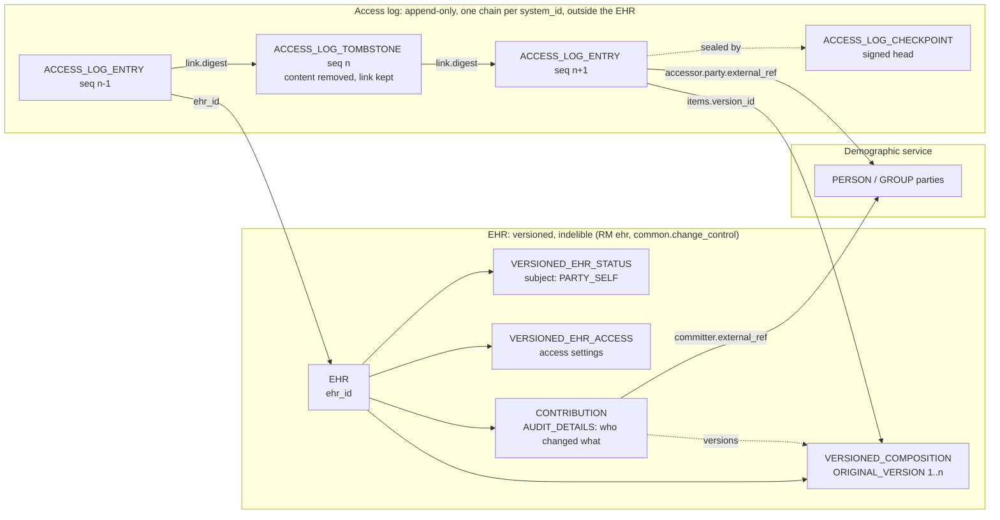
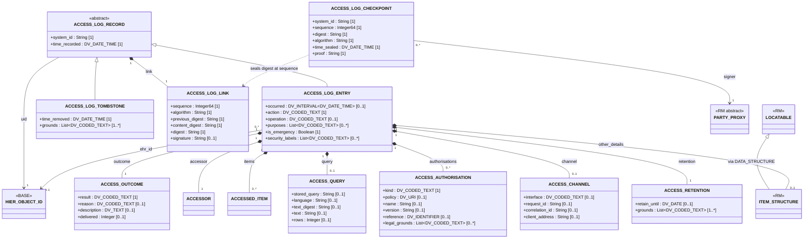
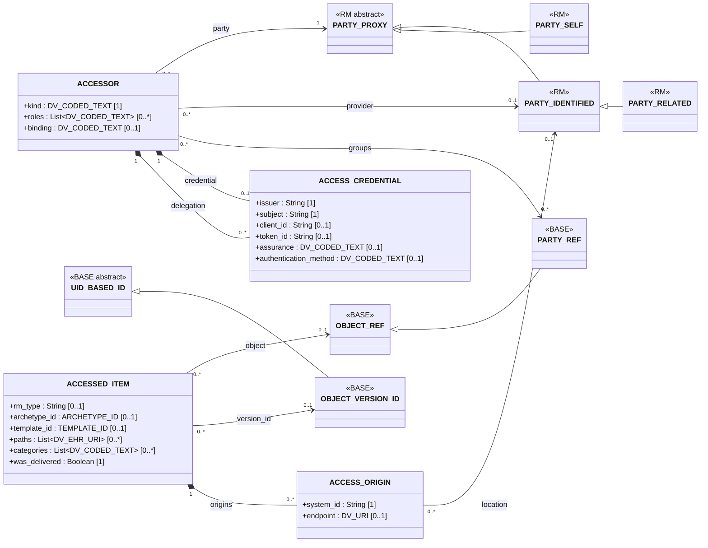
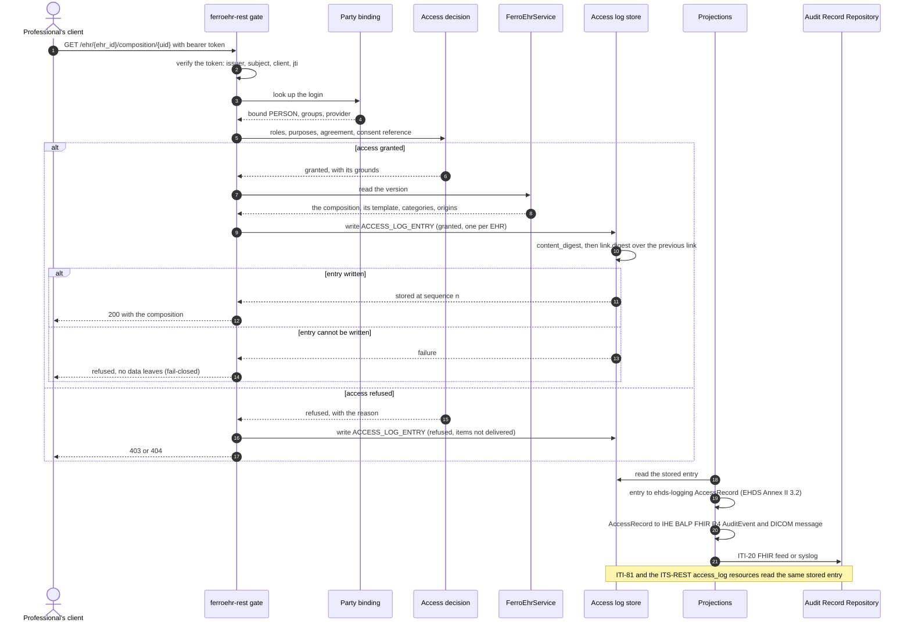
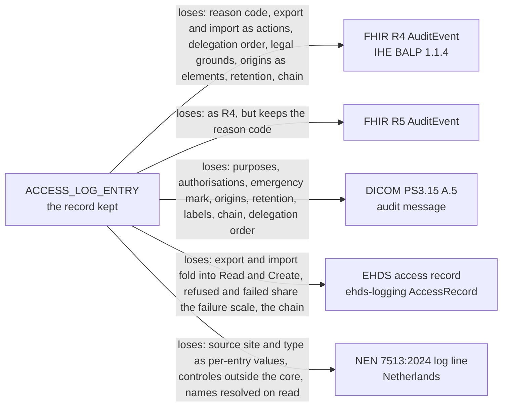

# openEHR access log: model, API, mappings and proposal (tracker issue #5121)

- Status: in-progress (the design, for the owner's review; nothing in it is
  proposed outside this repository until the owner approves)
- Started: 2026-11-07
- Consumes: openEHR BASE 1.3.0 security overview, RM 1.2.0 common package,
  ITS-REST 1.1.0, AQL 1.1; Regulation (EU) 2025/327 (EHDS) and Implementing
  Regulation (EU) 2026/2083; IHE BALP 1.1.4; FHIR R4 and R5 `AuditEvent`;
  DICOM PS3.15 2026c Annex A.5; RFC 3881; RFC 8785; the eHDSI Audit Trail
  Profile 10.1.0; ISO 27789:2021 and ISO 22600:2014 by their public scope;
  the party binding (#5002, #5007, #5008) and the consent reference (#5106)

This plan is the design and its rationale. Beside it,
`docs/plans/access-log/antora/` holds the draft openEHR specification change,
written as specification text another vendor could implement and laid out
as an Antora module of the openEHR RM component, so it drops into the
openEHR specification repositories (`antora/PROVENANCE.md` names the
`openEHR/antora-openehr` and `openEHR/specifications-RM` commits it
follows):

- `antora/modules/access_log/`: the specification pages (requirements,
  design overview, the `access_log` package with its class descriptions,
  recording, integrity and retention, terminology, ITS-REST resources, AQL,
  and the appendix with the conformance points and the amendment record);
- `antora/modules/ROOT/partials/`: the class partials, rendered from the BMM;
- the draft model as a BMM 2.4 schema that includes `openehr_rm_1.2.0`, in
  the P_BMM JSON form of the vendored schemas, lives outside this tree at
  `tools/openehr-codegen/draft/bmm/openehr_access_log_0.1.0.bmm.json`, the
  generator's input for `openehr-rm`'s `draft::access_log` module (#5124,
  #5540);
  on submission it goes to the RM repository's `computable/BMM/`.

The tree goes with this plan when the last implementation issue lands
(`docs/plans/README.md`). The specification text is the part that outlives
FerroEHR's implementation; the issue that submits it carries it forward.

## Objectives

1. A record of every access to EHR data in openEHR terms: who, on whose
   behalf, what, when, why, under which authorisation, with which outcome,
   and through which channel.
2. One source of truth in FerroEHR. The IHE BALP `AuditEvent`, the DICOM
   audit message and the EHDS access record become projections of the
   openEHR log.
3. A proposal to openEHR precise enough for another CDR vendor to implement
   and to exchange logs with FerroEHR.

## The gap

openEHR BASE 1.3.0, `docs/specs/openehr/BASE/docs/architecture_overview/master07-security.adoc`
§Security Policy, lists access logging among the principles "that should be
implemented in even a minimal EHR deployment but are not directly specified
by openEHR": "read accesses by application users to EHR data should be
logged in the EHR system. Currently openEHR does not specify models of such
logs, but might do so in the future." The same section names the use that
needs the log most, record demerging: "the access logs for that EHR should
be used to determine who has accessed that data". It also records that "even
read-access logs" could be "made part of the content of the EHR proper" and
that "currently openEHR does not support this approach".

What openEHR does specify is the audit of change. RM 1.2.0
(`org.openehr.rm.common.generic`, `AUDIT_DETAILS`) records `system_id`,
`time_committed`, `change_type`, `description` and `committer` on every
`CONTRIBUTION` and `VERSION`; `ATTESTATION` adds a signed attestation with
`proof`; `FEEDER_AUDIT` and `FEEDER_AUDIT_DETAILS`
(`org.openehr.rm.common.archetyped`) record where imported data came from.
BASE §Integrity: "every write access of any kind to any part of an openEHR
record is logged with the user identification, time, reason". A read leaves
no openEHR trace.

## openEHR principles the design keeps

The design adds to openEHR in the way openEHR is built. Four principles
govern it, each quoted from the vendored specifications, with how the
design keeps it.

| Principle | What openEHR says | How the design keeps it |
|---|---|---|
| Two-level modelling | BASE `master04-design_principles.adoc`: "Only the first level (the Reference Model) is implemented in software"; archetypes and templates are the levels above it. `master10-archetypes.adoc` §Overview: the reference model is "a stable object model from which software and data can be built". | The log is fixed RM structure, implemented in software like `AUDIT_DETAILS`, so every CDR reads every entry the same way. Its classes are not `LOCATABLE` and are not archetyped. The one archetypable point is `ACCESS_LOG_ENTRY.other_details`, an `ITEM_STRUCTURE`, as on `FEEDER_AUDIT_DETAILS`, where a jurisdiction adds fields under an archetype (the Dutch `controles` of NEN 7513, the eHDSI assertion ids) without a change to the RM. |
| Indelibility | BASE `master07-security.adoc` §Security Policy: "health record information cannot be deleted; logical deletion is achieved by marking the data in such a way as to make it appear deleted (implemented in version control)". | The log is outside the EHR, so expiring entries never touches EHR content, and nothing in the EHR is marked, versioned or deleted by an access. Inside the log, entries are never changed; retention replaces content by a tombstone that keeps the chain link, so the log's own history stays complete. |
| EHR and demographic separation | BASE `master06-design_of_the_ehr.adoc`: "One of the basic principles of openEHR is the complete separation of EHR and demographic information, such that an EHR taken in isolation contains little or no clue as to the identity of the patient it belongs to". `master07-security.adoc`, "Anonymity". | An entry names the subject by `ehr_id` only, and the accessor by a `PARTY_PROXY` whose `external_ref` points into the demographic service, as `AUDIT_DETAILS.committer` does. No patient name or national identifier is copied into the log; the subject view resolves names when it is read. The log is a third store beside the EHR and the demographic service, so a stolen log alone gives neither clinical content nor identities beyond the accessors'. |
| The version and contribution model | RM `master06-change_control_package.adoc` §Contributions: "The list of all Contribution objects for a version repository (such as an EHR) provides a complete history of the change-sets made to the repository", and every `VERSION` records its Contribution and `commit_audit`. | The log does not repeat the change audit: a write's entry points at the version it left (`ACCESSED_ITEM.version_id`), and the `CONTRIBUTION` keeps who changed what. A read creates no `VERSION` and no `CONTRIBUTION`. An imported log keeps its origin's `system_id` and links, the way an `IMPORTED_VERSION` keeps the `ORIGINAL_VERSION` it wraps. |

The package changes no existing class (our own design, so another vendor
adopts it without touching data it already holds).

## Sources compared

Every file path below is vendored in this repository. Three sources are
cache only or a record only, because their terms permit no copy; they are
cited by section from the cache or from the publisher's public summary.

| Source | Version and path | What it requires of an access log |
|---|---|---|
| openEHR BASE security overview | 1.3.0, `docs/specs/openehr/BASE/docs/architecture_overview/master07-security.adoc` | §Security Policy: read accesses "should be logged in the EHR system"; record demerging reads the log per EHR; the log is outside the EHR content today. §Integrity, §Digital Signature: change audit and signatures per version. |
| openEHR RM common | 1.2.0, `tools/openehr-codegen/vendor/bmm/components/RM/json/openehr_rm_1.2.0.bmm.json`, `AUDIT_DETAILS`, `ATTESTATION`, `FEEDER_AUDIT`, `FEEDER_AUDIT_DETAILS`, `PARTY_PROXY` | The vocabulary the log reuses: `system_id`, the committer as `PARTY_PROXY` with `_external_ref_` into the demographic service, `ATTESTATION._proof_` as the form of a signature, `FEEDER_AUDIT_DETAILS._location_` and `_system_id_` as the origin of data. |
| ISO 27789:2021 | record only, `docs/specs/iso-health-informatics/PROVENANCE.md` | By its public scope: a secure audit record whenever a user reads, creates, updates or archives personal health information, identifying at minimum the user, the subject of care, the function performed and the date and time; limited to actions on the EHR under the domain's access policy; security and system logs out of scope. |
| ISO 22600-1, -2:2014 | record only, same file | By their public scope: policy agreements between domains (part 1) and the formal policy, role, authorization and delegation models (part 2). The log names the policy and the delegation an access ran under; it does not model the policy. |
| RFC 3881 | October 2004, cache only, `docs/specs/rfc-independent/PROVENANCE.md` | The XML audit message the DICOM and IHE records descend from: event identification, active participants, the audit source and participant objects. |
| DICOM PS3.15 Annex A.5 | 2026c, cache only, `docs/specs/dicom-ps3-15/PROVENANCE.md` | A.5: the format and "the minimum set of attributes" of "who accessed healthcare data, when, for what action, from where, and which patients' records were involved"; A.5.1: the schema, "derived from the schema specified in [RFC 3881]", with `EventActionCode` C/R/U/D/E and `EventOutcomeIndicator` 0/4/8/12; A.5.3: the messages, among them A.5.3.2 "Audit Log Used" when the log itself is read, A.5.3.10 Query and A.5.3.14 Patient Record. "No behavioral requirements are specified for when audit messages are generated". |
| IHE BALP | 1.1.4, `docs/specs/ihe-balp/` | `volume-1.md` 1:52.4.1.3: the minimal pattern records identifiers and never the results of a search; 1:52.4.1.4: the raw query base64 in `entity[query].query`; 1:52.4.1.5: "Best Effort"; 1:52.4.1.6: one `AuditEvent` per patient. `content.md` 3:5.7.3: one profile per RESTful action; 3:5.7.3.1: the `X-Request-Id` entity; 3:5.7.5.4: the OAuth claims mapping (`jti` into `agent[user].policy`); 3:5.7.6: the consent decision record. |
| FHIR R4 `AuditEvent` | 4.0.1, `docs/specs/fhir-auditevent/R4/` | §6.4.2 Background and Context: "not intended to be accessible or used directly by other healthcare users, such as providers or patients", reports from it are; servers "would not generally accept update or delete operations". Elements `type`, `subtype`, `action`, `period`, `recorded`, `outcome`, `outcomeDesc`, `purposeOfEvent`, `agent`, `source`, `entity`. |
| FHIR R5 `AuditEvent` | 5.0.0, `docs/specs/fhir-auditevent/R5/` | The same scope text; the elements become `category`, `code`, `action`, `severity`, `occurred[x]`, `recorded`, `outcome.code` and `outcome.detail`, `authorization`, `basedOn`, `patient`, `encounter`, `agent.authorization`, `entity.agent`. |
| EHDS | Regulation (EU) 2025/327, `docs/law/eu/ehds/text.html` | Annex II 3.2: on "every access event or group of events" record (a) the provider or other individuals, (b) "the specific natural person or persons", (c) the categories of data, (d) the time and date, (e) the origins. Annex II 3.3: review tools. Annex II 3.4: "different retention periods and access rights that take into account the origins and categories". Art 9(1) and (2): the person's right to this information, "free of charge and without delay", "available for at least three years from each date of access", with at least (a) the provider or individuals, (b) the date and time, (c) which data. Art 9(3): Member States may restrict it. Art 11(5): an emergency access to restricted data "shall be logged in a clear and understandable format and shall be easily accessible for the data subject". Art 36(1): the common specifications for Annex II, by 26 March 2027. |
| MyHealth@EU | Implementing Regulation (EU) 2026/2083, `docs/law/eu/myhealth-eu-2026-2083/text.html` | Art 15(1)(f)(ii): exchanges through MyHealth@EU "are logged systematically", "including the identity of actors involved, the categories of personal data and the purposes". Binds the national contact points. |
| eHDSI Audit Trail Profile | 10.1.0, `docs/specs/ehdsi-specifications/ehdsi-audit-trail-profile-10.1.0.docx` | §2.2: "The payload of each auditable event MUST be safeguarded by a payload signature"; the Patient Privacy audit schema is written in the patient's country. Binds the NCPs (2026/2083 Art 4(1)). |
| GDPR | `docs/law/eu/gdpr/text.html` | Art 5(1)(c) data minimisation and Art 5(1)(e) storage limitation, which bound what an entry holds and how long; Art 15 the access right Art 9 EHDS builds on. The log is itself a processing of personal data: Art 30(1) asks the controller to record it among its processing activities, with "the envisaged time limits for erasure" (f) and "a general description of the technical and organisational security measures" (g); Art 32(1)(b) asks for "the ongoing confidentiality, integrity, availability and resilience of processing systems", and Art 32(2) weighs "unauthorised disclosure of, or access to personal data". |
| Besluit elektronische gegevensverwerking door zorgaanbieders (Begz) | `docs/law/nl/begz/text.html` | Art 5(1): the care provider responsible for a zorginformatiesysteem, and the party responsible for an elektronisch uitwisselingssysteem, "dragen er zorg voor dat de logging van het systeem voldoet aan het bepaalde in NEN 7513". Art 5(2): the retention period for logging is set under NEN 7513 and published in the Staatscourant. Art 1 defines NEN 7513 as the standard for "het vastleggen van acties op elektronische patiëntdossiers". |
| Besluit vaststelling bewaartermijn logging | `docs/law/nl/besluit-bewaartermijn-logging/text.html` | Made under Begz Art 5(2): logging "wordt ten minste 5 jaar bewaard vanaf het moment dat de logregel wordt geschreven". |
| Wabvpz | `docs/law/nl/wabvpz/text.html` | Art 15e: a copy of the record given under Art 15d(1) includes, at the client's request, "(a) wie bepaalde informatie via het elektronisch uitwisselingssysteem beschikbaar heeft gesteld en op welke datum" and "(b) wie bepaalde informatie heeft ingezien of opgevraagd en op welke datum"; Art 15d(1): electronically, "met redelijke tussenpozen". |
| NEN 7513:2024 | record only, `docs/law/nl/nen-7513/PROVENANCE.md` (which still names the 2018 edition); the field list from Logius's Logboek Dataverwerkingen NEN7513 Extensie, `docs/specs/nen-7513-sources/logius/specificatie.md`; the scope from Kamerstuk 27529 nr. 228, cache only, `docs/specs/nen-7513-sources/PROVENANCE.md` | By the Minister's letter: the standard specifies "de gebeurtenissen die worden gelogd en de loggegevens die bij een gebeurtenis in een logregel worden vastgelegd"; the events are "toegang tot patiëntgegevens, toegang tot de logging en gebeurtenissen die invloed kunnen hebben op de betekenis of de betrouwbaarheid van de logging"; added data stay "in het patiëntdossier, niet in de logging". By the Logius extension, the fields of a 2024 log line "zoals verplicht gesteld": the DICOM-derived event, user, source and participant fields, plus `participantObjectPermissionPolicySet`, `participantSegments`, `autorisatieProtocol`, `behandelrelatieProtocol`, `toestemmingsProfiel` and `controles` (§To NEN 7513:2024). No NEN text is copied. |

The Art 36 common specifications for the logging component are not adopted
in the vendored corpus. The design meets Annex II 3.2 as written and is
offered to that work (§Proposal path).

### Where the sources disagree

1. **Who may read the log.** FHIR R4 and R5 §6.4.2 say the raw `AuditEvent`
   is not meant for patients and that access "would typically be limited to
   security, privacy, or other system administration purposes". EHDS Art 9
   gives the person the right to the information "through electronic health
   data access services". The design serves the person a reduced view of the
   same entries (§Patient access) and keeps the full entry for review.
2. **Best effort or refuse.** BALP 1:52.4.1.5 prefers "recording some
   information" to failing. Annex II 3.2 asks for a record "on every access
   event", and FerroEHR refuses an access whose record it cannot write. The
   design keeps fail-closed: the entry is written before data leave the
   system, and an entry with fields the system could not fill is still
   written, so best effort applies to the content and never to the
   existence of a record.
3. **One record per patient or per group of events.** BALP 1:52.4.1.6 records
   one `AuditEvent` per patient. Annex II 3.2 permits "every access event or
   group of events". Art 9 serves each person their own accesses. The design
   writes one entry per EHR and joins the entries of one request by its
   request id (§Recording rules).
4. **The query text.** BALP 1:52.4.1.4 records the raw query, base64, to
   catch malicious patterns. GDPR Art 5(1)(c) and BALP 1:52.4.1.3's own
   warning that the minimal record "would still contain sensitive data"
   argue against it, and an AQL text can carry a patient identifier. The
   design records a digest by default and the text only under a policy.
5. **Purpose of use and policy.** FHIR has `purposeOfEvent` (R4) or
   `authorization` (R5) and `agent.policy`; the DICOM A.5.1 schema has no
   element for either. A DICOM projection loses them.
6. **Integrity.** eHDSI §2.2 asks for a signature on each event; FHIR asks
   only that servers refuse update and delete; DICOM and BALP say nothing.
   The design chains every entry, signs each entry's link and signs
   checkpoints whenever the system holds a signing key (#5562).
7. **The patient identifier.** BALP and FHIR R5 name the patient as a
   `Patient` resource; DICOM names a patient id. openEHR keeps the EHR apart
   from identifying data (BASE §Security Policy, "Anonymity") and identifies
   the EHR by `ehr_id`. The design records `ehr_id` alone; a projection that
   needs a patient identifier resolves it at projection time.

## Where the log lives

**Decision: a separate, append-only log outside the EHR, one per system,
keyed by `ehr_id`. It is not versioned content beside `EHR_ACCESS`.**

The EHR keeps its versioned content and its change audit; the log sits
beside it and points into it by `ehr_id`, version ids and party references,
and nothing in the EHR points back:

The reasons, each from a source:

- **The EHR is indelible; the log must expire.** BASE §Security Policy:
  "health record information cannot be deleted". EHDS Art 9(2) sets a floor
  of three years from each date of access, GDPR Art 5(1)(e) bounds the upper
  end, Annex II 3.4 asks for periods per category and origin, and a national
  law can fix the period (in the Netherlands, Begz Art 5(2) has the period
  set under NEN 7513, and the Besluit vaststelling bewaartermijn logging
  sets at least five years from the moment the log line is written). Versioned
  EHR content can only be logically deleted, which keeps it.
- **A read would become a write.** Versioned content changes through a
  `CONTRIBUTION` with `AUDIT_DETAILS` (RM common, change control). Logging a
  read as EHR content would make every read commit, and the read of that
  version would need its own entry.
- **The EHR carries the subject's data.** An entry names staff, their roles
  and their organisations. Inside the EHR it would travel in every EHR
  Extract and every export the person or a successor system receives, which
  is more than Art 9(2) asks the person be told and more than GDPR Art
  5(1)(c) allows.
- **BASE already places it there.** "currently openEHR does not support"
  read logs as EHR content.

The log still speaks openEHR: its entries are RM-typed (`PARTY_PROXY`,
`OBJECT_VERSION_ID`, `DV_CODED_TEXT`), keyed by `ehr_id`, readable over
ITS-REST, and movable with the EHR (§Moving the log with the EHR). That
answers what the issue asks for: a patient, a CDR or a data holder can read
it in openEHR terms.

**Where in the specifications.** A new RM package, `org.openehr.rm.access_log`,
beside `ehr`, `demographic`, `ehr_extract` and `integration`. It reuses the
`common` and `support` packages and needs no change to any existing class
(our own design).

**FerroSYS.** The owner direction of 2026-10-06 (#3661) moves the store to
FerroSYS once it ships a log service; #3661 is closed as not planned until
then. The model is the same in either place: the recording system writes
entries and links, and a central store keeps them, verifies the chain and
serves the reads. Nothing in the model assumes one process.

## The model

The BMM is
`tools/openehr-codegen/draft/bmm/openehr_access_log_0.1.0.bmm.json`,
and the specification pages define every attribute. The two class diagrams
below carry every attribute of the BMM with its type and multiplicity; an
attribute whose type is a class is drawn as an association, with the
attribute's multiplicity at the far end. No access-log class inherits from
`LOCATABLE`: the only archetypable content is `other_details`, an
`ITEM_STRUCTURE`. The first diagram is the log and the entry:

The second is who accessed and what they reached, with the RM and BASE
classes the model reuses:

How each question of the issue is answered:

- **Who.** `ACCESSOR.party` is a `PARTY_PROXY`, the type the RM already uses
  for the committer. A bound person (#5002) is `PARTY_IDENTIFIED` whose
  `_external_ref_` names their demographic `PERSON`; the subject of care is
  `PARTY_SELF`; `groups` holds the `GROUP` parties the binding matched;
  `binding` carries the binding outcome code of #5007 (`bound`,
  `provisional`, `refused-unbound` and the rest) in FerroEHR's own
  terminology. A person no party here names (a relayed professional) is
  `PARTY_IDENTIFIED` with identifiers only. `provider` answers Annex II
  3.2(a), `party` 3.2(b).
- **On whose behalf.** `ACCESSOR.kind` distinguishes a person, a person
  through a delegated client, the subject, a representative, an external
  person, an organisation and a system (#5008). A representative is
  `PARTY_RELATED`, whose `_relationship_` the RM defines relative to the
  subject of the EHR, with an `ACCESS_AUTHORISATION` of kind
  `representation`. `delegation` lists the clients and parties between the
  person and the system, outermost first, the RFC 8693 actor chain #5007
  records.
- **What.** `ehr_id` and `items`: per item the versioned object and the
  version (`OBJECT_REF`, `OBJECT_VERSION_ID`), its RM type, archetype and
  template, the paths within it where the access reached only part of it
  (NEN 7513 `participantSegments`), the categories (Annex II 3.2(c)) and the
  origins (3.2(e)), and whether it was delivered. A query adds `ACCESS_QUERY`.
- **When.** `time_recorded` and `occurred` (3.2(d)).
- **Why.** `purposes`, coded (the eHDSI purpose of use, HL7
  `v3-ActReason`, or a national code system).
- **Under which authorisation.** `authorisations`: a role, a treatment
  relationship (NEN 7513 `behandelrelatieProtocol`), the agreement with its
  name, version and legal grounds, the consent decision reference of #5106
  in `reference`, a permit, an emergency override.
- **Outcome.** `ACCESS_OUTCOME.result` (granted, partially granted, refused,
  failed) and `reason`, so a refusal is an entry like any other.
- **System and transport.** `system_id` is the recording system;
  `ACCESS_CHANNEL` names the interface, the request id, the correlation id
  and the client address.

`ACCESS_LOG_ENTRY` is not `LOCATABLE` and not archetyped, like
`AUDIT_DETAILS`. Its one extension point is `other_details`, an archetypable
`ITEM_STRUCTURE` as on `FEEDER_AUDIT_DETAILS`, for fields a jurisdiction
adds. The coded attributes use four new openEHR Terminology groups (`access
action`, `access outcome`, `accessor kind`, `access authorisation`) and one
recommended group (`access refusal reason`); the proposal lists their
rubrics, and the codes are for the openEHR terminology editors to assign.

## Recording rules

These rules are in the proposal as normative text. Labels: where a source
governs, it is cited; otherwise "our own design".

1. **Every access to EHR data is recorded**, reads and queries included,
   refused and failed accesses included (Annex II 3.2; BASE §Security
   Policy). Writes are recorded too: the `CONTRIBUTION` audit answers who
   changed what, the entry answers through which channel and under which
   authorisation, and Annex II 3.2 covers every access.
2. **One entry per EHR.** An access that reaches several EHRs writes one
   entry per EHR whose data it asked for or delivered, and the entries share
   `channel.request_id` (BALP 1:52.4.1.6; Annex II 3.2 "group of events";
   Art 9(2)). For a population query this is one entry per EHR that
   contributed a row. The cost is linear in the EHRs reached; the alternative,
   one entry naming many EHRs, cannot be shown to one person without
   disclosing the others (our own design).
3. **The entry exists before the data leave.** The system writes the entry,
   or a durable reservation of it, before it sends a response that carries
   EHR data, and refuses the access when it cannot (our own design; FerroEHR
   does this today).
4. **Reading the log is an access, and it MUST be recorded.** A read of an
   access log writes an entry with an `ACCESSED_ITEM` whose `object` names
   the log, by every route: ITS-REST, ITI-81, AQL, an export, a reviewer's
   tool (DICOM PS3.15 A.5.3.2, "Audit Log Used"; NEN 7513 by the Minister's
   letter, "toegang tot de logging"; GDPR Art 32(2)). The rule has no
   exception for administrators or for the subject.
5. **No clinical content.** No entry carries data values from the EHR. The
   item names the object and version; the query is named or digested (§Data
   minimisation).
6. **An entry is never changed.** The only change is its replacement by a
   tombstone at the end of its retention (§Retention).
7. **What changes the log is recorded.** A change to its retention
   settings, a change of digest algorithm or signing key, a restore from
   backup, a correction of the system clock and an erasure ordered by law
   each write an entry naming the log (NEN 7513 by the Minister's letter,
   "gebeurtenissen die invloed kunnen hebben op de betekenis of de
   betrouwbaarheid van de logging").
8. **The log has its own access control.** Reading it needs a permission
   granted for the log alone, never one that comes with clinical access
   rights, and the subject view is the only view a subject or representative
   gets (GDPR Art 32(1)(b) and 32(2); our own design for the separation).

### One read, end to end

A granted read and a refused one, through the gate, the party binding
(#5002), the access decision, the log write and the projections:

## Integrity

**Decision: a hash chain over every record, a signature per entry and
signed checkpoints, whenever the system holds a signing key.**

- **The chain.** Each record carries an `ACCESS_LOG_LINK`. `content_digest`
  is the digest of the record serialised without its link: the canonical
  JSON of ITS-JSON, with object members sorted and no insignificant
  whitespace, the scheme of RFC 8785 (`docs/specs/rfc-independent/`).
  `digest` is the digest over `previous_digest`, `sequence` and
  `content_digest`. A removed, inserted or reordered record breaks every
  later link. The digest algorithm is named per link, so a system can move
  to a new algorithm at a known sequence.
- **Why digest the content separately.** Retention removes entries in the
  middle of the log, since periods differ per category and origin (Annex II
  3.4). A tombstone keeps the uid, the time, and the link with its
  `content_digest`, so the chain still verifies after the content is gone.
  FerroEHR's chain today reaps only the oldest span and leaves one tombstone
  (`app/ferroehr/migrations/audit/0003_tamper_chain.sql`), which cannot
  serve a period per category.
- **Signed checkpoints.** A hash chain alone proves order and completeness
  against an attacker who cannot rewrite the whole tail. A signed
  `ACCESS_LOG_CHECKPOINT` of the head, written on a schedule and on demand,
  fixes the tail: a verifier holding a checkpoint detects any later rewrite
  of the records it covers. The `proof` takes the form
  `ATTESTATION._proof_` uses. Publishing checkpoints outside the system
  (to FerroSYS, to a timestamping service, to the data protection officer)
  is a deployment choice (our own design).
- **A signature per entry** (`ACCESS_LOG_LINK.signature`), as the eHDSI
  Audit Trail Profile §2.2 asks of each NCP event, is written whenever the
  keyring holds an OpenPGP key (#5562). The writer locks the head, computes
  the links its records will get, signs them and stores each signature with
  its record in one `INSERT`, so signing adds no statement. Measured with
  the keyring's rPGP signing, a signature costs 13 µs with an Ed25519 key
  and 1.0 to 5.5 ms with an RSA key of 2048 to 4096 bits; an access writes
  one entry per EHR it reached, so Ed25519 is the recommended key.
- **One chain per system.** `sequence` has no gaps within a `system_id`.
  Several writers of one system serialise on the head, as FerroEHR's chain
  cursor does today (`app/ferroehr/migrations/audit/0011_chain_digest_v2.sql`).
  A store that receives several systems' logs keeps each chain apart.

## Retention

- Each entry states its own period when it is written: `retain_until` and
  the `grounds` that set it, so any store can apply it without the
  recording system's configuration (EHDS Annex II 3.4; `ehds-logging`'s
  `retention` module computes the same from category and origin).
- The floor inside the Union is three years from the date of access (EHDS
  Art 9(2)); a national law can set a longer period and GDPR Art 5(1)(e) bounds it
  from above. In the Netherlands, Begz Art 5(1) makes the logging of a
  zorginformatiesysteem meet NEN 7513, Art 5(2) has its retention period
  set and published, and the Besluit vaststelling bewaartermijn logging
  sets "ten minste 5 jaar" from the moment the log line is written; a Dutch
  entry carries that decree among its `retention.grounds`. An entry whose
  categories call for different periods keeps the longest.
- At the end of the period the content is removed and an
  `ACCESS_LOG_TOMBSTONE` takes its place (§Integrity). An erasure a law
  orders before then takes the same path with its own ground.
- An entry exported with its EHR keeps its `retain_until`; the receiving
  system may extend it under its own law and never shortens it below the
  floor (our own design).

## Patient access (EHDS Art 9)

- **The resource.** `GET /ehr/{ehr_id}/access_log` serves the subject of the
  EHR, or their representative, the entries of that EHR (§ITS-REST
  resources). It is free of charge and answered at once, with no request
  procedure (Art 9(2)).
- **What the subject sees.** At least: the provider and the person who
  accessed (`accessor.provider`, `accessor.party` with its name), the date
  and time, the action and outcome, the categories and the items (Art
  9(2)(a) to (c)), the purposes, and the emergency mark, which Art 11(5)
  asks to be "easily accessible". Refused accesses are shown: they tell the
  person who tried.
- **Dutch law asks the same of a copy.** Wabvpz Art 15e has a copy of the
  record under Art 15d(1) include, at the client's request, who made
  information available through an exchange system and when, and "wie
  bepaalde informatie heeft ingezien of opgevraagd en op welke datum". The
  subject view answers the second from `accessor`, `items` and
  `time_recorded`; the first is the `CONTRIBUTION` audit of the versions
  the exchange system made available.
- **What the subject does not see.** Credentials and token ids, client
  addresses, the delegation chain, the query digest, the security labels,
  `other_details`, and the chain links. These serve review and integrity,
  and some of them identify staff systems (our own design).
- **Restrictions.** Art 9(3) lets a Member State restrict the right "in
  exceptional circumstances". A deployment declares the restriction (for
  example, the person's name withheld for an accessor class) and the
  subject view applies it; the full entry is unchanged. An access to a
  resource held from the person under Art 3(3) is withheld from their view
  until the hold ends, as `ehds-logging`'s `withheld` module does today.
- **Their own reads.** The subject's reads of their own log are recorded
  (rule 4) and left out of their default view; `include_self=true` adds
  them (our own design).

## Data minimisation

GDPR Art 5(1)(c), BALP 1:52.4.1.3 (the minimal pattern) and the eHDSI
Section I Security Policies SR 5 cited by #5007 (no clinical payload in an
audit log) shape what an entry holds:

- **No clinical content.** Items name objects and versions, never values.
- **No patient identifier.** The subject is `ehr_id`; the demographic link
  stays in `EHR_STATUS` (BASE §Security Policy, "Anonymity").
- **References over copies.** A local accessor is a reference to the
  demographic party, whose versions are indelible, so the name is resolved
  when the log is read. A party from elsewhere, with no local record,
  carries its identifiers and name, which is the comprehensive pattern of
  BALP 1:52.4.1.3.2 for a cross-community access.
- **The query.** `stored_query` when a stored query ran; otherwise
  `text_digest`. The text is kept only where a policy asks, for example to
  investigate an injection attempt, and then with the shortest retention the
  deployment allows (our own design).
- **No credential.** The credential is named by issuer, subject, client and
  token id, never the token (BALP 3:5.7.5.1 opaque and minimal patterns).
- **The client address** is optional; a deployment that records it may give
  it a shorter retention than the rest of the entry (our own design).

## The log as a processing of personal data

The log holds personal data of two kinds of people: the subject of care
(by `ehr_id`, which the CDR links to them) and the staff and others who
accessed. GDPR applies to it as to any processing.

- **Records of processing (Art 30).** The deploying organisation lists the
  log among its processing activities. The model gives it what Art 30(1)
  asks: the purpose (Annex II 3.2, the Art 9 right, Begz Art 5 in the
  Netherlands), the categories of data subjects and data (the classes
  above), the recipients (reviewers, the subject, an Audit Record
  Repository the projections feed), the time limits for erasure (each
  entry's `retention`), and the security measures (below). The FerroEHR
  book page that describes the log is the product's input to that record.
- **Security of processing (Art 32).** Integrity: the hash chain, signed
  checkpoints, and append-only storage (§Integrity). Confidentiality: a
  permission for the log alone, never granted with clinical rights, the
  subject view for the subject, `security_labels` per entry (Annex II 3.4),
  and no clinical content or credential in an entry. Availability and
  resilience: the fail-closed write and the export with its checkpoint; the
  backups are the deployment's. Testing (Art 32(1)(d)): the scheduled chain
  verification.
- **Access to the log is logged.** Every read of the log, by any route and
  any role, is an entry (rule 4), and so is every change that affects the
  log's meaning or reliability (rule 7). A reviewer's reading of the log is
  therefore itself reviewable.

## ITS-REST resources

No openEHR specification defines these: our own design, written into the
proposal as an ITS-REST addition. They follow ITS-REST 1.1.0 conventions:
`offset` and `fetch` paging as the Query API's
(`docs/specs/openehr/ITS-REST/specifications/parameters/query/offset.yaml`,
`fetch.yaml`), ISO 8601 times, `ehr_id` paths as the EHR API's.

| Method and path | Who | What |
|---|---|---|
| `GET /ehr/{ehr_id}/access_log` | the subject, a representative, a professional or reviewer with the grant | The entries of one EHR, newest first. Filters: `from`, `to`, `action`, `outcome`, `accessor_kind`, `emergency`, `include_self`; `offset`, `fetch`. The subject view for the subject and a representative; the full entry for a reviewer. |
| `GET /ehr/{ehr_id}/access_log/{entry_uid}` | as above | One entry, or its tombstone. |
| `GET /admin/access-log` | a reviewer | Entries across EHRs. Filters: `ehr_id`, `party` (namespace, type, id), `issuer` and `subject`, `request_id`, `from`, `to`, `outcome`, `emergency`; `offset`, `fetch`. The review tool's source (Annex II 3.3). |
| `GET /admin/access-log/chain` | a reviewer, an auditor | The links between `from_sequence` and `to_sequence`, without content, for verification. |
| `GET /admin/access-log/checkpoint` | anyone the deployment lets verify | The latest signed checkpoint, or the one at `sequence`. |
| `GET /admin/access-log/export?ehr_id=` | a reviewer, for an EHR transfer | The EHR's entries and tombstones with the checkpoint they verify against. |

- **The response** is a JSON object with `offset`, `fetch` and `entries`,
  each entry in its ITS-JSON form with `_type`. No total count, since a
  count over a large log costs a scan (our own design).
- **The view is the server's choice.** The caller's authorisation selects
  the subject view or the full entry; no parameter can widen it.
- **Errors.** `400` for a malformed filter; `401` without credentials;
  `403` for a caller with no grant; `404` for an EHR the caller may not see,
  the same answer as for one that does not exist, so the existence of an
  EHR is not disclosed.
- **No write resource.** Entries are written by the system that served the
  access. The import that takes an exported log on an EHR transfer is an
  admin operation (§Moving the log with the EHR).
- **Each read of these resources is itself an entry** (rule 4). Its item
  names the log it read: `ACCESS_LOG_RECORD` and the entry's uid for one
  entry, `ACCESS_LOG` and the EHR id for an EHR's whole log (our own design,
  since the model names no class for the log itself).
- **The admin paths are hyphenated** (`/admin/access-log`), as the
  checkpoint, verification, export and erasure routes FerroEHR shipped
  first spell them; the EHR resources keep the ITS-REST resource spelling
  (`access_log`). In FerroEHR both sit under the extensions root, since no
  ITS-REST release defines them (our own design, #5130).
- **Who reads which view in FerroEHR** (#5130, our own design). The subject
  view goes to the patient token's launch-context EHR and to the EHR of the
  subject a bound representative represents (#5446); any other EHR answers
  `404` to them. The full view goes to the caller the admin class admits,
  the same caller `GET /admin/access-log` admits. The SMART requirement of
  the EHR resources is an authenticated caller and no clinical grant, so
  rule 8 holds: a `patient/` or `user/` composition grant reaches none of
  the log. The chain read answers at most 10000 positions. A tombstone
  keeps no `ehr_id`, so `GET /ehr/{ehr_id}/access_log/{uid}` answers `404`
  for it and the review serves it.

## AQL access

**Decision: justified for review, outside the EHR containment, and not part
of the first FerroEHR increment's ITS-REST surface.**

AQL 1.1 class expressions name "RM class name, such as `EHR`, `COMPOSITION`"
(`docs/specs/openehr/QUERY/docs/AQL/master03-syntax.adoc` §Class
expressions). An entry is an RM class, so `FROM ACCESS_LOG_ENTRY l` with
paths such as `l/accessor/party/external_ref/id/value` is syntactically
ordinary AQL. Two uses justify it:

- **Record demerging** (BASE §Security Policy): "who read version X of this
  EHR, and what did they write after it", across EHRs and against the
  `CONTRIBUTION` audit.
- **Review and analysis** (EHDS Annex II 3.3): unusual patterns, such as
  many EHRs read by one party at night.

The limits, in the proposal: `ACCESS_LOG_ENTRY` is a top-level class
expression only; it never appears inside `EHR CONTAINS`, so a query cannot
join log entries to clinical content in one result; it needs its own
permission, never granted with clinical query rights; and each such query is
itself an entry. FerroEHR built it after the ITS-REST resources (#5131):
the permission is the log's own, the same standing as the ITS-REST resources
(a reviewer the admin class admits reads the full view across EHRs, the
person and a bound representative the subject view of their EHR, where a
withheld path reads as absent in a column and in a condition); a path that
crosses a list reads as the list of what it reaches and a condition on it
holds when any member matches; aggregates, functions, `DISTINCT` and path
predicates are refused.

## Legal requirements and where the model meets them

One row per legal requirement that reaches an EHR system's access log. The
third column names the model element or rule that meets it; a row that the
model meets only in part says what is left and who carries it.

| Requirement | Source | Met by |
|---|---|---|
| Record "on every access event or group of events" | EHDS Annex II 3.2 | Rules 1 to 3: every access, granted, refused or failed; one entry per EHR, grouped by `channel.request_id`; written before data leave |
| (a) the healthcare provider or other individuals | EHDS Annex II 3.2(a) | `accessor.provider`; `accessor.kind` for an organisation accessor |
| (b) the specific natural person | EHDS Annex II 3.2(b) | `accessor.party` (bound `PERSON` by `external_ref`, or identifiers for an external person), `accessor.credential`, `accessor.delegation` |
| (c) the categories of data | EHDS Annex II 3.2(c) | `items.categories` |
| (d) the time and date | EHDS Annex II 3.2(d) | `time_recorded`, `occurred` |
| (e) the origins of the data | EHDS Annex II 3.2(e) | `items.origins` |
| Review and analysis tools | EHDS Annex II 3.3 | `GET /admin/access-log`, the chain and checkpoint resources, AQL over `ACCESS_LOG_ENTRY` |
| Retention and access rights by origin and category | EHDS Annex II 3.4 | `retention` per entry, tombstones in place; `security_labels`; rule 8 |
| The person's right to the information, "including through automatic notifications" | EHDS Art 9(1) | The subject view at `GET /ehr/{ehr_id}/access_log`, filterable by `from`, which a person's access service polls. A push channel to the person is not in this design; the electronic health data access service the Member State runs carries it |
| Free, without delay, at least three years from each access, with (a) to (c) | EHDS Art 9(2) | The subject view and its mandatory fields; the three-year floor in `retention` |
| Member State restrictions | EHDS Art 9(3) | A deployment's restriction applied to the subject view; the entry is unchanged |
| Emergency access to restricted data logged, clear, easily accessible | EHDS Art 11(5) | `is_emergency` with an `emergency` authorisation; shown in the subject view |
| Exchanges logged with the identity of actors, the categories and the purposes | Implementing Regulation (EU) 2026/2083 Art 15(1)(f)(ii) (binds the national contact points) | `accessor`, `items.categories`, `purposes`; applied at the data holder behind a contact point as the deployment's national implementation |
| A payload signature on each auditable event | eHDSI Audit Trail Profile 10.1.0 §2.2 (binds the national contact points) | `ACCESS_LOG_LINK.signature`, written for every entry whenever the keyring holds an OpenPGP key (#5562) |
| Data minimisation | GDPR Art 5(1)(c) | §Data minimisation: no clinical content, no patient identifier, references over copies, query digest, no credential |
| Storage limitation | GDPR Art 5(1)(e) | `retention.retain_until`, tombstones |
| The data subject's right of access | GDPR Art 15 | The subject view; Art 15(1)(c) recipients are the accessors it lists |
| Records of processing activities | GDPR Art 30 | §The log as a processing of personal data; each entry's `retention` gives the erasure limits of Art 30(1)(f) |
| Security of processing | GDPR Art 32 | The chain and checkpoints (integrity), rule 8 and `security_labels` (confidentiality), rule 4 (every read of the log logged), fail-closed writes and the export (availability), scheduled verification (testing) |
| Logging that meets NEN 7513 | Begz Art 5(1) (Netherlands) | §To NEN 7513:2024: every listed field mapped, three gaps named; NEN 7513's events (access to patient data, access to the logging, events affecting the logging's reliability) are rules 1, 4 and 7 |
| A retention period for logging, set and published | Begz Art 5(2); Besluit vaststelling bewaartermijn logging | At least five years from the moment the line is written, in `retention`, with the decree among its `grounds` |
| Who viewed or requested which information, and when, in a copy of the record | Wabvpz Art 15e(b), with Art 15d(1) | The subject view: `accessor`, `items`, `time_recorded` |
| A secure audit record for each read, create, update or archive, naming at least the user, the subject of care, the function and the date and time | ISO 27789:2021, scope (public summary) | Rule 1; `accessor`, `ehr_id`, `action` and `operation`, `time_recorded` |

## Mappings and their losses

Each projection reads one `ACCESS_LOG_ENTRY` and writes one target record.
FerroEHR writes the projections from the stored entry; nothing stores a
projection as a second source. "Loss" means the target cannot carry the
value; the entry keeps it.

In one picture, with what each target loses:

### To FHIR R4 `AuditEvent` under IHE BALP 1.1.4

| Entry | `AuditEvent` (R4) | Loss |
|---|---|---|
| `action` read, query, create, update, delete, export, import | `action` R, E, C, U, D, R, C; `type` `rest`; `subtype` the FHIR interaction BALP's profile fixes (read, search, create, update, delete) | export and import fold into R and C; the openEHR action is kept as a second `subtype` in the openEHR group's code system |
| `operation` | a further `subtype` in the ITS-REST operation code system | none |
| `time_recorded`, `occurred` | `recorded`, `period` | none |
| `outcome.result` granted, partially granted, refused, failed | `outcome` 0, 4, 4, 8 (12 when the system is left unavailable) | refused and partially granted share 4; `reason` goes to `outcomeDesc` as text, so its code is lost |
| `outcome.delivered` | `entity[query].detail` | none, as a detail |
| `accessor.party` | `agent[user].who.identifier`: the party reference as system and value; `who.display` only for an external party | no FHIR resource for an openEHR party; the reference is an identifier |
| `accessor.credential` | `agent[user].who.identifier` (`iss`, `sub`), `agent[user].policy` (`jti`), `agent[client].who.identifier` (`client_id`), per BALP 3:5.7.5.4 | assurance and authentication method have no element; they go to `entity` details |
| `accessor.provider` | `agent[userorg]` | none |
| `accessor.roles`, `accessor.kind` | `agent[user].role`, `agent[user].type` | `kind` folds into the role type |
| `accessor.groups`, `accessor.binding` | `entity` details | no element |
| `accessor.delegation` | one `agent` per actor with `requestor` false | the order of the chain: R4 gives the agents no order |
| `ehr_id` | `entity[patient].what.identifier` with the openEHR `ehr_id` system (BALP 1:52.4.1.6 patterns) | BALP expects a `Patient` reference; FerroEHR serves none, so a consumer that resolves only `Patient` finds nothing |
| `items` | one `entity[data]` each: `what.identifier` the version uid, `type` 2, `role` 4, `detail` the categories and the template | archetype id and RM type become details |
| `items.origins` | `entity` details per origin, as `ehds-logging` writes today | no element |
| `query` | `entity[query]`: `description` the stored query; `query` the text only when recorded | BALP expects the base64 text in `query`; by default the projection carries the digest in a detail and leaves `query` empty |
| `purposes` | `purposeOfEvent` and `agent[user].purposeOfUse` | none |
| `authorisations` | `agent[user].policy` (policy URIs); the consent decision as `entity[consent]` (BALP 3:5.7.6) | legal grounds and agreement version have no element; details |
| `is_emergency` | a purpose of use (for example `ETREAT`) and an `entity` detail | the mark becomes a code |
| `channel.request_id` | `entity` of type `X-Request-Id` (BALP 3:5.7.3.1) | none |
| `channel.client_address` | `agent[user].network.address` | none |
| `system_id` | `source.observer.identifier`, `source.site` | none |
| `security_labels` | `meta.security` | none |
| `retention` | `entity` details | no element |
| `link`, checkpoints | nothing | the chain does not travel; a reader verifies it on the openEHR side |
| `other_details` | nothing, or a profile's extension | lost unless a profile maps it |

### To FHIR R5 `AuditEvent`

The R4 table applies, with these differences: `type` and `subtype` become
`category` and `code`; `period` becomes `occurred[x]`; `outcome` is a
`Coding` with `outcome.detail`, so `reason` keeps its code (one loss fewer);
`purposeOfEvent` becomes `authorization`, and `agent.purposeOfUse` becomes
`agent.authorization`; `severity` is set to `informational`, and to
`notice` for a refusal (our own design); `patient` is a `Reference(Patient)`
and stays empty for the same reason as in R4; `entity.agent` carries an
actor of the delegation chain where it was responsible for an entity.
`agent.network[x]` takes the address as a string. BALP 1.1.4 profiles
FHIR 4.0.1 only (`docs/specs/ihe-balp/sushi-config.yaml`), so an R5
projection claims no BALP profile.

### To the DICOM PS3.15 A.5 audit message

| Entry | DICOM element (A.5.1) | Loss |
|---|---|---|
| `action` | `EventActionCode` C/R/U/D/E; `EventID` 110110 Patient Record (A.5.3.14), 110112 Query (A.5.3.10), 110106 Export (A.5.3.4), 110107 Import (A.5.3.5), 110101 Audit Log Used for a log read (A.5.3.2); a refusal the system treats as a security event also writes 110113 Security Alert (A.5.3.11) | as in R4 |
| `operation` | `EventTypeCode` | none |
| `time_recorded` | `EventDateTime` | `occurred` |
| `outcome` | `EventOutcomeIndicator` 0/4/8/12, `EventOutcomeDescription` | the reason's code |
| `accessor.credential` | `ActiveParticipant` `UserID` (issuer and subject), `UserIsRequestor` true | assurance, method, token id |
| `accessor.party` | `AlternativeUserID` (the party reference) | the party's type and namespace structure |
| `accessor.roles` | `RoleIDCode` | none |
| `accessor.delegation` | one `ActiveParticipant` per actor, `UserIsRequestor` false | the chain's order |
| `accessor.provider` | `AuditSourceIdentification` `AuditEnterpriseSiteID` | the provider's identifiers beyond one id |
| `system_id` | `AuditSourceID` | none |
| `channel.client_address` | `NetworkAccessPointID`, type 2 | none |
| `ehr_id` | `ParticipantObjectIdentification`, type 1, role 1, the `ehr_id` as `ParticipantObjectID` | DICOM expects a patient id; the ehr_id stands in |
| `items` | `ParticipantObjectIdentification` type 2, the version uid, `ParticipantObjectDetail` for categories | archetype, template, origins become details or are lost |
| `query` | `ParticipantObjectIdentification` role 24 Query, `ParticipantObjectQuery` only when the text is recorded | the digest goes to a detail |
| `purposes`, `authorisations`, `is_emergency` | none in the A.5.1 schema | lost, unless the IHE ATNA extension for purpose of use is used, which this design does not vendor |
| `retention`, `security_labels`, `link`, `other_details` | none | lost |

`ehds-logging`'s `atna` module writes the DICOM message today with the
participants the eHDSI Audit Trail Profile 10.1.0 names for a relayed
access; the projection keeps that behaviour and takes its input from the
entry.

### To and from the EHDS access record (`ehds-logging` 0.4.0 `AccessRecord`)

| `AccessRecord` | Entry | Loss either way |
|---|---|---|
| `action` (Query, Read, Create, Update, Delete) | `action` | entry to record: export and import fold into Read and Create |
| `recorded` | `time_recorded` | none |
| `outcome` (Success, MinorFailure, SeriousFailure, MajorFailure), `outcome_description` | `outcome.result`, `outcome.description` | record to entry: refused and failed are not told apart, so the projection back keeps the entry's result |
| `accessor.binding`, `party`, `groups`, `provider`, `roles`, `professional`, `assurance` | `accessor.binding`, `party`, `groups`, `provider`, `roles`, `credential.assurance` | none |
| `accessor.acting`, `actors`, `represents` | `accessor.kind`, `delegation`, a `representation` authorisation with `PARTY_RELATED` | none |
| `accessor.relayed` (the eHDSI professional, provider, agreement, assertion ids, gateways) | `party` with identifiers, `provider`, an `agreement` authorisation, `channel.correlation_id`; the assertion ids and gateways in `other_details` | the eHDSI fields outside the core go to `other_details` under an archetype a jurisdiction defines |
| `accessor.purposes`, `policies` | `purposes`, `authorisations` | none |
| `subject.ehrs` | one entry per EHR (rule 2) | the record's list becomes several entries joined by `request_id` |
| `subject.population` (a reason, a count, a limit) | no counterpart; one entry per EHR | the entry side writes every EHR; the record's population summary is what FerroEHR writes today above its limit, which this design replaces |
| `subject.patient` (a relayed patient identifier) | none in the core; `other_details` | the identifier is minimised away unless a jurisdiction archetype keeps it |
| `categories` | `items.categories` | none |
| `delivered`, `origins`, `origin_count` | `outcome.delivered`, `items.origins` | `origin_count` is derived |
| `request` (id, operation, resource, query, stored query, client address, correlation) | `channel`, `operation`, `items`, `query` | the query text becomes a digest |
| `retention`, `labels` | `retention`, `security_labels` | none |
| `emergency` | `is_emergency` with an `emergency` authorisation | none |
| `inserted` (EHDS Art 5) | the written version in `items`, with `accessor.kind` subject or representative | the mark lives on the version's committer, as #5008 decides |
| `transformations` | `other_details` | outside the core: a semantic transformation is an interoperability component concern |

The EHDS access record is a projection that loses almost nothing; the
entry is the wider of the two because it adds the chain, the tombstone, the
per-EHR split and the openEHR item references.

### To NEN 7513:2024

Begz Art 5(1) makes NEN 7513 binding on a Dutch zorginformatiesysteem. The
standard is sold under copyright and is not read here; the field list is the
one Logius's NEN7513 extension gives as "zoals verplicht gesteld"
(`docs/specs/nen-7513-sources/logius/specificatie.md`), which names NEN 7513
of December 2024. The extension is a draft, so the list is checked against
the standard by someone who holds it before a Dutch deployment relies on this
table (#5136 moves the repository's NEN 7513 record to the 2024
edition). Most fields keep their DICOM PS3.15 names, so the DICOM table
above applies to them; this table adds the Dutch ones and states every gap.

| NEN 7513 field (Logius extension) | Entry | Gap |
|---|---|---|
| `EventID`, `EventActionCode`, `EventTypeCode` | `action`, `operation` | none |
| `EventDateTime` | `time_recorded` (`occurred` where the access spans time) | none |
| `EventOutcomeIndicator` | `outcome.result` | the reason's code, as in DICOM |
| `AuditEnterpriseSiteID` | the organisation responsible for `system_id`, which signs the checkpoints | no attribute per entry: a deployment constant, written by the projection |
| `AuditSourceId` | `system_id` | none |
| `AuditSourceTypeCode` | `channel.interface` in part | no attribute per entry: a deployment constant, written by the projection |
| `users[].userID` | `accessor.credential` (`issuer`, `subject`) | none |
| `users[].alternateUserID` | `accessor.party.external_ref` | none |
| `users[].userName` | the name of `accessor.party`, resolved from the demographic party when read; copied for a party from elsewhere | not copied for a local party (GDPR Art 5(1)(c)); the projection resolves it |
| `users[].userIsRequestor` | true for `accessor`, false for each `accessor.delegation` actor | none |
| `users[].roleIDCode` | `accessor.roles` | none |
| `users[].purposeOfUse` | `purposes` | none |
| `users[].networkAccessPointTypeCode`, `networkAccessPointID` | `channel.client_address` | the type code is derived from the address form |
| `participants[]` for the patient: `participantObjectTypeCode`, `TypeCodeRole`, `IDTypeCode`, `ID` | `ehr_id` | the patient is identified by `ehr_id`; where a deployment must log the BSN, the projection resolves it from `EHR_STATUS.subject` at projection time, so the log itself never holds it |
| `participants[]` for data: `participantObjectID`, `TypeCode`, `TypeCodeRole` | `items.version_id`, `items.object`, `items.rm_type` | none |
| `participantObjectDataLifeCycle` | derived from `action` | not stored; derived |
| `participantObjectPermissionPolicySet` | `authorisations.policy` | none |
| `participantObjectSensitivity` | `security_labels` | none |
| `participantObjectName` | none | deliberately not recorded (minimisation); resolved when read |
| `participantObjectDetail` | `items.categories`, `items.template_id` | none |
| `participantObjectDescription` | `items.archetype_id`, `items.rm_type` | none |
| `participantSegments[]` | `items.paths`, the parts of an item reached, as `DV_EHR_URI` runtime paths | none; `paths` was added to the model for this field |
| `autorisatieProtocol` | `authorisations` of kind `role` or `agreement`, with `policy` | none |
| `behandelrelatieProtocol` | `authorisations` of kind `treatment relationship` | none; the rubric was added to the `access authorisation` group for this field |
| `toestemmingsProfiel` | `authorisations` of kind `consent`, with `reference` (the consent decision of #5106) | none |
| `controles` | `other_details`, under a Dutch archetype | the checks an access decision ran are jurisdiction-specific and stay outside the core model |
| `trace_id`, `span_id`, `parent_span_id` (W3C Trace Context) | `channel.request_id`, `channel.correlation_id` | the trace and span are not separate attributes |

Who may read a NEN 7513 log, and how, the standard sets; its public summary
names access to the logging as an event to log, which rule 4 does. Rule 8
keeps the log's own permission apart from clinical rights; the roles a Dutch
deployment grants it are the deployment's to set under NEN 7510 and NEN 7513.

### From FHIR `AuditEvent` and DICOM into the log

A store that receives foreign audit records, such as FerroBRIDGE's facade
records (`docs/architecture.md`, the EHR system table), maps them into
entries. The losses run the other way: an `agent.who` that references a
`Practitioner` the CDR does not hold becomes `PARTY_IDENTIFIED` with its
identifiers and no `external_ref`; a raw `entity.query` becomes a digest; a
DICOM `UserID` without an issuer becomes a credential whose issuer is the
sending system; extensions and unmapped details go to `other_details`. An
imported record keeps its own `system_id`, and the receiving store chains it
in its own log.

## How FerroEHR's log becomes the openEHR log

Today (`app/ferroehr/src/system_log/`, `app/ferroehr/migrations/audit/`)
FerroEHR builds an `ehds-logging` `AccessRecord` per request, stores it in
`audit.audit_event` columns, renders the FHIR R4 `AuditEvent` from the
columns (`0017_render_audit_event_from_columns.sql`), chains the rows, and
serves ITI-81 at `GET /fhir/r4/AuditEvent`, with a subject-scoped read under
`subject_audit_role` (#3240). The change:

1. The request path builds `ACCESS_LOG_ENTRY` values, one per EHR.
2. The store keeps the entry in its ITS-JSON form as the record, with the
   promoted columns for search, and the chain over the content digest.
3. `ehds-logging` and `ihe-atna` receive their `AccessRecord` and
   `AuditEvent` from a projection of the stored entry; the ITI-81 search,
   the syslog sender and the ITI-20 feed read projections.
4. Retention replaces entries by tombstones in place.
5. The ITS-REST resources serve the entries.
6. Records written before the change stay as they are and keep verifying
   under their digest version, as #5007 requires of every migration.

The FerroAUDIT crates keep their role: the EHDS record, its classification,
retention computation and the BALP and DICOM renderings. FerroEHR adds the
conversion from the entry; the crates gain no dependency on openEHR.

**Where the types come from.** The draft BMM is no openEHR release, so its
classes do not belong in the published `openehr-*` crates, which carry the
openEHR specifications. They are still a BMM model, and the codegen rule
forbids hand-transcribing one (`.claude/rules/codegen.md`). The first
implementation issue therefore teaches `openehr-codegen` to read a
FerroEHR-local BMM component that includes `openehr_rm_1.2.0` and to emit it
as a generated module of `app/ferroehr`, marked `// @generated` and named as
a draft, with the drift check over it. When openEHR adopts the package, the
input moves to the vendored BMM and the module to `openehr-rm`.

**The order of the work** (each a sub-issue of #5121 in v5.8.0):

1. the generated access-log types from the draft BMM (#5124);
2. the store: entries as the record, the chain over the content digest,
   tombstones in place of the oldest-span reaper (#5125);
3. the recording path: one entry per EHR, refusals, log reads, items with
   version ids, categories and origins, fail-closed, with the performance
   gate run over a population query (#5126);
4. the projections: the EHDS record, the BALP `AuditEvent` and the DICOM
   message from the stored entry, feeding ITI-81, syslog and ITI-20, with a
   test per loss in the mapping tables (#5127);
5. retention per entry (#5128);
6. signed checkpoints, chain verification and the export and import of an
   EHR's log (#5129);
7. the ITS-REST resources with the subject view (#5130);
8. AQL over `ACCESS_LOG_ENTRY` (#5131);
9. the submission of the proposal to openEHR and the note to the EU
. the repository's NEN 7513 record moved to the 2024 edition and the
    clauses the pages cite rechecked (#5136).

## Moving the log with the EHR

EHDS Annex II 2.6 forbids features that place "an undue burden on
authorised exporting of personal electronic health data for the reasons of
replacing the EHR system", and Art 9(2) keeps the information available
for three years from each access, whichever system holds the EHR by then.
The export resource hands over an EHR's entries and tombstones with the
checkpoint they verify against. The receiving system imports them keeping
their `system_id`, links and `retain_until`, so the old chain stays
verifiable against its checkpoint, and records the import itself as an
entry of its own log (our own design). Carrying the log inside an EHR
Extract (`org.openehr.rm.ehr_extract`) is left to the proposal's review:
the extract is defined for EHR content and its transfer has its own
authorisation, so a separate export keeps the two apart.

## Proposal path

Nothing below is posted outside this repository until the owner approves
the design.

**To openEHR**, as change requests against the specifications the proposal
touches (the openEHR Jira projects by component):

- **SPECRM:** the new `org.openehr.rm.access_log` package and its classes,
  with the BMM in `tools/openehr-codegen/draft/bmm/` as its computable form.
- **SPECTERM:** the groups `access action`, `access outcome`, `accessor
  kind`, `access authorisation` and `access refusal reason`, and the group
  id constants on `OPENEHR_TERMINOLOGY_GROUP_IDENTIFIERS`.
- **SPECITS:** the ITS-REST resources, the ITS-JSON schema of the new
  classes, and the canonical serialisation the chain digests.
- **SPECQUERY:** `ACCESS_LOG_ENTRY` as a top-level AQL class expression, with
  the containment limit.
- **SPECBASE:** §Security Policy of the architecture overview, whose
  "Access logging" paragraph would point at the new package.
- **SPECPR:** a problem report that records the gap this proposal fills,
  quoting BASE §Security Policy, so the CRs have a report to resolve.

The Antora module in `docs/plans/access-log/antora/` is the body of the
SPECRM request, in the layout the openEHR specifications now use; its
terminology, ITS-REST and AQL pages move to the TERM, ITS-REST and QUERY
components for the other requests.

**To the EU work on the logging component's common specifications** (EHDS
Art 36(1), due 26 March 2027), a note would contain:

- the mapping of Annex II 3.2 (a) to (e) to the model's attributes, as
  evidence that one openEHR record carries every item;
- the question of what a "group of events" may group, with the design's
  answer (one entry per person, joined by request) and the reason (Art 9(2)
  is served per person);
- retention per category and origin (Annex II 3.4) with tamper evidence
  that survives removal in the middle of a log (tombstones keep the chain);
- the minimum fields the person's view must show and those it may withhold
  (Art 9(2), 9(3), 11(5));
- the request that the common specification name FHIR `AuditEvent` under
  IHE BALP as its exchange form and leave the storage model free, so an
  openEHR store and a FHIR store can both conform.

## Decisions and their ground

| Decision | Ground |
|---|---|
| A separate, append-only log outside the EHR | BASE §Security Policy (indelibility; read logs not EHR content); EHDS Art 9(2) and GDPR Art 5(1)(e) (expiry) |
| A new RM package, no change to existing classes | our own design |
| `PARTY_PROXY` for the accessor | RM common `AUDIT_DETAILS.committer`; #5002 |
| One entry per EHR, joined by request id | BALP 1:52.4.1.6; EHDS Annex II 3.2, Art 9(2) |
| Fail-closed recording | EHDS Annex II 3.2 ("every access event"); our own design against BALP 1:52.4.1.5 |
| Hash chain over a content digest, tombstones in place | our own design, for Annex II 3.4 |
| RFC 8785 canonical JSON as the digest input | our own design |
| Signed checkpoints; optional signature per entry | our own design; eHDSI Audit Trail Profile §2.2 for the per-entry case |
| Retention stated on each entry | EHDS Annex II 3.4, Art 9(2) |
| Every read of the log and every change to the log recorded | DICOM PS3.15 A.5.3.2; NEN 7513 (by Kamerstuk 27529 nr. 228); GDPR Art 32(2) |
| A permission for the log alone | GDPR Art 32(1)(b); our own design for the separation from clinical rights |
| `ACCESSED_ITEM.paths` and the `treatment relationship` authorisation | NEN 7513:2024 (`participantSegments`, `behandelrelatieProtocol`, by the Logius extension) |
| Subject view as a reduction of the entry | EHDS Art 9(2), 9(3), 11(5); FHIR R4 and R5 §6.4.2 |
| Query digest by default | GDPR Art 5(1)(c); our own design against BALP 1:52.4.1.4 |
| ITS-REST resources and their paging | our own design on ITS-REST 1.1.0 conventions |
| AQL over the log outside EHR containment | our own design on AQL 1.1 §Class expressions |
| BALP, DICOM and the EHDS record as projections of the stored entry | #5121 |
| Export and import of an EHR's log | EHDS Annex II 2.6, Art 9(2); our own design |

## Tasks

- [x] Read and vendor the sources (`scripts/vendor/ihe-balp.sh`,
  `fhir-auditevent.sh`, `dicom-ps3-15.sh`, `rfcs-independent.sh`,
  `iso-health-informatics.sh`).
- [x] The design (this file).
- [x] The draft specification change and its BMM.
- [ ] The owner's review of the design.
- [x] The implementation issues in v5.8.0, as sub-issues of #5121.

## Exit criteria

- [ ] The owner has reviewed the design and the proposal.
- [ ] Every implementation sub-issue of #5121 is closed; the last one deletes
  this file and `docs/plans/access-log/`, and the specification text moves to
  the issue that submits it.
