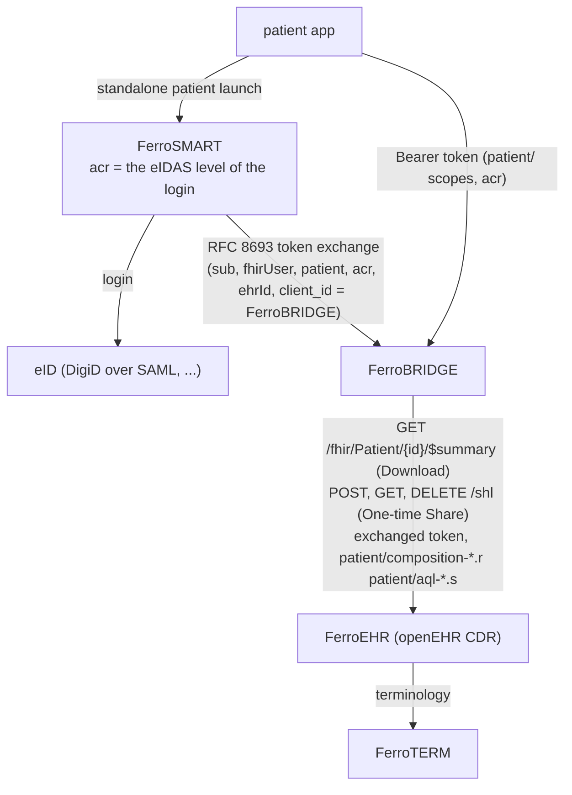

# The xShare Yellow Button: flow, data protection and the Bronze evidence

Cadasto B.V. declares the xShare industry label at Bronze level for the EHR
system FerroEHR forms with FerroBRIDGE, its European interoperability
software component (Regulation (EU) 2025/327, the EHDS, Art. 25(1),
`docs/law/eu/ehds/text.html`), with FerroSMART as its authentication
component. Bronze is a self-declaration on the "xShare Yellow Button
Declaration of Conformity" at the EHRxF Hub. Its statements draw on the
Provider conformance statements of the xShare Yellow Button implementation
guide, `hl7.eu.fhir.xshare-yb` 0.3.0
(<https://hl7.eu/fhir/ig/xshare-yb/conformance.html>), in wording of their
own. This page records the flow those statements describe, the data
protection facts of it, and the evidence for each statement of the form.
The declaration itself is submitted by
Cadasto B.V.; nothing in this repository submits it.

The system is offered as an API for patient-facing apps: there is no patient
portal of its own. Any SMART app that signs the person in at FerroSMART
reaches the two Yellow Button functions on FerroBRIDGE.

## The flow

1. The person signs in to a patient app with a standalone patient launch
   (SMART App Launch 2.2). FerroSMART authenticates them at an
   eIDAS-recognised eID and writes the level of that login into the token's
   `acr` (EHDS Art. 16(1)).
2. The app calls FerroBRIDGE with the person's token. FerroBRIDGE checks it
   and exchanges it at FerroSMART (RFC 8693) for a token at FerroEHR's
   openEHR base that names the same person, their EHR and FerroBRIDGE as the
   client, with no `act` and the read and query scopes alone.
3. FerroEHR treats the exchanged token as the person on their own record:
   it serves only the EHR whose subject is the person's `PERSON`, withholds
   what the EHDS Art. 3(3) access delay holds, refuses a login below the
   `[authz.assurance]` floor with the RFC 9470 §3 step-up challenge, and
   records each access naming the person, FerroBRIDGE and the level (EHDS
   Annex II 3.2).
4. **Download.** FerroBRIDGE writes the patient summary as an HL7 IPS 2.0.1
   document `Bundle`, with codes from FerroTERM, validates it against its
   profile and returns it.
5. **One-time Share.** FerroBRIDGE writes the same document, encrypts it
   once under a fresh key it hands back in the SMART Health Link and never
   keeps, and serves the link's manifest to the receiver within the link's
   limits (SMART Health Cards and Links 1.0.0). The person lists and
   revokes their links.

## Data protection

- **Purpose.** The person's right to access their electronic health data
  and to download an electronic copy of it in the European exchange format
  (EHDS Art. 3(1) and (2)), and to give another healthcare provider access to
  it (Art. 7(1)), beside the right of access and to data portability of
  Regulation (EU) 2016/679 (GDPR) Art. 15 and 20.
- **Lawful basis.** GDPR Art. 6(1)(c), a legal obligation of the controller,
  the healthcare provider, under the EHDS Art. 3, with Art. 9(2)(h) for the
  health data. The controller is the healthcare provider who deploys the
  system; Cadasto B.V. is its manufacturer.
- **Minimisation.** The exchanged token reads compositions and runs one
  EHR-scoped query, nothing else, and lives five minutes at most.
  FerroBRIDGE keeps no plaintext document and no key for a link: its link
  store holds the rules, the Argon2id hash of a passcode and the ciphertext,
  and a link leaves the store whole at its expiry, its revocation, its last
  answer or when its passcode attempts run out. A link expires 24 hours after
  creation by default and 7 days at most, answers once by default, and is
  disabled after five wrong passcodes over its life.
- **Records of the shares.** The creation, every answer, every refused
  passcode, the revocation and the end of a link are access records with the
  recipient the receiver named, and so is every read FerroEHR serves the
  exchanged token. They are kept as every access record is, for at least the
  three years EHDS Art. 9(2) asks: FerroEHR's under its retention register,
  FerroBRIDGE's at the Audit Record Repository the deployer configures.

## The Bronze evidence

The table is keyed to the live form, the "xShare Yellow Button Declaration
of Conformity" on Microsoft Forms
(<https://forms.office.com/e/QBHxdknvEm>, linked from
<https://ehr-exchange-format.eu/adopting-ehrxf/industry-label/>), in the
version last modified on 2026-11-23 at 12:55 UTC and read on 2026-11-26. Its
statements are copied as the form words them, spelling included. The form
has 10 Download statements and 6 One-time Share statements, and they do not
follow the guide's Provider statements one to one: the IG column names the
guide's Download (D1 to D5) or One-time Share (S1 to S6) statement each one
matches, or says there is none. The Consumer statements are not declared:
the system is a Provider. A change of the form's modified date means the
table is compared with the form again before it is submitted.

The form is submitted only once FerroEHR 6.0.0 and FerroBRIDGE v0.0.30 are
released, the two versions the declaration names.

FerroBRIDGE tests are under `app/ferrobridge-server/tests/it/` in
FerroHEALTH/FerroBRIDGE; the FerroEHR tests are in
`app/ferroehr-rest/tests/it/exchanged_patient_token_http.rs`. The CI
evidence is FerroBRIDGE's run 45860946294 on main `5988ea6`: the job
`e2e (containers)` writes the documents, and the job
`fhir-validator (eehrxf documents)` validates them with the HL7 FHIR
Validator against IPS 2.0.1, and again with `hl7.eu.fhir.xshare-yb` 0.3.0
loaded, with no fatal or error result.

| Form line | Statement (form wording) | IG | Answer | Evidence or reason |
|---|---|---|---|---|
| Download a | I declare that the applying entity is a legally established organisation and that all data provided in the context of the labelling process is authentic and based on real medical data. | no IG match | Unticked | Decision 10 on FerroHEALTH/FerroEHR#6419: Cadasto B.V. is legally established, but the conformance evidence uses synthetic test records (patient `SYN-PAT-2014` in `facade/summary.rs`), so the real-medical-data half does not hold. Ticked once a deployment holds real records. |
| Download b | I declare that my solution ensures individuals are authenticated and can access the xShare Yellow Button Download feature. | D1 | Ticked | FerroBRIDGE `facade/summary.rs` `a_patient_token_for_another_patient_answers_404`; the journey `yellow_button_e2e/mod.rs` `a_patient_downloads_shares_and_revokes_their_summary_through_ferrosmart`. FerroEHR `the_exchanged_token_reads_its_own_ehr_and_no_other`. |
| Download c | I declare that user authentication in my solution complies with applicable European regulations, including eIDAS and GDPR. | D2 | Ticked | FerroSMART writes the eIDAS level into `acr` and holds each client to a minimum (FerroHEALTH/FerroSMART#784). FerroBRIDGE checks the level of every access token on its facade against its `[assurance]` floor (FerroHEALTH/FerroBRIDGE#2137). FerroEHR `the_exchanged_token_below_the_floor_gets_the_step_up_challenge`, `the_access_record_names_the_patient_the_client_and_the_level`. GDPR: [Data protection](#data-protection). The deployer connects an eIDAS-recognised eID at substantial or high; book page [The xShare Yellow Button](../../website/book/src/xshare-yellow-button.md). |
| Download d | I declare that only authenticated individuals can search for and select the documents or health data to download. | D3 | Ticked | FerroEHR `the_exchanged_token_reads_its_own_ehr_and_no_other`, `the_access_delay_withholds_from_the_exchanged_token`; FerroBRIDGE `a_patient_token_for_another_patient_answers_404`. |
| Download e | I declare that individuals are enabled to receive and access health information through SMART Health Links | no IG match | Unticked | No SMART Health Link viewer ships with the system. It creates links and serves their manifests, which One-time Share c to e declare (`facade/shl.rs` `a_link_with_a_passcode_opens_once_in_a_receiver_and_yields_the_summary`). |
| Download f | I declare that my system passes automated validation tests for each selected Priority categories of health data under the EEHRxF (e.g., Patient Summaries, Electronic Prescriptions and Dispensations, Medical Imaging Studies and Related Imaging Reports, Medical Test Results, Discharge Reports). | D4 | Ticked (Patient Summaries) | Declared content specification: IPS 2.0.1, the Patient Summary xBundle of the guide. FerroBRIDGE validates each document before it serves it (`a_document_that_breaks_its_profile_is_refused_with_422`). The validator job checks `server-summary-ips` and `journey-summary-ips` against IPS 2.0.1 and with the xShare 0.3.0 package (FerroHEALTH/FerroBRIDGE#2015, FerroHEALTH/FerroBRIDGE#2029), and its reports are attached to every release. |
| Download g | I declare that my solution supports the Download of at least one of the Priority categories of health data under the EEHRxF defined in the EHDS (e.g., Patient Summaries, Electronic Prescriptions and Dispensations, Medical Imaging Studies and Related Imaging Reports, Medical Test Results, Discharge Reports). | D5 | Ticked (Patient Summaries) | `GET /fhir/Patient/{id}/$summary` answers an IPS 2.0.1 document `Bundle` as `application/fhir+json`: `a_patient_s_summary_is_an_ips_document_with_coded_entries`. |
| Download h | I declare that the downloaded health data is encoded using HL7 FHIR implementable specifications and follows the data structure and constraints defined for the selected xBundle(s), including required and optional sections. | D4 and D5 | Ticked | An IPS 2.0.1 FHIR R4 document `Bundle` in JSON, the Patient Summary xBundle. `a_patient_s_summary_is_an_ips_document_with_coded_entries` checks the Composition (LOINC 60591-5) and its medication, problem, allergy and procedure sections; the validator job reports no error. |
| Download i | I declare that the provided  data includes all required coded elements such as SNOMED CT, LOINC, or ATC, where applicable, for key clinical concepts like Bundle  conditions, medications, and observations. | no IG match | Ticked | `a_patient_s_summary_is_an_ips_document_with_coded_entries`: SNOMED CT on the Condition, AllergyIntolerance and Procedure, LOINC on the document and its sections, and ATC added to the medication by FerroTERM's `ConceptMap/$translate`. The required bindings pass the validator job. FerroBRIDGE carries the code the record holds and adds the translation. |
| Download j | I declare that the downloaded data bundle is not empty, and it includes patient metadata, including identifiers and demographic data, as required for the selected priority category. | no IG match | Ticked | `a_patient_s_summary_is_an_ips_document_with_coded_entries`: one Patient with an identifier (value, assigner, type), name, birth date and gender, and the custodian Organization. |
| One-time Share a | I declare that only authenticated Individuals can act as Authorised Data Recipients. | no IG match; S1 covers the person using the feature | Unticked | The receiver of a SMART Health Link is not authenticated: anyone with the link, and its passcode when one is set, opens it, and the receiver only names itself in the manifest request's `recipient` (SMART Health Cards and Links 1.0.0). `facade/shl.rs` `a_link_without_a_passcode_is_u_and_answers_one_direct_request`. The person using the feature is authenticated (S1): `a_create_outside_the_limits_or_without_a_person_is_refused`. |
| One-time Share b | I declare that user authentication in my solution complies with applicable European regulations, including eIDAS and GDPR. | S2 | Ticked | As Download c. |
| One-time Share c | I declare that users can generate SMART Health Links that allow secure access to selected health data for a limited time or specific purpose. | S4 | Ticked | `facade/shl.rs` `a_link_with_a_passcode_opens_once_in_a_receiver_and_yields_the_summary`, `a_link_gives_the_answers_it_was_created_with`, `an_expired_link_and_a_lapsed_location_answer_inactive`, `a_create_outside_the_limits_or_without_a_person_is_refused`. A link expires 24 hours after creation by default and 7 days at most, and answers once by default. |
| One-time Share d | I declare that each SMART Health Link corresponds to a valid, standards-compliant FHIR document, based on HL7 FHIR implementable specifications from a supported priority category of health data under the EEHRxF. | S6 | Ticked | The decrypted file of a link is written by `a_link_with_a_passcode_opens_once_in_a_receiver_and_yields_the_summary` (`server-shl-ips`) and by the journey (`journey-shl-ips`, FerroHEALTH/FerroBRIDGE#2018). The validator job holds both to IPS 2.0.1, with and without the xShare 0.3.0 package (FerroHEALTH/FerroBRIDGE#2243). |
| One-time Share e | I declare that retrieved health data shared through the link can be properly displayed, parsed, or integrated by recipient systems. | S5 | Ticked | The receiver in `a_link_with_a_passcode_opens_once_in_a_receiver_and_yields_the_summary` decrypts the manifest's file with the link's key and parses the IPS `Bundle`; the journey checks the same. The document passes the HL7 FHIR Validator (One-time Share d). |
| One-time Share f | I declare that users can control or revoke shared access through available options (e.g., link expiration, token revocation). | no IG match | Ticked | `GET /shl` and `DELETE /shl/{handle}`: `facade/shl.rs` `the_person_lists_and_revokes_only_their_own_links`, `an_expired_link_and_a_lapsed_location_answer_inactive`, `wrong_passcodes_count_down_and_the_fifth_disables_the_link`; the journey's revoke step. |

### Answers for the self-assessment

| Form line | English | Nederlands |
|---|---|---|
| Download a | Not ticked. Cadasto B.V. is legally established, but the evidence uses synthetic test records. It is ticked once a deployment holds real records. | Niet aangevinkt. Cadasto B.V. is rechtsgeldig gevestigd, maar het bewijs gebruikt synthetische testgegevens. Dit wordt aangevinkt zodra een installatie echte gegevens bevat. |
| Download b | Yes. Every Yellow Button endpoint requires the person's SMART access token, and FerroEHR serves the person's own record only. | Ja. Elk Gele Knop-endpoint vereist het SMART-toegangstoken van de persoon, en FerroEHR levert alleen het eigen dossier van de persoon. |
| Download c | Yes. The person signs in with an eIDAS-recognised eID, and the level of assurance is checked on every request, at substantial at least. The processing follows the GDPR as the data protection section sets out. | Ja. De persoon logt in met een door eIDAS erkend eID, en het betrouwbaarheidsniveau wordt bij elk verzoek gecontroleerd, minimaal substantieel. De verwerking volgt de AVG, zoals het onderdeel over gegevensbescherming beschrijft. |
| Download d | Yes. Only the signed-in person selects their patient summary; another person's record is refused. | Ja. Alleen de ingelogde persoon kiest de eigen patiëntsamenvatting; het dossier van een ander wordt geweigerd. |
| Download e | Not ticked. No viewer for SMART Health Links ships with the system. It creates links and serves them, which is declared under One-time Share. | Niet aangevinkt. Het systeem levert geen viewer voor SMART Health Links. Het maakt links aan en levert ze uit, en dat staat onder One-time Share. |
| Download f | Yes, for Patient Summaries. The patient summary is validated against IPS 2.0.1 before it is served, and CI checks it with the HL7 FHIR Validator, with and without the xShare package. | Ja, voor patiëntsamenvattingen. De patiëntsamenvatting wordt vóór levering gevalideerd tegen IPS 2.0.1, en de CI controleert haar met de HL7 FHIR Validator, met en zonder het xShare-pakket. |
| Download g | Yes, for Patient Summaries. The person downloads their patient summary. | Ja, voor patiëntsamenvattingen. De persoon downloadt de eigen patiëntsamenvatting. |
| Download h | Yes. HL7 IPS 2.0.1 as a FHIR R4 document Bundle in JSON, in the structure of the Patient Summary xBundle; the validator reports no errors. | Ja. HL7 IPS 2.0.1 als FHIR R4-documentbundel in JSON, in de structuur van de xBundle voor de patiëntsamenvatting; de validator meldt geen fouten. |
| Download i | Yes. Conditions, allergies and procedures carry SNOMED CT codes, the document and its sections LOINC codes, and the medication gets its ATC code from FerroTERM, where the record holds a code. | Ja. Aandoeningen, allergieën en verrichtingen hebben SNOMED CT-codes, het document en de secties LOINC-codes, en de medicatie krijgt haar ATC-code van FerroTERM, voor zover het dossier een code bevat. |
| Download j | Yes. The Bundle holds the patient with an identifier, name, date of birth and gender, and the custodian organisation. | Ja. De bundel bevat de patiënt met een identificatie, naam, geboortedatum en geslacht, en de beherende organisatie. |
| One-time Share a | Not ticked. The receiver of a link is not authenticated: anyone with the link, and its passcode when one is set, can open it. The person who creates the link is authenticated. | Niet aangevinkt. De ontvanger van een link wordt niet geauthenticeerd: iedereen met de link, en de toegangscode als die is ingesteld, kan hem openen. De persoon die de link maakt is wel geauthenticeerd. |
| One-time Share b | Yes, as Download c. | Ja, zoals bij Download c. |
| One-time Share c | Yes. The person creates a SMART Health Link (SMART Health Cards and Links 1.0.0) that expires after 24 hours by default and after 7 days at most, and opens once by default. | Ja. De persoon maakt een SMART Health Link (SMART Health Cards and Links 1.0.0) die standaard na 24 uur verloopt en uiterlijk na 7 dagen, en standaard één keer te openen is. |
| One-time Share d | Yes. The link serves the validated IPS 2.0.1 document. | Ja. De link levert het gevalideerde IPS 2.0.1-document. |
| One-time Share e | Yes. The receiver decrypts the file in the manifest with the key from the link and reads a valid IPS document, which any system that supports IPS can process. | Ja. De ontvanger ontsleutelt het bestand uit het manifest met de sleutel uit de link en leest een geldig IPS-document, dat elk systeem met IPS-ondersteuning kan verwerken. |
| One-time Share f | Yes. The person lists and revokes their own links, and a link also ends at its expiry, after its last answer or after five wrong passcodes. | Ja. De persoon ziet de eigen links en kan ze intrekken, en een link vervalt ook als hij verloopt, na het laatste antwoord of na vijf foute toegangscodes. |
