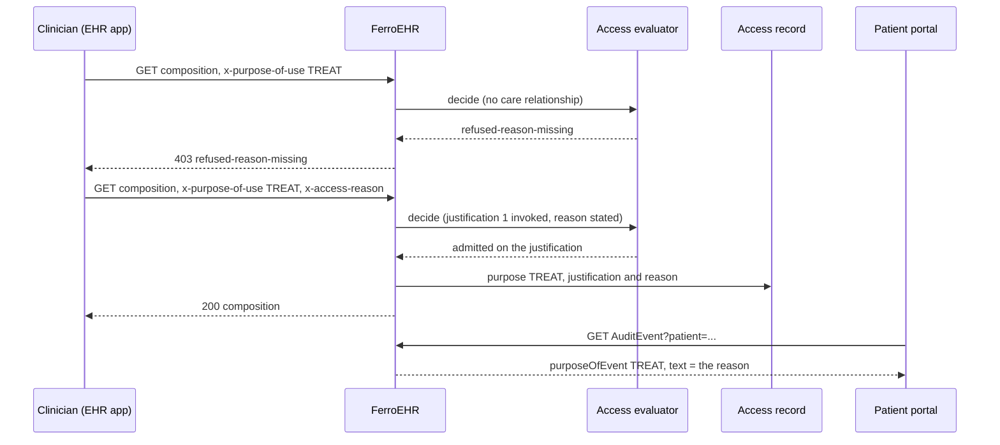

# Access control in detail

How each layer of authorization behaves and what it answers. The model as a whole is on
[How FerroEHR decides access](explanation/access-model.md).

<!-- toc -->


Authorization has two composable layers. The per-EHR `EHR_ACCESS` gate with
the access evaluator is the openEHR-grounded base and is always on; the coarse
role layer is active when authentication is enabled. A request must clear every
active layer. Deployments serving SMART apps can enable a third, token-scope
layer on top; see [SMART App Launch](smart-app-launch.md). The access
evaluator alone confines a patient to their own EHR
([a patient's own EHR](#a-patients-own-ehr)).

The model as a whole (parties, roles and grants, the patient's settings, the
access policy, justification and the legal marks) is explained on [How
FerroEHR decides access](explanation/access-model.md). This section holds the
details of each part.

## Per-EHR access control (`EHR_ACCESS`)

Every EHR carries a versioned `EHR_ACCESS` object, the openEHR
access-decision authority for that record. A new EHR has no settings, and what
that admits is a **server-wide choice**:

| `authz.rbac.ehr_access_default` | An EHR with no settings |
|---|---|
| `open` *(default)* | reachable by any caller the coarse layers already admitted |
| `restricted` | reachable only by `authz.rbac.admin_role` |

`open` is the default because it is what every existing deployment runs, and
changing it changes who can read existing records. `restricted` is object-level
**default-deny**, and it is the setting to reach for if your threat model
includes a caller enumerating record ids: a server-created `ehr_id` is a
time-ordered UUIDv7, so it is not even unpredictable, and the OWASP
[Insecure Direct Object Reference Prevention](https://cheatsheetseries.owasp.org/cheatsheets/Insecure_Direct_Object_Reference_Prevention_Cheat_Sheet.html)
cheat sheet is explicit that an unpredictable identifier is not itself an access
control.

> [!NOTE]
> Under `restricted`, the admin role still reaches a setting-less EHR. That is
> deliberate: a plain deny would make such a record unreachable by everyone
> (including the operator who would author the settings that fix it) which is an
> outage rather than a control. A patient reaches only their own EHR
> ([a patient's own EHR](#a-patients-own-ehr)); this key decides only the
> default disposition.

Committing settings of the `access_directives` scheme switches that EHR to
explicit policy, and those settings **always win over the server default**,
in both directions. The settings are an `ACCESS_DIRECTIVE_SETTINGS`, a class
of FerroEHR's draft access control package, and every coded value is a code
of the access control groups of the draft openEHR access terminology `openehr_access`:

```json
{
  "_type": "EHR_ACCESS",
  "name": { "_type": "DV_TEXT", "value": "EHR Access" },
  "archetype_node_id": "openEHR-EHR-EHR_ACCESS.access_directives.v1",
  "archetype_details": {
    "_type": "ARCHETYPED",
    "archetype_id": { "_type": "ARCHETYPE_ID",
                      "value": "openEHR-EHR-EHR_ACCESS.access_directives.v1" },
    "rm_version": "1.2.0"
  },
  "settings": {
    "_type": "ACCESS_DIRECTIVE_SETTINGS",
    "default_access": {
      "_type": "DV_CODED_TEXT", "value": "restricted",
      "defining_code": { "_type": "CODE_PHRASE",
        "terminology_id": { "_type": "TERMINOLOGY_ID", "value": "openehr_access" },
        "code_string": "restricted" }
    },
    "gate_keepers": [
      { "_type": "PARTY_SELF" },
      { "_type": "PARTY_RELATED",
        "external_ref": { "_type": "PARTY_REF", "namespace": "demographic", "type": "PERSON",
                          "id": { "_type": "HIER_OBJECT_ID",
                                  "value": "0190b3a2-5a3e-7c1d-9e2f-3b4c5d6e7f80" } },
        "relationship": { "_type": "DV_CODED_TEXT", "value": "guardian",
          "defining_code": { "_type": "CODE_PHRASE",
            "terminology_id": { "_type": "TERMINOLOGY_ID", "value": "openehr" },
            "code_string": "10" } } }
    ]
  }
}
```

- **Default access:** `open` admits any caller the other layers admit.
  `restricted` admits the administrator (`authz.rbac.admin_role`), the
  gate-keepers, a caller with a live care relationship to the subject and a
  caller a consent permit names; `consent_required` admits the
  administrator, the gate-keepers and a caller a consent permit names. Every
  other caller gets `403` with `refused-consent-required`. The record's
  person always reads their own record. An EHR Extract export by manifest
  (`POST /message/export`) passes the access evaluator for every EHR the
  manifest names before it reads any content, so one EHR the caller may not
  reach refuses the whole export.
- **Who writes the settings:** while the current settings name no
  gate-keeper, the record's person writes their own settings, as a
  mentally competent adult is their own gate-keeper (BASE Architecture
  Overview, Access Control). Once the settings name gate-keepers, a new
  `EHR_ACCESS` version is committed only by a gate-keeper they name.
  `PARTY_SELF` names the record's person; any other gate-keeper names a
  party of the demographic service by its `external_ref`, matched against
  the `PERSON` the caller is bound to. Naming gate-keepers without
  `PARTY_SELF`, such as a guardian, takes the person's own write away.
  Changing `gate_keepers` is itself a write, so only a current writer
  changes them. An administrator acting on the person's instruction writes
  in every case. Settings held closed are written only by an administrator.
  Every other caller is refused with `403`. A gate-keeper commits changes with a
  CONTRIBUTION (there is no dedicated `EHR_ACCESS` endpoint in the openEHR
  REST API). The controller commits them on the person's instruction with
  `POST /ferroehr/rest/extensions/v1/admin/ehr-access`, which names the EHR
  in its body, so it reaches an EHR a restriction hides, and reads every
  version with `GET /ferroehr/rest/extensions/v1/admin/ehr-access?ehr_id=…`.
  Every change is versioned and audited like all record content.
- **Who reads the settings:** the administrator, the record's person and the
  gate-keepers. To anyone else the settings are absent, so a restriction stays
  invisible to a provider (EHDS Art. 8): an AQL query returns no
  `EHR_ACCESS` row of the EHR, an EHR Extract leaves its `EHR_ACCESS` out,
  and a CONTRIBUTION that commits an `EHR_ACCESS` version reads as unknown
  (`404`). One caller more receives the `EHR_ACCESS` in an EHR Extract: the
  holder of an `export_ehr_extract` grant whose `subject_namespace` covers
  the EHR, such as a migration client, since the extract transfers the whole
  EHR and an import elsewhere must keep the person's directives. Those
  callers read the settings over the wire with
  `GET /ferroehr/rest/extensions/v1/ehr/{ehr_id}/ehr_access` and its
  `versioned_ehr_access` reads, a FerroEHR extension shaped on the
  `EHR_STATUS` reads ([Resource walkthroughs](using-the-api/resources.md#ehr_access)),
  which another product uses to exchange the directives.
- **Every write is checked:** a CONTRIBUTION, an EHR Extract import and an
  admin archive load that carry settings are refused whole naming the first
  defect: with `400` for settings of another scheme or a member the class does not
  declare, and with `422` for a broken invariant of the draft package, named
  as `CLASS.Invariant`, such as `ACCESS_DIRECTIVE.Restriction_denies`, or a
  `DV_DATE_TIME` or `DV_DURATION` that is no ISO 8601 value
  (`DV_DATE_TIME.Value_valid`). The
  same writes, and the controller's commit, refuse with `422` a directive
  that names a party the demographic service does not hold, naming the
  directive and the party: an actor scope's `party`, or the `external_ref`
  of the `instructed_by` party, in the directive or any of its exceptions. A
  reference of another type than the party it names is refused the same
  way, and so is an id that is no UUID, since the evaluator could never
  match it to a caller. A gate-keeper whose `external_ref` names such a
  party is refused the same way, naming the gate-keeper, since it would lock
  the settings to nobody. An import may name a party its own demographics
  chapter carries, and an archive load one its demographic records carry.
  An import and an archive load check only the head `EHR_ACCESS` version,
  the one in force: an earlier version is the unchanged record of what was
  in force then and decides nothing, so a party erased since (under GDPR
  Art. 17, for example) never blocks a faithful restore of your own export.
  `PARTY_SELF` names the record's person and needs no lookup.
- **Unreadable settings:** stored settings that do not read as the scheme
  hold the EHR closed. A request that names the EHR is refused with `500`,
  no query reaches it, and the server logs an error naming it. Only settings
  stored before the write check can hold an EHR. An administrator repairs a
  held EHR with
  `POST /ferroehr/rest/extensions/v1/admin/ehr-access/repair`, body
  `{"ehr_id": "…", "settings": {…}}`: the new settings must pass the write
  check, the repair commits a new `EHR_ACCESS` version with its own commit
  audit and contribution, and it writes an access record
  (`ehr-access-repair:<versioned object uid>`) naming the administrator. The
  repair is refused with `409` for an EHR that is not held; such an EHR
  changes its settings with a CONTRIBUTION.
- **Every replica decides by the committed settings:** the commit of an
  `EHR_ACCESS` version writes the EHR's settings into a side table in the
  same transaction, as a settings class and its facts, and notifies every
  replica when it commits. The class is what the EHR's settings share with
  others, and the facts are what is particular to the EHR: instants, parties,
  objects and origins. Every opt-out from a date shares one class. Each
  replica holds a copy of the settings of the EHRs it read most recently and
  of every class, and drops an entry on that notification, so a revoked
  gate-keeper or directive decides the next request on every replica. A query
  reads each EHR's class and facts in its own SQL, so its counts and pages
  stay exact. An EHR of a class the replica has not copied yet contributes no
  row. While a replica's listener is down it reads the settings on every
  request, and a settings store that cannot answer is `503`. The first boot
  fills the side table from the stored versions, and
  `ferroehr party-binding refill` rebuilds it.
- **What a replica holds does not grow with the EHRs that carry settings:**
  at most 4096 EHRs' settings and the settings classes. The measured sizes
  and times, against the whole-set copy this replaced:

{{#include ../generated/access-index-bench.md}}
- **The access evaluator decides every request:** see
  [Access directives](#access-directives) below.
- **The default definition:** every boot stores the archetype
  `openEHR-EHR-EHR_ACCESS.access_directives.v1.0.0` when no definition of its
  id is stored, and never over a stored one. It constrains the settings to
  `ACCESS_DIRECTIVE_SETTINGS` and its attributes; the definition upload
  validates an archetype that names a class of the draft access control
  package against the RM extended by that package. FerroEHR reads the
  settings by their codes, never by this id, so a deployment may use its own.

The scheme is a FerroEHR extension: openEHR mandates the `EHR_ACCESS` object
and its change control but publishes no concrete access-control scheme. The
decision also holds for AQL, ad-hoc and stored queries alike: data the caller
may not read contribute no rows, whether the query names the EHR in its
`WHERE` clause, in an `EHR` predicate, through the `ehr_id` parameter, or not
at all, as in a population query, and `COUNT`, `LIMIT` and `OFFSET` count only
the rows the caller reads.

## Access directives

The access evaluator decides every request that reaches an EHR. Its steps,
refusal codes and answers are on [How FerroEHR decides
access](explanation/access-model.md#how-one-request-is-decided); the rules
below say when each step applies.

- **Who is bound.** The record's person skips every step on their own EHR
  (EHDS Art. 3), so no controller rule limits a patient's own access, and is
  refused at step 0 on any other. A caller bound to the person reads their own
  record as the person, unless it performs a professional `ROLE`: then its
  read is a professional's, refused at step 5 as a conflict of interest, and
  the staff member reads their own record under their own login. A
  representative reaches only the EHR of the subject it represents, refused
  at step 0 on any other, and is held there to steps 1 to 3 and 5 and skips
  the others (Art. 4(2)): a controller rule can keep, say, a minor's confidential
  data from a parent.
  An access service is a caller holding an `access_service` grant or a
  verified caller of a `federation` issuer.
- **When a directive applies.** Every attribute an `applies_to` entry sets
  must hold for the caller: the party (its own `PERSON` or `AGENT`, a care
  team it is a member of, the provider its client acts for, or a `GROUP`
  that provider is a member of), a role it performs (the coded `name` of a
  `ROLE` in force it performs, compared by terminology and code; a token's
  role claims never count), the `care` relationship (a live care relationship), the
  `representative` and `proxy` relationships, or its caller kind. Its
  `operations` (`read`, `write`, `export`, `query`), `purposes` and
  `time_validity` must hold too, and its `data` scopes say which data it
  covers: objects, templates, root archetypes, categories (through the
  [category map](audit.md)), sensitivities, origins and commit time. One
  level of `exceptions` of the opposite effect narrows it.
- **A fact that cannot be read never opens data.** A `time_validity` bound
  with no offset, or a commit with no recorded origin, is read as covered by
  a deny and not by a permit, and so is a purpose the request does not
  declare, against a directive of the person.
- **A purpose is declared.** The caller states the purpose, and the access
  policy's `purpose_required` refuses a request without one at step 4. A
  controller rule's `purposes` therefore match only a purpose the request
  declares: "no medical examination" refuses that purpose and nothing else,
  and a request with no purpose under a policy that does not require one is
  not refused by a purpose rule.
- **Emergencies.** An emergency is a
  [justification](#justified-access-outside-the-care-relationships) of the
  access policy whose `emergency` is set. A caller it names that declares
  its purpose and states a reason reads data a restriction, a consent deny,
  an exclusion or a deny rule covers where its `emergency_override` holds,
  and passes steps 6 to 8 (Art. 11(5)); an access service that may override
  an opt-out reads an opted-out EHR the same way, unless it acts for the
  person (Art. 10(2)). A directive whose `emergency_override` is false binds
  in every emergency, as an absolute opt-out of the Member State's law does
  (recital 55). Each such access is recorded as an emergency with its
  reason.
- **Writes.** A write is judged by steps 1 and 2 for the EHR as a whole and
  by steps 3 to 8 for the version it commits: its template, root archetype,
  origins and the sensitivities the policy's classifications give it. A
  restriction and an opt-out restrict who sees data, not its recording
  (EHDS Art. 8): no write is refused for its content by either, so care is
  always documented and a write never reveals one, and the data written stay
  restricted for reading. Where the answer depends on the
  datum, the first step that refuses that datum answers, for a named object
  as for a written version, before any step about the EHR alone.
- **Every decision is a copy.** The settings, the caller facts and the access
  policy are held on each replica and dropped on the notification of the
  commit that changes them, so a decision adds no database transaction. A
  named object is read for its template, archetype, origins and commit time
  only when a directive, label or classification of the EHR depends on them.
- **Refusals.** A `403` names its code in `detail`, and with
  `Prefer: return=representation` in the `refusal` member, with the
  `legal_grounds` of the controller rules that refused at step 5
  ([problem types](using-the-api/problems.md#forbidden)). Steps 1 and 2 say
  nothing.

The decision procedure, its order and its codes are FerroEHR's own design:
RM EHR IM §EHR Access requires every decision to follow `EHR_ACCESS`, and
publishes no procedure.

## Care relationships

Where the [access policy](#the-access-policy) sets
`care_relationship_required`, a professional reads a patient's clinical data
only while a care relationship to the patient is live: the professional's
`PERSON` is a member of a care team or unit the patient's `PERSON` is under
the care of, and the admission has begun and has not ended more than the
policy's `relationship_grace` ago. Otherwise step 7 refuses with
`403 refused-no-care-relationship`. openEHR leaves it to the care delivery
environment to say who cares for whom (BASE Architecture Overview, §The
Problem of Roles), so your ADT system writes admissions and team rosters
under the `write_care_relationship` grant, or your identity provider
provisions care teams as SCIM Groups. An admission, a transfer, a discharge
or a membership change decides the next request on every replica.

A query that names no EHR reads care from the care projection, which a
replica uses only while it reflects the care facts the replica holds, so a
discharge or a removed membership never admits from a stale row
([The care projection](installation/config-privacy.md#the-care-projection)).
How the relationships are modelled is on
[Caller facts: roles and care relationships](caller-facts.md#caller-facts-roles-and-care-relationships).

## Sensitivity

Data carries a sensitivity from two places: a label on a single object in
the person's `EHR_ACCESS` settings, and a classification in the access
policy that gives every object it covers (by template, root archetype,
category or origin) its sensitivities. Sensitivity codes are those of your
jurisdiction's terminology, such as HL7 `HL7_Confidentiality` and
`HL7_ActCode`. Step 6 refuses data with a sensitivity that no applying permit
names, with `403 refused-sensitivity`. Two permits clear a caller: a consent
permit of the person whose `data` names the sensitivity, and a permit rule
of the access policy, such as one that clears the psychiatrist role for
`PSY`. No capability or token claim clears a caller.

## Record confidentiality

The controller can protect a whole record, for example of a public figure,
a staff member or a person under protection, by setting a confidentiality
marking in the record's `EHR_ACCESS` settings: the `marking` of
`ACCESS_DIRECTIVE_SETTINGS`, a `CONFIDENTIALITY_MARKING` with the level, who
set it, when and why. The level is a code of HL7 `HL7_Confidentiality`: `N`
normal (the same as no marking), `R` restricted or `V` very restricted
(`U`, `L` and `M` read as `N`). A label on one object can carry a marking
too, and a classification of the access policy a `confidentiality`; the
confidentiality of a datum is the highest of the three.

- **Who sets it.** Only the controller, through `POST /admin/ehr-access`
  (or a CONTRIBUTION by a holder of the administrator role). A version a
  patient or another gate-keeper commits must carry the current marking
  unchanged; one that sets, changes or clears it is refused `403` whole.
- **Who reads the record.** Step 6 refuses data above `N` that no applying
  permit clears. A permit clears a datum when one of its `data` scopes
  names, in `confidentialities`, the datum's level or a higher one, so a
  permit for `V` also clears `R`. With no rule that names a level, a marked
  record is read by its subject alone. A typical policy permits `R` to
  callers with a care relationship (`applies_to` with `relationship` `care`)
  for a treatment purpose, and `V` to a named role. The patient still reads
  their own record, and an emergency justification invoked with a reason
  lifts the step, recorded in the access log.
- **What a refused caller sees.** A named read answers `403
  refused-confidentiality`, which names neither the level nor the reason, so
  `R` and `V` answer alike. A level listed in the access policy's
  `concealed_confidentialities` answers `404`, as an unknown record. A
  query, an export and `GET /ehr?subject_id=` always leave a refused record
  out, inside the query's one SQL statement, so `COUNT`, `LIMIT` and paging
  agree.
- **Who reads the marking.** The subject and the controller read the
  `EHR_ACCESS` settings whole. A representative, and any other gate-keeper
  who is not the subject, reads them without `marking`, since the marking
  itself says the record is protected. That holds on every route that
  serves the settings: `GET /ehr/{ehr_id}/ehr_access` and the
  `versioned_ehr_access` reads, a CONTRIBUTION read with `Prefer:
  resolve_refs`, an EHR Extract (unless the caller holds an
  `export_ehr_extract` grant, whose extract moves the marking with the
  record) and AQL, where a whole `EHR_ACCESS` or its `settings` comes
  without the marking (no path below `settings` resolves in AQL, for any
  reader, so no query filters on the marking). A version served this way no
  longer holds the data its `signature` signs, so it carries no `signature`,
  and the REST response says so in the header `Redacted: marking`, a header
  of this CDR's own design (no openEHR or HTTP specification defines one).
- **The access log.** Every access to a marked record carries the level as
  the entry's security label (the BALP `entity.securityLabel` in the
  `v3-Confidentiality` system), a refusal names the marking's level in its
  description, and the controller's commit that sets or clears a marking is
  an entry naming the level it set or cleared.

## The access policy

The controller's access policy is one versioned `ACCESS_POLICY` that holds
for every EHR this FerroEHR keeps: the classifications above, whether access
needs a declared purpose (step 4) and a care relationship (step 7), the
controller's rules (step 5, EHDS Art. 11(3)), the catalogue of named
directives a person accepts by reference, and the restrictions of the
access log's subject view. An administrator holding the
`write_access_policy` grant writes it over the admin API, and it decides the
next request on every replica. Its `justifications` say who may open a
record outside their care relationships, and in an emergency
([below](#justified-access-outside-the-care-relationships)). The trust and
the floor stay in `ferroehr.toml`: `authz.rbac.admin_role` and
`ehr_access_default`. The policy can only tighten them. Until you write one,
nothing is tightened and nobody is admitted on a justification. The model and
the rules are on [The access policy](access-policy.md#the-access-policy).

## Justified access outside the care relationships

A clinician sometimes needs a record outside their caseload: a consultation,
a second opinion, a colleague's patient on a shift, or an emergency. Your
EHR lets them open it when your access policy allows it for the purpose they
declare, asks them why, and FerroEHR keeps the reason in the access record
the patient reads (EHDS Art. 9 and Annex II 3.2, Art. 11(5)). The
justification, the header and the bound of the reason are this CDR's own
design; the purposes are HL7 v3 `ActReason` codes, and the reason travels
on as the text of the purpose of use (FHIR R4 `AuditEvent.purposeOfEvent`
and `agent.purposeOfUse`, IHE BALP).

- **The policy.** Each entry of `ACCESS_POLICY.justifications` names the
  `purposes` that invoke it, the callers that may (`applies_to`, actor
  scopes as in a rule: a role they perform, a party, a caller kind; void
  means every professional), and whether it is an `emergency`. Without
  `justifications` nobody is admitted on one.
- **The request.** The clinician declares the purpose in `x-purpose-of-use`
  and the reason in `x-access-reason` (`[audit] reason_header`): their own
  words, percent-encoded UTF-8 (RFC 3986 §2.1) so any language travels in an
  HTTP header, 1 to 1000 characters after decoding, with no control
  character. A malformed or longer value is a `400` naming the header, and
  nothing is recorded in part.
- **The decision.** The first justification whose purposes hold the
  declared purpose and whose `applies_to` names the caller is invoked. It
  stands in for a live care relationship at steps 7 and 8 for the data no
  relationship of the caller covers: with a reason they are admitted, and
  without one they are refused `403 refused-reason-missing`, which tells
  your EHR to ask the clinician why. Inside the caller's care relationships
  no reason is asked. An emergency justification lifts each
  `emergency_override` and steps 6 to 8, and needs the reason before any
  directive is read, so its refusal never reveals a restriction.
- **What it never lifts.** A justification that is no emergency lifts no
  restriction, opt-out, consent deny, exclusion, controller rule,
  sensitivity, confidentiality or conflict. The patient's restriction still
  refuses (EHDS Art. 8), and a GDPR Art. 18 restriction of processing refuses
  every access, an emergency included.
- **The record.** The access record stores the purpose and the reason
  (`audit_event.justification`), the access-log entry names the
  justification with its `reason` (`justification`, or `emergency`), and the
  patient's own ITI-81 retrieval shows who looked, why and that it rested on
  a justification ([Audit](ehds-logging.md#justified-and-emergency-access)).



A policy that admits consultations under `TREAT` and emergencies under
`ETREAT` to every professional, and break the glass only to the emergency
physicians:

```json
"justifications": [
  { "_type": "ACCESS_JUSTIFICATION", "emergency": false,
    "purposes": [{ "_type": "DV_CODED_TEXT", "value": "treatment",
      "defining_code": { "terminology_id": { "value": "HL7_ActReason" }, "code_string": "TREAT" } }] },
  { "_type": "ACCESS_JUSTIFICATION", "emergency": true,
    "purposes": [{ "_type": "DV_CODED_TEXT", "value": "break the glass",
      "defining_code": { "terminology_id": { "value": "HL7_ActReason" }, "code_string": "BTG" } }],
    "applies_to": [{ "_type": "ACCESS_ACTOR_SCOPE",
      "role": { "_type": "DV_CODED_TEXT", "value": "emergency physician",
        "defining_code": { "terminology_id": { "value": "urn:example:roles" }, "code_string": "EP" } } }] }
]
```

Each purpose must also be on `[audit] purpose_codes` when that list is set,
since a purpose the audit layer does not record is no declared purpose.

## Restriction of access by health professionals (EHDS Art. 8)

Regulation (EU) 2025/327 Art. 8 gives a person the right to restrict the
access of health professionals and healthcare providers to all or parts of
their data, and has the fact of the restriction stay invisible to healthcare
providers. Art. 11(5) lets the restricted data be reached where necessary to
protect the person's vital interests, logged so the person can see it. No
openEHR specification governs this; it is our own design.

- **Recording it.** A restriction is a `restriction` deny directive of the
  EHR's own `EHR_ACCESS` settings (the `access_directives` scheme above). The
  controller records it on the person's instruction by committing a new
  `EHR_ACCESS` version with `POST /ferroehr/rest/extensions/v1/admin/ehr-access`,
  for the whole EHR (no `data`) or for the versioned objects its
  `data[].objects` name, and lifts it by committing a version without it
  ([the routes](operations-admin-apis.md#legal-marks-restriction-objection-and-retention)).
  `GET /ferroehr/rest/extensions/v1/admin/ehr-access` reads every version, so a
  lifted restriction stays in the history, and an EHR Extract carries the
  versions. A whole-EHR restriction covers data recorded after it too.
- **What the server reads of it.** The access evaluator reads every
  attribute of the directive for each caller ([Access directives](#access-directives)):
  its `data` scope, `applies_to`, `operations`, `purposes`, `time_validity`
  and `exceptions`. The event stream, which has no caller, withholds every
  object a restriction in force covers, and the whole EHR for a `data` scope
  beyond `objects`.
- **What a professional sees.** Restricted data reads as absent: a restricted
  composition or EHR answers **404** exactly as an unknown one does, a query
  leaves it out at every scope (and a query scoped to a restricted EHR answers
  as for an unknown EHR), an export skips it, a CONTRIBUTION lists none of its
  versions, the event stream withholds it, and a write to it is refused as a
  write to an unknown target. No status, header or count says that a
  restriction exists.
- **What it does not change.** Nothing is deleted, and storage and the
  controller's own processing go on: the admin routes (dump, archive, erase,
  the registers) see everything. It is not the GDPR Art. 18 restriction of
  processing, which answers **403** and stops processing itself.
- **The emergency override.** A caller an emergency
  [justification](#justified-access-outside-the-care-relationships) of the
  access policy names, declaring its purpose and stating a reason, reads the
  restricted data where the directive's `emergency_override` holds, and its
  access record names the emergency with the reason
  ([Audit](ehds-logging.md#justified-and-emergency-access)). Without the reason, or
  without a justification that names the caller, nothing is lifted.

The grain is the versioned object, the whole EHR, or both. A finer grain (one
entry inside a composition) is not built: an object is the unit the version
reads, the queries and the exports already decide on, and splitting a
composition would change what the stored, signed version holds.

## Opt-out from the access services (EHDS Art. 10)

Regulation (EU) 2025/327 Art. 10(1) lets a Member State's law give a person
"the right to opt out from the access to their personal electronic health data
registered in an EHR system through the electronic health data access services
referred to in Articles 4 and 12", and has the Member State "ensure that the
exercise of that right is reversible". Art. 10(2) lets the Member State admit
"a healthcare provider or health professional" where processing "is necessary
in order to protect the vital interests of the data subject or of another
natural person", even after an opt-out. No openEHR specification governs this;
it is our own design.

FerroEHR ships the software part: a mark on the whole EHR that the callers you
grant as the access services read as absent. Whether the right exists, how
the person exercises it, and the rules and safeguards of Art. 10(2) are your
Member State's law and yours to apply. Where the Member State enforces the
opt-out in its own services, leave the mark unused.

- **Granting the access services.** Your Art. 4 access service (the
  person's) and your Art. 12 health professional access service each hold an
  `access_service` grant in the CDR: a capability of a `ROLE` their `ACTOR`
  or `PERSON` performs ([Operational policy](operational-policy.md#what-the-grants-decide)).
  `[authz.grants] allowed` does not allow `access_service` by default, so the
  opt-out holds for nobody, and recording one is refused with **400**. A role
  a token names grants nothing here.
- **Recording and reversing it.** An opt-out is an `opt_out` deny directive
  of the EHR's own `EHR_ACCESS` settings, at most one, covering the whole EHR.
  The controller records it on the person's instruction by committing a new
  `EHR_ACCESS` version with `POST /ferroehr/rest/extensions/v1/admin/ehr-access`,
  and reverses it by committing a version without it
  ([the routes](operations-admin-apis.md#legal-marks-restriction-objection-and-retention)).
  The reversed opt-out stays readable as a past version, and a version
  without one is accepted whatever the configuration, so an opt-out can
  always be reversed. Its `emergency_override` false makes it absolute: no
  vital-interest override lifts it (EHDS recital 55).
- **What an access service sees.** A request from a caller holding an
  `access_service` grant reads the EHR as absent: a route that names the EHR or an
  object in it answers **404** as for an unknown EHR, a population query leaves
  its data out, a query scoped to it answers as for an unknown EHR, an export
  and the lookup by subject find no such EHR, and a write to it is refused as a
  write to an unknown EHR.
- **What it does not change.** Every other caller reads the record as before:
  your own care, through callers that hold no `access_service` grant, and the
  controller's admin routes. Nothing is deleted. It is not the Art. 8
  restriction above, which reaches every professional route and leaves the
  person's own access open.
- **The vital-interest override.** An access-service caller an emergency
  [justification](#justified-access-outside-the-care-relationships) names
  (an `applies_to` of caller kind `access_service`), declaring its purpose
  and stating a reason, reads the EHR where the opt-out's
  `emergency_override` holds, unless it acts for the
  person (a SMART `patient/` grant or the patient claim), because Art. 10(2)
  names a healthcare provider or health professional. Its access record
  names the emergency with the reason
  ([Audit](ehds-logging.md#justified-and-emergency-access)), and a
  route that names the opted-out EHR, in its path or in a `POST
  /message/export` manifest, adds an access record
  `access-opt-out-override:ehr-wide` against it.
- **The record.** Each commit and each read through the controller's route
  is an access record on the EHR (`ehr-access:ehr-wide`) naming the
  administrator.

```toml
[authz.grants]
allowed = ["commit_composition", "access_service"]

[audit]
purpose_codes = ["TREAT", "ETREAT"]
```

## Information a person inserts (EHDS Art. 5)

Regulation (EU) 2025/327 Art. 5 lets a person, or their representative, insert
information in their own EHR through the access services. That information
"shall be clearly distinguishable as having been inserted by the natural
person or by his or her representative", and the person "shall not be able to
directly alter the electronic health data and related information inserted by
health professionals". FerroEHR keeps both rules at the commit. No openEHR
specification governs who may change what, so the rules are our own design;
the marker is the RM's own.

- **Who counts as the person.** A caller the party binding binds to the
  `PERSON` an EHR's subject names, with no professional `ROLE`. A patient
  claim or a `patient/` scope in the token does not make a caller the person,
  because a professional's token in a patient's context carries both (SMART
  on openEHR master08 §Resource Scopes).
- **Who counts as the representative.** A person bound to their own `PERSON`
  who acts for the patient through a representation relationship FerroEHR has
  recorded ([how a login is looked up](installation/config-authz.md#how-a-login-is-looked-up)),
  ([Representatives](caller-facts.md#representatives)).
  The rules below hold for the representative exactly as for the person.
- **The marker.** Every version and CONTRIBUTION the person commits records
  `PARTY_SELF` with no `external_ref` as `AUDIT_DETAILS.committer`, the RM's
  way to say the committer is the record subject (RM common, Audit Details).
  A representative's records `PARTY_RELATED`, naming the representative's own
  `PERSON` and the coded relationship. FerroEHR writes this committer itself
  and refuses one the request states that differs, in the
  `openehr-audit-details` header or in a CONTRIBUTION body. Every read of the version carries it, an AQL query reads it with
  `v/commit_audit/committer`, the contribution list extension flags the change
  set with `inserted_by_person`, and the viewer names the committer "The person
  or their representative". The marker is part of the stored version, so a
  dump and its restore keep it.
- **The composer.** A COMPOSITION the person or the representative commits
  names the person (`PARTY_SELF`) or their representative (`PARTY_RELATED`)
  as its composer.
  Any other composer is refused with **403**, so the person cannot present what
  they insert as a professional's.
- **What the person may change.** The person and their representative may
  update and delete a version whose committer is `PARTY_SELF` or
  `PARTY_RELATED`. An update or a deletion of a version anyone else committed,
  a professional or a system, is refused with **403** and a body that names
  EHDS Art. 5, whether it comes as a direct write or inside a CONTRIBUTION.
  Nothing is written. The marker is in the version, so the rule holds whatever
  became of the access record of the write.
- **What a professional may change.** A professional's writes are unchanged.
  A professional may update or delete an entry the person inserted; the new
  version is the professional's, which the person may then no longer alter.
  The person's own versions stay in the version history.

## Delayed access by the person (EHDS Art. 3(3))

Regulation (EU) 2025/327 Art. 3(1) gives a person access to their data
"immediately after the personal electronic health data have been registered in
an EHR system". Art. 3(3) lets a Member State restrict that right "by delaying
access to their personal electronic health data for a limited period of time
until a health professional is able to properly communicate and explain to the
natural persons concerned information that can have a significant impact on
their health". Recital 10 gives the example: a diagnosis of an incurable
disease should come first in a consultation, not through an electronic
channel. This is the opposite direction of the Art. 8 restriction above: the
data is withheld from the person, never from a professional. No openEHR
specification governs it; it is our own design.

FerroEHR ships the software part. Whether the delay applies, to which data and
for how long is the Member State's rule, and you configure it in
[the access-delay register](installation/config-auth.md#the-access-delay-register), an
[admin register](access-policy.md#the-admin-registers). It is off by
default, so the person's access stays immediate.

- **What is held.** With the register on, every new COMPOSITION whose category
  (the [audit category register](installation/config-audit.md#the-audit-category-register), template first,
  then the root archetype) is listed in the register's `categories` is held from
  the moment it is committed, for the register's `max_delay`. Only the first version
  is held: a composition the person has already seen stays visible when it is
  amended, and a professional holds an amendment by hand if it needs
  explaining. A composition the person commits is never held from them.
- **Who it is held from.** A request that may be the person's own: a bearer
  token the party binding binds as the person or a representative. Such a
  token is treated as the
  person's, whatever `user/` or `system/` grant it also carries, so a mixed
  token is withheld from rather than shown the data too early. The rule is the
  FerroHEALTH family's, shared with the other products through
  `ferrohealth-smart`. To that request a held composition reads
  as absent: a read answers **404** as for an unknown composition, a query and
  an export leave it out, a CONTRIBUTION lists none of its versions, and a write
  to it is refused as a write to an unknown target.
- **On a professional's own record.** The person an EHR belongs to is read
  from the party binding: a caller whose identity is bound to the `PERSON`
  the EHR's `EHR_STATUS.subject` names is that record's person, whatever
  roles it holds. On that EHR the hold applies to them as above, in a read,
  a query pinned to the EHR, a query across the population and an export,
  and their own write to it is never held. A bound person holding no role
  reaches only their own records, so the hold applies on every one.
- **What a professional sees.** Everything else, as before. The hold changes
  no professional route, query or export on another person's record.
- **Releasing it.** The treating professional releases a composition once it
  has been explained, from the clinical surface with
  `POST /ferroehr/rest/extensions/v1/ehr/{ehr_id}/versioned_composition/{versioned_object_uid}/access-delay/release`.
  The route takes the checks of a write to that EHR: its `EHR_ACCESS` gate and
  the SMART `composition-` update grant. A request that may be the person's is refused with **403**. The
  controller releases with
  `POST /ferroehr/rest/extensions/v1/admin/access-delay/release`, and holds
  one by hand with `POST /ferroehr/rest/extensions/v1/admin/access-delay`, for
  at most the access-delay register's `max_delay`
  ([the routes](operations-admin-apis.md#legal-marks-restriction-objection-and-retention)).
- **The limit.** Every hold ends by itself when its period passes, released or
  not, because Art. 3(3) allows a delay "for a limited period of time" only.
- **The record.** Placing a hold, releasing it and its expiry are each an
  access record: the release names the professional who made it, and the
  server writes the expiry record within a minute of the limit passing.
- **The person's access trail (Art. 9).** A record about a held composition
  would tell the person a result exists. The subject-scoped ITI-81 read, the
  one an app serves the person's own trail from, leaves out every
  record that names a held composition, its hold included, until the hold is
  released or expires; the records then appear unchanged, with their original
  times. The filter is `ehds-logging`'s, the FerroHEALTH family's EHDS
  logging component. The controller's unscoped read shows every record at
  all times.

Turning the section off makes every held composition readable to the person at
once: the holds stay in the register, and no new one can be placed.

## RBAC (role-based, coarse)

Every openEHR operation is classified as **Public**, **Clinical**, or
**Admin**, and a role model gates each class. Roles are plain,
case-insensitive strings. A Clinical operation needs an authenticated caller
and no role; the configured roles default to `ADMIN` (`admin_role`, every
Admin operation) and `READONLY` (`readonly_role`, refused on every write).

| Environment variable | Default | Meaning |
|---|---|---|
| `FERROEHR__AUTHZ__RBAC__ENABLED` | `true` | the coarse role gate (active only when auth is enabled) |
| `FERROEHR__AUTHZ__RBAC__ADMIN_ROLE` | `ADMIN` | role required for admin operations |
| `FERROEHR__AUTHZ__RBAC__READONLY_ROLE` | `READONLY` | role marking a principal read-only: refused on every write |
| `FERROEHR__AUTH__ISSUER__<NAME>__ROLE_CLAIMS` | `["roles","groups","entitlements"]` | JWT claim paths mined for roles, per issuer; a Keycloak issuer adds `realm_access.roles` |
| `FERROEHR__AUTHZ__RBAC__ROLE_ISSUERS` | empty | the names of the issuers whose role claims may grant the administrator role; a token of any other issuer never holds it |

Roles come from the JWT claims listed in `ROLE_CLAIMS`, or from a Basic user's
configured roles. The defaults are the carriers
[RFC 9068 §2.2.3.1](https://www.rfc-editor.org/rfc/rfc9068#section-2.2.3.1) names
for conveying authorization state (`roles`, `groups`, `entitlements`, of which
`roles` and `entitlements` are [SCIM](https://www.rfc-editor.org/rfc/rfc7643#section-4.1.2)
attributes), the default every FerroHEALTH product shares. A claim path may be
dotted, so an issuer that nests them differently, such as Keycloak's
`realm_access.roles`, is configuration rather than a code change; a claim
carrying a single string and one carrying an array are both accepted.

**A Clinical operation needs at least one role of any name; an Admin operation
needs the admin role.** A Basic user holds the roles its `roles` list names
and nothing else, so a user with none is refused every Clinical operation;
`roles = ["USER"]` satisfies the Clinical class and no Admin operation. A
bearer token whose SMART on openEHR resource scopes are all `system/` scopes,
such as `system/template-*.r`, is a backend client and needs no role for a
Clinical operation: its scopes decide what it reaches. The record's person and
their representative need no role either: a caller the party binding binds
to the `PERSON` they are, and a
caller acting for the person pass the Clinical class, and the access
evaluator decides from who they are (EHDS Art. 3 and 4(2)), confining them
to their own records. A token's own reading of the patient never counts
without that binding. The read-only role still refuses their writes.
Any other `user/` or `patient/` token belongs to a professional and still needs
a role.
Disabling RBAC restores authentication-only behaviour.

> [!IMPORTANT]
> **The management surface is not configured here.** `/management/*` is governed
> entirely by `[management.endpoints]`, one level per endpoint, and nothing under
> `[authz.rbac]` changes it. There is **no global default beside it: an endpoint
> you do not name is `off`** and is not mounted at all.
>
> Each level means: `off`, not mounted, answers `404`; `private`, any
> authenticated principal; `admin_only`, authenticated **and** holding
> `authz.rbac.admin_role` (the one place RBAC is consulted); `public`, no check
> at all, including no authentication.
>
> The consequence worth internalising: `prometheus = "public"` is reachable by
> an anonymous caller **whatever** your RBAC settings say, because a `public`
> endpoint is mounted outside the authentication layer. Lock the surface down by
> raising the levels in `[management]`, and read the effective set back from
> `/management/env` (or from the boot log line that names every mounted
> endpoint and its level) rather than assuming.

> [!IMPORTANT]
> **The OAuth2 `scope` claim does not grant roles.** A scope grants a *client*
> delegated authority ([RFC 6749 §3.3](https://www.rfc-editor.org/rfc/rfc6749#section-3.3));
> it asserts nothing about the subject's roles. Reading it as one also made the
> at-least-one-role check pass for every OIDC token, since `openid` alone
> satisfied it. If your callers rely on a scope naming a role, move that role
> into one of the role claims above. Scopes remain on the principal and still
> drive SMART scope enforcement.

> [!NOTE]
> The downloadable Compose quickstart deliberately runs with RBAC **off** and a
> single user, so every surface works out of the box (see
> [Docker Compose](installation/compose.md)). Turn the role gate on with
> `[authz.rbac] enabled = true` (or `FERROEHR__AUTHZ__RBAC__ENABLED=true`) and
> give each principal an explicit `roles` list.

A principal carrying the `readonly_role` (default `READONLY`) is refused on
every write operation (creating an EHR, committing a composition, uploading a
template, and any update/delete) even when it also holds granting roles such
as `ADMIN` (a restriction always overrides a grant). Reads and AQL queries stay
permitted, so a `READONLY` account is an authenticated, view-only principal. The
repository's from-source development stack ships one such account
(`ferroehr-readonly`, password `ferroehr`) alongside `ferroehr` and
`ferroehr-admin`, with RBAC at its default `enabled = true`, so the separation
can be tried out; the downloadable quickstart file has neither (one user, no
role gate).

## A patient's own EHR

A caller is the patient, the `subject` caller kind of the
[access evaluator](#access-directives), through a SMART App Launch
patient-context credential: a bearer token whose `patient/` grants name the
launch EHR in `ehrId` (master07 §Context Selection).
The patient's own EHR is the `ehrId` of that token's launch context
(ITS-REST SMART App Launch §Context Selection). The evaluator skips every step
of the decision procedure for the patient on their own EHR (EHDS Art. 3) and
refuses them every other EHR with **`403`** `refused-not-subject`, which the
access record names as step 0 (subject). No key
turns this on or off, and a representative comes in as a delegation of the
subject's directives.

- An operation on another patient's EHR is refused with **`403`**, whether the
  EHR is named in the path, the body or only in the result. That covers the
  EHR, `EHR_STATUS`, COMPOSITION, CONTRIBUTION and DIRECTORY operations and
  their item tags, and the EHR Extract import and export routes; an export by
  manifest (`POST /message/export`) holds every EHR it names, and one EHR of
  another patient refuses the whole export.
- An AQL query reads only the rows of the patient's own EHR, whatever the query
  scopes or projects, including a query that reads only the `ehr` row, and its
  counts and pages see only those rows.
- A patient-context token whose launch context names no EHR reaches none, and
  an operation on EHR data that names no EHR (creating an EHR, a lookup by
  subject, a query with no single-EHR scope, an import naming no EHR) is
  refused the same way.

The evaluator holds the launch context alone. The SMART layer checks a
`patient/` grant's resource family and permission and refuses on nothing
else, so every route answers a caller on another EHR the same way and the
access record names step 0. A professional whose grants are `patient/` grants
alone, a clinician app launched for one patient, is held to that patient's
EHR the same way, and on that EHR takes every step of the procedure. A contact
point's caller is held to the EHR of its treatment relationship
confirmation's patient.
