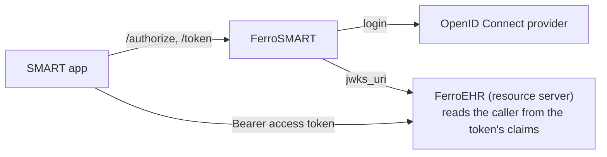

<!-- SPDX-FileCopyrightText: Cadasto B.V. -->
<!-- SPDX-License-Identifier: BUSL-1.1 -->

# Behind FerroSMART

FerroSMART is the FerroHEALTH family's SMART App Launch 2.x authorization
server. It signs people in at any OpenID Connect provider and uses that
provider for login alone. It issues plain RFC 9068 access tokens that
carry the launch context: `patient`, `encounter`, `fhirUser` and, at an
openEHR base, `ehrId`. FerroEHR runs behind it as a resource server. The
person never signs in to FerroEHR, and FerroEHR never sees the provider's
tokens. FerroSMART's architecture describes the whole deployment in
§13.21, A product behind FerroSMART, of its [architecture](https://github.com/FerroHEALTH/FerroSMART/blob/ferrosmart-v0.2.0/docs/architecture.md).
This page is FerroEHR's side of it.



## FerroSMART serves the openEHR base

FerroSMART issues a token only for a base it serves. Its
`[[ferrosmart.resource]]` table names FerroEHR's openEHR REST base as an
`openehr` resource. Its `subject_namespace` is the namespace FerroSMART's
patient picker looks EHRs up under:

```toml,ferrosmart
[[ferrosmart.resource]]
base = "https://ehr.example.org/ferroehr/rest/openehr/v1"
kind = "openehr"
subject_namespace = "examples"
```

## FerroEHR trusts FerroSMART

One `[auth.issuer.<name>]` table names FerroSMART's issuer
([Authentication & access](installation/config-auth.md)). FerroSMART is a
SMART App Launch 2.2 authorization server whose access tokens follow RFC
9068: `typ` `at+jwt` (RFC 9068 §2.1), the client in `client_id`, and
`scope` in every token (SMART App Launch 2.2.0, Obtain access token,
Response). Its registry is the one list of clients, so a token whose `aud`
names FerroEHR admits its client, and FerroEHR keeps no client list of its
own. Its party table's `identifier_type` is `pairwise` when it names none.
A token without `scope` or `client_id` is refused with `401`.

The audience is the openEHR base FerroEHR derives from `[server]
public_base_url`, the base FerroSMART names in `aud` (RFC 8707 §2), so the
table names none:

```toml
[server]
public_base_url = "https://ehr.example.org"

[auth.issuer.ferrosmart]
issuer = "https://smart.example.org"

[auth.issuer.ferrosmart.party]
identifier_issuer = "urn:example:ferrosmart-login"
identifier_type = "login"
```

FerroEHR starts whether or not FerroSMART answers: it reads FerroSMART's
metadata and key set in the background, refuses its tokens with `503`
(`issuer-unread`) and reports not ready until it has, then serves them.

- **A person through a SMART app.** A person's token through any client
  FerroSMART registers reads as that person, and the access record names
  the client. A token whose RFC 8693 `act` names an actor reads as that
  actor acting for the person, recorded with `acting_mode = delegated`
  ([Enterprise identity providers](identity-providers.md#who-the-caller-is)).
- **FerroSMART's patient picker.** The picker looks a patient's EHR up as
  the person who signed in, with a token whose `client_id` is FerroSMART's
  own (FerroSMART `docs/architecture.md` §13.6 item 4). It reads as that
  person, and the access record names FerroSMART as the client (Regulation
  (EU) 2025/327 Annex II).
- **A Backend Services client.** A client credentials token's `sub` is its
  `client_id` (RFC 9068 §2.2), so the same table reads it as the system. Its
  grants in the CDR decide what it reaches, as for any system caller.
- **One table per issuer.** Name FerroSMART in this one table. A second
  `[auth.issuer.<name>]` table of the same issuer refuses the start, naming
  the issuer (FerroHEALTH/FerroSMART#591).

The scopes a token grants still meet FerroEHR's own access decisions on top.

## A person's own record

FerroEHR reads who a record belongs to from the party binding and never from
the token alone. A person whose login binds to the `PERSON` that an EHR's
`EHR_STATUS.subject` names is that EHR's subject. On that EHR they read their
record and write its `EHR_ACCESS` settings as its subject (EHDS Art. 3), with
no role and no purpose of use. The access log records each access as their own.

The binding is the source because an openEHR launch token names its record
by `ehrId` and carries no `fhirUser` and no `patient` claim.

A FHIR-paired launch token can carry both. `ferrohealth-smart` reads a
token as the patient's own when its `fhirUser` is `Patient/<x>`, its
`patient` claim is `x` and it names no actor. FerroEHR uses that reading only
as a check, never as a grant:

- FerroEHR looks the token's login up in FerroSMART's party table,
  as it does for any person. The login has to bind a `PERSON` with no
  professional `ROLE` and no representation. That `PERSON` decides what the
  caller reaches, exactly as for an openEHR launch.
- A login that binds no `PERSON` is refused `403` with `refused-unbound`, or
  `refused-key-claim-missing` when the token lacks `sub`.
- A login bound to a professional's or a representative's `PERSON` is
  refused `403` with `refused-wrong-marker`.
- A token whose `ehrId` names an EHR whose `EHR_STATUS.subject` is not the
  bound `PERSON` is refused `403` with `refused-representation-unrecorded`.
  The same check holds for every caller bound as the person themself.

FerroEHR does not compare the `patient` claim with the `PERSON`, because it
cannot map a FHIR `Patient` id to a `PERSON` without the FHIR pairing. Each
refusal is recorded under its binding code on the access record.

FerroSMART's patient picker looks the EHR up with a token that carries no
role:

- A person holding no role reaches only the EHRs whose subject is their
  `PERSON`.
- A patient signs in at FerroSMART as staff do, through the picker or any
  app. Their `PERSON` holds no professional `ROLE`, so FerroEHR binds the login as that person:
  they hold no role, whatever the token asserts, and reach only the EHRs
  whose subject is their `PERSON`. Their commits name `PARTY_SELF`. A
  `patient/` grant reaches only the EHR its token's `ehrId` names (SMART on
  openEHR master08 §Resource Scopes), so a token that names none reaches
  their records by identity only through `user/` grants.
- Their lookup of their own subject finds their EHR. A lookup of anyone
  else's subject answers `404`, as a subject no EHR names does.
- A professional's lookup through the picker needs their roles on the
  picker's token (FerroHEALTH/FerroSMART#716).

A representative signs in at FerroSMART, as a `RelatedPerson` or as a user
whose `PERSON` is a representative's alone. FerroEHR reads the
representation from its own records, never from the token:

- The login binds a `PERSON` that carries the representative marker and no
  professional `ROLE`. FerroEHR admits it as a representative holding no
  role, whatever the token asserts.
- It reaches a subject's record only while a representation the CDR stores
  names that `PERSON` for that subject: live today, recorded for the provider
  the deployment acts for, and not written by the representative itself
  ([Operational policy](operational-policy.md)).
- The subject is the one of the EHR the token's launch context names, which
  then holds the caller to that EHR. Without a launch context it is the
  subject of the EHR the request names, or the subject the picker's lookup
  names.
- A request for any other subject, or one that names no subject, is refused
  `403` with `refused-representation-unrecorded`.
- Its commits name its own `PERSON` as a `PARTY_RELATED`, and the access log
  names the representation each access rested on.
- A representative who is also a patient reaches their own record as
  themself. When the subject a request reaches is their own `PERSON`, by
  the launch EHR, the EHR the request names or the picker's lookup, FerroEHR
  admits them as the person themself with no stored representation: their
  commits name `PARTY_SELF`, the access log records them as the subject of
  care, and a result held under the access delay stays held from them. A
  launch context that names someone else's EHR still holds them to that EHR.

## The patient's own token through FerroBRIDGE

FerroBRIDGE serves the xShare Yellow Button: the patient downloads their
Patient Summary (`Patient/$summary`) or shares it once through a SMART
Health Link. It reads the summary from FerroEHR as the patient, with the
token FerroSMART's RFC 8693 token exchange issues it for the patient's own
token (FerroHEALTH/FerroSMART#785). That token carries:

- the subject token's `sub`, `fhirUser`, `patient`, `acr` and `auth_time`;
- the `ehrId` of the patient's EHR at this openEHR base;
- `client_id` naming FerroBRIDGE, and no `act`;
- `patient/composition-*.r patient/aql-*.s` at most, for five minutes at
  most.

`ferrohealth-smart` reads it as the patient's own token: its `fhirUser` is
the `Patient` its `patient` claim names and it names no actor. FerroEHR then
treats it as the person, exactly as their own login:

- It reads only the EHR whose subject is the patient's `PERSON`. Any other
  EHR is refused `403` with `refused-not-subject`.
- A composition the [access delay](security.md#delayed-access-by-the-person-ehds-art-33)
  holds reads as absent until a professional releases it (EHDS Art. 3(3)).
- Below the `[authz.assurance]` floor it is refused `401` with the RFC 9470
  §3 step-up challenge, so FerroBRIDGE sends the person back to FerroSMART
  to sign in at a higher level.
- The access record names the patient's login and `PERSON`, FerroBRIDGE as
  the client, FerroSMART as the issuer, the level of assurance and the
  category of the data read (EHDS Annex II 3.2).

The xShare Yellow Button asks for an eIDAS-recognised eID at level
substantial at least (EHDS Art. 16(1)). FerroSMART writes the eIDAS level
URIs into `acr`, so a deployment behind it sets the floor to substantial,
or high where its Member State asks for that:

```toml
[auth.issuer.ferrosmart]
issuer = "https://smart.example.org"

[auth.issuer.ferrosmart.party]
identifier_issuer = "urn:example:ferrosmart-login"
identifier_type = "login"

[authz.assurance]
minimum = "substantial"

[authz.assurance.levels]
"http://eidas.europa.eu/LoA/low" = "low"
"http://eidas.europa.eu/LoA/substantial" = "substantial"
"http://eidas.europa.eu/LoA/high" = "high"
```

The floor holds every patient-data request, a professional's included, and
a Basic credential carries no level, so it is refused on patient data
([Authentication & access](installation/config-auth.md#authzassurance-the-assurance-level-patient-data-requires)).

## The discovery document describes FerroSMART

With `[auth.smart] discovery = true`,
`GET https://ehr.example.org/ferroehr/rest/openehr/v1/.well-known/smart-configuration`
describes the issuer `ferrohealth-smart`'s shared rule picks
([SMART App Launch](smart-app-launch.md)). With FerroSMART as the one
issuer, that is FerroSMART: the document names its
`authorization_endpoint` and `token_endpoint`, so an app that starts at
FerroEHR's base finds FerroSMART (SMART App Launch 2.2.0, Conformance,
Metadata). When FerroEHR trusts another issuer that signs user tokens
beside it, `[auth] described_issuer = "ferrosmart"` names FerroSMART's table.
Until FerroSMART's metadata is read, the document answers `503` with
`Retry-After` and the reason `issuer-unread`.

## Try it

The quickstart runs FerroEHR behind FerroSMART with Keycloak or ZITADEL
upstream ([Docker Compose](installation/compose.md#behind-ferrosmart)), and
[Enterprise identity providers](identity-providers.md#behind-ferrosmart) lists
every upstream FerroSMART supports with its setup.

No specification governs this deployment shape: our own design, built on
SMART App Launch 2.2.0 and RFC 9068.
