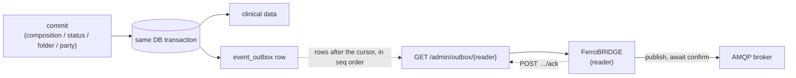

# Change events (outbox feed)

When something is committed to the CDR, downstream systems often need to know:
an analytics pipeline, a care-coordination service, a cache invalidator.
FerroEHR records a small event for every commit in a transactional outbox and
serves those events to the readers you name over a cursor feed. The events
carry identifiers and metadata, never the record content.

FerroEHR publishes to no message broker. FerroBRIDGE, the family's export and
import server, delivers the events to an AMQP broker such as RabbitMQ from 0.0.15
on: its `[events]` lane reads this feed and publishes each event with its own
exchange, routing keys and queues, and moves its cursor only after the broker
confirmed the event
([FerroBRIDGE issue 1367](https://github.com/FerroHEALTH/FerroBRIDGE/issues/1367)).

<!-- toc -->

## Delivery guarantees

- **No commit without its event.** Every commit writes its event row into the
  outbox in the *same database transaction* as the change itself. A rolled-back
  commit writes none.
- **Ordered, without gaps.** Each row gets a sequence number, `seq`. The feed
  serves the rows after a reader's cursor in `seq` order. A commit that drew a
  lower `seq` and has not ended yet holds a read back until it ends, so a reader
  never acknowledges past a row that becomes visible later.
- **At least once.** The cursor moves only when the reader acknowledges. A
  reader that reads, delivers and stops before acknowledging reads the same
  rows again, so a consumer deduplicates on `contribution_id`.
- **PHI-free envelopes.** An event carries ids, version numbers and metadata.
  To read the clinical content, a consumer calls the authenticated REST API.
- **Commits never wait on a reader.** A reader that is down loses nothing inside
  the retention window. The prune deletes a row only once it is older than the
  window *and* at or below every active reader's cursor.



## Naming the readers

The feed is off until you name a reader. The keys live under `[record.change_feed]`:

| Key | Environment variable | Default | Meaning |
|---|---|---|---|
| `readers` | `FERROEHR__RECORD__CHANGE_FEED__READERS` | `[]` | the readers of the feed, each matching `^[a-z][a-z0-9-]{0,62}$` |
| `retention` | `FERROEHR__RECORD__CHANGE_FEED__RETENTION` | `"7d"` | how long an acknowledged row is kept after its commit |
| `prune_interval` | `FERROEHR__RECORD__CHANGE_FEED__PRUNE_INTERVAL` | `"1h"` | how often the prune runs |

With no reader named, no commit writes an outbox row. At every boot the server
registers each named reader and marks every reader the list no longer names
inactive. An inactive reader keeps its cursor, so naming it again resumes where
it stopped, and it holds the prune back no longer.

```toml
[record.change_feed]
readers = ["ferrobridge"]
```

On Kubernetes the chart renders its `config` tree into the server's
configuration file, so the same keys are `config.outbox.*`.

## Reading the feed

```text
GET  {rest_root}/extensions/v1/admin/outbox/{reader}?limit=100&domain=clinical
POST {rest_root}/extensions/v1/admin/outbox/{reader}/ack?domain=clinical
```

Both routes need the scope `__ferroehr.outbox`, and the product scope does not
reach them. With `[authz.rbac]` on, the caller also needs the admin role, as on
every `/admin` route. Every read is one access record.

A read answers `200` with the events after the reader's cursor, at most
`limit` (1 to 1000, default 100), and an empty list when there are none. A read
moves no cursor:

```json
{
  "reader": "ferrobridge",
  "events": [
    {
      "seq": 42,
      "contribution_id": "0196f1f4-8c3a-7d2e-9b1a-3c5d7e9f1a2b",
      "ehr_id": "7d44b88c-4199-4bad-97dc-d78268e01398",
      "committed_at": "2026-11-02T09:15:00.123456Z",
      "versions": [
        {
          "vo_id": "0196f1f4-8c3b-7a10-8f2e-4d6c8b0a2e4f",
          "kind": "COMPOSITION",
          "sys_version": 3,
          "version_tree_id": "3",
          "change_type": "251",
          "template_id": "vital_signs.v1"
        }
      ]
    }
  ]
}
```

The acknowledgement takes `{"last_seq": 42}` and answers `204` once the cursor
is there. Acknowledging the current cursor again is a `204` too. A `last_seq`
below the cursor, or above the highest row, answers `409` and moves nothing. An
unknown or inactive reader answers `404` on both routes.

### The two outboxes

The clinical and the party domain each keep their own outbox, with their own
`seq` and their own cursor per reader. `domain=clinical` (the default) reads
EHR, composition, folder and contribution commits; `domain=party` reads the
demographic commits, whose `ehr_id` is `null`. A reader that never reads one of
the two holds that outbox's prune back, so read both.

## The event envelope

| Field | Meaning |
|---|---|
| `seq` | the row's place in its outbox |
| `contribution_id` | the contribution the commit made |
| `ehr_id` | the EHR; `null` for a demographic contribution |
| `committed_at` | the commit instant |
| `versions[]` | one entry per changed versioned object |

Each `versions[]` entry carries:

| Field | Meaning |
|---|---|
| `vo_id` | the versioned object's identifier |
| `kind` | the full RM type name: `COMPOSITION`, `EHR_STATUS`, `EHR_ACCESS`, `FOLDER`, or one of the demographic kinds (`PERSON`, `ORGANISATION`, `GROUP`, `AGENT`, `ROLE`, `PARTY_RELATIONSHIP`) |
| `sys_version` | the version ordinal |
| `version_tree_id` | the version-tree id, so a branch version is distinguishable from a trunk one |
| `change_type` | the numeric openEHR audit change-type code: `249` creation, `250` amendment, `251` modification, `523` deleted, `666` attestation, and the other members of that code group |
| `template_id` | the composition's operational template, or `null` |

An **erasure tombstone** tells each reader that an EHR or a party was
physically deleted, so it deletes what it derived (GDPR Art. 19). It carries
`"event": "erase"`, the erased `ehr_id` (or, for a party, `"ehr_id": null` and
the party's `vo_id`), and a `versions` list of entries whose `change_type` is
`erase`, with no `contribution_id` and no `committed_at`.

### What the feed leaves out

A commit to an EHR that carries a restriction (GDPR Art. 18) or an
unoverridden research objection (Art. 21(6)) writes no event. A read also leaves
out the rows of an EHR that carries such a mark, or an EHDS Art. 8 access
restriction of the EHR or of an object the commit touched, at the moment it is
read. Such a row is served once the mark is lifted, as long as the reader's
cursor has not passed it.

## Moving from FerroEHR's own RabbitMQ publisher

Earlier releases of FerroEHR published to RabbitMQ themselves, under
`[events]`, with subscription rows under `/admin/event_subscription`. Both are
gone. To keep the events flowing to the same broker through FerroBRIDGE 0.0.15
or later:

1. Name FerroBRIDGE's reader in `[record.change_feed] readers` and give its client the
   `__ferroehr.outbox` scope.
2. Configure FerroBRIDGE's events lane with the broker URL, the exchange and
   the queues your subscriptions used to declare.
3. Remove `[events]` from FerroEHR's configuration, `secrets.eventsUrl` from the
   chart values, and `plaintext_broker` from `deployment.accepts`: the server
   refuses to start on any of them.

A new reader starts at cursor `0`, so FerroBRIDGE delivers every row still in
the outbox: the ones the publisher had not sent, and the ones it had sent inside
the retention window, which a consumer that deduplicates on `contribution_id`
skips.
