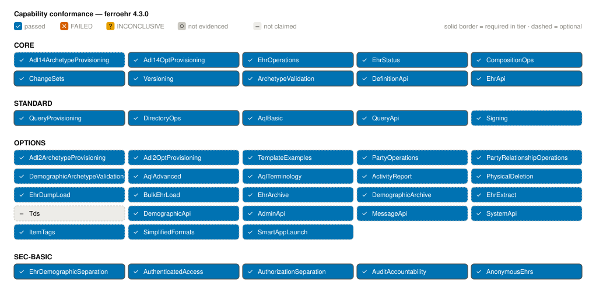

# Conformance

FerroEHR makes a measured claim: it is an openEHR-spec-conformant Clinical Data
Repository, and that claim is backed by a test run you can reproduce. This
chapter explains what conformance means here, how to run the suite against
FerroEHR, and how to read the artefacts it produces.

<!-- toc -->

## What is measured

Conformance is checked by **[Veredictum](https://github.com/Vernum-Projecten/Veredictum)**,
a separate CNF 2.0 reference runner. It lives in its own repository, has the
same maintainer as FerroEHR, and is consumed here at a pinned version. It is a data-driven
interpreter over a committed, machine-readable catalogue authored from the openEHR
Conformance framework itself: protocol-neutral case cores anchored on the official
platform test schedule (case ids follow the schedule's own naming, e.g.
`I_EHR_SERVICE.create_ehr-main`), per-operation bindings mapping every outcome to
its cited wire expectation, closed vocabularies for outcomes/selectors/captures, a
provenance-stamped corpus (the official openEHR Robot data sets re-adjudicated to
spec-text-only evidence), and a typed ambiguity register; a specification silence
is never resolved privately. Every expectation traces to specification text, never
to any server's observed behaviour. The catalogue spans the schedule's chapters:

| Chapter | Scope |
|---|---|
| EHR / EHR_STATUS | EHR service and status operations |
| COMPOSITION / CONTRIBUTION / DIRECTORY | Clinical content, change sets, folder trees |
| DEFINITION | ADL 1.4 + ADL 2 template and stored-query provisioning |
| QUERY | AQL query execution with committed result-set grounds |
| CONTENT | Reference-Model and archetype-constraint accept/reject tables |
| DEMOGRAPHIC / ADMIN / MESSAGING | Party, admin, and messaging services |
| SYSTEM | The `OPTIONS` capability/conformance manifest |
| SF | Simplified formats — FLAT and STRUCTURED commit/read, context, examples |
| SEC / SIG | Authenticated access, authorization separation, audit accountability, and version signing in both depths |
| SMART | SMART App Launch discovery and resource-scope enforcement |
| PERF | The measured performance classes ([Performance](performance.md)) |

The run is what turns cases into a claim. **Verdicts are computed, never
asserted**: a pure function rolls per-case outcomes up through the
capability→tier matrix from the CNF Profiles book into Core / Standard / Options /
SEC-BASIC profile verdicts, honouring the party statement's declared capabilities
and option selections. A case whose wire does not exist on the technology profile,
or whose ground a shared server cannot establish, is recorded as _not applicable
with a machine-readable citation_ rather than silently omitted.

> [!NOTE]
> The runner publishes a JSON Schema for every artefact family it writes, so a
> consumer can validate a record without trusting the tool that produced it. The
> instrument is built from the currently pinned specifications (AQL 1.1.0,
> Terminology 3.1.0, ITS-REST 1.1.0, and the Reference Model generation the
> system under test runs, for FerroEHR the default `development` profile,
> RM 1.2.0; the composed stack takes the profile from configuration, so a
> `stable`-profile run is the same catalogue against the released generation).
> The upstream Robot suites are reference material; their official data fixtures
> enter the corpus only as provenance-stamped re-adjudications.

## The current result

The whole conformance story in one picture: every capability of the claims
matrix, grouped by profile tier, colored AND glyph-marked by the evidence its
cases produced (both charts are generated from the committed runner artefacts and
regenerate-and-diff guarded in CI; no number on them is hand-typed):



The same run broken down two levels deep: a header per schedule chapter with its
total, then one bar per **band**, the surface a case actually exercises (EHR
resource, EHR_STATUS, COMPOSITION, …), with the exact outcome counts printed
beside every row. Every band the taxonomy declares is drawn, so one with no case
for this run shows as an explicit `no cases` row rather than disappearing, and a
hatched segment marks cited-N/A so it reads as neither a pass nor a failure:


The published run against FerroEHR reports:

<!-- Generated at build time from docs/conformance/ferroehr/results.json by
     scripts/render/conformance-stats.sh — never hand-type numbers here (CI:
     scripts/checks/conformance-numbers.sh). -->
{{#include ../generated/conformance-stats.md}}

Cases that did not execute are not-applicable with a machine-readable citation (an
unrealized wire on this technology profile, an undeclared option branch, or a
ground a shared server cannot establish), never silent omissions. Options
aggregates optional capabilities under the Profiles book's "any passes" rule.

## The party set

The runner is a separate project with its own release line, so the instrument
and the system it judges do not share a build. It assesses any openEHR CDR
reachable over HTTP; this repository runs it against FerroEHR alone. What it
reads about FerroEHR is the party set under `docs/conformance/party/ferroehr/`:

- **`statement.json`** claims the capability folders of the catalogue FerroEHR
  serves and selects one arm of every option the catalogue leaves to the
  implementation (canonical XML on each resource, the Simplified Formats,
  version signing, the administrative delete, and the others). Each arm states
  what the server does, and `veredictum validate --statement` holds the file to
  the published statement schema and the catalogue before a run.
- **`ixit.json`** describes the deployment: the `system_id` the server stamps
  into commit audits and the version ids it mints, the `environment` a measured
  run happened on, and `exclusive_server`, which lets the workflows that delete
  every EHR run.

Credentials are in neither file. The run reads them from the environment.

## Running the suite yourself

The suite runs against a real, deployed server (the same container image and
stack a deployment uses), so the wire under test is always the production
artefact. From a checkout with Docker or Podman available:

```bash
bash scripts/conformance.sh
```

The script reviews the statement, composes one FerroEHR deployment from the
current sources on fresh volumes, runs `veredictum test` through the pinned
release image with the Basic users of `docker/ferroehr.dev.toml` and the SMART
Platform base URL, writes `results.json`, `recording.har` and the JUnit, CTRF
and Markdown views `export` renders to `docs/conformance/ferroehr/`, and tears
the stack down. The recording holds the server's response bodies, so it is
never committed.

`CONF_PROFILE` picks the specification text the case citations are read
against. `released`, the default, is the frozen openEHR release: it is the
record and alone backs a released claim. `development` is the pinned `master`
of each openEHR repository, the text FerroEHR builds on (RM 1.2.0, BASE 1.3.0);
its views go to `docs/conformance/ferroehr-development/` and are never mixed
into the record.

Useful knobs: `CONF_DOCUMENTS` to narrow the run to named documents (a working
tool, never the record), `CONF_OUT` for a different artefact root,
`CONF_NO_COMPOSE` with `CONF_BASE_URL` to run against an already-deployed
FerroEHR, `SKIP_BUILD` to compose a published image instead of building from
source, and `CONTAINER_ENGINE` to choose between Docker and Podman.

The script also takes one stage: `review` runs `veredictum validate
--statement` alone, `up` composes the deployment and leaves it serving, and
`down` removes it with its volumes. The Conformance workflow uses these stages
to run the same deployment in CI. It compiles no server of its own: it judges
the server another lane built for the commit, runs `up`, and drives the
catalogue through the Veredictum GitHub Action, pinned by
commit SHA, on the same release image by digest, twice: once under the
`released` profile and once, on fresh volumes, under the `development`
profile. Both runs include the SMART documents. The released run decides the
job: it fails on a failed or errored row there. Each run's Markdown summary
goes on the job summary under its own heading, and each profile's results,
JUnit and CTRF views are kept as an artifact of their own.

Which server a run judges depends on the event:

| Event | Server under test | Called from |
|---|---|---|
| A pull request or the merge queue, when the change touches the server, the party set, the conformance compose files or the workflow | the binary CI compiled for the change, packaged into the runtime image | the CI workflow |
| A push to `main` | the server and database images the Containers workflow pushed for that commit, by digest (`:main` for an image the push did not rebuild) | the Containers workflow |
| A release tag | the release pipeline's own images, built cold, by digest | the Release workflow |
| Twice a week, or by hand | `ghcr.io/ferrohealth/ferroehr:main`, or the image a manual run names | the Conformance workflow |

The README badges come from the runs on `main`: every push and the twice-weekly run.

### The posture a run covers

The one deployment runs the SMART resource-server role with a trusted test
issuer, digest version signing, and FerroTERM as its terminology server, in the
**fail-open** posture.

- **SMART is part of the posture.** The tokens the SMART documents present are
  signed by a committed test issuer: public test key material for the harness,
  never usable for anything else.
- **External terminology is part of the posture too.** An archetype can
  constrain a coded element to a value set only an external terminology query
  server can resolve, so the pipeline composes a real FHIR R4B server beside the
  CDR, seeded with synthetic test code systems and value sets. That covers AQL
  `TERMINOLOGY()` resolved through the routed server, and commit-time validation
  of a bound value set. What a deployment does when the value set cannot be
  resolved *at all* is not decided by any openEHR text, so it is a declared
  option arm rather than a verdict.

A measured performance or stress run adds one more posture: rate limiting is
turned off for the duration, because the instruments deliberately offer load past
the server's knee and a throttled request would measure the limiter instead of the
server. Both instruments refuse to write a record if the server answered any
`429`, so a measurement can never be silently limiter-shaped.

## Reading the artefacts

A run writes machine records and three human-readable documents to
`docs/conformance/<sut-name>/`. Each has a distinct job.

### The machine records

`results.json` is the party results record: one outcome per case with its
rows-driven coverage, failing step and reason where applicable, and the excusing
citation for every not-applicable entry, alongside the system-under-test identity,
the runner's verification-pack status, the technology profile, and the ixit
digest. `verdicts.json` is the computed verdict report, and
`run-exceptions.json` registers anything the interpreter itself could not cover.
Every other artefact (the three documents, the badges, the charts) is generated
from these; nothing downstream is hand-edited.

### The conformance report

`CONFORMANCE_REPORT.md` is the honest, scoped record of _this run_: the system
under test, the outcome counts, the per-capability evidence rollup, the
machine-computed profile verdicts, and every not-applicable entry with its
excusing citation. Read this when you want to know exactly what happened and why
any case did not run.

### The conformance statement

`CONFORMANCE_STATEMENT.md` is the concise, generated claim: the supported
specification versions, the declared external data formats (JSON and XML), and the
profile results. Every line is a pure function of the machine verdicts, so the
statement can never claim more than the run proves.

### The conformance certificate

`CONFORMANCE_CERTIFICATE.md` follows the structure of the openEHR conformance
certificate template: the system under test, the scope of test, and a
per-capability profile report showing which capabilities are required in each
profile, what each was verified against, and whether each passed. The
**Realization** column separates capabilities verified over released ITS-REST
operations from any verified over routes a product serves of its own design — the
latter never gate an openEHR profile tier. Where the certificate carries a
measured run, its **Workload Coverage** table additionally shows which claimed
capabilities the hospital-simulation load actually exercised; a capability the
simulation does not reach must carry an adjudicated exclusion, printed with its
reason, and the runner's validation gate refuses an artefact tree that leaves such
a row undecided. It always identifies itself as a framework assessment with the
claim computed from the attached run; it is never an official openEHR
certification. This is the document to hand to a procurement or evaluation
reviewer who wants the capability-by-capability picture.

> [!TIP]
> The conformance badges in the project README are generated from the same run
> and carry the measured amounts (per-profile capability counts, the overall
> driven-case count, the earned performance class). A badge can never show a pass
> unless the machine verdict does, so a green badge is a claim you can
> immediately reproduce with `scripts/conformance.sh`.

## What conformance does not cover

The catalogue measures the openEHR platform surface, including the simplified
(FLAT/STRUCTURED) formats chapter of the ITS-REST specification. It deliberately
does not stand in for a performance benchmark: durations recorded during the
functional run are telemetry only, and the measured classes own that claim
([Performance](performance.md)).

The other honest boundary is the gap between openEHR's *service* model and its
*released* REST wire. Several service operations were never surfaced as
endpoints (listing an EHR's contributions, counting stored templates or queries,
deleting a template or a stored query) so a case that addresses one has no wire
to drive on this technology profile. Those cases are excused through the
schedule's typed ambiguity register, with the citation printed in the report, and
reported as an explicit scope exclusion on the certificate; never a silent pass
and never an unavoidable failure. FerroEHR does serve routes of its own design
for several of them (see
[Admin & messaging APIs](operations-admin-apis.md) and the archetype routes in
[Templates & validation](templates-validation.md)); those are marked
`extension` on the certificate and never gate an openEHR profile tier.
