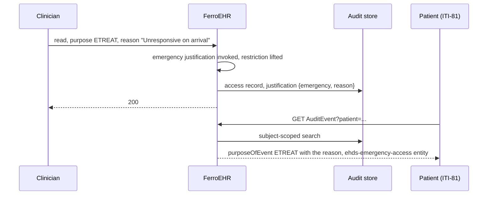

# The EHDS logging elements

How each element EHDS Annex II 3.2 asks a log to record maps onto FerroEHR's records.

<!-- toc -->

## The EHDS logging elements, mapped

Annex II 3.2 of [Regulation (EU) 2025/327](https://eur-lex.europa.eu/eli/reg/2025/327/oj)
lists five things the European logging software component must record "on every
access event or group of events". This is where each one lands, or does not.
The elements were read from the published text on 2026-09-10; the regulation is
the authority and the wording below is a paraphrase.

| Annex II 3.2 | Access-event field | DICOM PS3.15 | FHIR `AuditEvent` | State |
|---|---|---|---|---|
| (a) the healthcare provider or other individuals having accessed | `provider` of the binding (the provider of the caller's party binding, read from the CDR), or the `organisation` record of a verified external organisation | — (no such attribute) | the `acts-for` detail of the `ehds-accessor` entity | Recorded |
| (b) the specific natural person or persons having accessed | `principal` (+ `token_id`, `client_ip`), and `professional_id` + `acting_mode` for a caller its issuer classifies as a person or a delegate | `ActiveParticipant/@UserID` (the professional; a client application acting for one is a second, non-requesting participant; the token subject is `@AlternativeUserID` when it differs) | the `agent:user` slice, `who` the token's issuer and subject, the professional's identifier as its `ihe-otherId`, and the client application as an agent of its own (BALP 1.1.4 §3:5.7.5.4) | Recorded |
| (c) the categories of data accessed | `categories` + `category_basis` + `category_evidence` + `category_map_digest`, classified by `ehds-logging` through the audit category register (beside `resource_class`, `domain` and `result_count`) | none (no such element) | the `entity` named `ehds-categories`, with one `ehds-category` detail per category and its basis, each id the classification read and the map digest; each category is also a `meta.security` label | Recorded |
| (d) the time and date of access | `recorded_at` | `EventIdentification/@EventDateTime` | `recorded` | Recorded |
| (e) the origin or origins of data | `origins` + `origin_count` (the `FEEDER_AUDIT` originating systems of the served version bodies, or the server that created them, derived at commit onto `version.origins`) | — (no such element) | one `entity` named `origin` per origin, its `system-id` detail the originating system | Recorded |

Read (a) beside (b): they are both about the accessing side, and the pair
distinguishes the **organisation** on whose behalf the access happened from the
**natural person** who made it. The principal answers (b); the provider of the
caller's party binding answers (a). It is read from the CDR, never from a token
claim, so the provider a record names is the one the deployment bound the
caller to. A caller with no binding, such as a Basic user with no `PERSON`,
leaves it empty rather than guessed.

Element (b) asks for a **natural person**, and a bearer token can name a client
application instead. Each issuer's [`kind` and profile](security.md#assurance-level-and-the-natural-person-on-patient-data)
classify the caller, so every record says which it was and who stood behind it:

| Field | Meaning | DICOM PS3.15 | FHIR `AuditEvent` |
|---|---|---|---|
| `acting_mode` | `person` when the token names a natural person, `client` when it names a client application | the participant split below | the agent split below |
| `professional_id` | the natural person: the person's own claim, or the professional a client token acts for | `ActiveParticipant/@UserID` of the requesting participant | the `ihe-otherId` extension of the `agent:user`, typed `NPI` |
| `principal` | the token subject, as before: the client application in `client` mode | a second `ActiveParticipant` with `UserIsRequestor="false"` and the network address; `@AlternativeUserID` in `person` mode when it differs from the professional | `agent:user` `who.identifier`, with the issuer as its system; the acting mode is its first `role` |
| `assurance_level` | the eIDAS level (`low`, `substantial`, `high`) the token's assurance claim maps to under `[authz.assurance]` | none (no such attribute) | the `ihe-assuranceLevel` extension of the `agent:user` |
| `assurance_value` | the raw claim value the level was read from, usually `acr` | none | none |

[PS3.15 §A.5](https://dicom.nema.org/medical/dicom/current/output/chtml/part15/sect_A.5.html)
gives `ActiveParticipant` no assurance attribute, so the DICOM message and the
syslog feed carry no level. The FHIR export carries the level as the BALP
`ihe-assuranceLevel` extension (BALP 1.1.4 §3:5.7.5.4) and never the raw claim
value, which lives in the local store's column only. The tamper-evidence digest covers both columns, like every other column of
the record (see [Tamper evidence](audit-integrity.md#tamper-evidence) for records written before
the digest was versioned).

For a system caller the mode and the professional stay empty and (b) is
answered by `principal`, which names the client application. Without `[authz.assurance] levels` the level stays empty;
the raw value is still recorded when the token carries the claim. A Basic
credential records none of the four.

Element (c) asks for the **priority category** of the data, in the sense of
Art. 14(1): patient summaries, electronic prescriptions, electronic
dispensations, medical imaging, medical test results and discharge reports,
plus any category a Member State adds in national law. AQL selects archetypes
and templates, never categories, and no openEHR specification maps the one
onto the other, so the deployment declares the mapping in
[the audit category register](installation/config-audit.md#the-audit-category-register), an
[admin register](access-policy.md#the-admin-registers): a
template id, or failing that the root archetype id, maps to a set of categories
(a priority category by its code in HL7 Europe's
`EEHRxFDocumentPriorityCategoryCS`, such as `Patient-Summaries` or
`Laboratory-Reports`, a national category as its `<system>|<code>`), or to
`none` for content that holds no data of any category. While you declare no
template and no archetype, the map FerroEHR ships applies: the published CKM
templates and COMPOSITION archetypes whose data sit in one priority category
([the shipped map](installation/config-audit.md#the-audit-category-register)). Your own
map replaces it, and `ehds-logging` classifies each access through the map in
force.

Each record is classified when the access happens, from what it served or
wrote, and never at commit, because the map is your reading of your templates
and can change:

- a composition read or write is classified by the version's template id, then
  by its root archetype id;
- an AQL execution is classified by the template and root archetype ids of the
  versions its result page came from; where the answer carries no version (a
  `DISTINCT` or aggregate projection, or zero rows) by the query's positive
  archetype and template constraints, so an operand under `NOT CONTAINS` or a
  predicate under `NOT` never counts. Every id the query constrains to must be
  mapped, and every content operand bound to an id, or the record is
  `unclassified` beside what did map. Each per-EHR record of a query carries
  the categories that EHR disclosed;
- a logical delete writes no content, so it is classified by the version it
  deleted; a `VERSIONED_COMPOSITION` read by the composition it holds;
- a `CONTRIBUTION` read, with or without `Prefer: resolve_refs`, is classified
  by the versions the contribution committed, a deleted version again by the
  version it deleted;
- an EHR Extract export is classified by every version it carried, and an
  Extract import by the newest content of every versioned object it landed;
- `EHR`, `EHR_STATUS`, `EHR_ACCESS`, the directory, item tags and revision
  histories are recorded as `none`, by resource kind.

An access the map cannot classify is recorded `unclassified`, with the
template and archetype ids as evidence, and is never refused; the FHIR record
says why (`unmapped`, `unbound`, `named-nothing`). A stored category is its
`<system>|<code>` token. `category_basis` says what the classification was read
from (`returned`, `written`, `queried` or `resource-kind`; records written
before 5.3.2 carry `template`, `archetype` or `query` and the earlier
spellings), and `category_map_digest` names the map that produced it, so a
later map never rereads an old record. The map's
digest is also on the boot line and on `GET /management/info` under
`audit.category_map`. The classification stays in the access log: it is never
written to the request log, a span or a metric label. The DICOM rendering has
no element for it (PS3.15 §A.5), so it travels in the local store and the FHIR
export only.

Records in the demographic domain carry no classification, because no
priority category lives there.

Element (e) asks where the DATA came from, which is not where the request came
from. openEHR models that provenance as `FEEDER_AUDIT` on the content itself,
so every committed version records the distinct set of
`FEEDER_AUDIT.originating_system_audit.system_id` values found in its body, or
this server's own system id when it carries none. A composition, status or
folder read then records the origins of the version it served, and an AQL
execution the union over the version rows its result page came from. The record
carries the true distinct count beside a set capped at 32, so a page drawing on
more origins than that says how many rather than looking complete. A version
committed before the column existed is assessed when it is read.

One further element, adjacent to the five: **the declared purpose of use
reaches one export of the two**, and only one of them could carry it. It is
stored on the record, served by ITI-81, and rendered as
[`agent.purposeOfUse`](https://hl7.org/fhir/R4/auditevent.html) on the
requesting person's agent in the FHIR export. A declared code carries no
system: the vocabulary is the one you agree with your callers in `[audit]
purpose_codes`, which has no published code system URI, and attributing the
code to a system it does not come from would misdescribe it. A purpose the
access token states keeps the system the token gives it.
The
[DICOM Audit Message schema](https://dicom.nema.org/medical/dicom/current/output/chtml/part15/sect_A.5.html)
of PS3.15 §A.5 defines no purpose element at all (`EventIdentification`,
`ActiveParticipant`, `AuditSourceIdentification` and
`ParticipantObjectIdentification`, and none of them carries one), so on that
side it is a limit of the format, not something this code withholds.

### Where the purpose of use comes from

The purpose of use reaches the record from two places:

- **The access token.** An issuer with an `[auth.issuer.<name>.attributes]` table
  (`mapping = "iua"`) states its professionals' attributes in the token: the
  IHE IUA `purpose_of_use` and `subject_role` claims under
  `extensions.ihe_iua` (IHE ITI TF-2 §3.71.4.2.2.1.1), and with
  `authorization_details_purposes` the `purpose_of_use` of each RFC 9396
  `authorization_details` entry. The record stores them in
  `token_attributes`, and both renderings write them with their code systems:
  the purposes at the requesting agent's `purposeOfUse`, the roles at its
  `role`, beside the roles the caller held.
- **The `[audit] purpose_header`** (`x-purpose-of-use`), which the caller
  sets. It works alone for an issuer without an `[auth.issuer.<name>.attributes]` table,
  as before.

The token is the authorization server's statement, so it decides. A request
whose header names a purpose the token, which states purposes, does not
state is refused with `403`, and the refusal is recorded as a failed
authentication naming the caller and the token's purposes. A header naming
one of the token's purposes is admitted and recorded with both. Which source
wins is FerroEHR's own design; no openEHR specification governs the purpose
of use.

> [!NOTE]
> Every row of this table is asserted by a test
> (`app/ferroehr/tests/it/audit_ehds_mapping.rs`), **including the gaps**: the
> tests that record an absence fail the day the field arrives, so the table and
> the code cannot drift apart in either direction.

The common specifications the regulation's Article 36 provides for have not
been adopted. When they are, this mapping is re-verified against them rather
than assumed to still hold; see the
[EHDS readiness page](https://ferrohealth.eu/docs/ehds/readiness.html).

### The binding outcome

Every record of an authenticated request carries `binding`: how the caller
was bound to a demographic party, or why the binding refused it. The
committer the same request writes into a version is on
[Who is the committer](security/committer.md). It answers
Annex II 3.2(a) and (b) where the token's subject alone does not. The columns
beside it hold what each outcome needs:

| `binding` | The caller | Recorded beside it |
|---|---|---|
| `bound` | a person bound to a `complete` `PERSON` | `party`, `party_groups`, `provider`, `representation` for a representative, `actor_chain` for a delegated token |
| `provisional` | a person bound to an `incomplete` `PERSON` | `party`, `party_groups`, `provider` |
| `external` | a verified external person of a `federation` issuer | `external_fields`, `agreement`, `provider` |
| `organisation` | an organisation under an agreement with `accessor = "organisation"` | `external_fields`, `agreement` (with its legal ground and access class, and for a `chained` request `correlation_id` and `correlation_source`), `provider` |
| `system` | a client acting for nobody | `party`, the client's `ACTOR` in the policy parties; `provider`, the identifier of the `ORGANISATION` its acts-for relationship targets; `facilities` of the compositions it committed |
| `self` | the record's person, whose login the party binding binds to the `PERSON` an EHR's subject names | the principal; `party`, that `PERSON` |
| `refused-*` | a refusal of the binding or of a caller kind: `unbound`, `ambiguous`, `inactive`, `abandoned`, `deprovisioned`, `wrong-marker`, `representation-unrecorded`, `key-claim-missing`, `groups-unavailable`, `external-incomplete`, `trc-patient-mismatch`, `trc-missing`; and of a caller kind, `system-personal-scope` (a system caller holding a `user/` or `patient/` scope), `no-agreement` (no federation agreement admits the accessor) and `scope-beyond-agreement` (an external caller holding a scope its agreement does not read) and `correlation-missing` (a `chained` organisation request without an attested correlation id) | `party` for a party refused for its state or marker, `binding_detail` for what else the refusal names (`represented`, the subject a representative asserted; `claim`, the name of the key claim a token lacked, never its value) |

`acting_mode` is `person`, `delegated` for a person through a declared client
or actor, `external` for a verified external accessor and `system` for a client
acting for nobody (`client` remains on records written before). The FHIR
`AuditEvent` writes each mode as the person's `agent.role`. A record of a
request with no authenticated caller carries no binding. The columns are in the
chain digest: version 2 hashes them, version 3 adds `token_attributes`, a new
record is version 3, and a record written before keeps verifying under its own
version.

#### The binding fields in the renderings

Neither BALP 1.1.4 §3:5.7.5.4 nor DICOM PS3.15 §A.5 has an element for the
binding fields beyond the bound person, so `ehds-logging` writes them as
details of two entities it adds, and FerroEHR hands it every field. The FHIR
`AuditEvent` carries each entity as an `entity` with its `name` and one
`detail` per value. The DICOM message carries each as a
`ParticipantObjectIdentification` of type `4` (Other) with the entity name as
its `ParticipantObjectName` and one `ParticipantObjectDetail` per value
(RESTful ATNA Rev. 3.6 Table 3.20.4.2.2.1-1), and the ITI-20 syslog feed
sends that message. Both renderings take the detail list from
`ehds-logging`, so they never disagree.

| Recorded field | Rendered as |
|---|---|
| `binding` | `ehds-accessor`: `binding`, with `security-event` for `refused-trc-patient-mismatch` and `refused-trc-missing` |
| `party` | `ehds-accessor`: `party` as `<namespace>\|<type>\|<id>`; in the FHIR `AuditEvent` also the person's `otherId` typed `PRN` |
| `party_groups` | `ehds-accessor`: one `group` per group, in the party's namespace with type `GROUP` |
| `provider` | `ehds-accessor`: `acts-for` as `<issuer>\|<id>` |
| `facilities` | `ehds-accessor`: one `facility` per facility, as `<issuer>\|<id>` |
| `representation` | `ehds-accessor`: `represents`, `represents-ground` and `represents-relationship`; a refusal's `represented` as `represents` alone |
| `actor_chain` | `ehds-accessor`: one `actor` per actor, `<issuer>\|<subject>`, outermost first |
| `binding_detail` | `ehds-accessor`: `binding-claim` for `refused-key-claim-missing` |
| `external_fields` | `ehds-relayed`, marked `asserted` and naming the issuer by `relayed-issuer`: each 2026/2099 Annex field and eHDSI SAML attribute at its own detail (`hp-family-name`, `hp-identifier`, `provider-identifier` and the others), `consent.reference` as `agreement-consent`, and every other field as `asserted-field` `<name>=<value>` |
| `agreement` | `ehds-relayed`: `agreement-name`, `agreement-version`, `agreement-legal-ground` and `agreement-access-class` |
| `correlation_id`, `correlation_source` | the FHIR `AuditEvent`: `correlation-id` and `correlation-source` of the request id's entity; the DICOM message: the same two details of `ehds-relayed`, since it carries no request entity |
| `acting_mode` | the FHIR `AuditEvent`: the person's `agent.role`; DICOM: none |

Every value goes through the renderers' escape: a control character, a
bidirectional control or a line separator is written as its code point, and
no value is cut. A DICOM detail value is base64-encoded as given (PS3.15
§A.5.1.1). A binding record that lacks a field its code needs fails the
rendering, and the sender reports the failure, never a record without the
binding.

### Refusal records and their budgets

Every refused request is recorded as a failed user authentication, through the
same path as an operation record: a refusal whose record cannot be written is
answered `503`. A refusal of
the login binding or of a caller kind carries its `refused-*` code. Refusals
are charged to one of two budgets, which never draw on each other, so a flood
of invalid tokens cannot hide a verified caller's probing:

| Budget | Charged to | Per caller in a window | Per window |
|---|---|---|---|
| Failed verification | the source network: the `/24` of an IPv4 address, the `/64` of an IPv6 one | 10 | 1000 |
| Verified caller | the token's `iss` and `sub` | 10 | 1000 |

A window lasts 60 seconds. Past a caller's 10 records the rest of its
refusals in that window become one summary record, written when the window
closes: it names the caller and carries `summary`, the count and the EHR ids
the refused requests named (at most 64, while the count stays exact). Past a
budget's 1000 records, the refusals of every caller not yet recorded in that
window become one summary record per issuer and outcome, naming no caller. A
security event (`refused-trc-patient-mismatch`, `refused-trc-missing`) is
recorded once for every answered request and never summarised. A federation
caller above its agreement's `caller_rate`, a contact point's included, is
answered `429` before any patient lookup, and every such refusal goes into
that caller's summary record from the first, with `binding_detail` naming
`caller-rate`, so the count of security events stays bounded. A refusal
record the system log cannot take is counted in
`atna_audit_refusals_unwritten` and logged at `error`.

> [!NOTE]
> The limits, the windows and the budgets are kept **per replica**. Behind a
> load balancer with three replicas, one caller can have up to 30 refusals
> recorded one by one in a window before the summaries begin, and each replica
> writes its own summary records.

### Access through FerroBRIDGE's FHIR facade

The openEHR REST API carries no end-user identity on a read, so when
FerroBRIDGE's FHIR facade reads or writes through FerroEHR, FerroEHR's record
names the bridge's credential under (b) and cannot name the natural person
behind the FHIR request. From FerroBRIDGE 0.0.16 the bridge records each
facade access itself when its `[audit]` section is on: it writes the Annex II
3.2 record with the person, the categories, the time and the origin through
the same `ehds-logging` crate, and sends it as an IHE BALP `AuditEvent`
through `ihe-atna` over the ITI-20 FHIR feed to the Audit Record Repository
you configure there. The bridge refuses a facade access whose record it
cannot take. Read the two records together: FerroEHR's says which data left
the CDR and to which client, and FerroBRIDGE's says which person asked for
it. FerroBRIDGE's
[access record](https://ferrobridge.eu/docs/operate/access-record.html) page
describes its record and its configuration.

### Justified and emergency access

A clinician opens a record outside their care relationships on a
[justification](access-control.md#justified-access-outside-the-care-relationships)
of your access policy, with a reason in `x-access-reason`; an emergency is a
justification that also lifts what EHDS Art. 11(5) lets an emergency lift.
Art. 11(5) requires such cases to be "logged in a clear and understandable
format" and "easily accessible for the data subject", and Art. 9(1) and
Annex II 3.2 count every access among the ones the person is told about.
FerroEHR records what the access decision rested on, never what the request
merely declared:

- **The stored record:** the `justification` column holds the kind
  (`justification` or `emergency`) and the reason as the clinician wrote it.
  It is `NULL` for an access that rested on a care relationship or anything
  else, and for a refused justified access, which names its refusal
  instead; an emergency is recorded even when the access was refused.
- **The access-log entry:** the `justification` or `emergency` authorisation
  under `ACCESS_POLICY` and its version, with the `reason`.
- **The FHIR `AuditEvent`:** the reason is the `text` of the
  `CodeableConcept` beside the declared code on `purposeOfEvent` and on the
  requestor's `agent.purposeOfUse` (FHIR R4 `AuditEvent`, IHE BALP). An
  emergency also carries the `entity` named `ehds-emergency-access` that
  `ehds-logging` writes, whose `description` states the mark in plain words
  ("Emergency access: the accessor declared that the access was necessary
  to protect the vital interests of the data subject (Regulation (EU)
  2025/327 Art 11(5)).") and whose `ehds-emergency-purpose` detail names the
  purpose that invoked it. An app keys on the entity and shows its
  description, and shows the reason for every justified access.
- **The DICOM syslog feed:** neither the reason nor the mark; the message
  FerroEHR writes there carries no purpose of use.

The person reads their own log, every justified access included, through the
[subject-scoped ITI-81 retrieval](audit-integrity.md#retrieving-audit-records-iti-81), and the
access-log resource filters on `justification=justification` or
`justification=emergency`.

A justification lifts no restriction of the patient. A composition or EHR
restricted under GDPR Art. 18 stays refused with any justification, an
emergency included, because Art. 18(2) admits processing only with consent,
for legal claims, for the rights of another person or for an important
public interest, and the person's own vital interests are not on that list.
An EHDS Art. 8 restriction of access by health professionals yields only to
an emergency justification, where the directive's `emergency_override`
holds
([restriction of access](access-control.md#restriction-of-access-by-health-professionals-ehds-art-8)).

### Retention, and who chooses it

The controller decides how long the log keeps a record, in its access policy
(`ACCESS_POLICY.log_retention`, written through
[`/admin/access_policy`](operational-policy.md)). FerroEHR provides the
mechanism and names no national law of its own. `log_retention` holds:

- `in_union`: whether Regulation (EU) 2025/327 binds the controller. When it
  does, Art. 9(2) keeps the access information "available for at least three
  years from each date of access to the data", and FerroEHR refuses a shorter
  period.
- `period`: how long each record is kept from the date of access, in whole
  years (`P5Y`) or whole days (`P1826D`). Absent keeps every record without
  end.
- `floors` and `ceilings`: the minimum and maximum periods the controller's
  law sets, each with the provision that sets it, coded in the terminology the
  jurisdiction names (an `ACCESS_RETENTION_BOUND`).

A policy whose period breaks a floor or ceiling it declares is refused when it
is written, with `400`, and the version in force stays. So is a ceiling below
a floor, a ceiling with no period (a record kept without end outlasts every
ceiling), a controller outside the Union with no floor, and a period in any
unit other than years or days. Years are counted on the calendar: three years
admit `P1096D` as a floor but not as a ceiling, since 1 096 days can outlast
three calendar years. A new version applies to every record written after it,
on every replica, with no restart.

**With no `log_retention`, every record is kept without end.** That meets
every floor, so the log never forgets evidence a data subject's right of access
is served from. It is also undecided: GDPR Art. 5(1)(e) makes the period the
controller's to set. The `log_retention` readiness indicator reads `degraded`
until the access policy states it, and the instance stays in rotation. `ferroehr
config check` reads only the configuration file, so it cannot see the policy;
check the indicator on `GET /management/health` after the first policy write.

A stored policy version whose `log_retention` does not read (a damaged store;
the write check refuses one) is named and held loud. Each replica keeps the
last retention that read and records every access under it, so the access log
never stops, while the reaper purges nothing and the `log_retention`
indicator reads `down`, naming the version, until a version that reads is
committed.

Every record stores the first date it may be deleted on, and the reaper
deletes each record hourly on or after that date and never before it. A
record outside the access log ends the day after its date of access plus the
period in force when it was written.

**An openEHR access-log entry states its own retention.** Each
`ACCESS_LOG_ENTRY` carries an `ACCESS_RETENTION` when it is written:
`retain_until`, the last day it is kept; `grounds`, the provisions that set
the period; and `policy`, the version of the access policy it was taken from.
An entry kept without end states no `retain_until`. The grounds are Art. 9(2)
for a controller in the Union, coded by the regulation's European Legislation
Identifier with the subdivision as the code
(`http://data.europa.eu/eli/reg/2025/327/oj`, `art_9.par_2`), then each
declared floor and ceiling as the controller coded it. The ELI coding is our
own design (Council conclusions 2012/C 325/02 define the identifier). The
same hourly worker replaces every entry whose `retain_until` has passed by an
`ACCESS_LOG_TOMBSTONE` in place, in any order of expiry. The tombstone keeps the
entry's uid, `system_id` and `time_recorded`, names the grounds of the period
that ended, and holds nothing else of the entry; its row keeps the entry's
content digest, so its window's seal verifies after the content is gone
([Tamper evidence](audit-integrity.md#tamper-evidence)). A
tombstone is never replaced again, and the database refuses any other change
to it. An erasure a law orders before the period ends takes the same path
through `POST {ext}/admin/access-log/erase`, with the law's provisions as the
tombstone's grounds; the erasure is an access record of its own
(`access-log-erasure:<uid>`) naming the administrator
([Admin APIs](operations-admin-apis.md)).

**A tombstone is kept as long again, then its window folds.** A tombstone
holds no EHR, no accessor and no purpose, but its content digest is a hash
of the entry it replaced, and a copy of that entry elsewhere (a forwarded
BALP `AuditEvent`, an export, a backup) can be matched against it. It is
kept only while its window needs it to verify (GDPR Art. 5(1)(e)): for one
more retention horizon, its entry's own, so a tombstone stays as long after
its removal as its entry was kept before it. Once every record of a sealed
window is a tombstone past its end, the same hourly run removes the
window's entries and records the window as folded
(`audit.access_log_seal_fold`), with every ground its tombstones named and
when it was folded. The window's seal stays, so the seals still follow one
another, and a record that leaves the log any other way is reported as
tampering. A window folds whole: an entry kept longer keeps its window's
tombstones until it has folded too. An erasure a law orders is a tombstone
like any other and folds the same way. Several replicas fold on a
PostgreSQL advisory lock, so no window is folded twice. The metrics are
`access_log_folded_total` and `access_log_gaps_total`
([Access path](operations-access-path.md)). No configuration key sets the
second horizon. No openEHR specification governs audit retention: our own
design.

**An imported entry ends at its own `retain_until` too.** An entry imported
with an EHR from another system
([Seals, checkpoints and the transfer of a log](audit-integrity.md#seals-checkpoints-and-the-transfer-of-a-log))
keeps the `retain_until` its recording system stated, and the same hourly
run replaces it by its tombstone once that day has passed, on the entry's
own grounds. Its tombstone is kept as long again, as a local one is, and
then folds, leaving its uid, its bundle and its content digest
(`audit.access_log_imported_folded`), so its bundle still verifies. The
metrics count both logs, with `chain` = `local` or `imported`. No openEHR
specification governs this: our own design.

Choosing the period is a legal question for the controller. NEN 7513 is the
Dutch reference for this log and the Besluit vaststelling bewaartermijn
logging sets its five years; SGB V § 309 Abs. 1 caps the German
telematics-infrastructure log at three years; DSV Art. 4 Abs. 5 keeps a Swiss
log at least one year. A controller bound by one of them declares it as a
floor or ceiling with its provision. Art. 9 applies from 26 March 2029 for
patient summaries, prescriptions and dispensations and from 26 March 2031 for
the other priority categories (Art. 105). FerroEHR holds the Art. 9(2) floor,
so a log kept today already meets it when Art. 9 applies. One instance serves one access policy, so two controllers needing
different periods run two instances.
The retention in force is the access policy's (`GET {ext}/admin/access_policy`).
A record takes about 1.2 KB on disk, so the period decides how far the log
grows ([Storage sizing](storage-sizing.md#audit-retention)).

### The access log at steady state

With entries written at a rate of `r` a day and kept for `P` days, the log
levels off once the first tombstones fold, after `2P`:

- the entries of the last `P` days: `r × P ×` the bytes per entry;
- their tombstones, kept another `P` days: `r × P ×` the bytes per tombstone;
- the seals: one row a minute, and one folded-window row for each window the
  fold removed, kept without end.

The performance gate's run summary states the bytes per entry and per
tombstone of the release it measures. `VACUUM` reuses the space a fold frees
for later rows (PostgreSQL 19 docs, Routine Vacuuming, Recovering Disk Space).

### Getting the log out

Three routes, and they answer different questions.

- **The access log over ITS-REST:** the [access-log
  resources](access-log.md#reading-the-access-log-over-its-rest) serve the openEHR
  access-log entries: one EHR's log to the person it is about and their
  representative, and the full log to a reviewer. This is the person's own
  route (EHDS Art. 9(2)).
- **ITI-81 retrieval:** the [audit search](audit-integrity.md#retrieving-audit-records-iti-81)
  serves the records back as FHIR `AuditEvent` resources, filtered by patient,
  agent, date and outcome. This is the operator's route and the one an IHE
  Audit Consumer uses: everything Annex II 3.2 records is reachable through
  it, including the purpose and the organisation, which the syslog feed's
  DICOM form cannot carry.
- **The BALP feed:** records fan out to syslog and to a FHIR feed as they are
  written, for a SIEM or a central Audit Record Repository.
