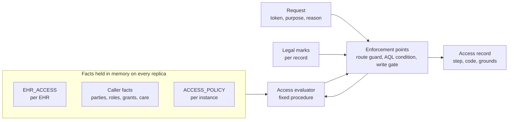
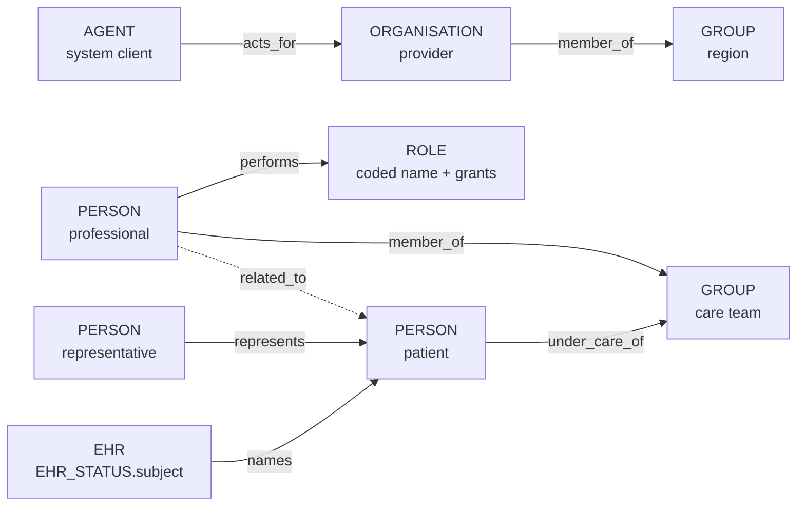
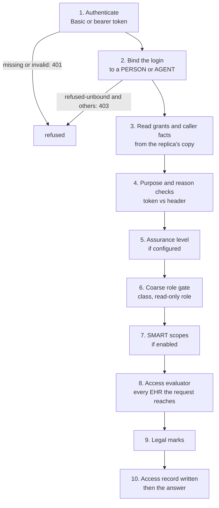

<!-- SPDX-FileCopyrightText: Cadasto B.V. -->
<!-- SPDX-License-Identifier: BUSL-1.1 -->

# How FerroEHR decides access

**For:** integrators, operators and anyone who has to sign off on who can see
a record. This page explains how the parts of the access model relate. The
keys are in [Authentication & access](../installation/config-auth.md), the
policy routes in [Operational policy](../operational-policy.md), and what each
decision records in [Audit trail](../audit.md).

<!-- toc -->

## The model in one picture

FerroEHR decides every request from facts it stores, using one fixed procedure
written in Rust. It runs no policy language and calls no remote decision
point. There are four kinds of fact:

- **The patient's choices**, in the `EHR_ACCESS` object of each EHR. openEHR
  makes that object the authority: "All access decisions to data in the EHR
  must be made in accordance with the policies and rules in this object"
  ([RM EHR IM, `EHR_ACCESS`](https://specifications.openehr.org/releases/RM/Release-1.2.0/ehr.html#_ehr_access_class)).
- **Who the caller is**: the demographic parties the caller's login is bound
  to, the roles they perform, the operations they are granted, and the care
  teams they belong to.
- **The controller's rules**: one versioned `ACCESS_POLICY` that holds for
  every EHR in the instance.
- **Legal marks** on single records: restriction of processing, objection to
  research, access delay and retention hold.

The configuration file holds only what the server needs before it can trust
anything: the token issuers, `[authz.rbac] admin_role`, the floor
`ehr_access_default` and the grant ceiling `[authz.grants] allowed`. Everything
else is data in the CDR. Every change is recorded with who made it, and it
takes effect on the next request with no restart.

openEHR leaves the access model open ("there is currently no published formal,
proven model of access control for shared health information", BASE
Architecture Overview, §Access Control). The concrete settings class, the
policy, the procedure and its refusal codes are FerroEHR's own design. They are
written up as a draft openEHR change request, the package
`org.openehr.rm.access_control`.

## Parties and their relationships

Every person who signs in is bound to a demographic `PERSON`. A login with no
`PERSON` is refused (`403`, `refused-unbound`). A system client is bound to an
`AGENT` by its token issuer and `client_id`. All parties are ordinary openEHR
demographic parties, written through the Demographic API or provisioned over
SCIM.

| Party | What it stands for | What the decision reads |
|---|---|---|
| `PERSON` | A professional, a patient or a representative | Its relationships, the `ROLE`s it performs, the record subjects it declares |
| `ORGANISATION` | The provider, a federation partner, a ward | Its coded type, and its membership of `GROUP`s |
| `GROUP` | A care team, or a regional group of providers | Its members |
| `ROLE` | A function a party performs, with a validity | Its coded name, matched by the policy's rules, and the grants its `CAPABILITY` holds |
| `AGENT` | A system client | Its `client_id` and the organisation it acts for |

A relationship is a `PARTY_RELATIONSHIP` stored in its source party. FerroEHR
recognises each by a code of the `openehr_access` terminology, in whatever
archetype you model it:

- **`acts_for`:** a system client acts for a provider. Its writes and access
  records name that provider (EHDS Annex II 3.2(a)).
- **`member_of`:** a person's membership of a care team, or an organisation's
  membership of a group.
- **`under_care_of`:** the patient is in the care of a team or a professional,
  with a validity and, optionally, an episode of care.
- **`represents`:** a representative acts for the patient. National law decides
  who may represent whom (EHDS Art. 4(2)); FerroEHR stores the relationship
  and its validity and holds no rule of its own.
- **`related_to`:** kinship between two persons. It only ever refuses (a
  conflict of interest) and never grants.

An EHR reaches its patient through `EHR_STATUS.subject`. The subject reference
names the patient's `PERSON`, directly or through an identifier the `PERSON`
declares, so a pseudonymous record still resolves to its party.

Only a caller holding `admin_role` writes a policy party: an `AGENT`, a
granting `ROLE` or an acts-for relationship. A care relationship needs the
`write_care_relationship` grant or `admin_role`. A patient may write a
representation of their own record, which names their proxy. A SCIM client
provisions the workforce only.

## Roles: the coarse gate and the grants

The word "role" means two things in FerroEHR. Keep them apart.

**Token roles** come from the `roles` claim of an access token (RFC 9068
§2.2.3.1). They feed a coarse gate per operation class:

| Class | Who passes |
|---|---|
| Public | everyone (health, status) |
| Authenticated | any authenticated caller |
| Clinical | any authenticated caller with at least one role; the patient and their representative pass with none |
| Admin | a caller holding `[authz.rbac] admin_role` (default `ADMIN`) |

A caller holding `readonly_role` is refused every write, whatever else it
holds. Only the issuers in `role_issuers` may grant `admin_role`, and
`first_admin` names the one Basic user that holds it from the file, so a new
deployment can write its first policy parties. An OAuth scope is never a role
(RFC 6749 §3.3).

**Demographic `ROLE`s** are what the access decision reads. A `ROLE`'s coded
name, such as a nurse or a general practitioner in your jurisdiction's code
system, is matched by the `role` of a rule in the access policy. Its
`CAPABILITY.credentials` may code an operation, which is a **grant**:

| Grant | What it allows |
|---|---|
| `commit_composition`, `compose_for` | A system client commits compositions; a scribe composes for a professional |
| `import_ehr`, `import_ehr_extract`, `export_ehr_extract` | Imports and exports, each scoped to subject namespaces |
| `federated_person_access`, `federated_organisation_access` | A federation agreement with a partner |
| `read_subject_audit`, `access_service` | Reading one subject's access log; acting as an EHDS Art. 10 access service |
| `query_system_wide`, `access_demographic` | A backend client's `system/aql-*` scope; the Demographic API |
| `write_care_relationship`, `write_access_policy`, `write_representation` | Writing care relationships, the access policy, representations |
| `data_origin`, `read_change_feed`, `scim_provision` | A registered data origin, a change-feed reader, a SCIM client |
| `hold_roles`, `hold_scopes`, `create_at_login` | Roles and scopes for a Basic user; admitting a first login |

`[authz.grants] allowed` caps what may be granted at all (default
`commit_composition`), so a compromised administrator cannot grant more than
the operator allows. No grant can carry `admin_role`. In the vocabulary of the
XACML RBAC profile, the `ROLE` is the assignment and the policy rule is the
permission.

## The patient's settings: `EHR_ACCESS`

Each EHR may carry settings of the scheme `access_directives`. An EHR with none
takes the server's `[authz.rbac] ehr_access_default`: `open` (the default)
admits any caller the other layers let through, `restricted` admits only
`admin_role`.

| Part | What it holds |
|---|---|
| `default_access` | `open`, `restricted` (a permit, a gate-keeper or a live care relationship is needed) or `consent_required` (a permit or a gate-keeper is needed) |
| `gate_keepers` | Who controls the settings; "usually the patient for mentally competent adults" (BASE Architecture Overview, §Access Control) |
| `directives` | The patient's consent permits and denies, a `restriction` (EHDS Art. 8), an `opt_out` (EHDS Art. 10) and `delegation`s for representatives (EHDS Art. 4(2)) |
| `labels` | A sensitivity or confidentiality on single objects |
| `marking`, `exclusions` | The record's confidentiality, and the people the controller keeps out of this record |

A directive applies by who it names (`applies_to`: a party, a role, a
relationship, an organisation type, a kind of caller), the operations, the
purposes, the data (templates, archetypes, categories, origins, episodes,
sensitivities) and a validity. It may carry one level of exceptions with the
opposite effect, the "base policy followed by a listing of exceptions" of FHIR
`Consent`. Its `evidence` points at the consent record itself, an
`ADMIN_ENTRY` in the EHR.

A new version is committed by the patient while no gate-keeper is named, by a
named gate-keeper, or by `admin_role` on the patient's instruction. Only those
callers and the patient read the settings, at
`GET {ext}/ehr/{ehr_id}/ehr_access`. To anyone else they are absent: a
restriction must not be visible to a provider (EHDS Art. 8). Only the
controller reads and writes the exclusions.

## The controller's policy: `ACCESS_POLICY`

The instance keeps one `VERSIONED_ACCESS_POLICY`, outside every EHR. Each write
is a new version in its own contribution, read and written at
`{ext}/admin/access_policy` by `admin_role` with the `write_access_policy`
grant. Until you write one, nothing is tightened. Its main parts:

| Part | What it says |
|---|---|
| `rules` | Controller rules, each an `ACCESS_DIRECTIVE` of kind `controller_rule`: which roles and organisation types may reach which data (EHDS Art. 11(3)) |
| `classifications` | The sensitivity and confidentiality of kinds of data |
| `care_relationship_required`, `relationship_grace` | Whether clinical access needs a care relationship, and for how long after it ends |
| `care_purposes`, `episode_shared`, `relationship_validity` | For which purposes care is a ground, which data every relationship covers, how long a relationship may run |
| `purpose_required` | Whether every request must declare a purpose of use |
| `justifications` | Who may reach a record outside their care relationships, for which purposes, and which are emergencies |
| `conflict_rules` | The conflicts of interest the professional path admits |
| `catalogue` | Named directives a patient accepts by reference, such as an IHE BPPC policy |
| `log_restrictions`, `log_retention` | What the patient's view of the access log leaves out, and how long entries are kept |

A deny rule binds every caller except the patient. No permit of the patient
lifts it, since the rule is the Member State's or the controller's. A permit
rule only clears a sensitivity or a confidentiality (step 6).

## Purpose of use, consent and justification

**The purpose of use** travels in the request header `x-purpose-of-use`
(`[audit] purpose_header`), as a code such as `TREAT` from HL7 `ActReason`.
A code outside `[audit] purpose_codes` is recorded as absent. When the token
states purposes (IHE IUA, RFC 9396) and the header names another, the request
is refused `403`. The purpose decides three things: whether a policy with
`purpose_required` admits the request at all, which rules apply (a rule that
names purposes applies only to a request declaring one of them), and whether a
care relationship counts (by default only for `TREAT`, `ETREAT` and
`CAREMGT`).

**Consent** is the patient's directives above. In healthcare the legal basis
is often GDPR Art. 9(2)(h) and not consent, so a directive is a choice the
patient makes under national law, and each carries its own `legal_grounds`.
A partner admitted under a federation agreement whose terms make reads depend
on a consent decision must name that decision in its credential. Otherwise it
is refused `refused-consent-reference-missing`.

**Justified access** is a way in outside the care relationships. The request
declares a purpose that a `justifications` entry of the policy lists, the
entry names the caller (with no `applies_to`, every professional), and the
caller states a reason in the header `x-access-reason` (`[audit]
reason_header`, percent-encoded UTF-8). A request without a reason is refused
`refused-reason-missing`, and a malformed reason header is `400`.

- **A justification** stands in for a live care relationship. It lifts nothing
  the patient set.
- **An emergency justification** (EHDS Art. 11(5)) also lifts a restriction, a
  consent deny, an exclusion or a deny rule whose `emergency_override` holds,
  steps 6 to 8 of the procedure below, and, for an access service, an opt-out
  (Art. 10(2)). The policy is in memory on every replica, so emergency access
  works while the policy store does not answer.

Every justified access is recorded with the reason and, for an emergency, the
emergency mark, so the patient sees it in their access log. The patient and a
representative never invoke a justification.

## Care relationships

Where the policy sets `care_relationship_required`, a professional reaches a
record only while a care relationship is live: the patient is `under_care_of` a
care team the professional is a `member_of`. Where the policy allows it, a
professional states a relationship for themself (`self_declared_care`), or a
federation credential attests one (`attested_care`). The grace period extends
access after a discharge. This is the openEHR "outer
limits ... defined by the interval of the episode of care in an institution
plus some further time" (BASE Architecture Overview, §Security Policy).

A relationship scoped to an episode of care covers only the data placed in
that episode, the data placed in none, and what `episode_shared` names. Other
data are refused `refused-outside-episode`. A query can be narrowed to the
caller's caseload. See [Care relationships and episodes of
care](../care-relationships.md).

## Legal marks

Four marks sit on single records beside the access decision. None is an openEHR
concept, and each is set and lifted through the admin API by the controller.

| Mark | Law | Effect |
|---|---|---|
| Restriction of processing | GDPR Art. 18 | The data stay stored. Reads answer `403` `processing-restricted`, queries and exports leave them out, writes are refused. No justification lifts it |
| Objection to research | GDPR Art. 21(6) | The EHR is left out of population queries, exports and the change feed. A clinician's named read is unaffected |
| Access delay | EHDS Art. 3(3) | A new composition of a listed category is held from the patient and their representative (read as absent) until a professional releases it or the delay ends |
| Retention hold | National retention law | Keeps a record off the list of data due for disposal. It changes no access |

The details are in [Retention, restriction and
objection](../compliance/retention.md) and
[Security](../security.md#delayed-access-by-the-person-ehds-art-33).

## How one request is decided

Steps 1 to 7 run once per request, and a composition operation has its SMART
scopes checked once more after the evaluator. The evaluator decides every EHR
the request reaches: a named read, each EHR of a query, an export, a write. A query
carries the decision into its one SQL statement, so `COUNT`, `LIMIT` and paging
see only rows the caller may read.

The evaluator runs a fixed order. The first step that refuses decides, and a
deny overrides a permit (the deny-overrides algorithm of XACML 2.0):

| Step | Refuses when | Code | Status |
|---|---|---|---|
| | The caller is the patient, on their own EHR | skips every step (EHDS Art. 3) | |
| 0 | A confined caller (patient context, representative) asks for another EHR; a consent reference is missing | `refused-not-subject`, `refused-not-represented`, `refused-consent-reference-missing` | 403 |
| | An exclusion of the controller names the caller | `refused-excluded` | 403 |
| 1 | An opt-out binds an access service | `refused-opt-out` | 404 |
| 2 | A restriction binds the caller | `refused-restricted` | 404 |
| 3 | Another deny directive applies | `refused-consent-denied` | 403 |
| 4 | The policy requires a purpose and none is declared | `refused-purpose-missing` | 403 |
| 5 | A conflict of interest; a deny rule of the policy | `refused-conflict`, `refused-policy-denied` | 403 |
| 6 | A sensitivity or confidentiality that no applying permit clears | `refused-sensitivity`, `refused-confidentiality` | 403, or 404 at a level the policy conceals |
| 7 | No live care relationship where the policy needs one | `refused-no-care-relationship`, `refused-outside-episode` | 403 |
| 8 | The default disposition is not met | `refused-consent-required` | 403 |

A restriction and an opt-out answer `404`, the same as an EHR that does not
exist, so the answer does not reveal them (EHDS Art. 8). A representative is
held to steps 1 to 3 and 5 on the record they represent and skips the others,
so a controller rule can keep a minor's confidential data from a parent. A
write is judged on the content it is about to store, by steps 3 to 8: an
opt-out or a restriction limits who reads data, never whether care is
documented.

Every decision, a refusal included, is one access-log entry. It names the step,
the code and the grounds: the `EHR_ACCESS` and `ACCESS_POLICY` versions, the
directive or rule, the care relationship, and the justification with its
reason (EHDS Art. 9 and Annex II 3.2). An access whose record cannot be written
is refused `503`, so no access goes unrecorded.

## Fresh facts, never stale ones

Each replica holds the facts in memory and drops a copy when PostgreSQL
notifies it of a change. Every decision also carries the revision of the facts
it used, and every read checks that revision against the store in the same
statement. A decision made on an older copy is thrown away and made again.
If the copy has not caught up within 100 ms the request is refused `503` with
the problem type `access-refreshing`. A revoked grant, an ended care
relationship or a new restriction is therefore never honoured late. An added
permission may wait for the next request. The metrics are on [Access path
metrics and runbooks](../operations-access-path.md).
