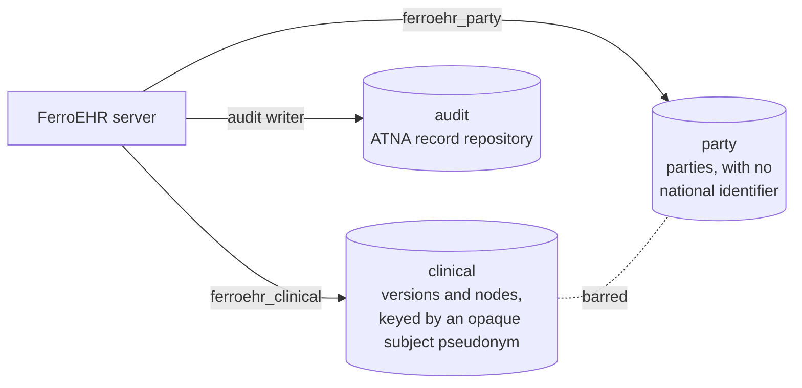

# The pseudonymisation boundary

Which database role reads which domain, and how a subject is linked across the boundary.

<!-- toc -->

The pseudonymisation boundary separates *a record from the person it is
about*, and it is enforced by PostgreSQL grants rather than by the server's own
routing: code that reaches for the wrong schema is a bug that can
be fixed, while a database role able to read two domains defeats the
separation however correct the code is.

GDPR [Art. 4(5)](https://eur-lex.europa.eu/eli/reg/2016/679/oj) defines
pseudonymisation as processing where attributing data to a person requires
additional information "kept separately and subject to technical and
organisational measures", and Art. 32(1)(a) names it a security measure for
health data. EDPB Guidelines 01/2025 require that separation to hold against
internal actors, operators with database access included.

Two domains hold the two parts, each behind its own role:

Read one domain and you hold a clinical record whose subject is an opaque
identifier, or a set of people with no records attached. Only the two together
re-identify anything, and no credential the server uses holds both. The
migrations create the roles, grant each its own schema, and **revoke every
other domain explicitly, in both directions**; each role is `NOINHERIT` and a
member of no other, so a grant cannot arrive through a membership.

The boundary is checked at startup, not assumed: the server reads the
catalogue for every table, view, sequence and function each role can reach in
a domain it does not own, and **refuses to serve** if it finds one, naming the
role and the object. A misconfigured grant is a failed boot, not a silent
weakening.

Two limits are worth stating plainly. The clinical schema holds a *pseudonym*
only when `[privacy] subject_namespaces` declares the namespaces a subject
reference may draw from — left unset, whatever a client sends is what gets
stored, and no schema split saves you from a national identifier written into
the clinical side; see
[Privacy and identifiers](installation/config-privacy.md). And the split is a
schema split by default: giving the demographic domain its own
`[database.party] url` is what turns it into a credential split, which is the
deployment step described in
[Operations](database-operations.md#database-roles-and-least-privilege).

## Encryption at rest is a deployment requirement

FerroEHR encrypts no field before it reaches PostgreSQL. A national identifier
belongs in the master patient index, never in the CDR, which knows the subject
only as a pseudonym
([Privacy & data minimisation](installation/config-privacy.md#national-identifiers-belong-in-the-master-patient-index)),
so the server holds no identifier to seal. What it does hold, every party and
every clinical record, sits in the database as written. GDPR Art. 32(1)(a)
names encryption as a measure for that risk: encrypt every database volume,
replicas and WAL archives included, and every backup and dump at rest, with the
keys outside the database hosts. The
[go-live checklist](security/go-live-checklist.md#9-the-database-volumes-and-backups-are-encrypted-at-rest)
checks it before real data arrives.

## Resolving across the boundary

One question needs both domains at once: *which record belongs to this
person?* The server answers it in the application, over two connections, never
in the database. An EHR names its subject in its own
`EHR_STATUS.subject.external_ref`, which the `ehr` relation copies into its
subject columns on every EHR create and `EHR_STATUS` update. A cohort and the
AQL demographic join read the parties on the `party` connection and the EHRs whose subject names them on the `clinical` connection,
with a second search path and, when `[database.party] url` is set, a second
database role. FerroEHR matches, links and merges no patients, and holds no
national identifier: resolving a person to their pseudonym is the master
patient index's job.

**No statement performs the join, because no credential could**: the
clinical role holds no grant in `party` and the party role holds none in
`clinical`, both revocations are explicit and in both directions, and the boot
check refuses to serve a database where either has been given one. The
crossing exists as an application step that can be audited, rather than as a
query anyone holding one password could write.

Every crossing records an access event in the `linkage` domain, naming who
asked, the purpose of use they declared, and how many EHRs it reached. A miss
is recorded like a hit: it says someone asked whether this deployment holds a
record for that person. The event deliberately does **not** name the EHR that
came back. A record pairing a party with its EHR would make the audit trail a
map from parties to their EHRs, which the split exists to withhold.

Looking an EHR up by subject (`GET /ehr?subject_id=…&subject_namespace=…`)
does **not** cross the boundary. That operation matches the EHR's own
`EHR_STATUS.subject.external_ref`, which is the opaque pseudonym the privacy
layer already constrains, so it resolves a pseudonym rather than an identity
and reads no party. It records a linkage-domain access event all the same,
naming the subject namespace and the EHR it found, because who resolved a
subject to a record is worth knowing wherever it happened.

The lookup puts the subject identifier in the URL, because ITS-REST passes it
as a query parameter. FerroEHR keeps it out of everything it writes: the
request log and every trace span record the path and the matched route without
the query string, and the `404` for an unknown subject names only the
namespace. A reverse proxy or load balancer in front of FerroEHR sees the whole
URL, so configure it not to log query strings on this route, or not at all.
FerroPIX as the EHR index provider (IHE PIXm, `record.subject_index = "pixm"`)
resolves a patient identifier to an EHR without putting it in a FerroEHR URL.

## The subject link in the party domain

The access evaluator needs the `PERSON` of an EHR's subject to read its care
relationships and its representatives. Under `record.subject_index = "pixm"`
the EHR names its subject by a pseudonym, so the patient's `PERSON` declares
it: an element of `PARTY.details` named by the `record_subject` code of
the draft openEHR access terminology `openehr_access`,
whose `DV_IDENTIFIER` holds the pseudonym and its namespace. An identifier
another organisation issued belongs in `details` (RM Demographic IM §2.1.3),
and the cross-reference stays out of the EHR (RM EHR IM §EHR Status). FerroEHR
projects it into the party table `binding_record_subject` at the commit of the
`PERSON`, and each replica holds the resolutions it uses in a bounded cache,
so a decision on a held subject adds no database transaction, a miss costs one
indexed read, and no decision calls the identity source.

**This is an accepted trade-off.** Without the
element, mapping a pseudonym back to a person needs a steward action in the
identity source. With it, the party domain maps the pseudonym to the `PERSON`
for every patient whose `PERSON` carries the element. The clinical side is
unchanged: it holds the pseudonym alone, and `ferroehr_clinical` still reads
nothing in `party`. Re-identifying a clinical record still needs both domains,
so the condition of GDPR Art. 4(5), additional information kept separately,
holds inside the CDR, and the link sits in the party domain under its own role
and dump, the "identity cross-reference" BASE Architecture Overview §Anonymity
describes. Only the `PERSON`s that need care relationships or representation
need the element, so the exposure is per patient (Art. 25(2)). The evaluator's
resolution tells the caller nothing, so it writes no `linkage` access event; a
representative's EHR lookup records one per subject reference it resolves.

## Declaring the posture

The separations above are each a configuration key, and a deployment that has
made none of them is indistinguishable from one that has made all of them
until something goes wrong. The top-level `deployment.profile` key
([configuration](installation/configuration.md#deploymentprofile)) makes the
posture explicit: `production` refuses to start while a separation is missing
and not accepted by name, and reads the cluster each pool reached from
`pg_control_system()` rather than trusting the DSN text; `sandbox`, the
default, names every missing separation on the banner, in the boot log and on
`GET /management/status`, reports the profile on `GET /rest/status`, and must
not hold real patient data. The database keeps
its own line of defence for the subject pseudonym too: once
`privacy.subject_namespaces` is declared, a trigger on `ehr` refuses a subject
reference that is not a UUID, whichever code path or session writes it.
