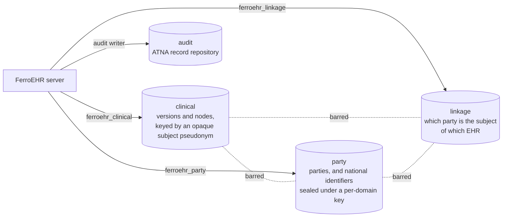

# Security

A clinical data repository holds PHI, so its access controls and audit trail
are part of the product. This chapter covers the four
security surfaces you configure when you deploy FerroEHR: **authentication**
(who is calling), **authorization** (what they may do), the
**pseudonymisation boundary** (which role reads which domain), and the **ATNA
audit trail** (recording what happened). Each is independently configurable,
and each is described here in terms of the environment variables you actually
set.

This chapter tells you **how to configure each control**. Its companions tell you
the rest: the [Threat model](threat-model.md) states **what remains true after
each control has done its job**: the trust boundaries, the residual risk at
each, and what this software explicitly does not defend against; and
[Verifying releases](verifying-releases.md) covers the artifacts themselves:
how to establish that the binary, image, or chart you downloaded came from this
project's own build. Read the threat model before you decide a control is
sufficient for your deployment.

<!-- toc -->

Configuration follows the same pattern throughout: the server reads defaults,
then the single `ferroehr.toml` file, then environment variables, with `__`
separating nested keys. The security configuration groups live in
distinct sections of `ferroehr.toml`: `[auth]` (authentication), `[authz]`
(authorization), `[privacy]` (the pseudonymisation boundary), and `[audit]`
(the ATNA audit trail). Any key can be overridden with the matching
`FERROEHR_*` environment variable shown below.

## Authentication

Authentication is on by default (`FERROEHR__AUTH__ENABLED=true`). Setting
it to `false` lets all requests through unauthenticated, a development-only
mode.

There is no single "mode" switch. The server offers two mechanisms and enables
each by the presence of its configuration. Both are checked by
`ferrohealth-smart`, the resource-server crate every FerroHEALTH product
shares; FerroEHR checks tokens and never issues them.

- **HTTP Basic** is active when `[[auth.basic.users]]` lists a user. Each user
  has a user-id, an Argon2id password hash (a PHC string beginning
  `$argon2id$`) or a `password_hash_file` pointing at one, and the SMART on
  openEHR `scopes` it holds, and its RBAC `roles` (a user with none holds no
  role). Because it is
  a list of users, the Basic store is normally supplied through the TOML
  configuration file rather than environment variables.
- **OAuth 2.0 bearer tokens** are active when `[auth]` names an `issuer`. The
  server reads the issuer's metadata and key set at boot and validates every
  token's signature (asymmetric algorithms only), issuer, audience, lifetime
  and type under RFC 9068.

Both mechanisms are validated at startup, and a configuration the server cannot
honour **refuses to boot** rather than degrading at the first request:

| Configuration | Boot outcome |
|---|---|
| `auth.enabled = true` with no mechanism | error: a `401` challenge must name a scheme the server implements (RFC 9110 §11.6.1) |
| an `issuer` with no `audience` | error: a server with no declared audience cannot reject another server's token (RFC 9068 §4, RFC 8725 §3.9) |
| an `issuer` not `https` (plain `http` is accepted on a loopback host only), carrying a query or fragment, or a user name or password | error: RFC 8414 §2, §6.2; OpenID Connect Core 1.0 §1.2 |
| an issuer whose metadata or key set cannot be read | error: the start is refused rather than the first request |
| `clock_skew_seconds` above `300` | error: leeway may be "no more than a few minutes" (RFC 7519 §4.1.4) |
| `algorithms` naming an `HS*` algorithm, or empty | error: the server accepts asymmetric algorithms only (RFC 8725 §3.1, §3.2) |
| a `jwks_file` holding a symmetric key or a private-key member | error: a verifier holds public keys only |
| a `product_scope` that is neither a full URI nor starts with `__` | error: SMART App Launch 2.2.0, Scopes and Launch Context, §Extensibility |
| a `password_hash` below `m=19456,t=2,p=1` argon2id | error: the OWASP Argon2id floor |
| `[authz.assurance] minimum` with an empty `levels` map, or with no mapped value at or above it | error: every patient-data request would be refused |
| an `[authz.assurance] levels` value that is blank or carries whitespace, a quote or a backslash | error: the step-up challenge names the values in one quoted `acr_values` parameter (RFC 9470 §3) |
| `[authz.professional]` with a blank `claim` or `acting_for_claim` | error: nothing to read the person from |

Successfully verified Basic credentials are cached for
`FERROEHR__AUTH__BASIC__CACHE_TTL_SECONDS` (default `0`, which checks every
request) so a busy client pays the deliberately expensive Argon2 verification
once per TTL instead of on every request. The cache names each entry by a keyed
hash of the credential, never the password, and an entry exists only after a
successful verification; the TTL bounds how long a removed user can still
authenticate, exactly like a session lifetime.

The bearer settings:

| Environment variable | Default | Meaning |
|---|---|---|
| `FERROEHR__AUTH__ISSUER` | unset (required for bearer tokens) | expected `iss`, and where the metadata is read: RFC 8414 §3 first, OpenID Connect Discovery 1.0 §4 after a `404` |
| `FERROEHR__AUTH__AUDIENCE` | unset (**required with an issuer**) | accepted `aud` values |
| `FERROEHR__AUTH__ALGORITHMS` | `RS256,RS384,PS256,PS384,ES256,ES384` | accepted signing algorithms, asymmetric only |
| `FERROEHR__AUTH__TOKEN_PROFILE` | `rfc9068` | `rfc9068` requires `typ` `at+jwt` and the `client_id`, `iat` and `jti` claims; `jwt` admits a plain JWT for an issuer that mints no RFC 9068 tokens |
| `FERROEHR__AUTH__CLOCK_SKEW_SECONDS` | `60` | leeway on `exp`, `nbf` and `iat`; capped at `300` |
| `FERROEHR__AUTH__JWKS_FILE` | unset | a static JWK Set of public keys, read instead of the issuer's metadata |
| `FERROEHR__AUTH__JWKS_MAX_AGE_SECONDS` | `600` | a key set older than this is read again |
| `FERROEHR__AUTH__JWKS_REFRESH_INTERVAL_SECONDS` | `60` | an unknown `kid` reads the key set again at most once per interval |
| `FERROEHR__AUTH__TIMEOUT_MS` | `10000` | one call to the authorization server |
| `FERROEHR__AUTH__REALM` | `ferroehr` | the realm every challenge names |
| `FERROEHR__AUTH__PRODUCT_SCOPE` | `__ferroehr.platform` | the scope that admits the ADMIN and DEMOGRAPHIC APIs |

There is no separate key-set URL to set: the server reads the `jwks_uri` from
the issuer's metadata unless you supply a `JWKS_FILE`. A rotated key is picked
up on the first token that names it, bounded by the refresh interval, and a
withdrawn key stops verifying within the max age.

Every route also enforces its SMART on openEHR requirement: a valid token or
Basic user whose scopes do not grant the operation is refused with `403`. See
[SMART App Launch](smart-app-launch.md).

> [!TIP]
> **Keycloak example.** Point the issuer at your realm and let discovery do the
> rest:
>
> ```bash
> export FERROEHR__AUTH__ISSUER=https://keycloak.example/realms/ferroehr
> export FERROEHR__AUTH__AUDIENCE=ferroehr-api
> export FERROEHR__AUTH__TOKEN_PROFILE=jwt
> ```
>
> Keycloak's access tokens carry `typ: JWT`, outside the RFC 9068 profile the
> server expects by default, hence `token_profile = "jwt"`. The client's
> default client scopes put the SMART on openEHR scopes the routes need into
> each token's `scope` claim.
>
> The same pattern works for Active Directory or any standards-compliant
> identity provider; walkthroughs for Entra ID and AD FS (and the answer for
> plain-LDAP directories) are in
> [Enterprise identity providers](identity-providers.md). User accounts,
> roles, and lifecycle are administered in the IdP; the CDR has no user API.

An unauthenticated request to a protected route is refused with `401`; an
authenticated request that lacks the required role or scope is refused with
`403`. Two outcomes are neither: a **malformed** `Authorization` header, or two
of them, is a `400` (the server never read a credential), and an **unreadable
key set** is a `503` (no token can be validated, so the server cannot decide; it
is not a statement about the caller's credential). The per-status table for
client authors is in [Using the API](using-the-api/index.md#which-status-a-credential-problem-gets).

The `401` body deliberately says nothing about *why*, and neither does the
challenge: every token that does not hold gets the one `invalid_token` answer
(RFC 9068 §4), with no `error_description`. Rendering the rejection would tell
an unauthenticated caller whether a token was expired or forged, which is
exactly the distinction an attacker probes for; the reason stays in the debug
log, where the operator can read it and the caller cannot. A `403` names no
scope either, in its challenge or its body. A request that carried no
credential at all, or one for a scheme the server does not admit, gets no error
code: it has not made a mistake yet (RFC 6750 §3.1).

### Assurance level and the natural person on patient data

Two optional blocks under `[authz]` judge *how* a professional
authenticated and *who* stands behind a token. Both are off by default; with
neither configured nothing below changes the wire.

**`[authz.assurance]`** reads the authentication assurance level from a
token claim (`claim`, default `acr`) and maps each value your identity provider
emits to an eIDAS level (`levels`: `low`, `substantial` or `high`). With
`minimum` set, a patient-data request whose token maps below it, carries a value
the map does not name, or carries no such claim is refused with `401` and the
OAuth 2.0 step-up challenge of RFC 9470 §3:

```text
WWW-Authenticate: Bearer realm="ferroehr", error="insufficient_user_authentication",
  error_description="patient data requires authentication at assurance level substantial or higher",
  acr_values="http://eidas.europa.eu/LoA/high http://eidas.europa.eu/LoA/substantial"
```

`acr_values` lists every mapped value at or above the minimum, so a client can
send the user back to the identity provider with that request. EHDS Annex II 3.1
asks an EHR system used by health professionals for reliable identification and
authentication of them; Implementing Regulation (EU) 2026/2099 Art. 6(3) sets
`substantial` for cross-border exchange, and `high` from 26 March 2032.

**`[authz.professional]`** names the claim that identifies the natural
person (`claim`, default `sub`). A token is a client token when it lacks that
claim, or, under the default `client_tokens = "sub_is_client"`, when its `sub`
equals its `client_id` or `azp` (RFC 9068 §2.2 has `sub` name the client when
no resource owner is involved). With the block present, a client token is
refused on patient data with `403`, unless `acting_for_claim` names a claim the
token carries the professional's identifier in (a dotted path reaches into a
JSON object, such as `act.sub`). The access record then names that
professional; see [Audit trail](audit.md#the-ehds-logging-elements-mapped).

What counts as **patient data**: every API route except the definition family
(`/definition/...`: templates, archetypes, stored-query texts), terminology,
the aggregate counts under `/admin/report`, and the admin routes that manage
configuration, event subscriptions, the retention policy, templates and
stored queries. The list of exceptions is closed, so a route
added later is judged patient data until it is listed. The health family,
`/rest/status`, discovery and `/management` are outside the API and never
judged.

**Basic credentials** carry no assurance level and no issuer-asserted person.
With `minimum` set a Basic request for patient data gets the same `401` step-up
challenge, and with `[authz.professional]` set it gets the `403`; definition
routes stay reachable with Basic.

The assurance level is judged before RBAC, so a caller below the level learns
it must step up rather than that it lacks a role. A client token acting for a
professional is held to the same level as any other token: the `acr` it
carries is the one judged, so a client-credentials token needs your
authorization server to put the professional's assurance level on it.

### Two limits worth planning around

**Plain-HTTP issuers are accepted on a loopback host only.** The server reads
the issuer's metadata and keys over TLS, because over plain HTTP an attacker on
the network could serve their own signing keys (RFC 8414 §6.2); there is no
switch that admits a plain-HTTP issuer elsewhere.

**Revocation latency equals the access-token lifetime.** Tokens are validated
offline against the issuer's published keys; the CDR calls no introspection
endpoint (RFC 7662 defines that mechanism but does not require a resource server
to use it), so a token revoked at the identity provider stays acceptable here
until its `exp` passes. That is deliberate: introspecting per request would put
the identity provider's availability in the request path, and caching the results
only shortens the lag. **The control is therefore the token lifetime, which your
authorization server owns**: keep access-token lifetimes short (minutes, not
hours) if prompt revocation matters, and use refresh tokens for session length.
`clock_skew_leeway_seconds` adds at most its own value on top of `exp`.

## Authorization

Authorization has three composable layers. The per-EHR `EHR_ACCESS` gate is
the openEHR-specified base and is always on; the coarse role layer is active
when authentication is enabled; the fine-grained attribute layer is opt-in.
A request must clear every active layer. Deployments serving SMART apps can
enable a fourth, token-scope layer on top; see
[SMART App Launch](smart-app-launch.md).

### Per-EHR access control (`EHR_ACCESS`)

Every EHR carries a versioned `EHR_ACCESS` object, the openEHR
access-decision authority for that record. A new EHR has no settings, and what
that admits is a **server-wide choice**:

| `authz.rbac.ehr_access_default` | An EHR with no settings |
|---|---|
| `open` *(default)* | reachable by any caller the coarse layers already admitted |
| `restricted` | reachable only by `authz.rbac.admin_role` |

`open` is the default because it is what every existing deployment runs, and
changing it changes who can read existing records. `restricted` is object-level
**default-deny**, and it is the setting to reach for if your threat model
includes a caller enumerating record ids: a server-created `ehr_id` is a
time-ordered UUIDv7, so it is not even unpredictable, and the OWASP
[Insecure Direct Object Reference Prevention](https://cheatsheetseries.owasp.org/cheatsheets/Insecure_Direct_Object_Reference_Prevention_Cheat_Sheet.html)
cheat sheet is explicit that an unpredictable identifier is not itself an access
control.

> [!NOTE]
> Under `restricted`, the admin role still reaches a setting-less EHR. That is
> deliberate: a plain deny would make such a record unreachable by everyone
> (including the operator who would author the settings that fix it) which is an
> outage rather than a control. Bind callers to patients with the ABAC layer
> below; this key decides only the default disposition.

Committing settings with the `ferroehr.access_control.v1` scheme
switches that EHR to explicit policy, and those settings **always win over the
server default**, in both directions:

```json
{
  "_type": "EHR_ACCESS",
  "name": { "_type": "DV_TEXT", "value": "access" },
  "archetype_node_id": "openEHR-EHR-EHR_ACCESS.generic.v1",
  "settings": {
    "_type": "FERROEHR_ACCESS_CONTROL_V1",
    "gate_keeper": "user:alice",
    "default_access": "restricted",
    "access_list": [
      { "principal": "user:bob",   "access": "full" },
      { "principal": "role:nurse", "access": "restricted_below", "max_level": 2 }
    ],
    "privacy": {
      "default_level": 0,
      "composition_overrides": [
        { "uid": "8849182c-82ad-4088-a07f-48ead4180515", "level": 3 }
      ]
    }
  }
}
```

- **Access list:** with `default_access: "restricted"`, only listed
  principals may touch the EHR: `user:<login or OIDC subject>` or
  `role:<role>` (matched against the caller's roles). Everyone else gets
  `403`.
- **Privacy levels:** integer sensitivity levels with meanings you define
  for your jurisdiction. A composition's level is its override entry or the
  default, and a caller may read it only when its level is *strictly below*
  their ceiling. `full` access has no ceiling; `restricted_below` uses the
  entry's `max_level`; a caller with **no access-list entry** gets
  `default_level + 1`, so the default level stays readable and only raised
  levels are withheld. This gate applies to Composition **read** routes.
- **Gate-keeper:** once set, only that principal may commit a new
  `EHR_ACCESS` version (via a CONTRIBUTION; there is no dedicated
  `EHR_ACCESS` endpoint in the openEHR REST API). Changes are versioned and
  audited like all record content.

The scheme is a FerroEHR extension: openEHR mandates the `EHR_ACCESS`
object and its change control but publishes no concrete access-control
scheme. The per-EHR decision also holds for AQL, ad-hoc and stored queries
alike: an EHR the caller may not read contributes no rows, whether the query
names it in its `WHERE` clause, in an `EHR` predicate, through the `ehr_id`
parameter, or not at all, as in a population query. Query results are not
filtered by privacy level.

### Restriction of access by health professionals (EHDS Art. 8)

Regulation (EU) 2025/327 Art. 8 gives a person the right to restrict the
access of health professionals and healthcare providers to all or parts of
their data, and has the fact of the restriction stay invisible to healthcare
providers. Art. 11(5) lets the restricted data be reached where necessary to
protect the person's vital interests, logged so the person can see it. No
openEHR specification governs this; it is our own design.

- **Recording it.** The controller records a restriction on the person's
  instruction with `POST /ferroehr/rest/extensions/v1/admin/access-restriction`, for a whole EHR or
  for one versioned object, and lifts it with
  `POST /ferroehr/rest/extensions/v1/admin/access-restriction/lift`
  ([the routes](operations-admin-apis.md#legal-marks-restriction-objection-and-retention)).
  A whole-EHR restriction covers data recorded after it too.
- **What a professional sees.** Restricted data reads as absent: a restricted
  composition or EHR answers **404** exactly as an unknown one does, a query
  leaves it out at every scope (and a query scoped to a restricted EHR answers
  as for an unknown EHR), an export skips it, a CONTRIBUTION lists none of its
  versions, the event stream withholds it, and a write to it is refused as a
  write to an unknown target. No status, header or count says that a
  restriction exists.
- **What it does not change.** Nothing is deleted, and storage and the
  controller's own processing go on: the admin routes (dump, archive, erase,
  the registers) see everything. It is not the GDPR Art. 18 restriction of
  processing, which answers **403** and stops processing itself.
- **The emergency override.** A caller holding the role
  `authz.rbac.emergency_access_role` names that declares one of
  `[audit] emergency_purpose_codes` reads the restricted data, and its access
  record carries the [emergency mark](audit.md#emergency-access-ehds-art-115).
  Either alone lifts nothing. Unset, nobody may override.

```toml
[authz.rbac]
emergency_access_role = "EMERGENCY"

[audit]
purpose_codes = ["TREAT", "ETREAT"]
emergency_purpose_codes = ["ETREAT"]
```

The grain is the versioned object, the whole EHR, or both. A finer grain (one
entry inside a composition) is not built: an object is the unit the version
reads, the queries and the exports already decide on, and splitting a
composition would change what the stored, signed version holds.

### Opt-out from the access services (EHDS Art. 10)

Regulation (EU) 2025/327 Art. 10(1) lets a Member State's law give a person
"the right to opt out from the access to their personal electronic health data
registered in an EHR system through the electronic health data access services
referred to in Articles 4 and 12", and has the Member State "ensure that the
exercise of that right is reversible". Art. 10(2) lets the Member State admit
"a healthcare provider or health professional" where processing "is necessary
in order to protect the vital interests of the data subject or of another
natural person", even after an opt-out. No openEHR specification governs this;
it is our own design.

FerroEHR ships the software part: a mark on the whole EHR that the callers you
declare as the access services read as absent. Whether the right exists, how
the person exercises it, and the rules and safeguards of Art. 10(2) are your
Member State's law and yours to apply. Where the Member State enforces the
opt-out in its own services, leave the mark unused.

- **Declaring the access services.** `authz.rbac.access_service_roles` lists
  the roles your Art. 4 access service (the person's) and your Art. 12 health
  professional access service carry in their tokens or Basic users. It is
  empty by default, so the opt-out holds for nobody, and recording one is
  refused with **400**.
- **Recording and reversing it.** The controller records the opt-out on the
  person's instruction with
  `POST /ferroehr/rest/extensions/v1/admin/access-opt-out` and reverses it with
  `POST /ferroehr/rest/extensions/v1/admin/access-opt-out/reverse`
  ([the routes](operations-admin-apis.md#legal-marks-restriction-objection-and-retention)).
  A reversal keeps the row in the register with its reversal time, and stays
  open whatever the configuration, so an opt-out can always be reversed.
- **What an access service sees.** A request from a caller holding one of the
  declared roles reads the EHR as absent: a route that names the EHR or an
  object in it answers **404** as for an unknown EHR, a population query leaves
  its data out, a query scoped to it answers as for an unknown EHR, an export
  and the lookup by subject find no such EHR, and a write to it is refused as a
  write to an unknown EHR.
- **What it does not change.** Every other caller reads the record as before:
  your own care, through callers that hold none of the declared roles, and the
  controller's admin routes. Nothing is deleted. It is not the Art. 8
  restriction above, which reaches every professional route and leaves the
  person's own access open.
- **The vital-interest override.** An access-service caller that declares one
  of `[audit] emergency_purpose_codes` reads the EHR, unless it acts for the
  person (a SMART `patient/` grant or the patient claim), because Art. 10(2)
  names a healthcare provider or health professional. Its access record
  carries the [emergency mark](audit.md#emergency-access-ehds-art-115), and a
  route that names the opted-out EHR adds an access record
  `access-opt-out-override:ehr-wide` against it.
- **The record.** Recording, reversing and reading the register are each an
  access record on the EHR (`access-opt-out:ehr-wide`) naming the
  administrator.

```toml
[authz.rbac]
access_service_roles = ["EHDS-ACCESS-SERVICE"]

[audit]
purpose_codes = ["TREAT", "ETREAT"]
emergency_purpose_codes = ["ETREAT"]
```

### Information a person inserts (EHDS Art. 5)

Regulation (EU) 2025/327 Art. 5 lets a person, or their representative, insert
information in their own EHR through the access services. That information
"shall be clearly distinguishable as having been inserted by the natural
person or by his or her representative", and the person "shall not be able to
directly alter the electronic health data and related information inserted by
health professionals". FerroEHR keeps both rules at the commit. No openEHR
specification governs who may change what, so the rules are our own design;
the marker is the RM's own.

- **Who counts as the person.** A bearer token with a `patient/` scope and no
  `user/` or `system/` scope (for example `patient/composition-*.cruds`), from an
  issuer in [`[smart] patient_issuers`](smart-app-launch.md#launch-context-binding-to-one-ehr).
  The SMART scope grammar reserves `patient/` for "applications acting in the
  context of a specific patient/EHR" and `user/` for those acting for a
  logged-in practitioner, so a clinician's app uses `user/` scopes and keeps
  every professional right. The ABAC patient claim does not make a caller the
  person, because a professional's token in a patient's context carries it
  too. The rule is the FerroHEALTH family's strict answer, shared through
  `ferrohealth-smart`; the Art. 3(3) delay below asks its broad one.
- **The marker.** Every version and CONTRIBUTION the person commits records
  `PARTY_SELF` as `AUDIT_DETAILS.committer`, the RM's way to say the committer
  is the record subject (RM common, Audit Details). Its `external_ref` names the
  login: a `GENERIC_ID` holding the token subject, in the scheme of the token
  issuer. FerroEHR writes this committer itself and ignores any committer the
  request names, in the `openehr-audit-details` header or in a CONTRIBUTION
  body. Every read of the version carries it, an AQL query reads it with
  `v/commit_audit/committer`, the contribution list extension flags the change
  set with `inserted_by_person`, and the viewer names the committer "The person
  or their representative". The marker is part of the stored version, so a
  dump and its restore keep it.
- **The composer.** A COMPOSITION the person commits names the person
  (`PARTY_SELF`) or their representative (`PARTY_RELATED`) as its composer.
  Any other composer is refused with **403**, so the person cannot present what
  they insert as a professional's.
- **What the person may change.** The person may update and delete a version
  whose committer is `PARTY_SELF`. An update or a deletion of a version anyone
  else committed, a professional or a system, is refused with **403** and a
  body that names EHDS Art. 5, whether it comes as a direct write or inside a
  CONTRIBUTION. Nothing is written.
- **What a professional may change.** A professional's writes are unchanged.
  A professional may update or delete an entry the person inserted; the new
  version is the professional's, which the person may then no longer alter.
  The person's own versions stay in the version history.

### Delayed access by the person (EHDS Art. 3(3))

Regulation (EU) 2025/327 Art. 3(1) gives a person access to their data
"immediately after the personal electronic health data have been registered in
an EHR system". Art. 3(3) lets a Member State restrict that right "by delaying
access to their personal electronic health data for a limited period of time
until a health professional is able to properly communicate and explain to the
natural persons concerned information that can have a significant impact on
their health". Recital 10 gives the example: a diagnosis of an incurable
disease should come first in a consultation, not through an electronic
channel. This is the opposite direction of the Art. 8 restriction above: the
data is withheld from the person, never from a professional. No openEHR
specification governs it; it is our own design.

FerroEHR ships the software part. Whether the delay applies, to which data and
for how long is the Member State's rule, and you configure it in
[`[access_delay]`](installation/config-auth.md#access_delay). It is off by
default, so the person's access stays immediate.

- **What is held.** With the section on, every new COMPOSITION whose category
  (the [`[audit.categories]`](installation/config-audit.md) map, template first,
  then the root archetype) is listed in `access_delay.categories` is held from
  the moment it is committed, for `access_delay.hours`. Only the first version
  is held: a composition the person has already seen stays visible when it is
  amended, and a professional holds an amendment by hand if it needs
  explaining. A composition the person commits is never held from them.
- **Who it is held from.** A request that may be the person's own: a bearer
  token carrying a SMART `patient/` grant, or the ABAC patient claim
  (`authz.abac.patient_claim`). A token that carries either is treated as the
  person's, whatever `user/` or `system/` grant it also carries, so a mixed
  token is withheld from rather than shown the data too early. The rule is the
  FerroHEALTH family's, shared with the other products through
  `ferrohealth-smart`. To that request a held composition reads
  as absent: a read answers **404** as for an unknown composition, a query and
  an export leave it out, a CONTRIBUTION lists none of its versions, and a write
  to it is refused as a write to an unknown target.
- **What a professional sees.** Everything, as before. The hold changes no
  professional route, query or export.
- **Releasing it.** The treating professional releases a composition once it
  has been explained, from the clinical surface with
  `POST /ferroehr/rest/extensions/v1/ehr/{ehr_id}/versioned_composition/{versioned_object_uid}/access-delay/release`.
  The route takes the checks of a write to that EHR: the EHR access list, the
  ABAC check of a composition update and the SMART `composition-` update
  grant. A request that may be the person's is refused with **403**. The
  controller releases with
  `POST /ferroehr/rest/extensions/v1/admin/access-delay/release`, and holds
  one by hand with `POST /ferroehr/rest/extensions/v1/admin/access-delay`, for
  at most `access_delay.hours`
  ([the routes](operations-admin-apis.md#legal-marks-restriction-objection-and-retention)).
- **The limit.** Every hold ends by itself when its period passes, released or
  not, because Art. 3(3) allows a delay "for a limited period of time" only.
- **The record.** Placing a hold, releasing it and its expiry are each an
  access record: the release names the professional who made it, and the
  server writes the expiry record within a minute of the limit passing.
- **The person's access trail (Art. 9).** A record about a held composition
  would tell the person a result exists. The subject-scoped ITI-81 read, the
  one a patient portal serves the person's own trail from, leaves out every
  record that names a held composition, its hold included, until the hold is
  released or expires; the records then appear unchanged, with their original
  times. The filter is `ehds-logging`'s, the FerroHEALTH family's EHDS
  logging component. The controller's unscoped read shows every record at
  all times.

Turning the section off makes every held composition readable to the person at
once: the holds stay in the register, and no new one can be placed.

### RBAC (role-based, coarse)

Every openEHR operation is classified as **Public**, **Clinical**, or
**Admin**, and a role model gates each class. Roles are plain,
case-insensitive strings; the defaults are `USER` and `ADMIN`.

| Environment variable | Default | Meaning |
|---|---|---|
| `FERROEHR__AUTHZ__RBAC__ENABLED` | `true` | the coarse role gate (active only when auth is enabled) |
| `FERROEHR__AUTHZ__RBAC__ADMIN_ROLE` | `ADMIN` | role required for admin operations |
| `FERROEHR__AUTHZ__RBAC__READONLY_ROLE` | `READONLY` | role marking a principal read-only: refused on every write |
| `FERROEHR__AUTH__ROLE_CLAIMS` | `["roles","groups","entitlements"]` | JWT claim paths mined for roles; a Keycloak issuer adds `realm_access.roles` |
| `FERROEHR__AUTHZ__RBAC__SUBJECT_AUDIT_ROLE` | unset | role that reads the access log for ONE subject at a time (`GET /fhir/r4/AuditEvent` with `patient` required). Unset, that log stays admin-only. See [Audit trail](audit.md#getting-the-log-out) |

Roles come from the JWT claims listed in `ROLE_CLAIMS`, or from a Basic user's
configured roles. The defaults are the carriers
[RFC 9068 §2.2.3.1](https://www.rfc-editor.org/rfc/rfc9068#section-2.2.3.1) names
for conveying authorization state (`roles`, `groups`, `entitlements`, of which
`roles` and `entitlements` are [SCIM](https://www.rfc-editor.org/rfc/rfc7643#section-4.1.2)
attributes), the default every FerroHEALTH product shares. A claim path may be
dotted, so an issuer that nests them differently, such as Keycloak's
`realm_access.roles`, is configuration rather than a code change; a claim
carrying a single string and one carrying an array are both accepted.

**A Clinical operation needs at least one role of any name; an Admin operation
needs the admin role.** A Basic user holds the roles its `roles` list names
and nothing else, so a user with none is refused every Clinical operation;
`roles = ["USER"]` satisfies the Clinical class and no Admin operation. A
bearer token whose SMART on openEHR resource scopes are all `system/` scopes,
such as `system/template-*.r`, is a backend client and needs no role for a
Clinical operation: its scopes decide what it reaches. A `user/` or `patient/`
token belongs to a person and still needs a role. The former `user_role` key is refused at boot.
Disabling RBAC restores authentication-only behaviour.

> [!IMPORTANT]
> **The management surface is not configured here.** `/management/*` is governed
> entirely by `[management.endpoints]`, one level per endpoint, and nothing under
> `[authz.rbac]` changes it. There is **no global default beside it: an endpoint
> you do not name is `off`** and is not mounted at all.
>
> Each level means: `off`, not mounted, answers `404`; `private`, any
> authenticated principal; `admin_only`, authenticated **and** holding
> `authz.rbac.admin_role` (the one place RBAC is consulted); `public`, no check
> at all, including no authentication.
>
> The consequence worth internalising: `prometheus = "public"` is reachable by
> an anonymous caller **whatever** your RBAC settings say, because a `public`
> endpoint is mounted outside the authentication layer. Lock the surface down by
> raising the levels in `[management]`, and read the effective set back from
> `/management/env` (or from the boot log line that names every mounted
> endpoint and its level) rather than assuming.

> [!IMPORTANT]
> **The OAuth2 `scope` claim does not grant roles.** A scope grants a *client*
> delegated authority ([RFC 6749 §3.3](https://www.rfc-editor.org/rfc/rfc6749#section-3.3));
> it asserts nothing about the subject's roles. Reading it as one also made the
> at-least-one-role check pass for every OIDC token, since `openid` alone
> satisfied it. If your callers rely on a scope naming a role, move that role
> into one of the role claims above. Scopes remain on the principal and still
> drive SMART scope enforcement and ABAC policy.

> [!NOTE]
> The downloadable Compose quickstart deliberately runs with RBAC **off** and a
> single user, so every surface works out of the box (see
> [Docker Compose](installation/compose.md)). Turn the role gate on with
> `[authz.rbac] enabled = true` (or `FERROEHR__AUTHZ__RBAC__ENABLED=true`) and
> give each principal an explicit `roles` list.

A principal carrying the `readonly_role` (default `READONLY`) is refused on
every write operation (creating an EHR, committing a composition, uploading a
template, and any update/delete) even when it also holds granting roles such
as `ADMIN` (a restriction always overrides a grant). Reads and AQL queries stay
permitted, so a `READONLY` account is an authenticated, view-only principal. The
repository's from-source development stack ships one such account
(`ferroehr-readonly`, password `ferroehr`) alongside `ferroehr` and
`ferroehr-admin`, with RBAC at its default `enabled = true`, so the separation
can be tried out; the downloadable quickstart file has neither (one user, no
role gate).

### ABAC (attribute-based, fine-grained)

For attribute-level decisions ("may this user touch this patient's data,
under this organisation, for this template?") enable ABAC. A policy decision
point is consulted per clinical operation with resolved attributes. An
enabled ABAC block that cannot be built (a missing or invalid policy
directory, an unreachable-by-construction PDP client) aborts server startup:
a configuration that promises fine-grained authorization never silently runs
without it.

| Environment variable | Default | Meaning |
|---|---|---|
| `FERROEHR__AUTHZ__ABAC__ENABLED` | `false` | master ABAC switch |
| `FERROEHR__AUTHZ__ABAC__ENGINE` | `cedar` | `cedar` (embedded) or `remote` (external PDP) |
| `FERROEHR__AUTHZ__ABAC__ORGANIZATION_CLAIM` | `organization_id` | JWT claim for the organisation attribute |
| `FERROEHR__AUTHZ__ABAC__PATIENT_CLAIM` | `patient_id` | JWT claim for the patient attribute (enables the subject gate) |
| `FERROEHR__AUTHZ__ABAC__CHECK_DIRECTORY` | `false` | also submit DIRECTORY (FOLDER) operations to the policy engine |
| `FERROEHR__AUTHZ__ABAC__CEDAR__POLICY_DIR` | — (required for `cedar`) | directory of `*.cedar` policy files |
| `FERROEHR__AUTHZ__ABAC__CEDAR__RELOAD_SECS` | off | optional policy hot-reload interval |
| `FERROEHR__AUTHZ__ABAC__REMOTE__SERVER` | — (required for `remote`) | PDP base URL (must end with `/`) |
| `FERROEHR__AUTHZ__ABAC__REMOTE__CONNECT_TIMEOUT_MS` | `2000` | PDP connect timeout |
| `FERROEHR__AUTHZ__ABAC__REMOTE__REQUEST_TIMEOUT_MS` | `5000` | PDP request timeout |

Two engines sit behind one interface. **Cedar** is the embedded default:
policies live in `*.cedar` files, are schema-validated at boot against a
shipped schema built from the resource-kind and access-mode sets themselves (an
invalid policy set stops the server rather than silently denying), and need no
external service. The **remote PDP** option consults an external policy server
over HTTP for deployments that already run one; it additionally requires an
`[authz.abac.policy.<kind>]` binding for every resource kind it will be asked
about, and a missing one is a boot error rather than a first-request surprise.

A policy sees the **caller**, not just the request: the authenticated subject,
its roles (as the role layer above resolved them), its scopes, the resolved
organization and patient, the resource's patient, template, category and
origin, and the operation id. So a rule can be written about one caller, a role,
a scope, or a single operation; the [shipped example policy](https://github.com/FerroHEALTH/FerroEHR/tree/main/app/ferroehr-rest/examples/policies)
shows a role-keyed break-glass permit and a scope-keyed write restriction.

**Category and origin** (EHDS Annex II 3.4 asks for access rights that take
the origins and categories of the data into account). On a composition read,
write or delete, a contribution and a query, `resource.category` holds each
EHDS category of the data, spelt as the access record spells it: the
`<system>|<code>` token of a priority or national category,
[`[audit.categories]`](installation/config-audit.md#auditcategories) classifying
the template, then the root archetype; `none`; or `unclassified`.
`resource.origin` holds each origin the data came from, as the version recorded
it at commit: a `FEEDER_AUDIT` originating-system id, the registered origin of
the committing client, or this server's `system_id`
([keying on an origin](compliance/retention.md#keying-a-period-on-an-origin)
declares the register). A write is decided on what its body names: its
template's category and the origin the commit will stamp. A FLAT or STRUCTURED
write is converted only after the check, so it carries the category its
template header implies and no origin attribute. A remote PDP receives both as
the `category` and `origin` parameters of `[authz.abac.policy.<kind>]`.

```cedar
// Laboratory reports fed by the lab are readable by the lab's own staff only.
forbid (principal, action == Action::"composition.read", resource)
when {
  resource has category && resource has origin &&
  resource.category == "http://hl7.eu/fhir/health-data-api/CodeSystem/eehrxf-document-priority-category-cs|Laboratory-Reports" &&
  resource.origin == "lab.example" &&
  !(principal has organization && principal.organization == "lab")
};
```

A request whose `patient`, `template`, `category` or `origin` resolves to several values is evaluated
over the full cartesian product of them, and **every** combination must permit;
the first deny short-circuits. A request that resolves to no combination at all
permits vacuously, because there is nothing to decide about.

> [!WARNING]
> Authorization is **fail-closed in two distinct senses**, and the difference
> shows up in the status code.
>
> Nothing permits by omission: a gate reached without an authenticated caller
> refuses, an unconfigured resource kind on the remote PDP denies (and the
> missing rule is a boot error), and Cedar is deny-by-default with `forbid`
> overriding `permit`. A denied decision is a **`403`**.
>
> And a stage that cannot **decide** is never read as a decision. An
> unreachable policy engine, a policy server answering `5xx`, or a policy that
> errors during evaluation is a **`500`**: never a silent permit, and never a
> `403`, which would claim a decision was made. (Cedar skips a policy that
> errors and reports it in its diagnostics; ignoring those would let an erroring
> `forbid` quietly stop forbidding.) A `4xx` from a remote PDP *is* a decision,
> so it denies.
>
> When a patient claim is configured, a local subject gate also rejects access to
> another patient's EHR before any policy call.

## Response security headers

Three surfaces, three honest answers: the set differs because what they serve
differs.

**The REST API** carries, on every response including the transport-layer ones
(`413` from the body limit, `408` from the timeout, `500` from the panic handler):

| Header | Value | Why |
|---|---|---|
| `Cache-Control` | `no-store` | responses carry patient data; the OWASP cheat sheet names `no-store` for exactly that. It does not affect openEHR's `ETag`/`If-Match` concurrency control, which is a precondition mechanism, not a caching one |
| `X-Content-Type-Options` | `nosniff` | stops a proxy or browser re-guessing `application/json` as something executable |
| `Referrer-Policy` | `strict-origin-when-cross-origin` | request paths carry `ehr_id` and version identifiers; this keeps them out of cross-origin `Referer` headers |
| `Cross-Origin-Resource-Policy` | `same-site` | refuses cross-site embedding of API responses |
| `X-Frame-Options` | `DENY` | for the HTML this origin can serve (Swagger UI) |
| `Content-Security-Policy` | `default-src 'none'; frame-ancestors 'none'` | the defensive minimum, applied wherever a response does not set its own; Swagger UI needs a real policy and brings one. The cheat sheet is explicit that CSP "might be meaningless in the response of a REST API that returns content that is not going to be rendered", so this is not a policy pretending to govern scripts: it says nothing loads and nothing frames |

`X-XSS-Protection` and `X-Powered-By` are absent because the cheat sheet says to
remove them, and no `Server` header is sent at all.

**`Strict-Transport-Security` is deliberately not sent by the API server.** It is a
property of the TLS edge, and [RFC 6797 §7.2](https://www.rfc-editor.org/rfc/rfc6797#section-7.2)
requires a browser to *ignore* it over plain HTTP, which is how this server is
commonly reached behind a terminating proxy. Set it at the proxy or ingress that
owns TLS; sending it from here would be inert at best and misleading at worst.

**The viewer** carries the FerroHEALTH console set instead, because it serves
HTML: a CSP that admits scripts and styles from its own origin alone
(`script-src 'self'; style-src 'self'`, no nonce, no inline script or
style), `Referrer-Policy: no-referrer` and `Cross-Origin-Opener-Policy:
same-origin` (the [viewer chapter](viewer/index.md#browser-security-headers)
lists them). Its `Cache-Control` has one scoped exception to `no-store`:
FerroUI's stylesheet, theme and scripts under `/ferrohealth-ui/<version>/`
are served `no-cache`, so the browser keeps them and revalidates them, and
they hold nothing clinical (the viewer reaches the CDR from its own server,
never from the browser). Every document carries `no-store`, because
documents carry patient data. An asset response that is not a served body
(a `404`, a redirect) is never kept either.

**The published documentation site cannot carry response headers at all:** it is
static files on GitHub Pages, so its policy travels as a `<meta http-equiv>`
element, which is weaker by specification (`frame-ancestors`, `report-uri` and
`sandbox` are ignored in meta form). Anyone re-hosting these docs behind a real
web server should send the headers properly instead.

## Request limits and rate limiting

Four different protections, four different statuses, and an operator should be
able to tell them apart from the status alone.

**Connection bounds:** `[server] header_read_timeout_ms`. The limit that applies
*before* a request exists, because a client that opens a socket and trickles
headers, or sends nothing at all, reaches none of the others: a client that has
not sent its request head in time, counted from accept, is disconnected, on the
plain and the TLS listener alike. On a kept-alive connection the bound counts
from the first byte of each later request head, and `[server] idle_timeout_ms`
(120 s by default) closes a connection that waits that long for its next request.
Keep it longer than the idle timeout of your clients (90 s for a Go client) and
of any load balancer in front, so they close an idle connection first.

**Body size:** `[server] body_limit_bytes` and `[rest] body_limit_bytes`. Two
tiers: the routes that accept bulk by design (template upload and
`/message/import`) take the listener's limit, and the clinical surface the
narrower `[rest]` one when it is set. Over-limit is `413`. The listener's
default is the family's 1 MiB; a deployment that uploads operational
templates raises it (the chart and the Compose files set 64 MiB), and one whose
compositions embed large `DV_MULTIMEDIA` data raises the clinical tier
deliberately.

**Request rate:** `[server.caller_rate]`, unset by default and set by the chart
and the Compose quickstart. It sits inside authentication, keyed on the
authenticated subject, because a hospital behind one NAT is a single address and
address-keying a clinical API would throttle a whole site for one busy client.
Refusal is `429` with `Retry-After`.

**Concurrency:** `[server] max_concurrent_requests`, the admission bound.
Refusal is `503` with `Retry-After`; the health routes are never refused.

So: `503` means the server is full right now, `429` means you are asking too
fast, `413` means your payload is too big. Full key tables are on the
[configuration page](installation/configuration.md).

**If you benchmark this server, turn the rate limiter off first**, or you will
measure the limiter. Our own measurement lanes compose an overlay that disables
it, and both instruments refuse to write a record if the server answered any
`429`: a performance number that is really a configuration key is worse than no
number.

## Operational surfaces: what is reachable, and by whom

Everything reachable without a credential is listed here, with the reason it
is public. Every other route answers `401` to a request without one, and a
test drives every mounted route to keep this list closed. A public answer says
only what a client or probe needs; the detail behind it is on the
authenticated `/management` surface.

| Surface | Default | Why it is public, or how it is gated |
|---|---|---|
| `/health`, `/health/liveness` | **always on, unauthenticated** | Orchestrator probes carry no credential. Liveness answers `{"state":"up"}` with no I/O behind it; `/health` answers the readiness status with the state alone. |
| `/health/readiness` | **always on, unauthenticated** | An orchestrator probe: `200` while ready, `503` while the process boots or drains or an indicator is `down`. The body is the state, the phase and each indicator's name and state, nothing more. The detail is `/management/health`. |
| `{rest root}/status` | **always on, unauthenticated** | A documented client contract: status, server version, ITS-REST version, timestamp and the deployment profile. The licence, the deployment gaps and the support period are `/management/status`. |
| `{rest root}/.well-known/smart-configuration` | mounted only with SMART on | SMART App Launch service discovery, read before the client holds any token (ITS-REST SMART App Launch, *Service Discovery*). |
| `OPTIONS {base path}` | **always on, unauthenticated** | The ITS-REST System API's options manifest, which its released OpenAPI document declares without security. |
| `{rest root}/swagger-ui`, `{rest root}/api-docs/*` | **`private`** (`rest.swagger_ui`) | Public only if you set `public`; `admin_only` and `off` are the other levels. |
| `/management/*` | **not mounted at all** (`management.enabled = false`) | With the master switch off, every route is `404`. |
| `/management/{info,metrics,prometheus,env,loggers,flamegraph,health,status}` | each **`off`** individually | Even with the master switch on, each endpoint stays unmounted until you name a level for it. There is no global fallback: silence means `off`, so a surface this privileged opens one endpoint at a time, by name. |
| `management.port` | unset (shares the API listener) | Set it to serve ops introspection from **its own listener** on its own port. It binds all interfaces and always stays plain HTTP even with `[server.tls]` on, so treat it as an internal surface and keep it off any publicly routed port; the interface half of the separation is your network's, not this key's. Under `deployment_profile = "production"` setting it opens the `plaintext_listener` gap, so the server refuses to start unless the gap is accepted by name. |

`env` and `flamegraph` deserve particular caution: `env` renders the
effective configuration (redacted, but still configuration), and `flamegraph`
starts a CPU profiler on request, which is both a disclosure and a
denial-of-service lever. Both are `off` until you name a level, and the profiler
additionally caps the window and sampling frequency, refusing an out-of-range
request rather than clamping it silently.

## Secrets: mount files, never bake values

Every secret this server reads has a `*_file` sibling, and the loader reads and
trims the file at startup. Exactly one of a pair may be set; both is a boot
error naming the pair:

| Secret | File sibling |
|---|---|
| the database DSN, per storage domain, and the credential that prepares the schema | `db.url_file`, `storage.<domain>.url_file`, `db.migrate_url_file` |
| a Basic user's Argon2 hash | `auth.basic.users[].password_hash_file` |
| the PGP signing-key passphrase | `signing.key_passphrase_file` |
| a terminology OAuth2 client secret | `terminology.server.oauth.client_secret_file` |
| the object-store secret key | `multimedia.secret_access_key_file` |
| the AMQP URL of the change events | `events.url_file` |
| the national-identifier root key | `demographic.identifier_protection.key_file` |

(The TLS `certificate_file` / `client_ca_file` settings and a static key
set's `auth.jwks_file` are paths by nature and have no inline form at all,
which is the same property arrived at from the other direction.)

That is deliberately the shape Docker Secrets and Kubernetes Secrets deliver: a
file mounted into the container. So the recommended posture needs no extra
machinery.

```yaml
services:
  ferroehr:
    environment:
      # Point the key at the mount path; the VALUE never appears anywhere.
      FERROEHR__SIGNING__KEY_PASSPHRASE_FILE: /run/secrets/signing_passphrase
    secrets:
      - signing_passphrase

secrets:
  signing_passphrase:
    file: ./secrets/signing_passphrase.txt   # or `external: true` in swarm
```

Why files rather than environment variables: an environment variable is readable
from `/proc/<pid>/environ` by anything in the container's namespace, appears in
`docker inspect` output, is inherited by every child process, and is routinely
captured whole by crash reporters and process listings. A mounted file is none of
those, and it can be rotated without recreating the container.

Two properties worth knowing because they are not obvious:

- **Redaction is a property of the type, not a list.** Secret-bearing fields are a
  `Secret`/`SecretUrl` newtype whose `Debug` and serialization render `***`, so a
  new secret key cannot be forgotten by a per-endpoint redactor: `/management/env`
  and `ferroehr config check` show `***` because the type does, not because
  something remembered to hide it. A Basic password hash in `[auth]` is a
  `secrecy` secret of the shared crate's section, rendered `***` the same way.
- **A Kubernetes `Secret` is base64, not encryption.** The cheat sheet is blunt
  about this: Secrets are stored unencrypted in etcd by default. Enable
  encryption at rest or use an external manager; the chart mounts whatever you
  give it and cannot make an unencrypted store safe.

> [!WARNING]
> The downloadable quickstart carries an inline Argon2 hash for its throwaway
> `ferroehr` user, because a self-contained demo file cannot reference a secret you
> do not have. That is the one place a credential appears in our own artifacts, and
> it is a development credential by construction; replace it before any real use.

## Verifying what you pulled

Release binaries, container images and the Helm chart carry signed build
provenance, SBOMs and checksums, so you can establish that the bytes you are
about to run came from this repository's own pipeline and see what went into
them. The commands, the SBOM formats, the SLSA levels claimed per artifact, and
the published VEX justifications for scanner findings are all in
**[Verifying releases](verifying-releases.md)**. Enforcing image provenance at
admission time inside a Kubernetes cluster is covered separately, in
[Images: build, provenance, scanning](installation/hardening-supply-chain.md).

## The pseudonymisation boundary

The pseudonymisation boundary separates *a record from the person it is
about*, and it is enforced by PostgreSQL grants rather than by the server's own
routing: code that reaches for the wrong schema is a bug that can
be fixed, while a database role able to read two domains defeats the
separation however correct the code is.

GDPR [Art. 4(5)](https://eur-lex.europa.eu/eli/reg/2016/679/oj) defines
pseudonymisation as processing where attributing data to a person requires
additional information "kept separately and subject to technical and
organisational measures", and Art. 32(1)(a) names it a security measure for
health data. EDPB Guidelines 01/2025 require that separation to hold against
internal actors, operators with database access included.

Three domains hold the three parts, each behind its own role:



Read one domain and you hold a clinical record whose subject is an opaque
identifier, or a set of people with no records attached, or a table of two
identifier columns naming neither. Only the three together re-identify
anything, and no credential the server uses holds more than one of them. The
migrations create the roles, grant each its own schema, and **revoke every
other domain explicitly, in both directions**; each role is `NOINHERIT` and a
member of no other, so a grant cannot arrive through a membership.

The boundary is checked at startup, not assumed: the server reads the
catalogue for every table, view, sequence and function each role can reach in
a domain it does not own, and **refuses to serve** if it finds one, naming the
role and the object. A misconfigured grant is a failed boot, not a silent
weakening.

Two limits are worth stating plainly. The clinical schema holds a *pseudonym*
only when `[privacy] subject_namespaces` declares the namespaces a subject
reference may draw from — left unset, whatever a client sends is what gets
stored, and no schema split saves you from a national identifier written into
the clinical side; see
[Privacy and identifiers](installation/config-privacy.md). And the split is a
schema split by default: giving the demographic domain its own
`[storage.party] url` is what turns it into a credential split, which is the
deployment step described in
[Operations](operations.md#database-roles-and-least-privilege). The linkage
domain takes its own credential from `[storage.linkage] url` the same way.

### Resolving across the boundary

One question needs all three domains at once: *which record belongs to this
person?* The server answers it in exactly one place — the linkage service —
and answers it in the application, over two connections, never in the
database.

An external identity (a national identifier, say) is matched against the
sealed `party.national_identifier` map by keyed digest, which returns a
party without decrypting anything. That party is then looked up in
`linkage.subject_ehr` on a second connection, with a second search path and,
when `[storage.linkage] url` is set, a second database role. **No statement
performs the join, because no credential could**: the linkage role holds no
grant in `demographic` and the demographic role holds none in `linkage`, both
revocations are explicit and in both directions, and the boot check refuses to
serve a database where either has been given one. The crossing exists as an
application step that can be audited, rather than as a query anyone holding
one password could write.

Every resolution — and every write that opens, merges or splits a mapping —
records an access event in the `linkage` domain, naming who asked, the purpose
of use they declared, and whether anything matched. A miss is recorded like a
hit: it says someone asked whether this deployment holds a record for that
person. The event deliberately does **not** name the EHR that came back. The
audit trail lives in its own schema, outside the linkage role, so a record
pairing a party with its EHR would be a second copy of the map the split
exists to hold apart.

Merges and splits are period-closing writes. A mapping that stops being true
gets an end date rather than a deletion, and the linkage role holds no
`DELETE` privilege to delete it with. "Which party was the subject of this EHR
when that composition was written" therefore still has an answer after two
person records have been merged. The database enforces one mapping in force per
party with a temporal primary key, so the rule holds against any code path, not
only the intended one.

Erasure is the one exception, and the role still cannot perform it: physically
deleting an EHR calls a `SECURITY DEFINER` function that removes the rows
naming that one EHR id, in force or historical. A row that survived would go
on asserting whose record an erased EHR was.

Looking an EHR up by subject (`GET /ehr?subject_id=…&subject_namespace=…`)
does **not** go through any of this. That operation matches the EHR's own
`EHR_STATUS.subject.external_ref`, which is the opaque pseudonym the privacy
layer already constrains, so it resolves a pseudonym rather than an identity
and consults no map. It records a linkage-domain access event all the same,
because who resolved a subject to a record is worth knowing wherever it
happened.

The lookup puts the subject identifier in the URL, because ITS-REST passes it
as a query parameter. FerroEHR keeps it out of everything it writes: the
request log and every trace span record the path and the matched route without
the query string, and the `404` for an unknown subject names only the
namespace. A reverse proxy or load balancer in front of FerroEHR sees the whole
URL, so configure it not to log query strings on this route, or not at all.
FerroPIX as the EHR index provider (IHE PIXm, planned in
[#3380](https://github.com/FerroHEALTH/FerroEHR/issues/3380)) resolves a
patient identifier to an EHR without putting it in a FerroEHR URL.

### Declaring the posture

The separations above are each a configuration key, and a deployment that has
made none of them is indistinguishable from one that has made all of them
until something goes wrong. The top-level `deployment_profile` key
([configuration](installation/configuration.md#deployment_profile)) makes the
posture explicit: `production` refuses to start while a separation is missing
and not accepted by name, and reads the cluster each pool reached from
`pg_control_system()` rather than trusting the DSN text; `sandbox`, the
default, names every missing separation on the banner, in the boot log and on
`GET /management/status`, reports the profile on `GET /rest/status`, and must
not hold real patient data. The database keeps
its own line of defence for the subject pseudonym too: once
`privacy.subject_namespaces` is declared, a trigger on `ehr` refuses a subject
reference that is not a UUID, whichever code path or session writes it.

## One instance, one organisation

FerroEHR is single-tenant, and that is where openEHR puts the boundary. BASE
`architecture_overview/master06-design_of_the_ehr.adoc` §The EHR System defines
a system as "a distinct logical repository corresponding to an organisational
entity that is _legally responsible_ for the management and governance of the
healthcare data contained within", and says it is "distinct from any underlying
virtualisation infrastructure or cloud computing facility, which may house
multiple logical EHR systems in a multi-tenant fashion". Multi-tenancy belongs
to the layer that hosts several systems, not inside one of them.

So several organisations are served by several instances: one instance, one
database, one set of domain roles each. That is a stronger boundary than a row
predicate — a defect in a query cannot cross it, because there is nothing to
cross — and it is what the §System Identity rule needs, since `system_id`
"becomes embedded in the version identifiers of committed -- and possibly
signed -- content" and "cannot easily be changed afterwards". One `system_id`
shared across organisations mints version identifiers that cannot tell the
responsible parties apart.

There is therefore no tenant column on any relation, no row policy, no session
variable to set and no `[tenancy]` configuration. What separates the clinical
record from the identity of its subject is the pseudonymisation boundary above,
which is a different question and stays.

## Version signing

Every version the server commits can carry a `VERSION.signature`, computed
inside the write transaction over the canonical form of the version itself.
Signing is **on by default** in `digest` mode, and read-time verification of
the server's own signatures defaults to `strict`, so a served version that no
longer matches its stored signature is a `500` rather than a silently served
record.

The chapter **[Version signing](signing/index.md)** covers the mechanism in two
pages: [Digest signing](signing/digest.md) (what is signed, when, what the
stored value proves, and how to reproduce it yourself) and
[PGP signing](signing/pgp.md) (key configuration and rotation, client-supplied
signatures, and the signature an import wrapper carries). The `[signing]` keys
are in the [configuration reference](installation/config-auth.md#signing).

## ATNA audit trail

Separately from openEHR's own provenance, FerroEHR keeps an IHE ATNA
security audit trail of API access: **on by default**, persisted in the
local Audit Record Repository (the dedicated `audit` PostgreSQL schema),
rendered in both official formats (FHIR R4 `AuditEvent` per IHE BALP, and
the DICOM PS3.15 audit message for the classic syslog feed), retrievable via
the RESTful-ATNA **ITI-81** FHIR search, and optionally forwarded to an
external ARR over syslog and/or the ITI-20 FHIR feed. Node authentication
(ITI-19) is available as native mutual TLS on the listener.

Stored records are **tamper-evident**: each is linked into a SHA-256 hash
chain maintained by the database, the table refuses every rewrite path except
the forwarding stamp, and `SELECT * FROM audit.verify_audit_chain()` names any
record that was modified or removed. That is detection, not prevention: the
controls that make it hard to forge wholesale are the least-privilege database
role and the off-box sinks.

The full chapter (record content, sinks, tamper evidence, the ITI-81 search,
fail-mode semantics, and mTLS) is **[Audit trail (IHE ATNA)](audit.md)**;
every `[audit]` key is in the
[configuration reference](installation/config-audit.md#audit).

> [!NOTE]
> The ATNA trail is orthogonal to openEHR's own `CONTRIBUTION` and
> `AUDIT_DETAILS`, which the server always writes in the same transaction as
> every change. openEHR audit records what a version says about its own
> authorship; ATNA records security surveillance of API access. Both coexist.
> Identified data never enters telemetry (metrics, traces, logs), so the audit
> trail is the single place where access to identified data is recorded; see
> [Operations](operations.md).
