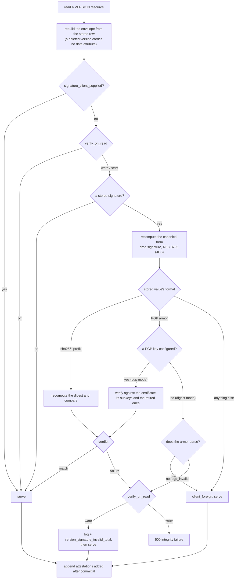

# PGP signing

`pgp` mode replaces the stored SHA-256 digest with an OpenPGP
([RFC 9580](https://www.rfc-editor.org/rfc/rfc9580)) detached signature made
with a key the server holds. The key is ML-DSA-65+Ed25519, the composite
post-quantum signature algorithm (ID 30) that
[RFC 9980](https://www.rfc-editor.org/rfc/rfc9980) requires every
implementation to support. openEHR names that format directly: the
signature "is generated according to the openPGP standard", and where a
digest only detects tampering, a signature "authenticates the user as the
author of the content to readers of the content" and "acts as a
non-repudiation measure, since the signature is stored permanently with the
data" ([RM Common IM, Change Control §Digital
Signature](https://specifications.openehr.org/releases/RM/Release-1.1.0/common.html#_digital_signature)).

Read [Digest signing](digest.md) first: what gets signed, when, and
how the canonical form is built are identical in both modes. This page
covers what changes.

<!-- toc -->

## What differs from digest mode

|                      | `digest`                                    | `pgp`                                          |
|----------------------|---------------------------------------------|------------------------------------------------|
| Stored value         | `sha256:` + base64(SHA-256(canonical form)) | ASCII-armored RFC 9580 detached signature      |
| Key material         | none                                        | an armored secret key the server loads at boot |
| Hash                 | SHA-256                                     | SHA2-512, inside the OpenPGP signature         |
| Proves               | the version was not altered after committal | that, plus which key signed it                 |
| Boot behaviour       | nothing to validate                         | refuses to start without a usable key          |
| Verification at read | recompute and compare                       | verify against the configured certificate      |

The bytes being signed do not change. The server assembles the version
envelope, drops the `signature` attribute, reduces it to its RFC 8785
canonical form, and hands that string to the signer. Only the last step
differs.

## Configuring the key

`pgp` mode needs a `key_file` pointing at an armored ML-DSA-65+Ed25519
secret key, and the passphrase that unlocks it if it has one. GnuPG cannot
make such a key; `ferrohealth-sop`, the Stateless OpenPGP command line of the
`ferrohealth-openpgp-pq` crate, can:

```shell
cargo install ferrohealth-openpgp-pq --version =0.1.0 --locked
ferrohealth-sop generate-key --signing-only --with-key-password=pgp-pass \
  "FerroEHR records <records@example.org>" > signing.asc
ferrohealth-sop extract-cert < signing.asc > signing.pub.asc
```

Its signatures are version 6 signatures over SHA2-512 that carry both an
Ed25519 and an ML-DSA-65 signature, and verify only when both halves verify
([RFC 9980 §3.2](https://www.rfc-editor.org/rfc/rfc9980#section-3.2)). A
signature over a hash with a digest under 256 bits is refused before any
cryptography ([§5.3.1](https://www.rfc-editor.org/rfc/rfc9980#section-5.3.1)),
and so is any signature over MD5, SHA-1 or RIPEMD-160
([RFC 9580 §9.5](https://www.rfc-editor.org/rfc/rfc9580#section-9.5)).

```toml
[record.signing]
enabled = true
mode = "pgp"
key_file = "/etc/ferroehr/signing.asc"
key_passphrase_file = "/run/secrets/pgp-pass"
retired_key_files = ["/etc/ferroehr/signing-2025.pub.asc"]
```

The same settings as environment variables:

```shell
FERROEHR__RECORD__SIGNING__MODE=pgp
FERROEHR__RECORD__SIGNING__KEY_FILE=/etc/ferroehr/signing.asc
FERROEHR__RECORD__SIGNING__KEY_PASSPHRASE_FILE=/run/secrets/pgp-pass
FERROEHR__RECORD__SIGNING__RETIRED_KEY_FILES=/etc/ferroehr/signing-2025.pub.asc
```

Prefer `key_passphrase_file` over the inline `key_passphrase`: it is the
shape Docker Secrets and Kubernetes Secrets deliver, and the passphrase then
never appears in the environment. Setting both of the pair is a boot error.
The full key table, the Kubernetes `config.files` mount, and the rotation
walkthrough are in the
[configuration reference](../installation/config-auth.md#recordsigning).

**Boot is fail-closed.** The server loads the key, then signs a fixed test
string with it. A missing `key_file`, an unparseable file, a wrong
passphrase, or a key that fails its checks (version 6, a valid direct-key
self-signature with the signing flag, not revoked) all stop startup with an
error rather than leaving a running server that cannot sign.

**A classical signing key is refused at boot.** An Ed25519, EdDSA, RSA,
ECDSA or Ed448 key in `key_file` stops startup with an error that names the
key's fingerprint and points at `ferrohealth-sop generate-key`. Classical
signatures are quantum-vulnerable, and a version signature is kept for the
life of the record. Generate an ML-DSA-65+Ed25519 key and list the classical
certificate's public half in `retired_key_files`: the versions it signed
keep verifying.

**The key is unlocked once, at boot.** The passphrase in
`key_passphrase_file` decrypts the key when the server loads it and runs its
boot check. The server then holds the unlocked key in memory and drops the
passphrase. This is the usual practice for a signing
service: the string-to-key derivation that protects a key at rest is slow on
purpose (RFC 9580
[§3.7](https://www.rfc-editor.org/rfc/rfc9580#section-3.7)), and running it
for every signature would put it on every write and every access-log entry.
Holding the unlocked key exposes nothing that holding the passphrase
did not. Protect the process memory as you protect the key file: no core
dumps, no swap to unencrypted disk, no debugger attached in production.

**Every signature is ML-DSA-65+Ed25519.** The server signs every committed
version, every access-log link and every system-log seal, so an access log
that records an access to each EHR a query serves makes several signatures
per request. Both halves run in `aws-lc-rs`, and the ML-DSA-65 half is the
hedged form RFC 9980 §5.1.2 requires.

### Retired keys and rotation

A stored `VERSION.signature` records no key identifier, and it is an
immutable committed fact that cannot be re-issued. Rotating the key
therefore keeps the old one verifiable: the replaced certificate's
**public** half is listed in `retired_key_files` and consulted during
verification. A public key verifies and can never sign again, so a retired
entry cannot become an active signer.

A retired certificate may use any algorithm the server can verify,
ML-DSA-65+Ed25519, Ed25519, RSA, ECDSA and Ed448 included, with its subkeys,
so the classical signatures that versions before the move to
ML-DSA-65+Ed25519 stored keep verifying.

## Server-generated versus client-supplied signatures

A `VERSION.signature` in this repository is one of two things, and the
distinction is recorded on the row rather than guessed from the value.

**Server-generated** is the ordinary case. The direct write routes
(`POST`/`PUT`/`DELETE` on a composition, the EHR status, the directory, a
demographic party) carry no signature field at all, so every version they
commit is signed by this server when signing is enabled.

**Client-supplied** reaches the server through one route: an
`UPDATE_VERSION.signature` inside a CONTRIBUTION commit. When a member
carries one, the server stores it verbatim and does not sign that version
itself, whatever `record.signing.mode` says. openEHR models the signature as a
fact created by the committer and carried with the data, potentially in
another agreed serialization, so the server has nothing to recompute it
against. Such a signature is never re-verified at read, and no
`verify_on_read` setting changes that.

> [!NOTE]
> A client-supplied value is stored as sent, so an opaque or invalid one is
> served back unchanged rather than refused. It is a claim by the committer,
> and this server neither vouches for it nor mistakes it for its own. Only
> signatures the server generated are covered by read-time verification.

## Imported versions carry two signatures

An EHR Extract import wraps each received `ORIGINAL_VERSION` in an
`IMPORTED_VERSION`, and openEHR is explicit about what happens to signatures
there. The wrapped original "is never modified", and the wrapper is signed
like any other version: "all attributes of the object are serialised and
then used to generate a signature. The result will be that the
`IMPORTED_VERSION` instance will carry its own signature which signifies the
act of importing and making available locally an `ORIGINAL_VERSION` from
another system."

FerroEHR implements exactly that:

- **The wrapper is signed by this server**, over the whole
  `IMPORTED_VERSION` including the wrapped `item`, using the configured mode.
  An import is a local act of committal, so it is signed like one.
- **The wrapped original's signature rides inside `item` untouched.** It
  belongs to the source system's key, which this server does not hold, so it
  is served verbatim and never verified.

Reading such a version verifies the wrapper and leaves the wrapped
signature alone. Reading the same version as an `ORIGINAL_VERSION` (the form
an EHR Extract export carries) reproduces the received original with its
foreign signature and verifies nothing, which is what makes a re-export a
faithful copy.

## Read-time verification

The stored signature's own format decides how it is checked, which is why a
mode change does not strand history. The full path:



The server reaches one of five verdicts: `digest_match`, `digest_mismatch`,
`pgp_valid`, `pgp_invalid`, `client_foreign`. Two of them are failures,
`digest_mismatch` and `pgp_invalid`, and those are the ones counted, under
the `verdict` label on `version_signature_invalid_total`.

Three parts of the path are worth stating in prose:

- **Attestations added after committal are appended after verification.**
  openEHR allows an attestation "at any time after committal", so such an
  attestation post-dates the signature and cannot be inside it. The server
  verifies the at-committal form and then extends the served list.
- **A version with no stored signature is served normally.** Versions
  committed while signing was disabled carry none, and their absence is not
  a failure.
- **`strict` is the default while signing is enabled.** A mismatch is a
  `500` rather than a served record that is provably altered. `warn`
  downgrades that to a logged and metered event, which is a deliberate
  reduction in an integrity guarantee rather than a setting to leave on.
