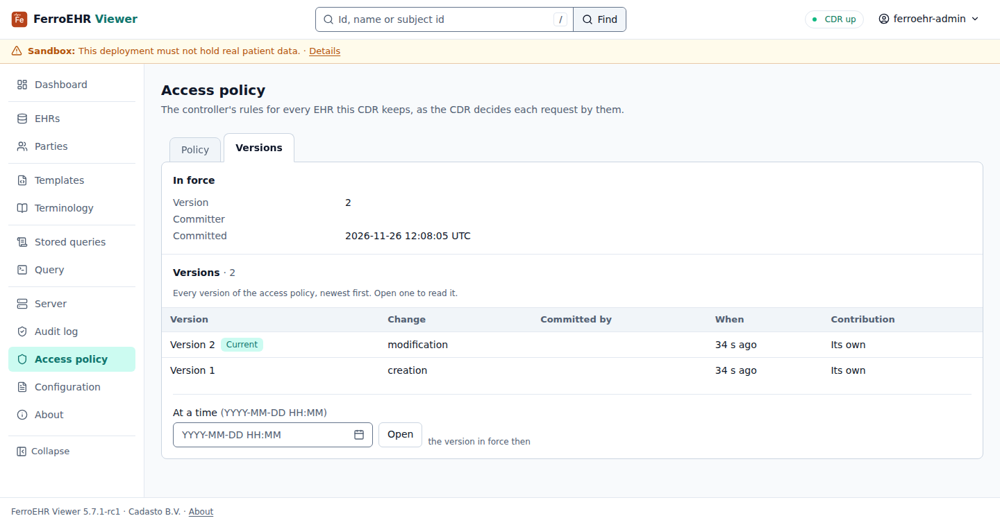

# Access control

For operators: the pages that show how this FerroEHR decides each request.

The **Access policy** page shows the rules your FerroEHR decides every request
by, and lets an administrator change them. Everything on it comes from the
CDR's admin extension over HTTP, so it shows only what the CDR lets your
account read.

<!-- toc -->

## The access policy

**Access policy**, in the sidebar's console group, reads the controller's
`ACCESS_POLICY` in force (`GET {ext}/admin/access_policy`, see
[Operational policy](../operational-policy.md#the-access-policy)) and draws it
by section:

- **Classifications:** which data carry which sensitivities and
  confidentiality.
- **Controller rules:** who may do what with which data, for which purposes,
  and whether each rule denies or permits (EHDS Art. 11(3)).
- **Catalogue:** the named directives a patient accepts by reference.
- **Care relationship facts:** `care_relationship_required`,
  `relationship_grace`, `self_declared_care`, `attested_care`, `caseload` and
  `episode_shared`. An attribute the policy leaves out reads as its strictest
  default, and the page says it is left out.
- **Purpose of use:** `purpose_required`.
- **Conflict rules**, **Concealed confidentialities**, **Log restrictions**
  (EHDS Art. 9(3)) and **Value sets**.
- **Other attributes:** the rest of what the policy states, such as its time
  zone.

Each coded value shows its rubric, its code and its terminology. Under the
sections, the policy's document is shown whole, as the CDR sent it.

While no policy is committed, the page says so: nothing is tightened, and the
CDR decides every request by its configuration alone. An administrator can
write the first version from there.

If your account may not read the policy (the CDR answers `403`), the page says
so. If the CDR runs with its admin API off (`[api] admin = false`, every admin
route answering `405`), the page says that instead, and offers no action.

## Versions

The **Versions** tab lists every version of the policy, newest first, with its
committer, the time it was committed and its change type. Open a version to
read it, drawn by section, with a notice that it is an older version; an older
version offers no edit. **At a time** opens the version that was in force at
the instant you give.

## Editing the policy

**Edit the policy** opens the whole `ACCESS_POLICY` in the code editor. The
save commits the next version over the one you opened: the viewer sends that
version in `If-Match` (or `If-None-Match: *` for the first version), so if
another administrator saved first the CDR refuses the save with `412`, and the
page offers to reload the newest version. A document the CDR cannot read is
refused with `400`, and one that breaks a rule of the policy model with `422`;
either refusal is shown beside the editor in the CDR's words, with the line it
names marked, and your document stays as you typed it.

A save also needs a `write_access_policy` grant in the CDR, so the admin role
alone changes no policy ([The policy
parties](../operational-policy.md#the-policy-parties)). The new version applies
on every replica from its next request.

## Roles and grants

**Roles and grants**, in the console group, lists what the CDR's policy
parties grant ([The policy
parties](../operational-policy.md#the-policy-parties)). It reads them through
AQL rooted at `ROLE`, `AGENT` and `PARTY_RELATIONSHIP` (`POST
/query/aql`), so the CDR's policy-party rule decides what you see: an
administrator reads every policy party, and anyone else gets an empty list.

- **Roles holding a grant:** each `ROLE` whose capability holds an
  `openehr_access` grant, with the grant codes and their rubrics, the terms
  that qualify them (such as a `scope` or a `binding_issuer`), the party that
  performs the role, the role's and the capability's validity, and whether the
  grant is in force now.
- **System agents:** each party bound to an OAuth 2.0 client, with its client
  id, the token issuer and the provider it acts for.

Each row opens its party. A grant is given by a new version of its `ROLE`
that adds the grant to the role's capability, and ended by a version whose
validity ends before today. You write either version in the party editor.

A party page marks a policy party under **Policy party**: the client the
party binds, and the grants its roles carry.

