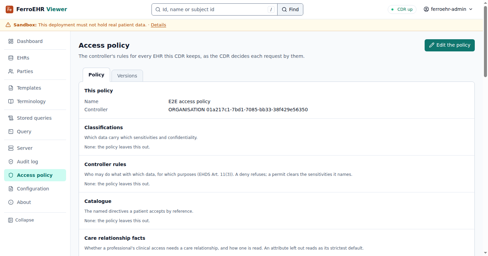
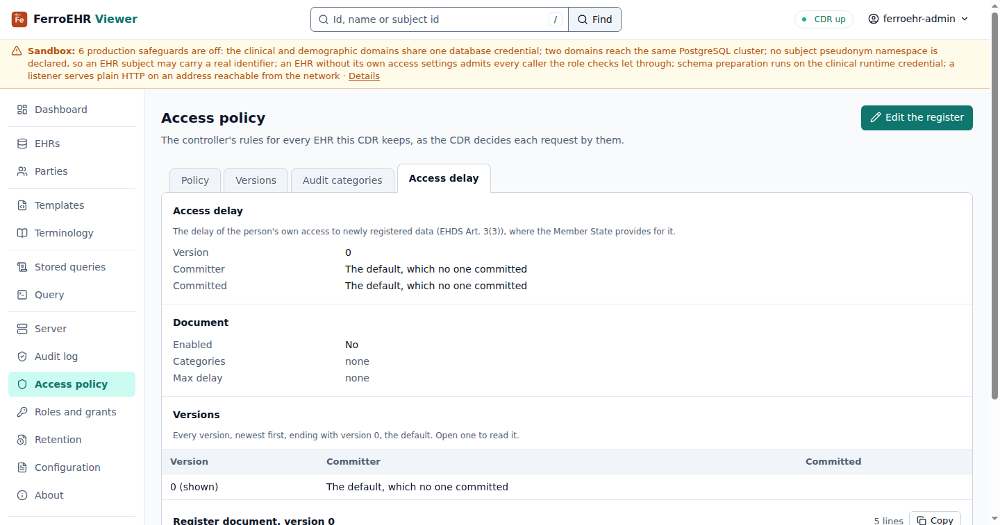
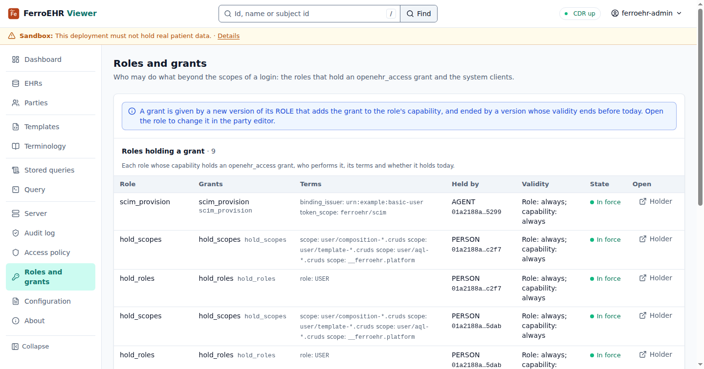
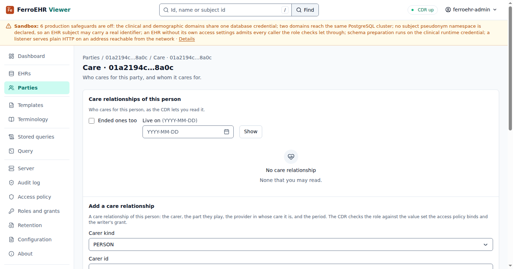
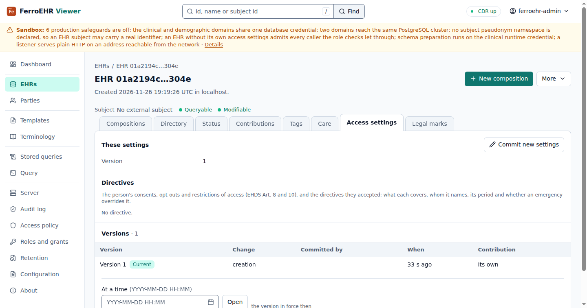
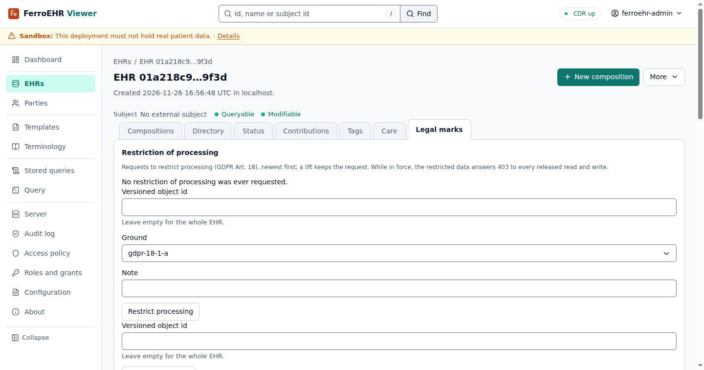
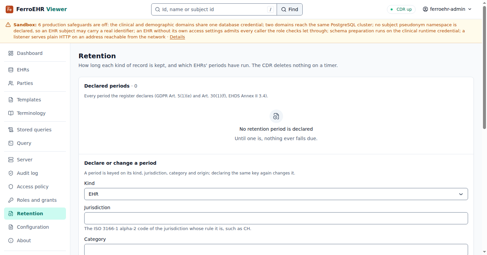

# Access control

For operators: the pages that show how this FerroEHR decides each request.

The **Access policy** page shows the rules your FerroEHR decides every request
by, and lets an administrator change them. Everything on it comes from the
CDR's admin extension over HTTP, so it shows only what the CDR lets your
account read.

<!-- toc -->

## The access policy

**Access policy**, in the sidebar's console group, reads the controller's
`ACCESS_POLICY` in force (`GET {ext}/admin/access_policy`, see
[The access policy](../access-policy.md#the-access-policy)) and draws it
by section:

- **Classifications:** which data carry which sensitivities and
  confidentiality.
- **Controller rules:** who may do what with which data, for which purposes,
  and whether each rule denies or permits (EHDS Art. 11(3)).
- **Catalogue:** the named directives a patient accepts by reference.
- **Care relationship facts:** `care_relationship_required`,
  `relationship_grace`, `self_declared_care`, `attested_care`, `caseload` and
  `episode_shared`. An attribute the policy leaves out reads as its strictest
  default, and the page says it is left out.
- **Purpose of use:** `purpose_required`.
- **Conflict rules**, **Concealed confidentialities**, **Log restrictions**
  (EHDS Art. 9(3)) and **Value sets**.
- **Other attributes:** the rest of what the policy states, such as its time
  zone.

Each coded value shows its rubric, its code and its terminology. Under the
sections, the policy's document is shown whole, as the CDR sent it.

While no policy is committed, the page says so: nothing is tightened, and the
CDR decides every request by its configuration alone. An administrator can
write the first version from there.

If your account may not read the policy (the CDR answers `403`), the page says
so. If the CDR runs with its admin API off (`[api] admin = false`, every admin
route answering `405`), the page says that instead, and offers no action.

## Versions

The **Versions** tab lists every version of the policy, newest first, with its
committer, the time it was committed and its change type. Open a version to
read it, drawn by section, with a notice that it is an older version; an older
version offers no edit. **At a time** opens the version that was in force at
the instant you give.

## Editing the policy

**Edit the policy** opens the whole `ACCESS_POLICY` in the code editor. The
save commits the next version over the one you opened: the viewer sends that
version in `If-Match` (or `If-None-Match: *` for the first version), so if
another administrator saved first the CDR refuses the save with `412`, and the
page offers to reload the newest version. A document the CDR cannot read is
refused with `400`, and one that breaks a rule of the policy model with `422`;
either refusal is shown beside the editor in the CDR's words, with the line it
names marked, and your document stays as you typed it.

A save also needs a `write_access_policy` grant in the CDR, so the admin role
alone changes no policy ([The policy
parties](../operational-policy.md#the-policy-parties)). The new version applies
on every replica from its next request.

## The admin registers

The Access policy area has a tab for each [admin
register](../operational-policy.md#the-admin-registers): **Audit categories**,
the EHDS category map every access is classified through, and **Access
delay**, the EHDS Art. 3(3) delay of the person's own access. Each reads
`GET {ext}/admin/registers/{register}` and shows the version in force, who
committed it and when, and its document drawn by its members: the access
delay's `enabled`, `categories` and `max_delay`, and the category map's
`shipped_map`, `national`, `templates` and `archetypes`.

The history (`/history`) lists every version, newest first, ending with
version 0, the default no one committed. Open a version to read it; an older
version offers no edit.

**Edit the register** replaces its whole document in the code editor. The save
names the version you opened in `If-Match`; a document the CDR refuses
(`400`) or a version another administrator replaced first (`412`) is shown in
the CDR's words, with your document kept. A `403` says your account may not
read the register, and with the admin API off the tab says so.

## Roles and grants

**Roles and grants**, in the console group, lists what the CDR's policy
parties grant ([The policy
parties](../operational-policy.md#the-policy-parties)). It reads them through
AQL rooted at `ROLE`, `AGENT` and `PARTY_RELATIONSHIP` (`POST
/query/aql`), so the CDR's policy-party rule decides what you see: an
administrator reads every policy party, and anyone else gets an empty list.

- **Roles holding a grant:** each `ROLE` whose capability holds an
  `openehr_access` grant, with the grant codes and their rubrics, the terms
  that qualify them (such as a `scope` or a `binding_issuer`), the party that
  performs the role, the role's and the capability's validity, and whether the
  grant is in force now.
- **System agents:** each party bound to an OAuth 2.0 client, with its client
  id, the token issuer and the provider it acts for.

Each row opens its party. A grant is given by a new version of its `ROLE`
that adds the grant to the role's capability, and ended by a version whose
validity ends before today. You write either version in the party editor.

A party page marks a policy party under **Policy party**: the client the
party binds, and the grants its roles carry.

## Care relationships

A care relationship says that a professional, a care team or a unit cares
for a person, for a period ([Caller facts: roles and care
relationships](../operational-policy.md#caller-facts-roles-and-care-relationships)).
The viewer reads them from the CDR's care relationship resources under
`{ext}`, and the CDR decides for each subject what you may see: a relationship
you may not read is left out, or the page shows the CDR's refusal.

- **An EHR's Care tab** lists the care relationships of the EHR's subject
  (`GET {ext}/care_relationship?subject_id=&subject_namespace=`): the carer,
  the care role with its code and terminology, the period and the path
  (direct, or through a team). It shows the live ones today; **Ended ones
  too** and **Live on** ask for more.
- **A party's Care page** (from **Care relationships** on its Overview) shows,
  for a `PERSON`, the same list for the subject it is
  (`GET {ext}/demographic/person/{id}/care_relationship`) and the form that
  adds one. For every party it lists the subjects in its care
  (`GET {ext}/care_relationship?carer=`), a page at a time.
- **A relationship's page** shows its facts and every version with who
  committed it and when. With a `write_care_relationship` grant, or as an
  administrator, you change its role or period, **End today** (its period
  closes today), or **Delete** one written in error. Each write names the
  version you read in `If-Match`, and a refusal is shown in the CDR's words.

To add one, give the carer's party id and kind, the care role (the
`HL7_ParticipationType` codes are offered; another terminology is written as
`terminology|code`), an identifier the provider's `ORGANISATION` carries, and
the period. The CDR checks the role against the value set the access policy
binds.

## An EHR's access settings

An EHR's **Access settings** tab shows its `EHR_ACCESS` settings
(`GET {ext}/ehr/{ehr_id}/ehr_access`): the person's consents and opt-outs,
their restrictions of access by health professionals (EHDS Art. 8) and the
directives they accepted. Each directive is drawn with its kind, its effect,
what it covers, whom it names, its period and whether an emergency overrides
it. With no settings the tab says the policy's defaults apply.

The tab lists every version (`/versioned_ehr_access/revision_history`) with
its committer and time, and opens any one read-only.

An administrator commits new settings on the person's instruction
(`POST {ext}/admin/ehr-access`): the whole `ACCESS_DIRECTIVE_SETTINGS` in the
code editor, saved over the version you opened, so settings another
administrator changed meanwhile are refused (`412`). **Repair** replaces
settings that do not parse (`POST {ext}/admin/ehr-access/repair`). Each
refusal is shown in the CDR's words; a `403` follows the CDR's decision.

## Legal marks

An EHR's **Legal marks** tab shows the four marks the law asks a repository to
hold beside its content, so you can see why a record answers `403` or why the
person does not see a composition. Each comes from the CDR's admin marks API
([Admin & messaging APIs](../operations-admin-apis.md#legal-marks-restriction-objection-and-retention)):

- **Restriction of processing** (GDPR Art. 18,
  `GET {ext}/admin/restriction?ehr_id=`): every request, newest first, with
  its ground, the object it covers or the whole EHR, when it was placed and
  when it was lifted. A lift keeps the request.
- **Objection to research processing** (GDPR Art. 21(6),
  `GET {ext}/admin/research-objection?ehr_id=`): whether the person's
  objection stands, when they objected, and any public-interest override.
- **Access delay** (EHDS Art. 3(3), `GET {ext}/admin/access-delay?ehr_id=`):
  the compositions held from the person, each with its basis, its end and its
  release.
- **Retention** (`GET {ext}/admin/retention/anchor` and `/hold`): the EHR's
  jurisdiction, anchor and any EHR-wide hold, and the objects held from
  disposal.

An administrator places and lifts a restriction (for the whole EHR, or one
object by its id), records an objection, its override or its withdrawal,
holds a composition from the person or releases it, records the retention
anchor, and holds an object from disposal or releases it. Each write that
changes what others may read waits behind a confirmation, and a refusal is
shown in the CDR's words.

A composition held from the person shows the hold on its own page, and the
treating professional releases it there
(`POST {ext}/ehr/{ehr_id}/versioned_composition/{uid}/access-delay/release`).

## Retention

**Retention**, in the console group, reads the CDR's retention register
(`GET {ext}/admin/retention/policy`, [Retention](../compliance/retention.md)):
every declared period with the kind of record it covers, its jurisdiction,
the EHDS category and the origin it is keyed on, the period, what it runs
from and the citation it rests on. An administrator declares a period, or
changes one by declaring its key again (`PUT {ext}/admin/retention/policy`);
a refusal is shown in the CDR's words, with the fields kept.

**What is due** (`GET {ext}/admin/retention/due`) lists the EHRs whose period
has run, oldest first, with the objects due and the objects held. The CDR
deletes nothing on a timer, and neither does the page: acting on a row is your
decision, through the physical delete. A `403` says your account may not read
the register, and with the admin API off the page says so.

