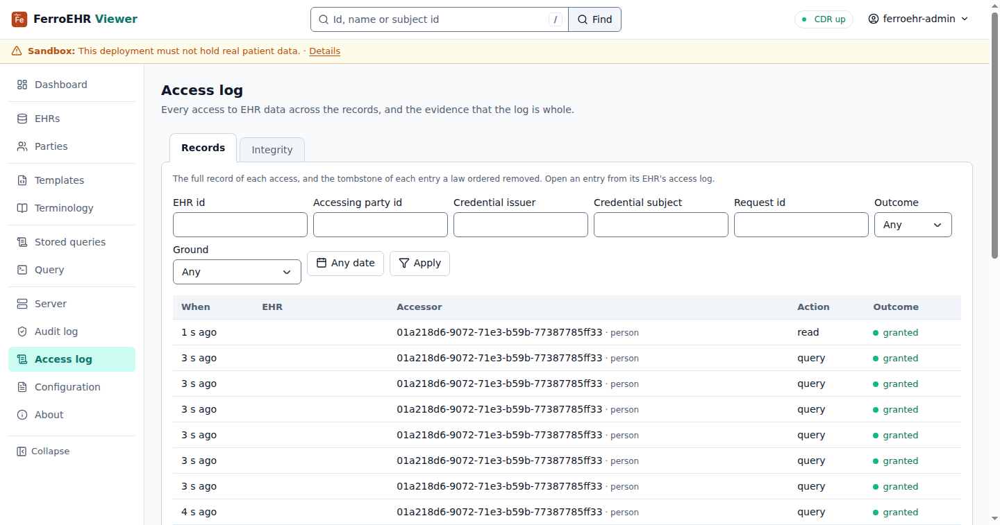
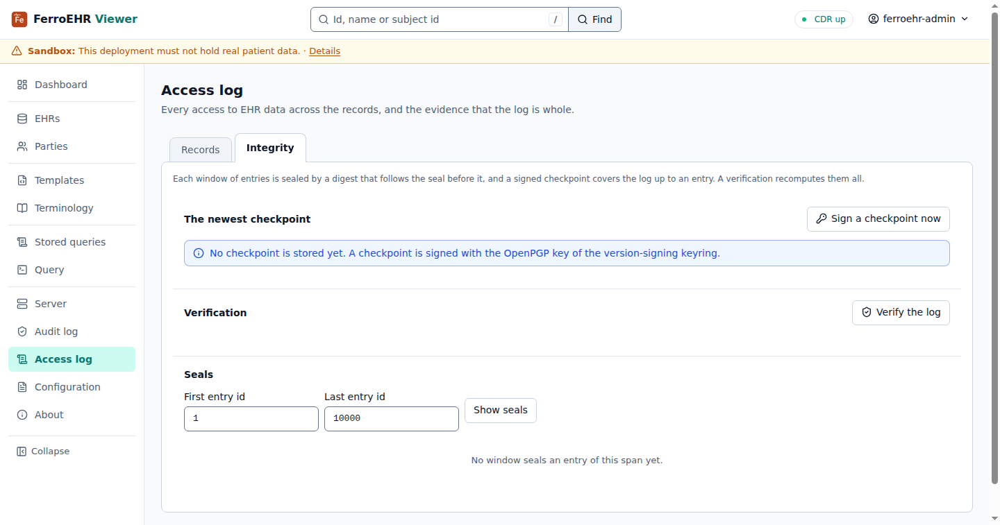

# Access log

For operators and reviewers, and for the person a record is about.

An EHR's **Access log** tab lists who accessed the record, when, what they
reached and what the access rested on, as FerroEHR recorded it. It reads
`GET /ferroehr/rest/extensions/v1/ehr/{ehr_id}/access_log`, and an entry
reads `GET …/access_log/{uid}`. What the log holds and who may read which
view is described on [The access log](../access-log.md#reading-the-access-log-over-its-rest).

<!-- toc -->

## The list

Each row is one access: when it was recorded, the accessor and their kind,
the action, the types of the objects reached, and the outcome. An access a
clinician made on a justification, or as an emergency, carries a mark beside
its outcome. Each row opens its entry.

The CDR decides what you read. The person the record is about and their
representative read their own view, which leaves out what serves review
alone; a reviewer reads the full record. Any other account sees that it may
not read the log. The person's own reads of their log are left out until you
tick **Include the person's own reads of this log**.

The filters are a plain form whose values stay in the address: the action,
the outcome, the kind of accessor, the ground (a justification or an
emergency) and the days recorded. The page position is kept in your browser's
session. Every read of the log is itself an access the CDR records.

## An entry

An entry shows the access (when, the accessor linked to their party, the
provider they acted for, their roles, the action and API operation, the
outcome and its reason, the purposes of use), what it rested on (each
authorisation with the policy version it names and, for a justified or an
emergency access, the reason the clinician stated), what it reached (each
object with its categories), and the entry as the CDR served it.

An administrator erases an entry from its page with **More actions** >
**Erase**, giving the grounds as a coded term (a terminology id, a code and
the words). The CDR replaces the entry with a tombstone that keeps the
grounds (`POST …/admin/access-log/erase`). **Export the log** on the tab
downloads the EHR's records with their links and the checkpoint that covers
them (`GET …/admin/access-log/export`); without a checkpoint the CDR refuses
it and the viewer says why.

## The review across EHRs

**Console** > **Access log** lists every record of the log for a reviewer,
newest first, in the full view, with the tombstone of each erased entry
(`GET …/admin/access-log`). Filter by EHR, accessing party, credential issuer
or subject, request, outcome, ground and days. A row opens the entry on its
EHR's access log. An account the admin role does not admit reads that it is
no reviewer, and with the admin API off the page says so.

## Integrity

The **Integrity** tab shows the evidence that the log is whole, as described
on [Audit trail](../audit.md#seals-checkpoints-and-the-transfer-of-a-log):

- the newest signed checkpoint, with its digest, algorithm, signer and
  signature (`GET …/admin/access-log/checkpoint`), and **Sign a checkpoint
  now**, which needs an OpenPGP key in the version-signing keyring;
- **Verify the log**, which recomputes every window against the checkpoint
  and lists each finding in the CDR's words (`POST …/admin/access-log/verify`);
- the seal of each window over a span of entry ids, at most 10000 apart
  (`GET …/admin/access-log/seals`).

