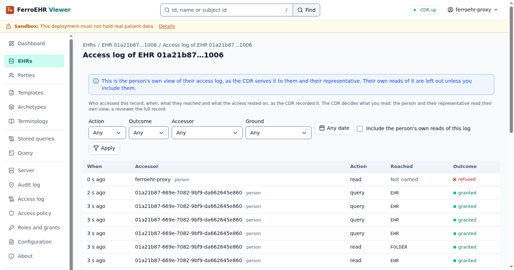
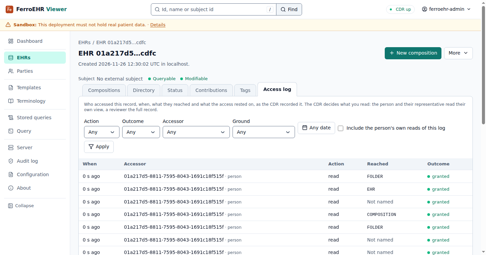

# Access log

For operators and reviewers, and for the person a record is about.

An EHR's **Access log** tab lists who accessed the record, when, what they
reached and what the access rested on, as FerroEHR recorded it. It reads
`GET /ferroehr/rest/extensions/v1/ehr/{ehr_id}/access_log`, and an entry
reads `GET …/access_log/{uid}`. What the log holds and who may read which
view is described on [The access log](../access-log.md#reading-the-access-log-over-its-rest).

<!-- toc -->

## The list

Each row is one access: when it was recorded, the accessor and their kind,
the action, the types of the objects reached, and the outcome. An access a
clinician made on a justification, or as an emergency, carries a mark beside
its outcome. Each row opens its entry.

The CDR decides what you read. The person the record is about and their
representative read their own view, which leaves out what serves review
alone; a reviewer reads the full record. When the CDR answers with the
person's own view, the tab and each entry say so above the list, from the
view the CDR names in its answer. Any other account sees that it may not read
the log. The person's own reads of their log are left out until you tick
**Include the person's own reads of this log**.

The tab stays on every EHR page. If the CDR serves no access log for the
record, the tab says so. The viewer does not check in advance, because each
read of the log is itself recorded.

The filters are a plain form whose values stay in the address: the action,
the outcome, the kind of accessor, the ground (a justification or an
emergency) and the days recorded. The page position is kept in your browser's
session. Every read of the log is itself an access the CDR records.

## An entry

An entry shows the access (when, the accessor linked to their party, the
provider they acted for, their roles, the action and API operation, the
outcome and its reason, the purposes of use), what it rested on (each
authorisation with the policy version it names and, for a justified or an
emergency access, the reason the clinician stated), what it reached (each
object with its categories), and the entry as the CDR served it.
