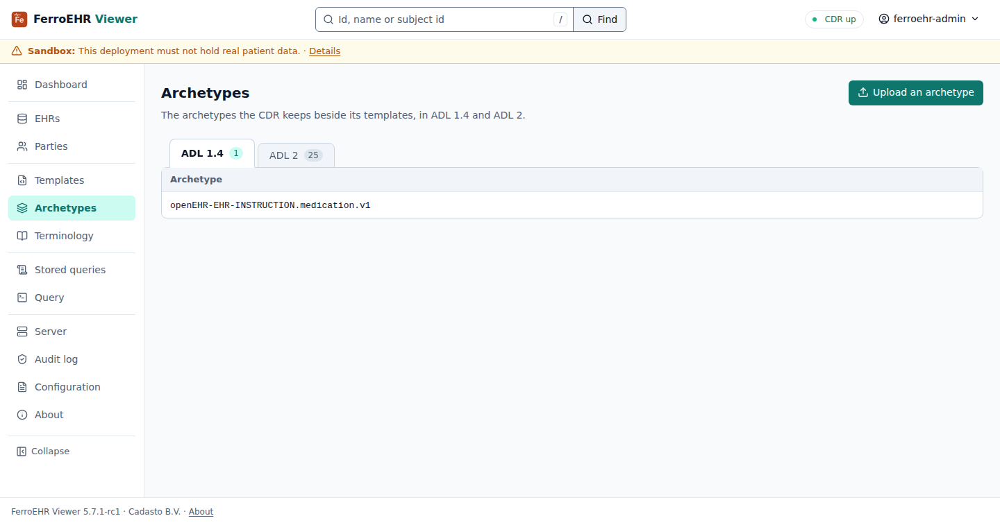
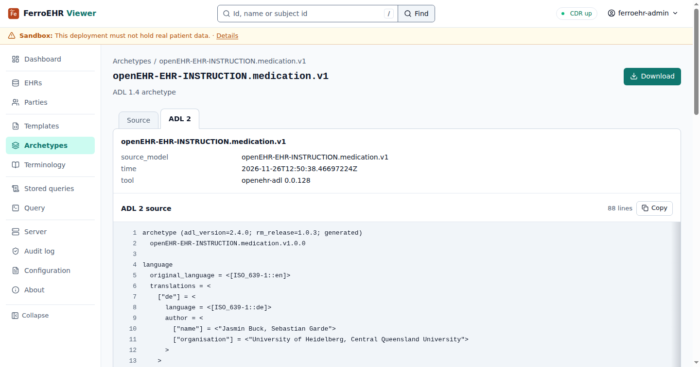

# Archetypes

For modellers and operators who keep a deployment's definition material in
the CDR.

**Archetypes**, under Definitions in the sidebar, lists the archetypes the CDR
keeps beside its templates and opens each one. They are a FerroEHR extension
under `/ferroehr/rest/extensions/v1`; [Templates & validation → Archetype
sources](../templates-validation.md#archetype-sources-a-ferroehr-extension)
describes the routes. A CDR that serves no archetype routes answers `404`, and
the page then says it keeps no archetypes and offers nothing.

<!-- toc -->

## The list

The list has a tab per family, each with its count:

- **ADL 1.4:** the stored ADL 1.4 archetype ids
  (`GET {ext}/definition/archetype/adl1.4`).
- **ADL 2:** the stored ADL 2 archetype ids
  (`GET {ext}/definition/archetype/adl2`).

The family stays in the address (`/archetypes?family=adl2`). A row opens the
archetype.

## An archetype

An ADL 1.4 archetype opens on **Source**, the source as stored
(`GET {ext}/definition/archetype/adl1.4/{archetype_id}`), with line numbers
and Copy. **ADL 2** shows the archetype converted to ADL 2
(`GET {ext}/definition/archetype/adl1.4/{archetype_id}/adl2`): the
conversion's notes, what it dropped or changed, and the ADL 2 source. A
source the CDR can no longer convert is reported in its words.

An ADL 2 archetype opens on its source, read where the openEHR API serves
every ADL 2 artefact (`GET /definition/template/adl2/{archetype_id}`).

**Download** saves either as a file: `.adl` for ADL 1.4, `.adls` for ADL 2.

## Uploading an archetype

**Upload an archetype** takes an ADL 1.4 source: choose or drop a file, or
paste the source, then **Upload**
(`POST {ext}/definition/archetype/adl1.4`). The CDR reads the archetype id
out of the source and replaces an archetype already stored under it. A
success opens the archetype; a source the CDR refuses, such as one that does
not parse, stays on the page with the CDR's words, and an account with the
read-only role is refused.
