# Templates & EHRs

**Templates** holds the operational templates the CDR validates compositions
against, and **EHRs** opens every EHR with its compositions, directory, status,
contributions and tags.

<!-- toc -->

## Templates

The list has a tab per family, **ADL 1.4** and **ADL 2**, each with its count,
a find field over id, concept and archetype, and a row per template with
**Build a query** and **Delete…** in its menu.

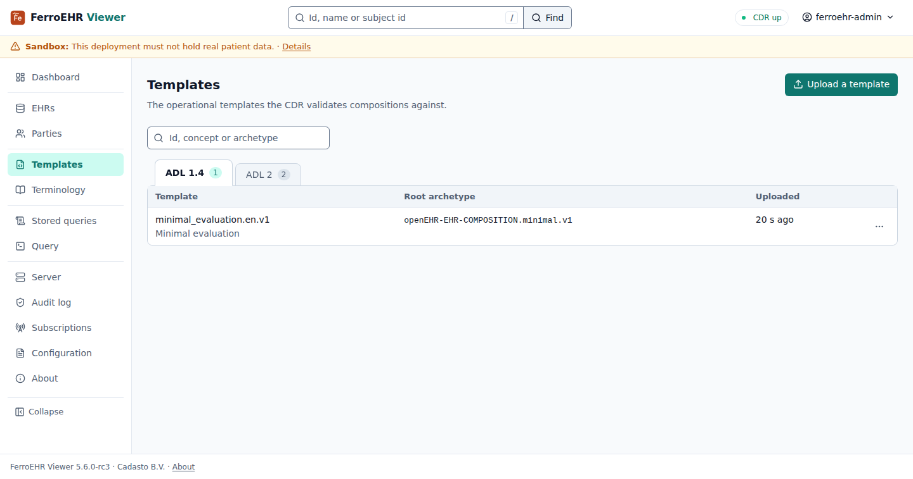

### Uploading a template

**Upload a template** opens an editor for one source: choose or drop a file
(`.opt` or `.xml` for ADL 1.4; `.adl`, `.adls`, `.adlt`, `.adl2` or `.txt` for ADL 2; up to 16 MiB) or
paste the source, then **Upload this template**. The CDR validates it; a
refusal keeps the source on the page beside the CDR's diagnostics, for ADL 2
the openEHR-ADL engine's own words. With JavaScript off, paste the source.

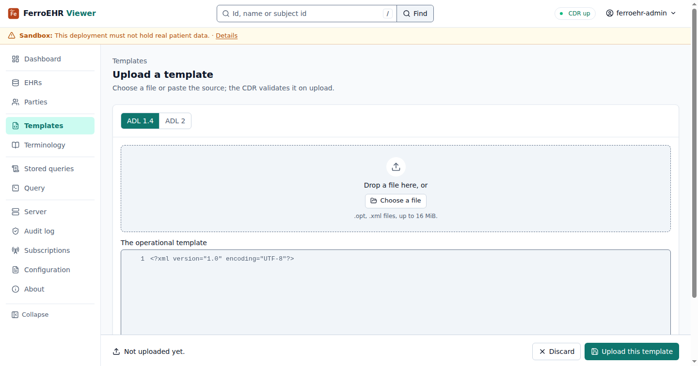

### A template

A template's page has four tabs. **Overview** reads its identity and how to
query it.

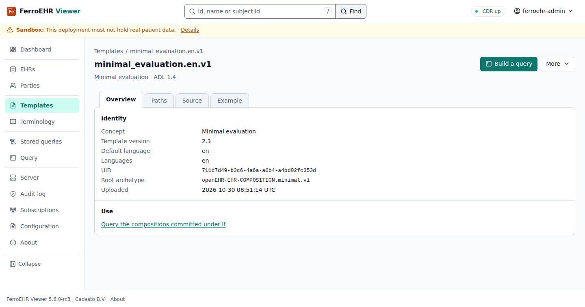

**Paths** is its Web Template as a tree: pick a node to read its path, type
and codes, and on a COMPOSITION template **Build a query on this path**. A
demographic template's nodes offer no query, since the query builder reads
compositions. With FerroUI's scripts loaded the tree folds in place and
answers the arrow keys; without them each node is a link.

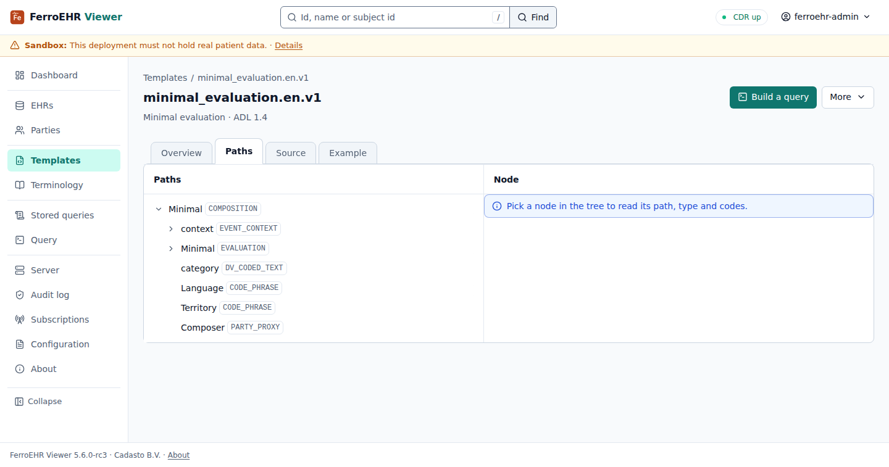

**Source** is the template as stored, with line numbers and Copy; **Download** in the More menu saves it as a file. **Example**
is the composition the CDR generates for it, in the format, type and detail
you pick.

### ADL 2 templates

The ADL 2 tab lists every release of every ADL 2 template, one row each. A
template's page shows its latest release with a picker over the others, and
the JSON tab beside Source shows the `OperationalTemplateV2` document. An
older release opens on its Overview, says which release you are reading, and
links back to the latest.

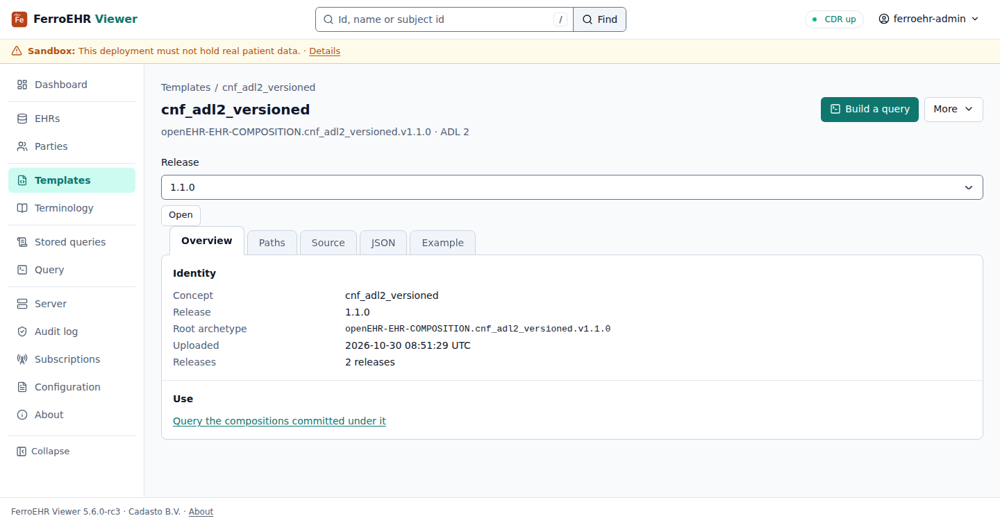

### Deleting a template

**Delete…** in a row's menu opens the template with the confirmation inline;
on the template's page it opens a dialog. The CDR refuses while compositions
use the template, and deleting needs its ADMIN role; either refusal arrives in
the CDR's words.

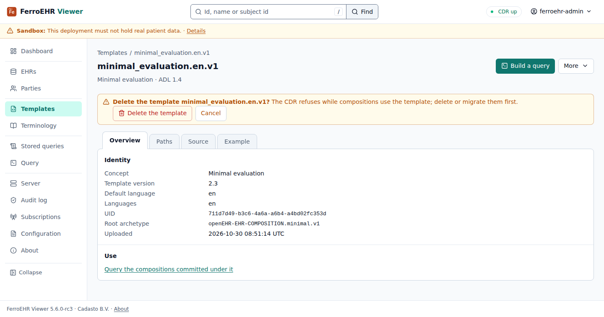

## EHRs

The list shows every EHR the CDR holds, newest first, and finds one by its
subject id and namespace. The subject is shown masked.

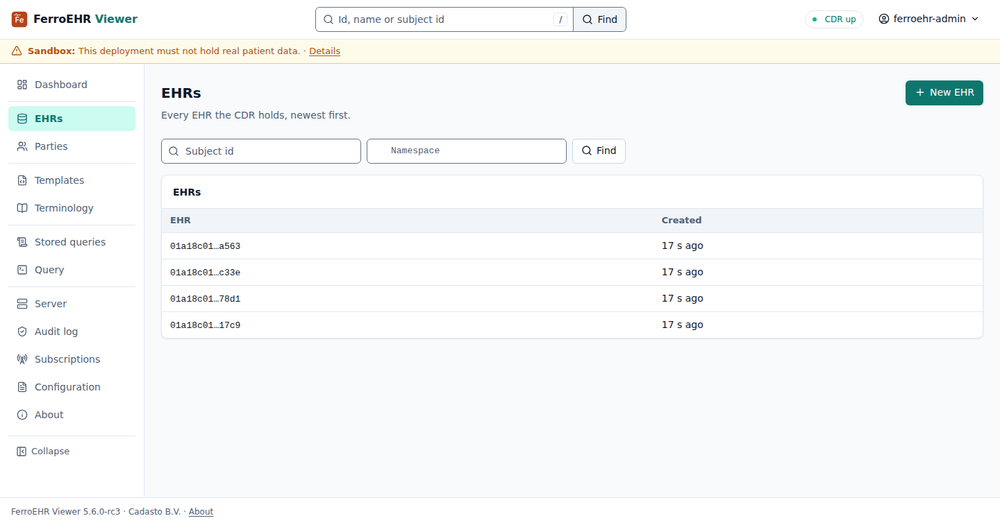

**New EHR** creates one with its status: an optional subject (an id the CDR
keeps without reading it, and its namespace) and an optional EHR id; leave the
id empty and the CDR mints a UUID. An id that is no UUID is refused before
anything is sent; an id the CDR already holds is refused with a link to that
EHR.

### An EHR

An EHR's page names it, its subject masked until you press **Reveal** (with
JavaScript off the reveal is a link),
and its Queryable and Modifiable badges, on every tab. A revealed subject hides
again after the time set in Your preferences (30 seconds unless you change
it). **New composition** and **More** (Commit several changes, Create the directory, Copy EHR id, Delete EHR…) sit in the
header.

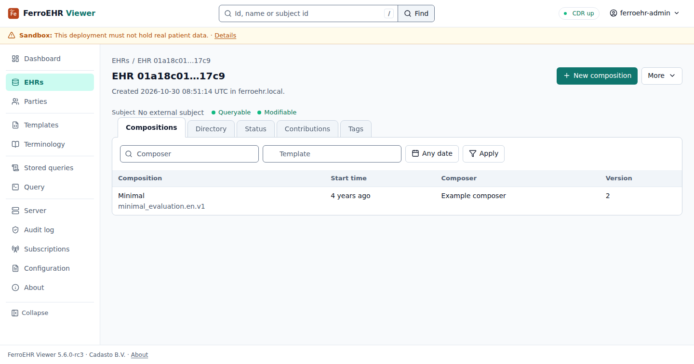

The tabs:

- **Compositions:** the EHR's compositions, filtered by composer, template and
  start date; the filters stay in the address.
- **Directory:** the folder tree, Show one folder by path, and the directory's
  versions with Restore… on each older one. **Edit** opens the editor: add,
  rename and remove folders and add references to the EHR's compositions;
  nothing reaches the CDR until you save. **Older versions** reads further back
  than the newest ten.
- **Status:** the current `EHR_STATUS` and its versions; **Edit status** sets
  Queryable, Modifiable and the other details as one new version.
- **Contributions:** the contributions per day over the last 30 days and every
  contribution, each opening its versions.
- **Tags:** every tag in the EHR, on a composition or on the EHR status, by
  key and value; a row opens the object it tags.

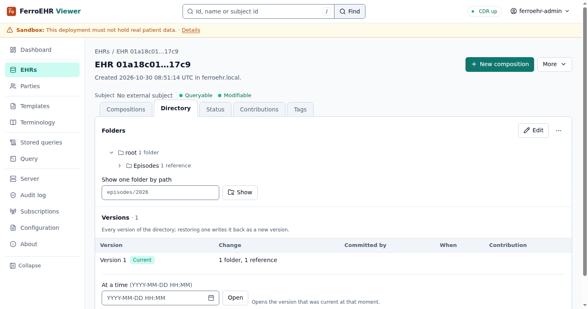

Every save names the version it supersedes (`If-Match`). A save over a
version someone else replaced meanwhile is refused with the CDR's `412`, and
the editor offers to reload the newer version.

### Deleting an EHR

**Delete EHR…** asks for the first eight characters of the EHR's id, then
removes the EHR and everything in it; it needs the CDR's ADMIN role.

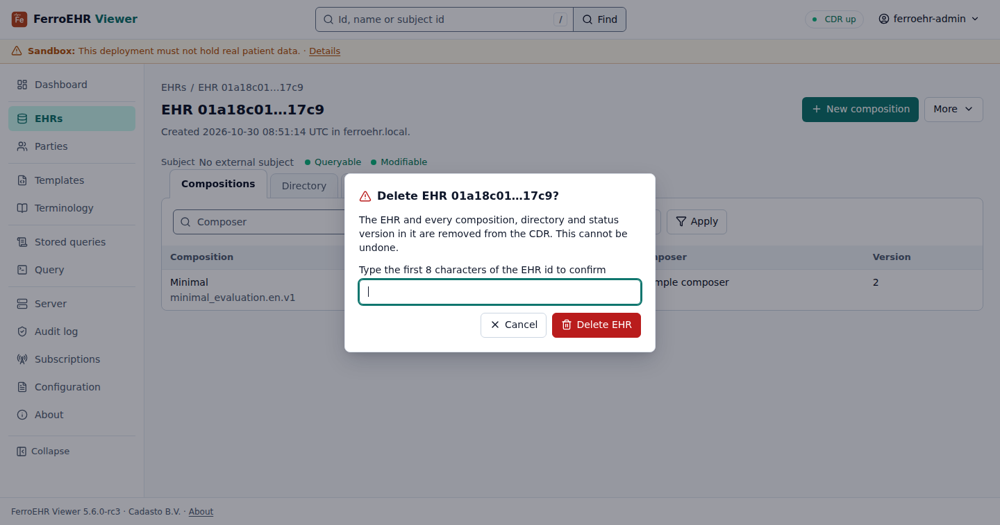

### Committing several changes at once

**Commit several changes** builds one contribution: stage a new composition,
an amended one or the EHR status, each with its document in an editor of its
own, as many as you need, then commit them together with a description. The CDR takes all of them or none: a refused
change keeps every staged change on the page beside the CDR's words.

## Compositions

A composition's page has four tabs. **Reading** shows it as a person reads
it, label and value, by section.

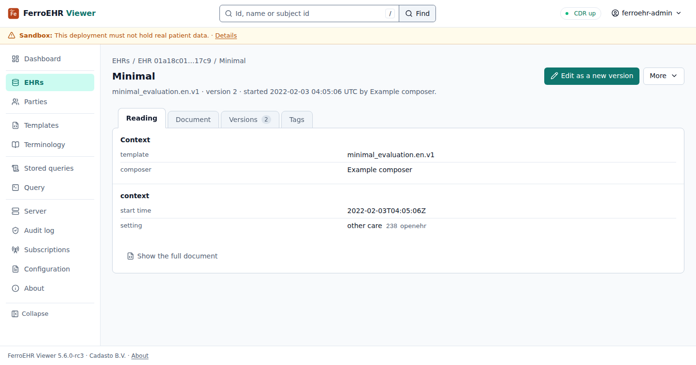

**Document** shows it in the format you pick (JSON, XML, FLAT or STRUCTURED),
as the CDR converts it. **Versions** lists every version and reads the
`VERSIONED_COMPOSITION` and the chosen version's envelope; **At a time** opens
the version that was current then. **Tags** lists the composition's tags and
sets or removes one; a tag stays on the composition across its versions and
commits no version.

**Edit as a new version** opens the document in an editor; the save writes
the next version. **Delete composition…** marks it deleted with a new version;
its versions stay readable and it leaves the EHR's list.
