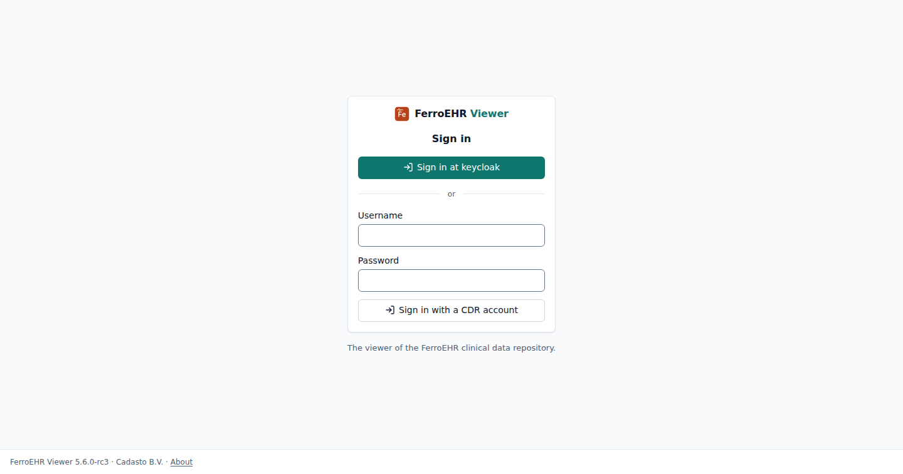
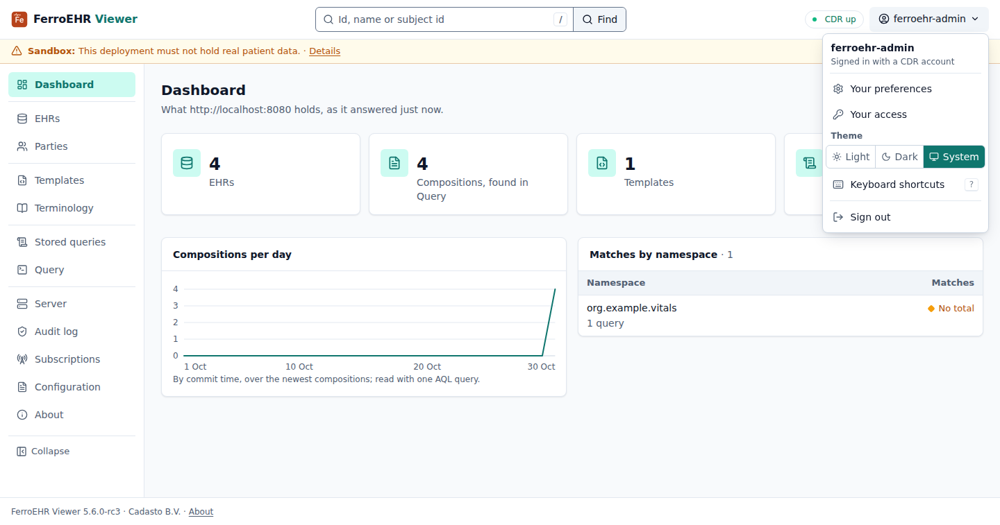
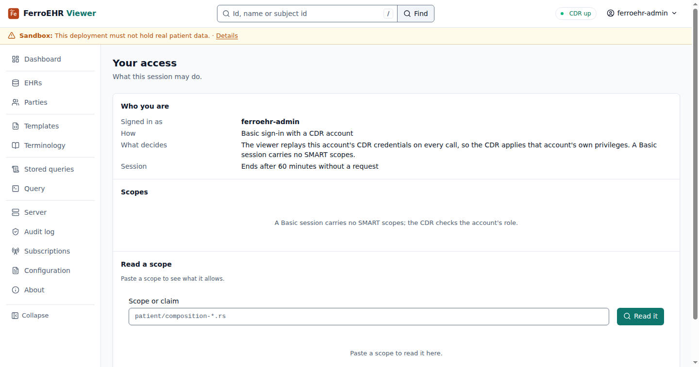
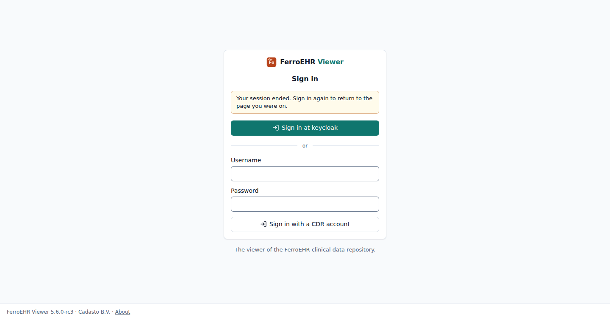

# FerroEHR Viewer

`ferroehr-viewer` is a standalone web UI for managing an
ITS-REST-1.1.0 CDR, this server or any other. It is a **pure REST client**:
everything it does goes through the CDR's public API (never the database),
so what you see in the viewer is exactly what the API serves. The whole
application is Rust, drawn on the server as plain HTML with FerroUI, the
component library the FerroHEALTH consoles share; the only scripts are
FerroUI's own small modules, and there is no hand-written JavaScript
anywhere, including its browser tests.

<!-- toc -->

## Running it

The quickstart compose ships the viewer as the `ferroehr-viewer` service on
port 3000, behind the `viewer` [profile](../installation/compose.md), so it
is opt-in and does not start with a plain `docker compose up`:

```bash
docker compose --profile viewer up
# → http://localhost:3000  (log in with the quickstart user ferroehr/ferroehr)
```

Standalone, point it at any CDR:

```bash
docker run -p 3000:3000 \
  -e FERROEHR_VIEWER__CDR__BASE_URL=https://cdr.example.org \
  ghcr.io/ferrohealth/ferroehr-viewer
```

### On Kubernetes

The Helm chart deploys the viewer as its own Deployment, Service and
ServiceAccount, with an optional Ingress and a NetworkPolicy that confines its
egress to the CDR and DNS: the viewer is a REST client of the CDR by mandate,
so the chart enforces that rather than trusting it. Off by default, and off
renders nothing:

```yaml
# values.yaml
viewer:
  enabled: true
  ingress:
    enabled: true
    hosts:
      - host: viewer.example.org
        paths:
          - path: /
            pathType: Prefix
  auth:
    oidc:
      enabled: true
      issuer: https://keycloak.example/realms/ferroehr
      clientId: ferroehr-viewer
      publicBaseUrl: https://viewer.example.org
  # the OIDC client secret is MOUNTED from a Secret you create, never env-borne
  existingSecret: viewer-oidc
```

It needs no database credential and never reaches the database. **Before you
enable OIDC:** a registered client whose redirect URI matches `publicBaseUrl`,
and a Secret holding its client secret. **To turn the viewer off**, set
`viewer.enabled: false` and upgrade; every viewer object is removed and the
CDR is untouched.

> [!NOTE]
> To scale the viewer past one replica, set the same `session.secret` on
> every replica: the session is a sealed cookie any key-holding replica can
> serve. Without a configured secret each replica seals with its own
> ephemeral key, and visitors get signed out whenever a request lands on
> another pod.

## Signing in

The sign-in page offers exactly the methods that can actually work: the
viewer's configured login modes intersected with the authentication
schemes the CDR advertises (its `WWW-Authenticate` challenge). A Basic
form is never shown against a bearer-only CDR, and vice versa. If the CDR
cannot be reached at all, the page falls back to the viewer's own
configuration and renders anyway, and the outage then surfaces on the login
attempt instead of hiding the page. A username or password the CDR refuses
brings you back to the sign-in card with the refusal under the password.



The viewer verifies the CDR and the OIDC issuer against the platform trust
store and the extra certificate authorities its configuration names: a CDR or
an identity provider whose certificate comes from a private CA is trusted once
`cdr.tls.trust_roots_file` or `auth.oidc.tls.trust_roots_file` names a PEM
bundle holding that CA, on Linux and macOS alike. A file that cannot be read,
or holds no certificate, refuses the start.

The viewer manages no accounts of its own: it authenticates you against the
CDR (Basic) or your identity provider (OIDC), and there are no user, role, or
password screens to find; those live in the CDR's configuration and in your
IdP.

The button with your name at the end of the top bar opens the user menu: who
is signed in and how, Your preferences, Your access, the theme, Keyboard
shortcuts and Sign out.



### Your access

**Your access** (`/access`) answers *what may this session do, and who says
so*: the principal and how it signed in (a Basic session replays its CDR
account and carries no SMART scopes; an OIDC session carries an access token
whose scopes are listed), every scope on the session read as its parsed grant
(the compartment, the resource family and id pattern, and which of create,
read, update, delete and search it permits, with a *broad access* marker on a
bare `*`; an identity or launch scope such as `openid`, `profile` or
`launch/patient` reads as the request it makes), and a previewer: paste any
scope or a whole claim, press **Read it**, and read the same rendering. A
malformed scope says what the grammar expected. The user menu and Server's
SMART tab link here.

The reading parses with the same grammar the CDR's SMART on openEHR
enforcement reads, so the two cannot drift. Scopes narrow access and never
grant it; the CDR remains the enforcer.



### When your session ends

A session ends when you sign out, when its idle window
(`session.idle_minutes`) passes with no request from your browser, or when
the CDR stops accepting the credential behind it (an expired or revoked
token). Every page is drawn on the server, so the next page you ask for is
where the viewer notices: it answers with the sign-in page, which says the
session ended, and signing in again (Basic or OIDC) returns you to the page you
asked for.



The idle window slides on each request your browser makes. The viewer polls
nothing in the background, so a tab left open and untouched idles out after
`session.idle_minutes` like a closed one, and the page it shows stays as it
was drawn until you ask for another.

## The deployment profile

The status pill at the end of the top bar says whether the CDR answers. A
deployment that declares the `sandbox` profile (`deployment_profile` in its
configuration, reported on `GET /rest/status`) raises a band under the top bar
on every signed-in page: this deployment must not hold real patient data,
with the number of production separations the server reported as open (a
shared database credential, a shared cluster, no subject pseudonym namespace,
no durable audit trail, schema preparation on the runtime credential).
Its **Details** opens Server's Overview, which names each one. A production
deployment raises no band. The
quickstart and the composed stacks run as `sandbox`; a CDR older than the
profile reports none and the viewer claims nothing. See the
[deployment profile](../installation/configuration.md#deployment_profile) in
the server configuration.

## Configuration

One TOML file (`ferroehr-viewer.toml`, read from the path `--config` or
`FERROEHR_VIEWER_CONFIG` names; with none named, no file is read), with
`FERROEHR_VIEWER__<SECTION>__<KEY>` environment overrides and `--set
key=value` pairs over both. Unknown keys and unknown `FERROEHR_VIEWER_`
variables are refused at startup. The CDR refuses only an unknown `FERROEHR__`
override, because the viewer's variables share its prefix:

| Key | Default | Meaning |
|---|---|---|
| `server.listen` | `127.0.0.1:3000` (`0.0.0.0:3000` in the image) | The socket address the viewer listens on. `LEPTOS_SITE_ADDR` no longer sets it: a value other than `server.listen` refuses the start. |
| `server.tls` | unset | The listener's certificate and key, as the CDR's [`[server.tls]`](../installation/config-server.md) table; unset, the viewer speaks plain HTTP behind a terminating proxy. |
| `server.request_timeout_ms` / `body_limit_bytes` | `60000` / `16777216` | How long one request may take, and the largest body it may post (a template or composition posts whole). |
| `server.drain_delay_ms` / `shutdown_timeout_ms` | `0` / `10000` | On `SIGTERM` the viewer withdraws readiness, waits the drain delay, then gives the requests in flight the shutdown bound. |
| `server.*` | as the CDR's | The other keys of the CDR's [`[server]`](../installation/config-server.md) table (`header_read_timeout_ms`, `idle_timeout_ms`, `max_concurrent_requests`, `retry_after_s`, `trusted_proxies`, `forwarded_header`, `compression`, `compression_min_bytes`) apply as they do there. `base_path` and `caller_rate` are refused: the viewer's pages are served at `/`, and it mounts no per-caller limit. |
| `telemetry.*` | as the CDR's | The CDR's [`[telemetry]`](../installation/config-server.md#telemetry) section: `format` (`auto`, `json` or `pretty`), `filter` (default `info,hyper=warn,tower=warn,h2=warn`, refused at startup when it does not parse; `RUST_LOG` is a lower-priority fallback, as on the CDR), `logged_query_parameters`, `environment` and the `[telemetry.otlp]` export. A viewer request line has the CDR's fields, and a panic writes the CDR's one fixed line. The `service.name` is `ferroehr-viewer`; the viewer serves no Prometheus surface, so its `http.server.request.duration` histogram leaves only over OTLP with `otlp.metrics`. |
| `cdr.base_url` | `http://localhost:8080` | The CDR origin (`cdr.base_path` is appended). |
| `cdr.base_path` | `/ferroehr/rest/openehr/v1` | The CDR's ITS-REST base path. Mirror of the CDR's own `rest.base_path`: set the same value here when a deployment [shortens it](../installation/config-server.md#base_path-shortening-the-rest-base-path), or the viewer calls paths the CDR does not serve. The status document, the OpenAPI documents and the SMART discovery document are derived from it by the same rule the CDR uses. |
| `cdr.request_timeout_secs` | `30` | Per-request timeout toward the CDR. |
| `cdr.tls.trust_roots_file` | unset | A PEM bundle of certificate authorities trusted for the CDR beside the platform's roots, for a CDR behind a private PKI. |
| `cdr.tls.client_identity` (`_file`) | unset | The client certificate chain and its private key, in one PEM, presented to a CDR that asks for mutual TLS. |
| `cdr.tls.min_version` | `"1.3"` | The oldest TLS version the CDR client speaks; `"1.2"` lowers it. |
| `cdr.management_base_url` | derived from `cdr.base_url` | The CDR's management surface, base path included; set it when the CDR serves management on its own internal listener (`management.port`) or under a renamed base path. Drives Server's [management tabs](server.md#health-metrics-and-logging). |
| `auth.basic_enabled` | `true` | Offer the username/password form (validated against the CDR; held server-side). |
| `auth.oidc.enabled` | `false` | Offer OIDC login (authorization code + PKCE). |
| `auth.oidc.issuer` / `client_id` / `client_secret` (`_file`) / `public_base_url` / `scopes` | — | The OIDC client registration; `public_base_url` is the viewer's externally visible origin for the redirect URI. Enabling OIDC without issuer, client id and public base URL is a startup error. |
| `auth.oidc.tls.trust_roots_file` / `client_identity` (`_file`) / `min_version` | unset / unset / `"1.3"` | The issuer client's TLS, as `cdr.tls`: extra certificate authorities for an issuer behind a private PKI, a client identity, and the oldest TLS version. |
| `auth.oidc.resolve` | — | A `host=ip:port` override for the issuer host, for split-horizon DNS: the viewer reaches an issuer whose canonical name only resolves inside the container network, while browsers and tokens keep the canonical URL. |
| `login.notice` | empty | Informational text on the sign-in card, line breaks preserved. A demo or evaluation deployment states its public credentials and usage expectations here. |
| `login.links` | empty | Links under the sign-in card, each `{ label, href }` — an API reference, a documentation page. |
| `session.idle_minutes` | `60` | Session idle expiry: the window slides on each request the browser makes, and the viewer polls nothing in the background (carried inside the sealed cookie). |
| `session.cookie_secure` | `true` | On by default; set `false` only for plain-HTTP local development. |
| `session.secret` | empty | The session-cookie sealing key: base64 of at least 64 bytes (`openssl rand -base64 64`). Every replica of a scaled deployment must hold the same value. Empty = an ephemeral per-instance key, fine for exactly one replica. |
| `session.secret_file` | — | Path to a file holding the sealing key; wins over `session.secret`. |
| `ui.locale` | `en` | The language a page renders in when the browser's `Accept-Language` names none the viewer ships. English is the one language that ships today. A language is added as a catalog file under `app/ferroehr-viewer/locales/<tag>/` (the viewer's words) beside FerroUI's (the components' words) with no code change; the catalogs are embedded when the viewer is built, so a new one reaches a deployment in a rebuilt image, never at run time. A value that is no BCP 47 language tag is a startup error. |

### Commands

`ferroehr-viewer` (or `ferroehr-viewer serve`) serves until `SIGTERM` or
`SIGINT`. `ferroehr-viewer config check` reads the configuration and builds
the CDR and issuer clients, reading every TLS file, without reaching either.
`ferroehr-viewer healthcheck`, the image's `HEALTHCHECK`, asks the viewer
beside it for `GET /health/readiness` over the loopback (over TLS when
`server.tls` is set) and exits `0` only on `200`. The viewer serves the
family's health routes: `/health/liveness`, `/health/readiness` and `/health`.

### Browser security headers

Every response carries a Content-Security-Policy that admits scripts and
styles from the viewer's own origin alone (`script-src 'self'; style-src
'self'`), with no nonce and neither `'unsafe-inline'` nor `'unsafe-eval'`,
beside `X-Content-Type-Options: nosniff`, `X-Frame-Options: DENY`,
`Referrer-Policy: no-referrer` and `Cross-Origin-Opener-Policy: same-origin`.
Every document is `Cache-Control: no-store`; FerroUI's stylesheet, theme and
scripts under `/ferrohealth-ui/<version>/` are `no-cache`, so a browser
revalidates them. A request that is not a
safe method (a form post, the search panel's answer) is refused `403` unless the
browser's `Sec-Fetch-Site` says it came from the viewer's own pages; without
that header its `Origin` or `Referer` must name `auth.oidc.public_base_url`.

The viewer is **stateless**: it has no database and keeps no local files of
its own. Everything it shows, including how stored queries are grouped,
which is derived from the namespace in each query's qualified name, lives in
the CDR and is read over ITS-REST, so nothing here needs backing up and
every replica shows the same repository. Sessions are a **sealed cookie**
(AES-256-GCM, keyed by `session.secret`), so any replica holding the key can
serve any signed-in visitor.

Login and sessions live in the viewer's server; the browser stores only
the encrypted session cookie: CDR credentials and bearer tokens never reach
it in readable form.

## How the pages work

The viewer draws every page on its server and sends it complete. Every link
is a link and every action is a form that posts to the page it sits on, so
the whole viewer works with JavaScript off. The browser then loads FerroUI's
small script modules, which add behaviour to a few parts of a page (the code
editor, the path trees, the chart legend, the date pickers, the search
panel's suggestions, the user menu's keyboard handling, the subject reveal
and Copy buttons); nothing on a page waits for them. There is no
hand-written JavaScript.

An editor (a new EHR, a composition, the EHR status, the directory, a party, a
subscription, a template upload) ends in a bar docked at the foot of the page:
what has changed, **Discard**, and the save. A save that the CDR refuses
keeps what you typed on the page beside the CDR's own words.

The screens are listed in the sidebar; below 48 rem it folds into a drawer
behind the menu button.

- **Dashboard:** record counts, the compositions committed per day, and the
  stored queries by namespace. See [Queries](queries.md).
- **EHRs:** find, create and delete EHRs; each EHR's compositions, directory,
  status, contributions and tags. See [Templates and EHRs](browsing.md).
- **Parties:** the demographic parties, their versions, relationships and
  tags. See [Parties](parties.md).
- **Templates:** upload and read ADL 1.4 and ADL 2 operational templates. See
  [Templates and EHRs](browsing.md).
- **Terminology:** the terminologies the CDR serves. See
  [Terminology](terminology.md).
- **Stored queries** and **Query:** build or write AQL, run it, chart and
  export the rows, save it to the CDR. See [Queries](queries.md).
- **Server:** what the CDR is, how it runs and what it serves, and the **Audit
  log**. See [Server and audit log](server.md).
- **Subscriptions:** the CDR's event subscriptions. See
  [Event subscriptions](subscriptions.md).
- **Configuration:** the CDR's redacted running configuration, by section.
- **About:** the viewer, the CDR and their versions, the manufacturer and
  the CDR's conformance manifest.

The top bar's search takes an EHR id, a composition or party uid, a subject
id, a template id or a stored-query name. From the second character a panel
under the field shows what matches, five of a kind; the arrow keys move
through it, Enter opens a hit and Escape closes it. Submitting the search
opens the find page, which lists every match, or the other ways to find a
record when nothing does.

The footer under every page names the viewer and its version, the
manufacturer (Cadasto B.V.), and an About link.

### Paging

A listing that can show patient data (the EHRs, an EHR's compositions and
contributions, the audit log) pages with First, Previous, Next and Last under
the table and keeps its page in a cookie for the browser session, never in the
address or the history, as FerroUI asks of every family console. A filter
stays in the address, so a filtered view is still shareable; the page you
were on is not. Each step is a form that posts to `/paging` and comes back to
the listing, so paging works with JavaScript off.

### Preferences and the keyboard

**Your preferences** keeps the viewer's display choices, each in its own
cookie for that browser: the theme, the reading choices, and the keyboard
shortcuts. See [Preferences and the theme](preferences.md).

## Audit log

The audit log has its own section in [Server and audit log](server.md#audit-log).

## Acknowledgment

The viewer's feature set (the Template Manager, the point-and-click Query
Builder, and saved, grouped and cohort queries) is inspired by
[EHRServer](https://github.com/ppazos/cabolabs-ehrserver) by Pablo Pazos and
CaboLabs Health Informatics (Apache-2.0). The interface is reimplemented in
Rust over FerroEHR's own AQL engine, and no code is copied.
