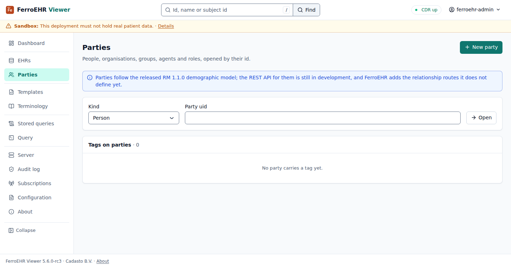
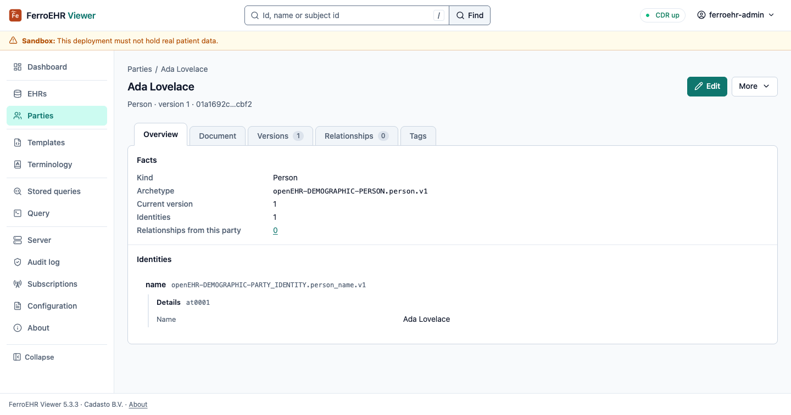

# Parties

**Parties** reads and writes the demographic parties the CDR holds (people,
organisations, groups, agents and roles), their versions, the relationships
between them, and their tags.

> [!NOTE]
> Parties follow the released RM 1.1.0 demographic model. The openEHR REST API
> for them is still in development, and the relationship routes are this
> server's own extension: a different openEHR server will not serve them.

<!-- toc -->

## Finding a party

Pick a kind and type a party's uid, then **Open**. There is no list of
parties: the demographic API publishes no "list all people" endpoint, and AQL
reads EHRs. A versioned object uid opens the latest version; a version uid
opens the object it belongs to. Open is a plain form and works with
JavaScript off.

The one demographic collection the API publishes is the **tag index**, under
Open: every tag on any party, each row opening the party it tags.

## Creating a party

**New party** opens an editor with a starting document for the kind you pick
(**Start over** swaps it for another kind's). Every attribute in it is one
openEHR requires: the party's `name`, which openEHR uses for its type (the
names a person goes by live in `identities`), the `archetype_details` and the
root `archetype_node_id`, at least one identity, and for a role its
`performer`. Fill in the identity, replace the archetype ids with your own
demographic archetypes', and create. The document is sent as you wrote it; a
refusal comes back with the CDR's words and the path it names, the document
still on the page.

## A party

A party's page has five tabs. **Overview** reads its facts and identities.

**Document** shows it as the CDR serves it. **Versions** lists every version,
each opening its envelope and its contribution; **At a time** opens the party
as it stood then. **Relationships** lists the relationships the party is the
source of. **Tags** lists its tags and sets or removes one.

**Edit** opens the whole party as JSON; the save writes the next version with
the opened one as its `If-Match`, so a party someone else changed meanwhile is
refused with the CDR's `412`. **Delete party…** marks it deleted; its versions
stay readable.

## Relationships

A relationship joins a **source** party to a **target**: an employment, an
authority, a care relationship. openEHR models it two ways, and both are
visible here:

- inside the source party, which carries the relationships it is the source
  of; its Relationships tab lists those, each row opening the target;
- as an object of its own, with its id, versions and history, the shape this
  server's relationship routes serve.

The target side cannot be listed: openEHR defines "relationships pointing at
this party" as a derived attribute the CDR does not populate, and the tab says
so where you would look.

**Relate this party** opens a new relationship with this party as its source:
a type (openEHR stores it as the relationship's name), the target's kind and
uid, and optional details. A relationship's own page links both ends, reads
its facts, versions and document, and edits its type and details; the ends do
not change, since a relationship between other parties is another
relationship.

## Tags

A tag is a key, an optional value and an optional target path. Setting one
re-sends the party's whole tag collection, as the openEHR tag update does: the
viewer reads the current tags and merges yours in, so a tag another client
added between your read and your save can be lost; read again before editing a
busy party. A tag stays on the party across its versions and commits no
version.

## Contributions

Every write here commits a **contribution**, openEHR's record of one change
set: who committed it, when and why. A version's contribution link opens it,
with the versions it touched, each linked to the object it belongs to.
