# Preferences & the theme

**Your preferences** (in the user menu) keeps the viewer's display choices for
you, in this browser: each one is its own cookie, read when the server draws a
page, so a choice applies from the first paint and nothing is kept in browser
storage. Nothing here names a patient, and nothing changes what you may do.
**Reset to defaults…** clears them all.

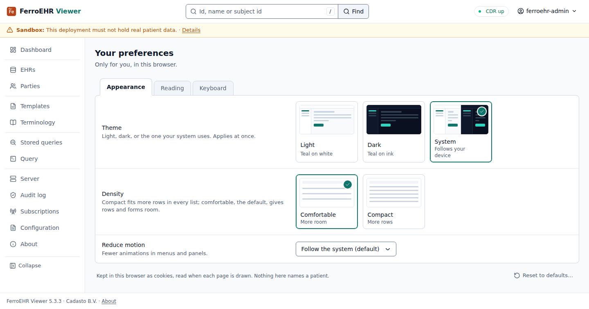

<!-- toc -->

## Appearance

- **Theme:** light, dark, or the one your system uses. The user menu sets it
  too.
- **Density:** comfortable (the default) gives rows and forms room; compact
  fits more rows in every list.
- **Reduce motion:** follow the system, or always reduce.

## Reading

- **Language:** follow the browser, or one of the languages the viewer ships
  (English today; see `ui.locale` under [Configuration](index.md#configuration)).
- **First day of the week** in the date pickers.
- **Show a revealed identifier for** 15 seconds to 2 minutes: how long a
  subject id stays shown after **Reveal**.

## Keyboard

**Shortcut hints**, the key caps after a label: on wide screens with a
keyboard (the default), on all wide screens, or never. Phones never show them.
The keyboard shortcuts themselves are listed under **Keyboard shortcuts** in
the user menu.

## The dark theme

Every screen is drawn in both themes:

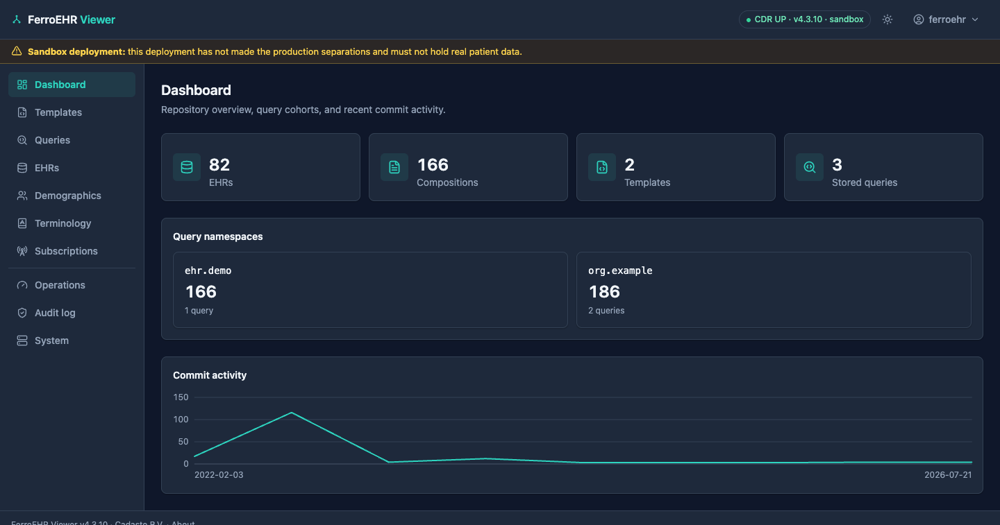

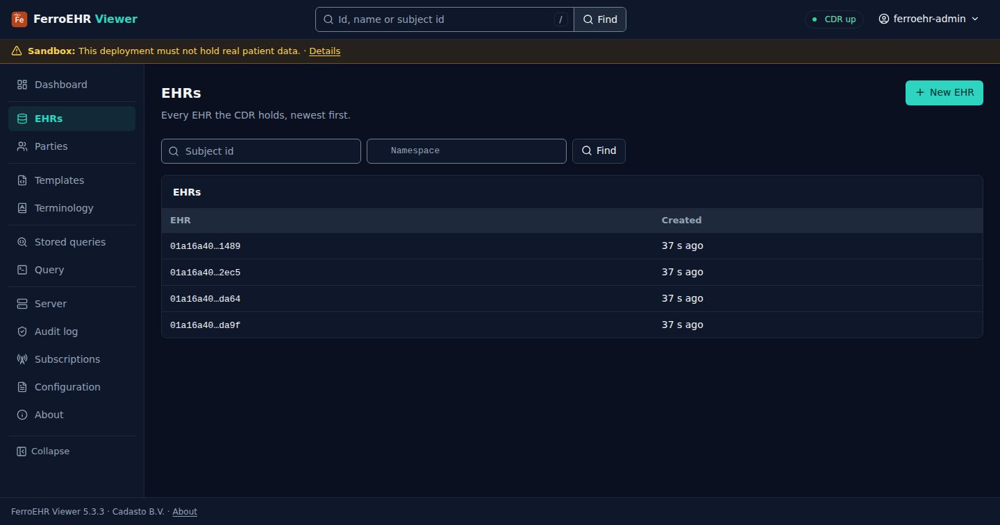

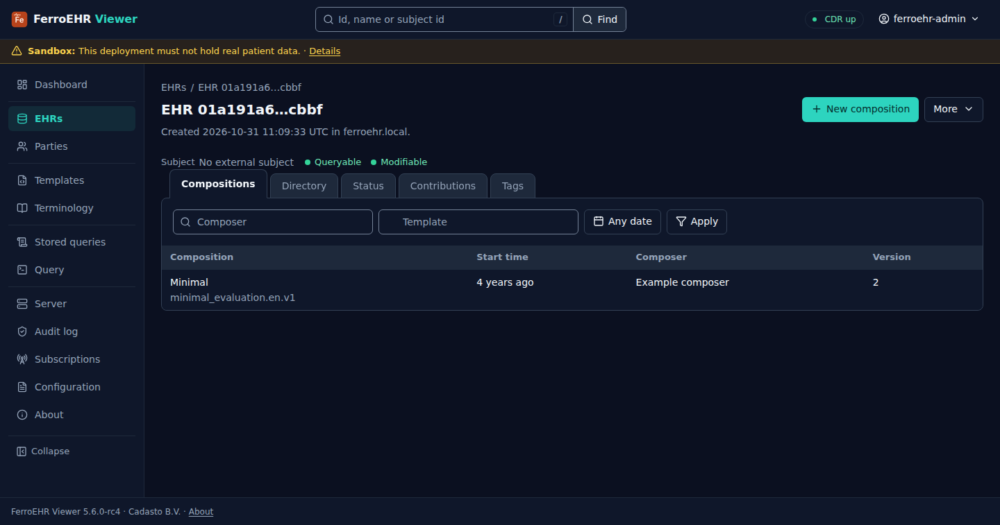

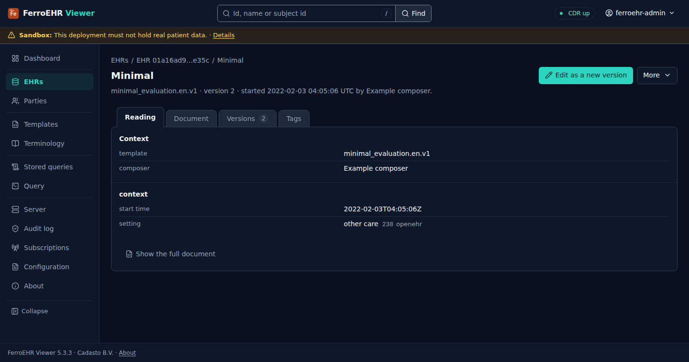

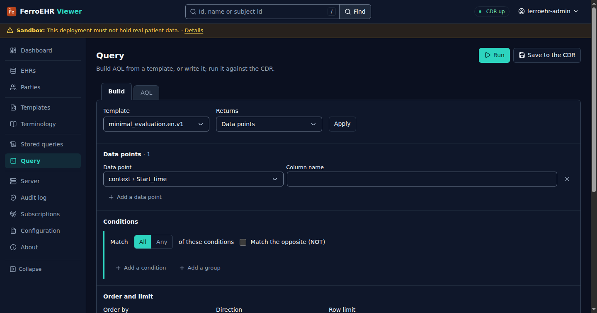

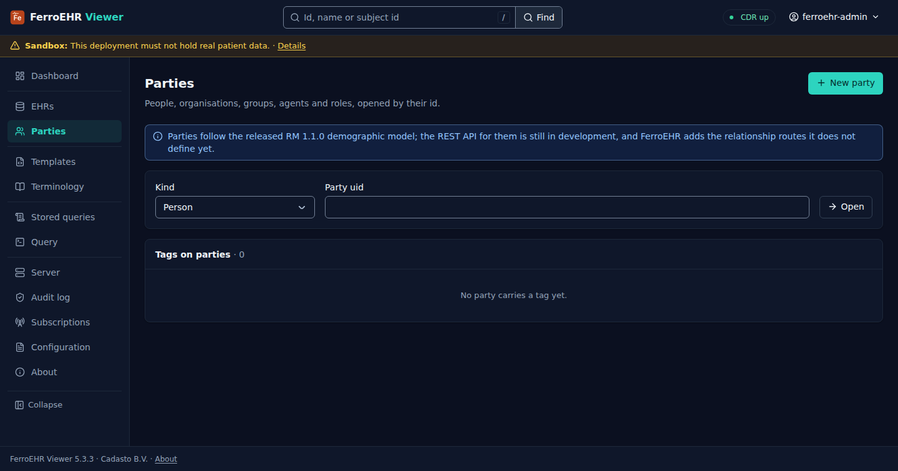

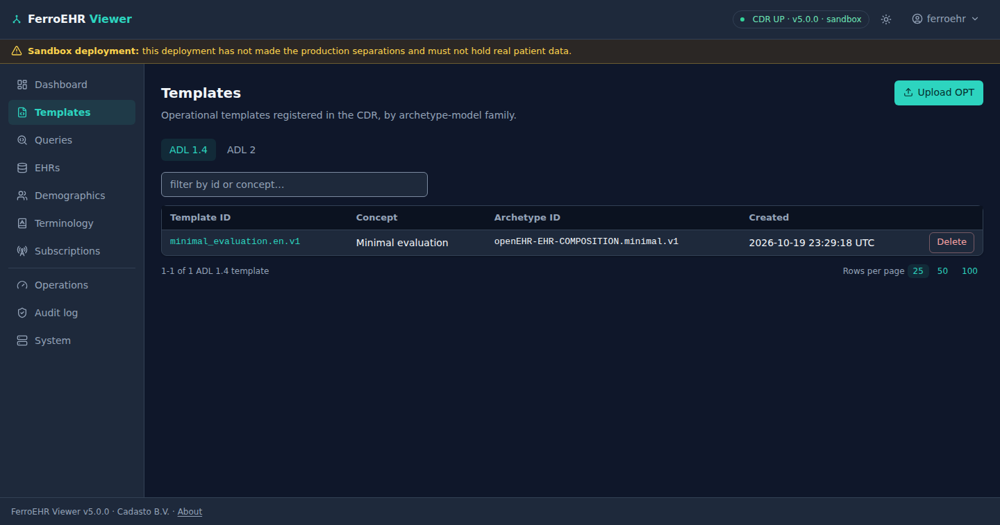

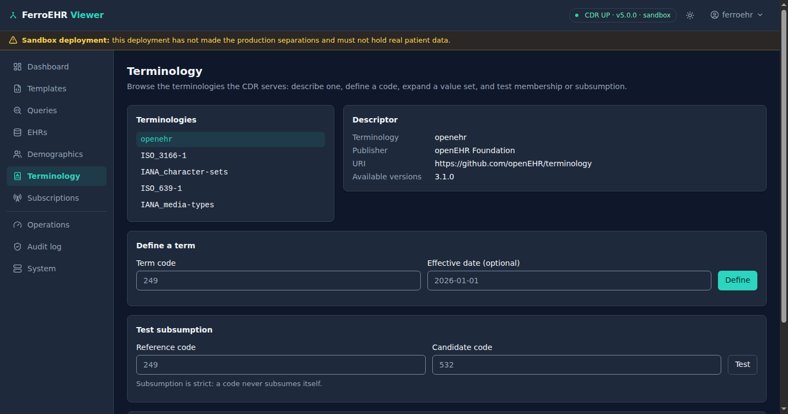

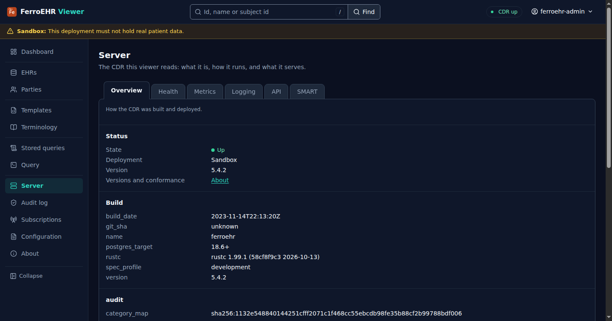

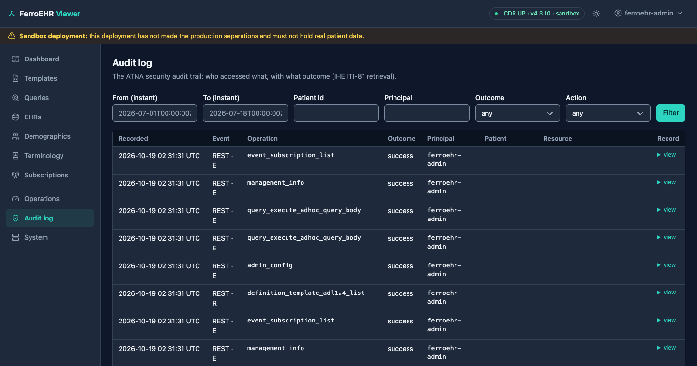

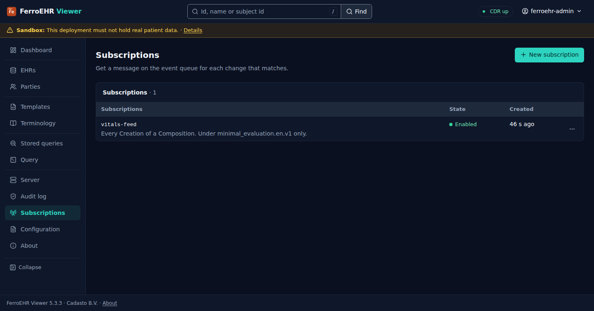
