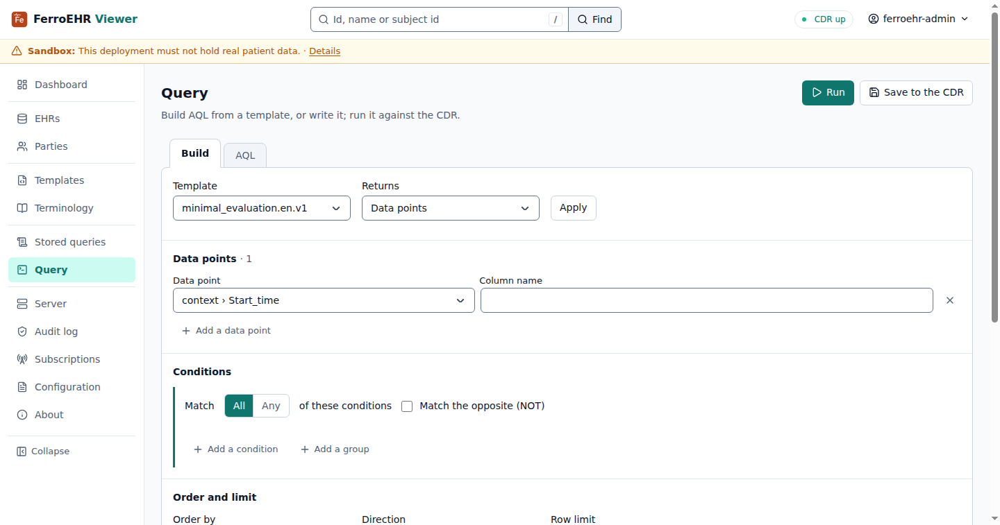
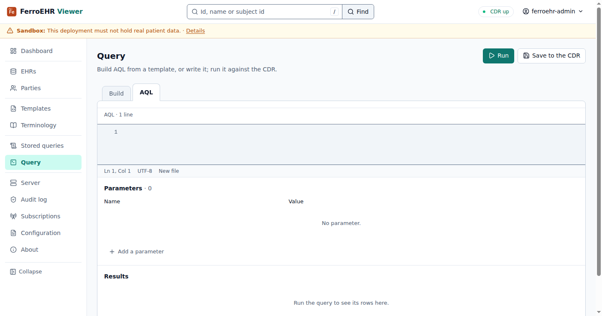
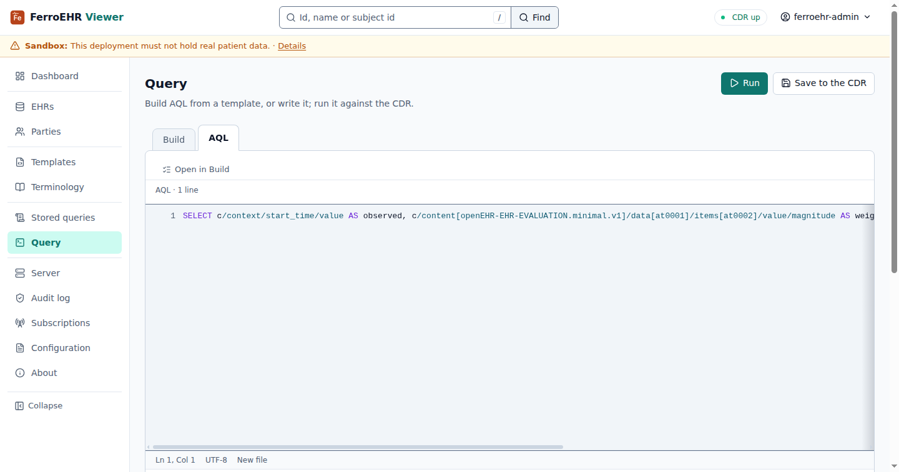
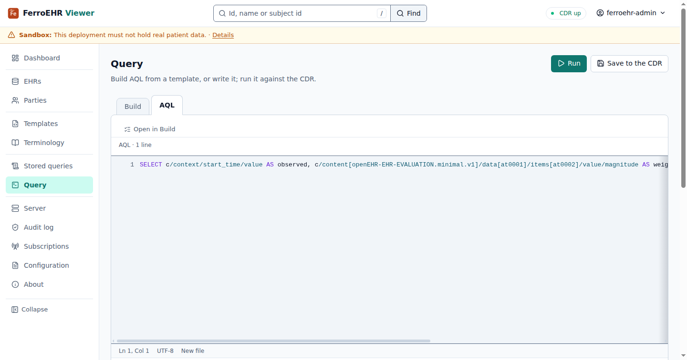
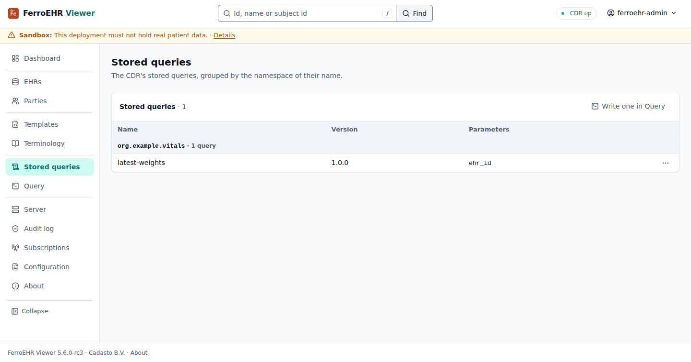
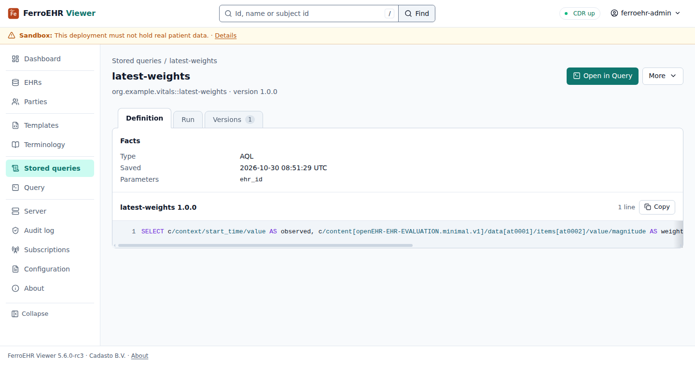
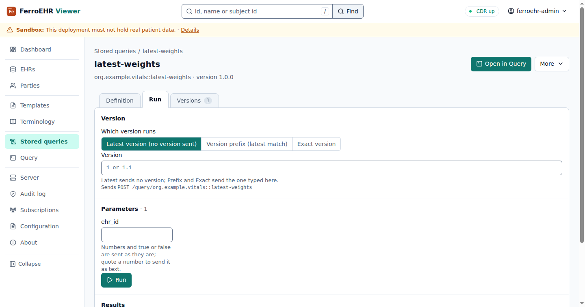

# Dashboard & queries

The dashboard opens the viewer, and **Query** and **Stored queries** cover AQL
end to end: build a query from a template or write it, run it, read the rows
as a table or a chart, export them, and save the query to the CDR as a
versioned stored query.

<!-- toc -->

## Dashboard

What the CDR holds, as it answered just now: the EHR, composition, template and
stored-query counts (each a link to its screen), the compositions committed per
day over the last 30 days, read by commit time with one AQL query, and the
stored queries grouped by namespace.

## Query

**Query** has two tabs over one form: **Build** and **AQL**. **Run** in the
page header runs whichever tab is open; **Save to the CDR** beside it stores
the query.

### Build

Build lowers a template and a few choices into AQL you can read:

- **Template**, the operational template the query reads, and **Returns**:
  data points, whole compositions, a count, or the EHRs (a cohort). **Apply**
  redraws the form for a new template or shape.
- **Data points**, each a path from the template's Web Template and an
  optional column name; **Add a data point** adds a row.
- **Conditions**, in groups that match all or any of their conditions, each
  negatable. A condition is a path, an operator for that data type and a value:
  a quantity takes a number with its unit, a date a date, a coded text one of
  the codes the template allows. **Add a condition** and **Add a group** close
  each group.
- **Order and limit**.

The AQL the form lowers to is shown under it, and is what Run sends.

Every control is a field of the page's form, and Add and Remove post it, so
Build works with JavaScript off.

### AQL

The AQL tab is a code editor with line numbers and the AQL grammar's findings
beside the line they name, before anything is sent. A `$parameter` in the
query gets a row under **Parameters**: its name and the value Run binds.
**Open in Build** appears when the query is one Build can represent, and opens
it there.

### Results

Results come back under the form: how many rows, whether the query carried
its own `LIMIT`, and the rows as a table.

**Chart** in the Results heading runs the query again and draws the numeric
columns as lines over the first time column (or over the row order when there
is none), one series per column with a legend; **Table** goes back, and the
next **Run** keeps the view you chose. The table under the chart names each
point by its time. With FerroUI's scripts loaded, pressing a legend entry
hides that series; the last one shown stays.

**Export** in the Results heading opens a menu of the formats: **CSV** and
**JSON** download the rows. The query runs again on the viewer's server and
the file arrives as `aql-export.csv` or `aql-export.json`. The menu works
with JavaScript off, and with no row Export is unavailable. The
viewer keeps no results between requests, so an export is always the CDR's
answer at that moment.

## Stored queries

**Stored queries** lists every stored query the CDR holds, grouped by the
namespace of its qualified name (`org.example.vitals::latest-weights` sits
under `org.example.vitals`): its versions, its parameters, and Run, Open in
Query and Delete this version from each row's menu.

A stored query's page has three tabs. **Definition** shows its AQL and facts.

**Run** runs it on the CDR with a value for each parameter. Which version runs
is the openEHR resolution choice: the latest (no version sent), a version
prefix (`1` or `1.1`, the latest matching it) or an exact version; the line
under the choice names the request it sends. Numbers and `true`/`false` are
sent as they are; quote a number to send it as text.

**Versions** lists every version.

### Saving and versions

**Save to the CDR** takes a namespace, a name and a version. An empty version
lets the CDR assign one. A stored `(name, version)` pair cannot change: saving
the same pair again is refused and the popover says so. Opening a stored
version in Query fills Save with its namespace, its name and the next minor
version.

Deleting a version needs the CDR's ADMIN role and asks first: **Delete
version…** on the query's page or in its row menu.
