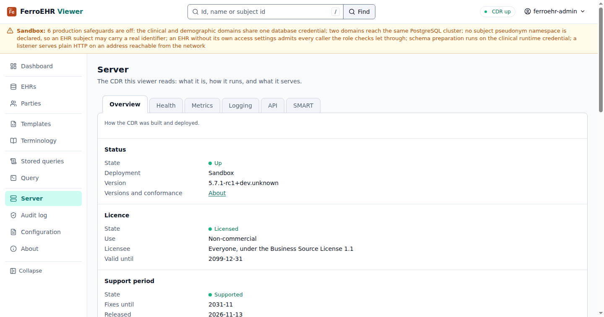
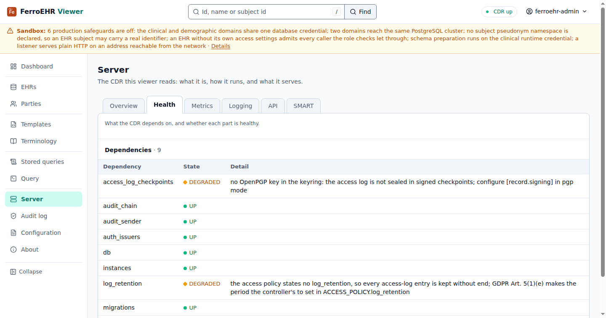
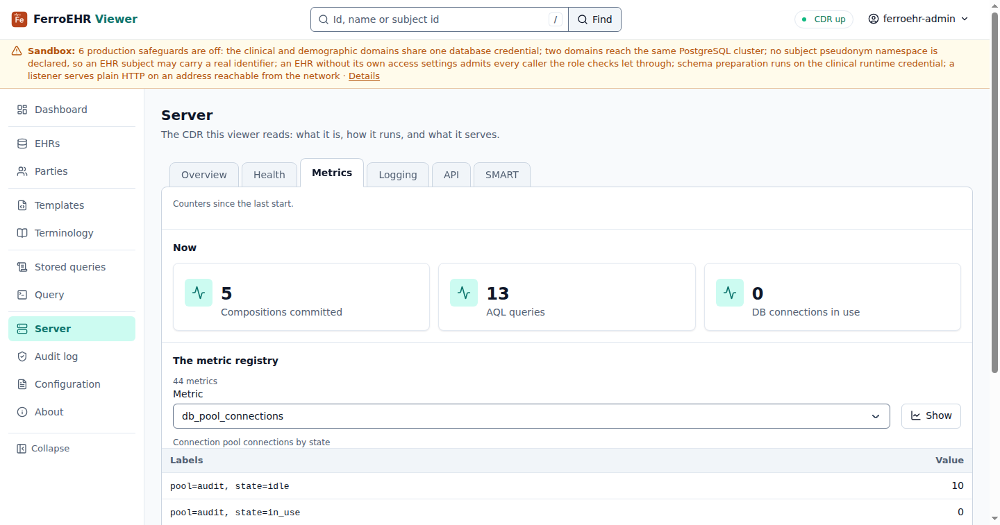
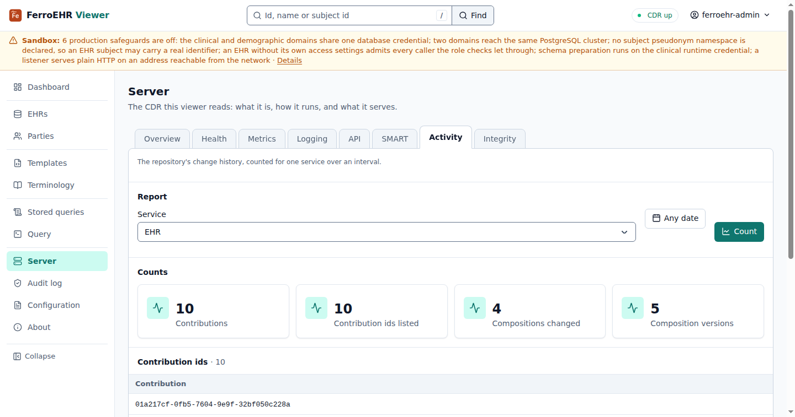
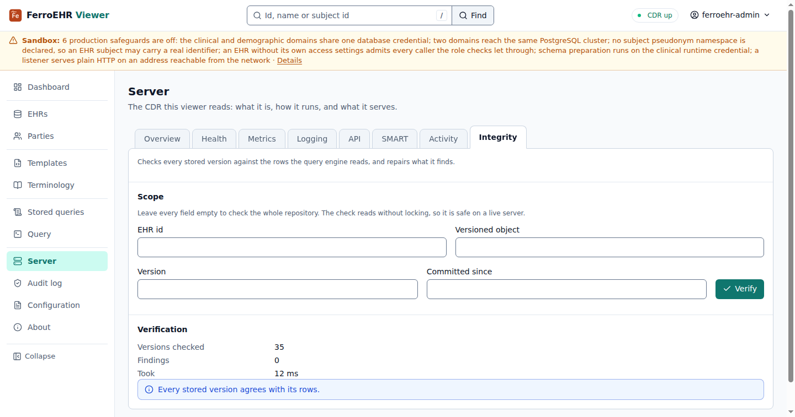
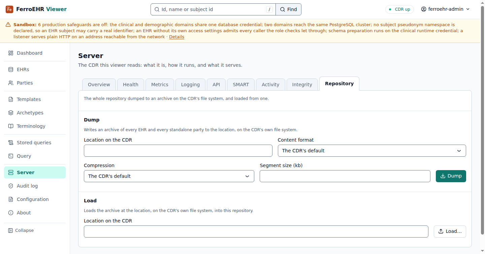
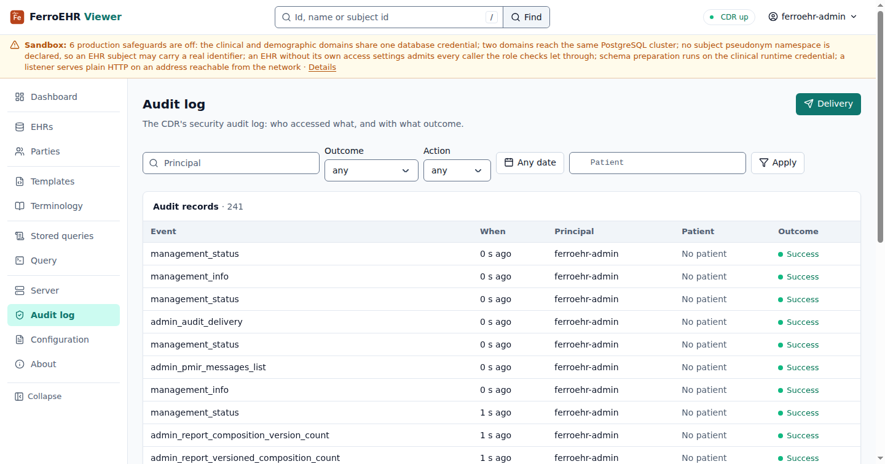
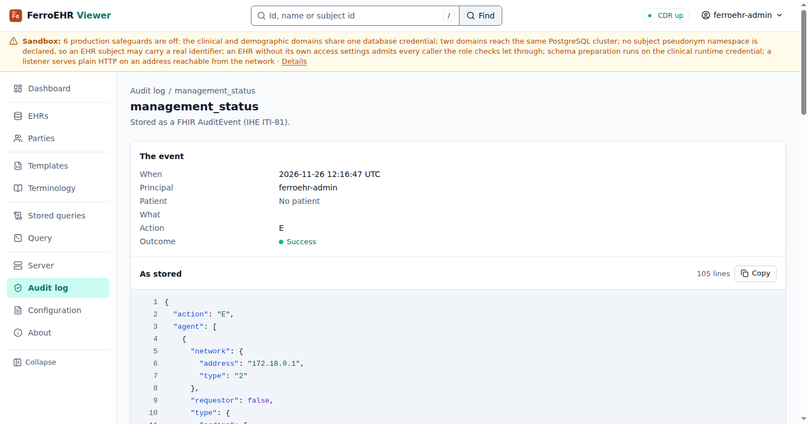

# Server & audit log

**Server** says what the CDR this viewer reads is, how it runs and what it
serves, as up to nine tabs, and the **Audit log** browses its security audit trail.
Everything on them comes from the CDR's own endpoints over HTTP; the viewer
has no privileged channel.

<!-- toc -->

## Overview

The CDR's state, its deployment profile and version, and how it was built:
the version, the git commit, the build date and `rustc`, the PostgreSQL
target, the audit posture (whether auditing is on), the active
[`spec_profile`](../installation/configuration.md#deploymentspec_profile) with the
openEHR specification versions it selects, the manufacturer, and the end month
of the release's support. The conformance manifest the CDR answers at
`OPTIONS` on its base path (its product, vendor, conformance profile and the
API groups it mounts) is on About.

When your account may read the CDR's full status document
(`GET /management/status`, the `status` endpoint of the management surface),
Overview also shows:

- **Licence:** whether a licence is in force, its use (commercial or
  non-commercial), the licensee and the last day it is valid.
- **Support period:** the release date, the last month the release receives
  fixes (CRA Art. 13(19)) and whether that period is running or has ended.
- **Production safeguards that are off:** each production separation the
  deployment has not made, in plain words, marked **Open** or **Accepted by
  name** (`deployment.accepts`).

A licence that expired, a configured licence file the CDR refused, no licence
at all, and an ended support period each show a warning at the top of the
tab. Without the full document, Overview says your account may not read it
and shows the public profile only.

The sandbox band under the top bar reads the same document: with the full
status it names each safeguard that is off, and otherwise it states the rule
that a sandbox must not hold real patient data. The viewer reads the status
document once per page, so the band, the top bar's pill and Overview agree.



## Health, Metrics and Logging

These three tabs read the CDR's management surface, and appear only when the
CDR serves it. To get them, enable the surface and give each endpoint an
access level ([Operations → The management
surface](../operations.md#the-management-surface)); every endpoint ships
`off`:

```toml
[management]
enabled = true

[management.endpoints]
info = "admin_only"     # the probe the tabs appear on; enable it with the rest
metrics = "admin_only"
env = "admin_only"
loggers = "admin_only"
```

If the CDR serves management on its own internal listener
(`management.port`) or under a renamed base path, point the viewer at it with
the full prefix (`FERROEHR_VIEWER__CDR__MANAGEMENT_BASE_URL`); unset, the
viewer derives `{cdr.base_url}/management`. Being allowed to read an endpoint
is the CDR's decision per request, and a refusal is reported on the tab that
asked.

**Health** lists what the CDR depends on (the database, the migrations, the
audit chain and sender, and any optional components) with each one's state
and the CDR's detail. It reads the public readiness probe
(`GET /health/readiness`). The pill in the top bar answers a different
question: whether the API answers at all.



**Metrics** has three tiles (compositions committed, AQL queries, database
connections in use) over the whole metric registry: pick a
metric and **Show** its current samples with their labels. The choice stays in
the address (`/server/metrics?metric=db_pool_connections`). For dashboards
and alerts, scrape `GET /management/prometheus`.



**Logging** shows the filter in effect and the boot filter, and changes the
live filter without a restart: type `tracing` directives
(`ferroehr=debug,sqlx=warn`), **Apply…**, and confirm in the dialog; **Reset
to the boot filter** puts the startup value back. The tab then reads the
CDR's answer, so what you see is what the server confirmed.

> [!IMPORTANT]
> A log-filter change applies to that CDR instance only and lasts until it
> restarts. Behind a load balancer each instance is set on its own; for a
> lasting change, set `log.filter` in the server configuration.

## API and SMART

**API** lists the OpenAPI documents the CDR serves for itself, one family at
a time: pick one (openEHR EHR, Query, Definition, Demographic, Admin, and the
FerroEHR extensions, or the complete surface) and read its endpoints by tag.
The family stays in the address (`?family=query`).

**SMART** reads the CDR's SMART discovery document: the scopes it supports as
parsed grants, the grant types and PKCE methods, and the document itself.
[Your access](index.md#your-access) shows the scopes your session holds.

## Activity and Integrity

These two tabs, and Repository below, drive the CDR's admin API and appear only when the CDR
mounts it (`api.admin`, see [Operations → Admin
APIs](../operations-admin-apis.md)). Each action is the CDR's decision per
request: a session without the admin role is refused in the CDR's words.

**Activity** counts the repository's change history for one service over an
interval ([the activity
report](../operations-admin-apis.md#the-activity-report)). Pick a service and,
if you like, a committed date range, then **Count**: the tab shows the
contributions, the composition containers changed and the composition
versions committed, and lists the contribution ids a page at a time. A
demographic contribution opens on its own page. The service and the range
stay in the address (`/server/activity?a_service=EHR&from=2026-01-01`). An
interval the CDR refuses, such as one whose start is after its end, is
reported beside the fields.



**Integrity** checks every stored version against the rows the query engine
reads ([storage integrity](../operations-admin-apis.md#storage-integrity)).
Leave the scope empty to check the whole repository, or narrow it to an EHR,
a versioned object, one of its versions, or what was committed since an
instant, then **Verify**. The report gives the versions checked and each
finding with its domain, kind and defect. When there are findings,
**Rebuild…** asks for confirmation, then has the CDR rewrite the rows of each
damaged version from its stored document over the same scope, and shows what
it did to each version. For a repository too large to check within the
request timeout, use the streamed sweep the operations page describes.



## Repository

**Repository**, the third admin tab, dumps the whole repository to an archive
and loads one ([dump and
load](../operations-admin-apis.md#dump-and-load)). The archive lives on the
CDR's own file system, so both name a location there and nothing passes
through your browser.

- **Dump** writes every EHR and every standalone party to the location, in
  the content format, compression and segment size you pick or the CDR's
  defaults (`POST {ext}/admin/dump`).
- **Load…** asks for confirmation, then writes every record of the archive at
  the location into this repository (`POST {ext}/admin/load`). A record the
  repository holds already is skipped.

Each answer lists the records that did not move, with the CDR's reason, or
says every record moved. A refusal, such as a location the CDR cannot write,
is shown in the CDR's words.



## Configuration

**Configuration** in the sidebar shows the CDR's redacted running
configuration by section, each key with what it means; secrets show as their
reference, never their value.

## Audit log

The **Audit log** browses the CDR's security audit trail (who accessed what,
with what outcome) through the IHE ITI-81 retrieval
(`GET /fhir/r4/AuditEvent`; see the [Audit trail chapter](../audit.md)).
Filter by principal, outcome, action, date window and patient; the filters
stay in the address, so a filtered view is shareable. The page lives in the
session, as on every listing that can show patient data.



A row opens its record: the event, who, the patient, what was done and the
outcome, and the stored FHIR R4 `AuditEvent` with line numbers and Copy.



A filter that matches nothing says so, with the filters named and a way to
clear them.

The audit trail is an operator surface: the screen needs the CDR's ADMIN role,
and a session without it is refused in the CDR's words. When the CDR's local
audit store is off, the screen says so.
