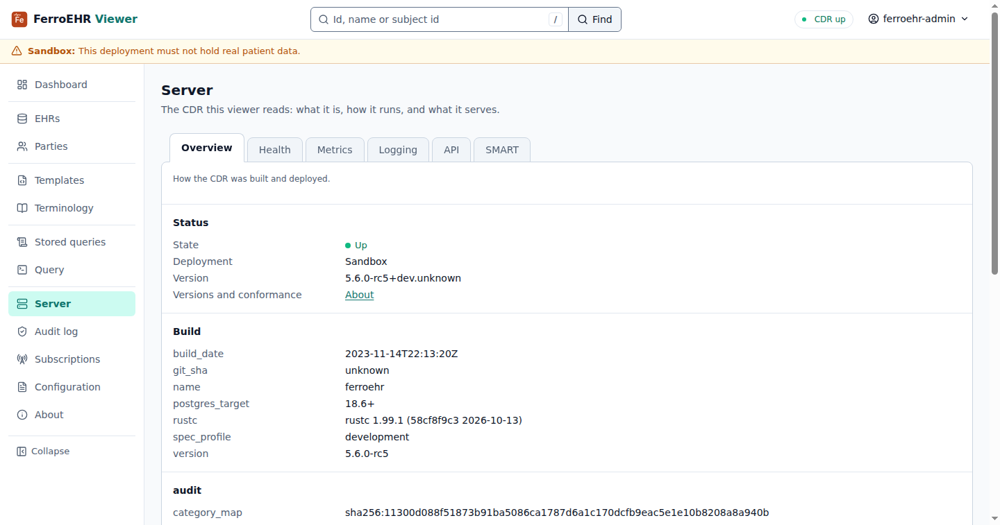
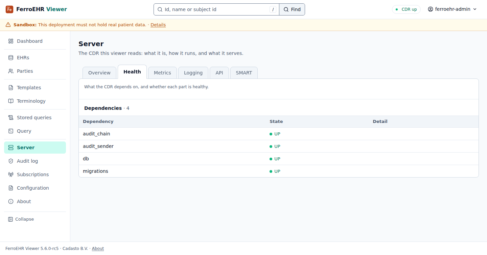
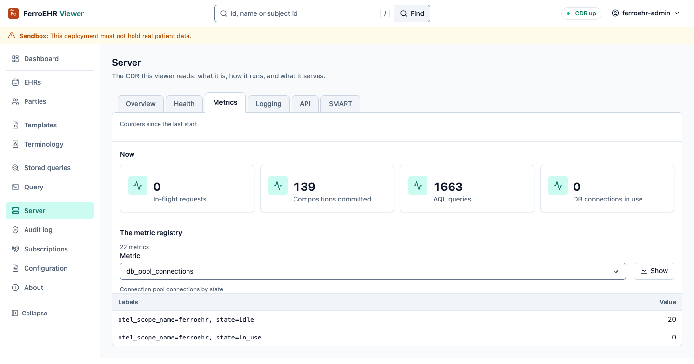
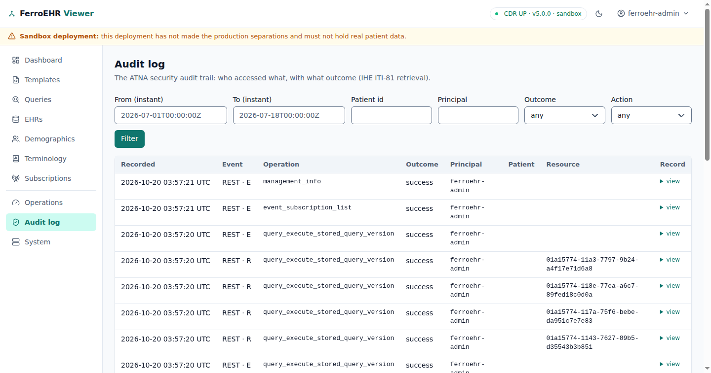
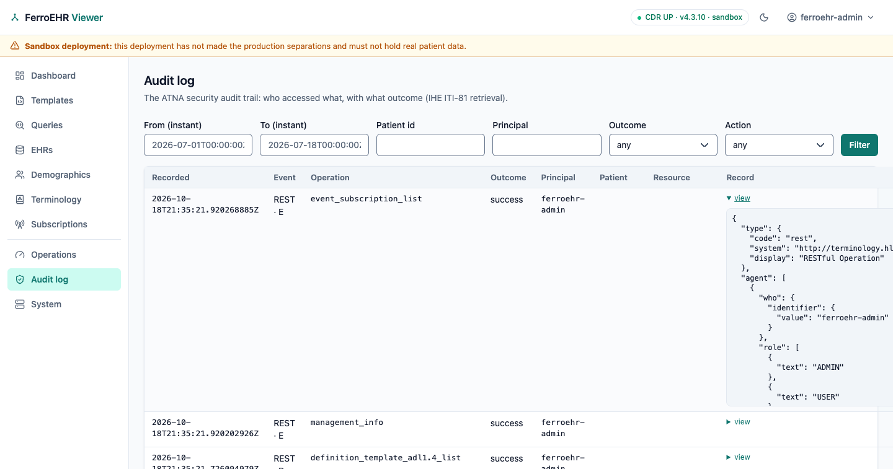

# Server & audit log

**Server** says what the CDR this viewer reads is, how it runs and what it
serves, as six tabs, and the **Audit log** browses its security audit trail.
Everything on them comes from the CDR's own endpoints over HTTP; the viewer
has no privileged channel.

<!-- toc -->

## Overview

The CDR's state, its deployment profile and version, and how it was built:
the version, the git commit, the build date and `rustc`, the PostgreSQL
target, the audit posture (whether auditing is on, its `fail_mode`, the local
store and the retention), the active
[`spec_profile`](../installation/configuration.md#spec_profile) with the
openEHR specification versions it selects, the manufacturer, and the end month
of the release's support. The conformance manifest the CDR answers at
`OPTIONS` on its base path (its product, vendor, REST API version and the
API groups it mounts) is on About.



## Health, Metrics and Logging

These three tabs read the CDR's management surface, and appear only when the
CDR serves it. To get them, enable the surface and give each endpoint an
access level ([Operations → The management
surface](../operations.md#the-management-surface)); every endpoint ships
`off`:

```toml
[management]
enabled = true

[management.endpoints]
info = "admin_only"     # the probe the tabs appear on; enable it with the rest
metrics = "admin_only"
env = "admin_only"
loggers = "admin_only"
```

If the CDR serves management on its own internal listener
(`management.port`) or under a renamed base path, point the viewer at it with
the full prefix (`FERROEHR_VIEWER__CDR__MANAGEMENT_BASE_URL`); unset, the
viewer derives `{cdr.base_url}/management`. Being allowed to read an endpoint
is the CDR's decision per request, and a refusal is reported on the tab that
asked.

**Health** lists what the CDR depends on (the database, the migrations, the
audit chain and sender, and any optional components) with each one's state
and the CDR's detail. It reads the public readiness probe
(`GET /health/readiness`). The pill in the top bar answers a different
question: whether the API answers at all.



**Metrics** has three tiles (compositions committed, AQL queries, database
connections in use) over the whole metric registry: pick a
metric and **Show** its current samples with their labels. The choice stays in
the address (`/server/metrics?metric=db_pool_connections`). For dashboards
and alerts, scrape `GET /management/prometheus`.



**Logging** shows the filter in effect and the boot filter, and changes the
live filter without a restart: type `tracing` directives
(`ferroehr=debug,sqlx=warn`), **Apply…**, and confirm in the dialog; **Reset
to the boot filter** puts the startup value back. The tab then reads the
CDR's answer, so what you see is what the server confirmed.

> [!IMPORTANT]
> A log-filter change applies to that CDR instance only and lasts until it
> restarts. Behind a load balancer each instance is set on its own; for a
> lasting change, set `log.filter` in the server configuration.

## API and SMART

**API** lists the OpenAPI documents the CDR serves for itself, one family at
a time: pick one (openEHR EHR, Query, Definition, Demographic, Admin, and the
FerroEHR extensions, or the complete surface) and read its endpoints by tag.
The family stays in the address (`?family=query`).

**SMART** reads the CDR's SMART discovery document: the scopes it supports as
parsed grants, the grant types and PKCE methods, and the document itself.
[Your access](index.md#your-access) shows the scopes your session holds.

## Configuration

**Configuration** in the sidebar shows the CDR's redacted running
configuration by section, each key with what it means; secrets show as their
reference, never their value.

## Audit log

The **Audit log** browses the CDR's security audit trail (who accessed what,
with what outcome) through the IHE ITI-81 retrieval
(`GET /fhir/r4/AuditEvent`; see the [Audit trail chapter](../audit.md)).
Filter by principal, outcome, action, date window and patient; the filters
stay in the address, so a filtered view is shareable. The page lives in the
session, as on every listing that can show patient data.



A row opens its record: the event, who, the patient, what was done and the
outcome, and the stored FHIR R4 `AuditEvent` with line numbers and Copy.



A filter that matches nothing says so, with the filters named and a way to
clear them.

The audit trail is an operator surface: the screen needs the CDR's ADMIN role,
and a session without it is refused in the CDR's words. When the CDR's local
audit store is off, the screen says so.
