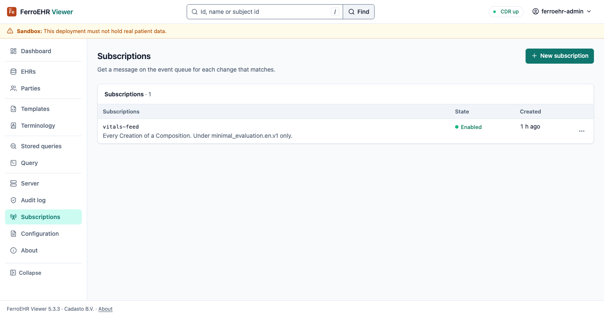
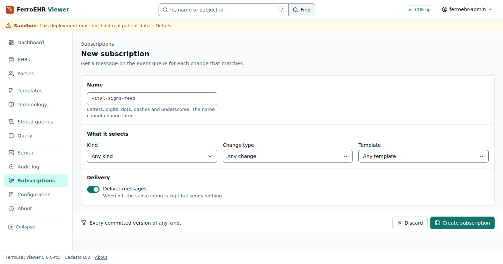

# Event subscriptions

The **Subscriptions** screen administers the CDR's event subscriptions: the
server-side filters that decide which committed versions are published to your
message broker, and to which queue. Everything on it comes from the CDR's own
subscription API over HTTP; the viewer has no privileged channel and keeps no
subscription state of its own.



<!-- toc -->

## When it appears

Change eventing is an **extension**: no openEHR specification governs event
publication or a subscription resource, so the whole surface (its paths, its
payloads, its status codes) is this CDR's own design, and it is off unless a
deployment turns it on. See [Change events (AMQP)](../beyond-core/amqp.md) for
what the stream carries and how a queue is bound.

The screen is **probe-and-hide**: on every page load the viewer asks the CDR
for `GET /admin/event_subscription`, and the sidebar entry appears only if that
route exists. A `404` (the CDR's answer while the subscription API is off,
which is the default) hides the entry entirely; any other answer counts as
present, so a refusal reaches you as a message on the screen that asked rather
than as a missing screen.

To get the screen, turn the subscription API on
([`[events]`](../installation/config-integrations.md#events)):

```toml
[events]
admin_api = true     # mount /admin/event_subscription
```

Reaching `/subscriptions` on a deployment without it is not an error either:
the screen names that switch instead of drawing a table that cannot be read.

> [!NOTE]
> `admin_api` and `enabled` are separate switches, and this screen needs only
> the first. Subscriptions are **stored** whether or not the publisher is
> running, so you can define them before a broker exists; they start being
> delivered when `[events] enabled = true` connects the server to one.

> [!NOTE]
> The API is mounted under `/admin`, so the CDR's role-based access control
> classes every call here as admin work. The screen renders whenever the
> surface exists; being allowed to use it is the CDR's per-request decision,
> and a session without the ADMIN role is refused with a message naming what is
> missing.

## What a subscription is

A subscription is a name plus three **predicates**, each of which matches one
facet of a committed version:

| Field | Matches | Example |
|---|---|---|
| Kind | the versioned object's type | `COMPOSITION`, `EHR_STATUS`, `FOLDER` |
| Change type | the audit change-type code | `249` (creation), `251` (modification), `523` (deletion) |
| Template id | the template a composition was committed against | `vital_signs.v2` |

**A field left empty matches anything.** Each row says in words what it
selects ("Every Creation of a Composition"), so a feed of every committed
version reads as one.


The **name** is unique on the CDR and is also the suffix of the queue the
server declares for the subscription (`ferroehr.events.<name>` with the default
exchange), so it may hold only letters, digits, and `_`, `.` or `-`, and it
cannot be changed afterwards; a rename would be a different queue.

**State** is the `enabled` flag: an enabled subscription is one the server
binds and delivers to; a disabled one is kept, exactly as you defined it, and
not delivered. Disabling is therefore the reversible way to stop a feed.

## Administering them

The list shows every stored subscription, newest first: its name, what it
selects in words, its state and when it was created, with Edit, Disable or
Enable, and Delete… in each row's menu.

- **New subscription** opens an editor: a name, and as many predicates as you
  want to narrow by; leave them all empty for a feed of everything, and switch
  delivery off to keep it without sending. A name the CDR cannot accept, or one
  it already holds, is refused on the form, what you typed kept.
- **Edit** opens the subscription's current values. Saving replaces every
  predicate, so a field you clear becomes *any* on the CDR: the whole update,
  not a patch. The name is shown and never editable.
- **Delete…** opens the subscription with the confirmation, and nothing is sent
  until you confirm.

Every write reports its outcome as a notice, a failure as visibly as a
success.



> [!WARNING]
> Deleting a subscription stops the server binding its queue; it does not
> delete the queue from your broker. A durable queue left behind keeps what it
> holds and stops receiving new messages, so remove orphaned queues on the
> broker in the same change.
