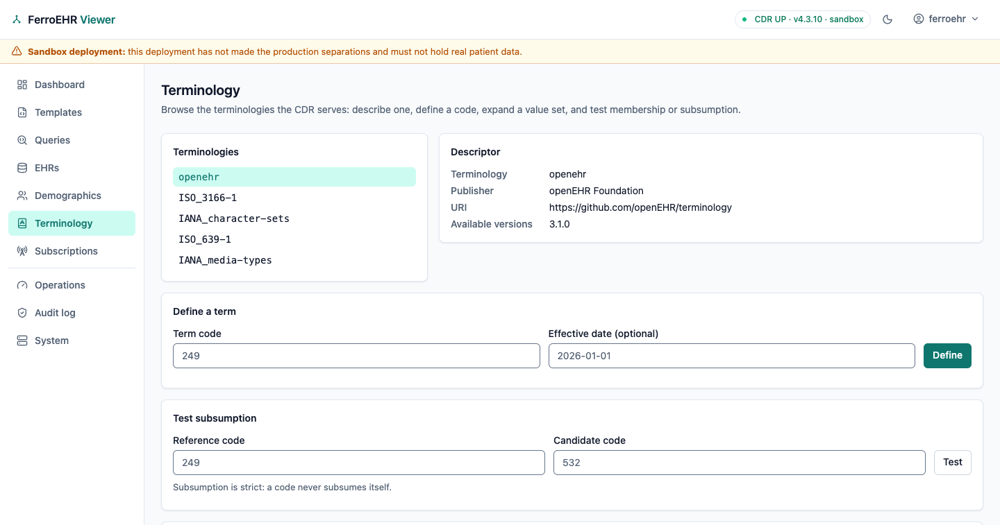
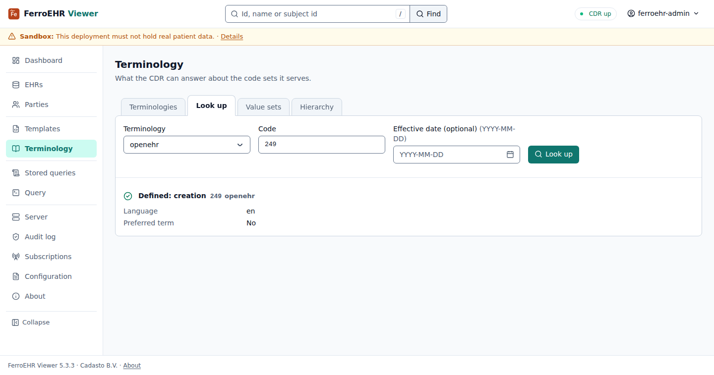
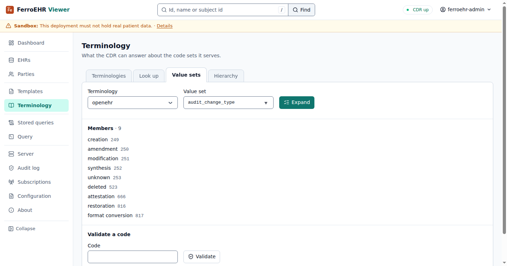

# Terminology

The **Terminology** screen browses the coded vocabularies the CDR can answer
questions about: which terminologies it serves, what a code means, which codes a
value set holds, whether a given code is one of them, and whether one code
subsumes another. Everything on it is a read of the CDR's public API; nothing
is stored on the viewer's side.



<!-- toc -->

> [!NOTE]
> The terminology API is **this server's own extension**. openEHR's REST release
> publishes no terminology contract, so the operations come from the openEHR
> Service Model (`I_TERMINOLOGY_SERVICE`) while the URLs and JSON envelopes are
> this server's. A different openEHR server will not serve them.

## Switching it on

The surface is **opt-in and off by default**. While it is off the CDR answers
its terminology routes as if they were not mounted, and the screen says so in
one card instead of pretending to work:

```toml
[terminology]
api_enabled = true
```

or, as an environment override, `FERROEHR__TERMINOLOGY__API_ENABLED=true`.

Turning it on exposes only lookups over terminologies the server already holds:
the bundled openEHR terminology plus the external code sets beside it. Wiring
the FHIR terminology server is a separate setting, and it changes what
these lookups can answer; both are covered in
[Terminology servers](../beyond-core/terminology.md).

## The terminologies

**Terminologies**, the first of four tabs, lists exactly what the CDR reports:
the internal `openehr` vocabulary and the external code sets beside it
(languages, countries, character sets, media types). A row opens the
terminology's descriptor: publisher, identifying URI, version, and the fields
an extract may ask for, with links to look a code up in it and to expand one
of its groups. Fields the server does not publish are left out.

## Look up

Pick a terminology, type a code and **Look up**. A defined term comes back with
its text, the language it is written in and whether it is the preferred term.
An **effective date** is optional: supplied, it asks for the definition as it
stood that day; the openEHR bundle is one pinned release, so a date changes
nothing there, while an external terminology server can answer differently.

A code the terminology does not define is an answer, not an error: the page
says so, naming the code and the terminology.



> [!NOTE]
> openEHR terminology codes are scoped to their group: `532` is `complete` in
> one group and `completed` in another. A lookup reads the `openehr`
> terminology as flat and returns the first group's rubric, so expand the
> group under Value sets whenever the group matters.

## Value sets

Pick a terminology and a value set (for `openehr`, a vocabulary group such as
`audit_change_type`, offered as you type) and **Expand** it into its members.
Under them, **Validate** answers whether a code is a member, as a sentence
either way; a value set the CDR does not know has no members.



## Hierarchy

**Test** asks whether one code is broader than another. The test is strict,
so a code is never broader than itself, and the openEHR vocabulary defines no
hierarchy, so for any two openEHR codes the answer is no; the page says why.
Hierarchical answers come from an external terminology server when one is
bound.

Every tab is a GET form: the question stays in the address, so an answer is
shareable, and every tab works with JavaScript off.

## In the query builder

A condition on a coded text in [Build](queries.md#build) offers the codes the
template allows as a select, so a coded criterion is never typed from memory;
the query carries the bare code.
